# Scans

Every page this book was read against, kept two ways: a link to the page where it was found online, and a copy saved beside the book, so every page can still be checked if the site that holds it goes down. Each page marker in the established source opens its page here. The full list, with where each copy was downloaded from and its SHA-256 fingerprint, is [the-saints-who-meet-arthur-scans.tsv](the-saints-who-meet-arthur-scans.tsv).

## Rees 1853

### Rees, Cambro British Saints (1853), 23

Saved copy: [scans/rees-1853.pdf, page 49](scans/rees-1853.pdf#page=49)

Found online: [archive.org](https://archive.org/details/livesofcambrobri00rees/page/n48)

### Rees, Cambro British Saints (1853), 24

Saved copy: [scans/rees-1853.pdf, page 50](scans/rees-1853.pdf#page=50)

Found online: [archive.org](https://archive.org/details/livesofcambrobri00rees/page/n49)

### Rees, Cambro British Saints (1853), 48

Saved copy: [scans/rees-1853.pdf, page 74](scans/rees-1853.pdf#page=74)

Found online: [archive.org](https://archive.org/details/livesofcambrobri00rees/page/n73)

### Rees, Cambro British Saints (1853), 49

Saved copy: [scans/rees-1853.pdf, page 75](scans/rees-1853.pdf#page=75)

Found online: [archive.org](https://archive.org/details/livesofcambrobri00rees/page/n74)

### Rees, Cambro British Saints (1853), 50

Saved copy: [scans/rees-1853.pdf, page 76](scans/rees-1853.pdf#page=76)

Found online: [archive.org](https://archive.org/details/livesofcambrobri00rees/page/n75)

### Rees, Cambro British Saints (1853), 99

Saved copy: [scans/rees-1853.pdf, page 125](scans/rees-1853.pdf#page=125)

Found online: [archive.org](https://archive.org/details/livesofcambrobri00rees/page/n124)

### Rees, Cambro British Saints (1853), 100

Saved copy: [scans/rees-1853.pdf, page 126](scans/rees-1853.pdf#page=126)

Found online: [archive.org](https://archive.org/details/livesofcambrobri00rees/page/n125)

### Rees, Cambro British Saints (1853), 192

Saved copy: [scans/rees-1853.pdf, page 222](scans/rees-1853.pdf#page=222)

Found online: [archive.org](https://archive.org/details/livesofcambrobri00rees/page/n221)

### Rees, Cambro British Saints (1853), 193

Saved copy: [scans/rees-1853.pdf, page 223](scans/rees-1853.pdf#page=223)

Found online: [archive.org](https://archive.org/details/livesofcambrobri00rees/page/n222)

### Rees, Cambro British Saints (1853), 159

Saved copy: [scans/rees-1853.pdf, page 189](scans/rees-1853.pdf#page=189)

Found online: [archive.org](https://archive.org/details/livesofcambrobri00rees/page/n188)

### Rees, Cambro British Saints (1853), 160

Saved copy: [scans/rees-1853.pdf, page 190](scans/rees-1853.pdf#page=190)

Found online: [archive.org](https://archive.org/details/livesofcambrobri00rees/page/n189)

### Rees, Cambro British Saints (1853), 161

Saved copy: [scans/rees-1853.pdf, page 191](scans/rees-1853.pdf#page=191)

Found online: [archive.org](https://archive.org/details/livesofcambrobri00rees/page/n190)

## La Borderie, Saint Efflam (1892)

### La Borderie, Saint Efflam (1892), 282

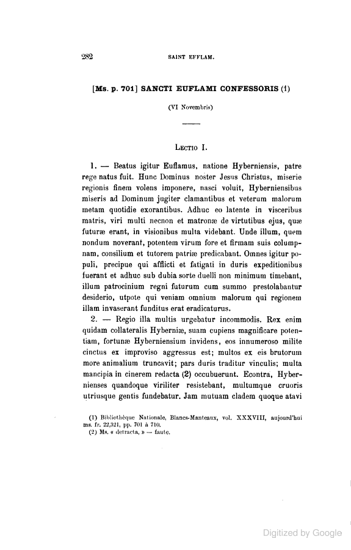

Found online: [books.google.com](https://books.google.com/books?id=jOAVAAAAYAAJ&pg=PA282)

### La Borderie, Saint Efflam (1892), 283

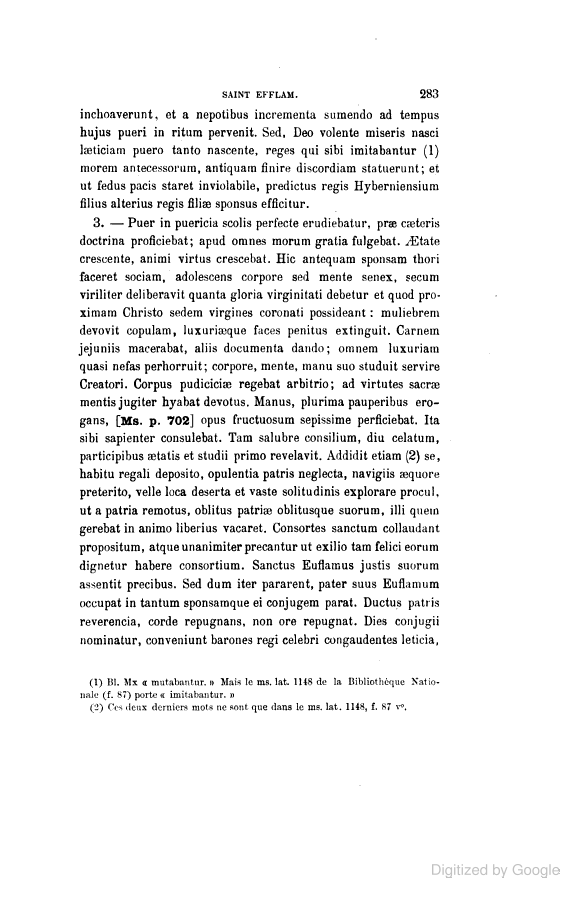

Found online: [books.google.com](https://books.google.com/books?id=jOAVAAAAYAAJ&pg=PA283)

### La Borderie, Saint Efflam (1892), 284

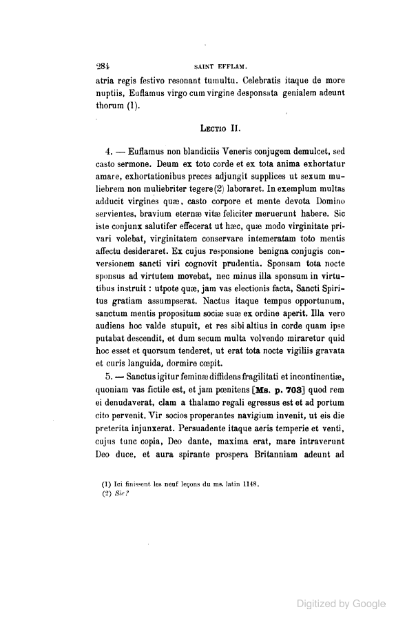

Found online: [books.google.com](https://books.google.com/books?id=jOAVAAAAYAAJ&pg=PA284)

### La Borderie, Saint Efflam (1892), 258 [285]

![La Borderie, Saint Efflam (1892), 258 [285]](scans/efflam-08.png)

Found online: [books.google.com](https://books.google.com/books?id=jOAVAAAAYAAJ&pg=PA285)

### La Borderie, Saint Efflam (1892), 286

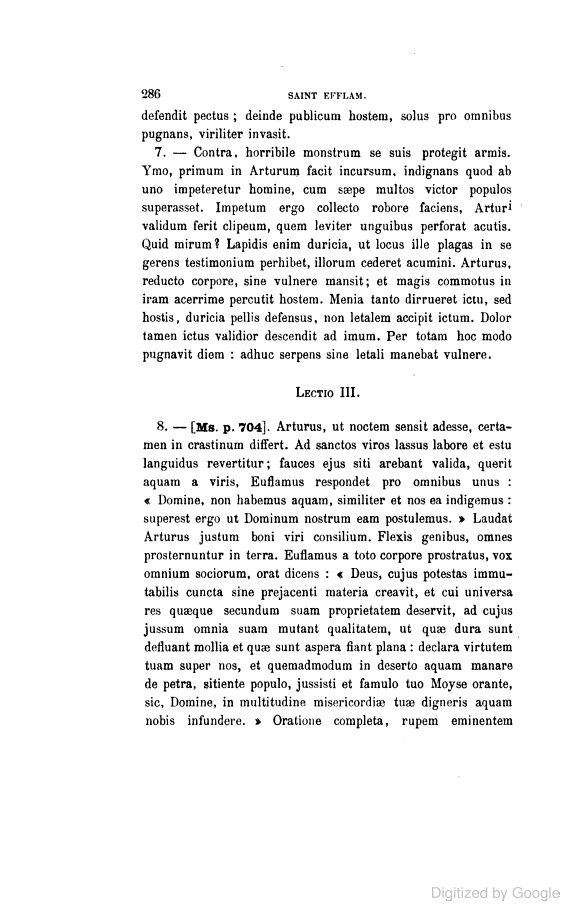

Found online: [books.google.com](https://books.google.com/books?id=jOAVAAAAYAAJ&pg=PA286)

### La Borderie, Saint Efflam (1892), 287

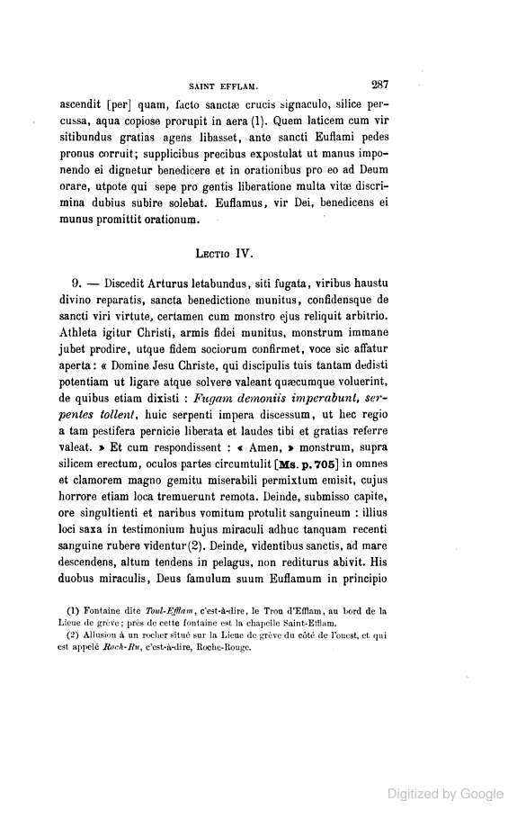

Found online: [books.google.com](https://books.google.com/books?id=jOAVAAAAYAAJ&pg=PA287)

### La Borderie, Saint Efflam (1892), 288

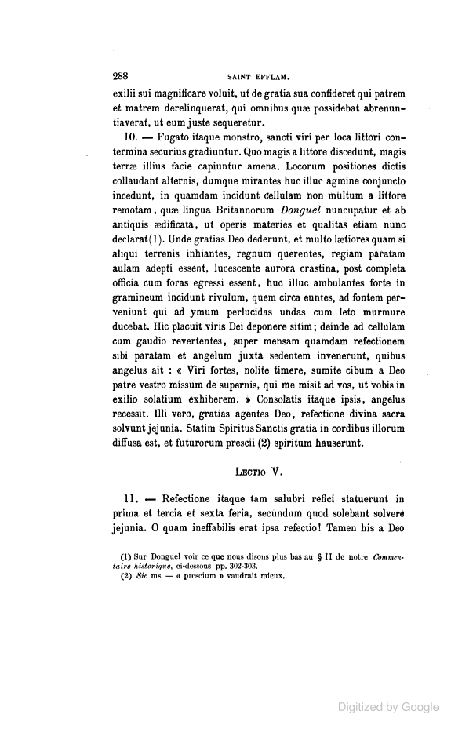

Found online: [books.google.com](https://books.google.com/books?id=jOAVAAAAYAAJ&pg=PA288)

### La Borderie, Saint Efflam (1892), 289

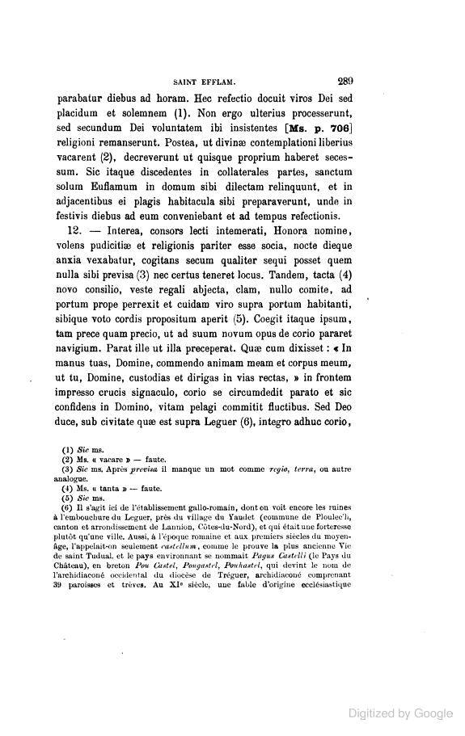

Found online: [books.google.com](https://books.google.com/books?id=jOAVAAAAYAAJ&pg=PA289)

### La Borderie, Saint Efflam (1892), 290

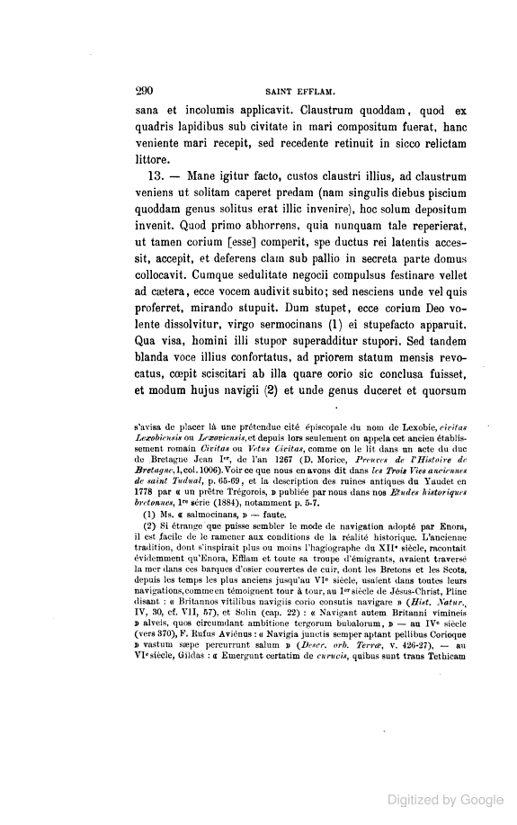

Found online: [books.google.com](https://books.google.com/books?id=jOAVAAAAYAAJ&pg=PA290)

### La Borderie, Saint Efflam (1892), 291

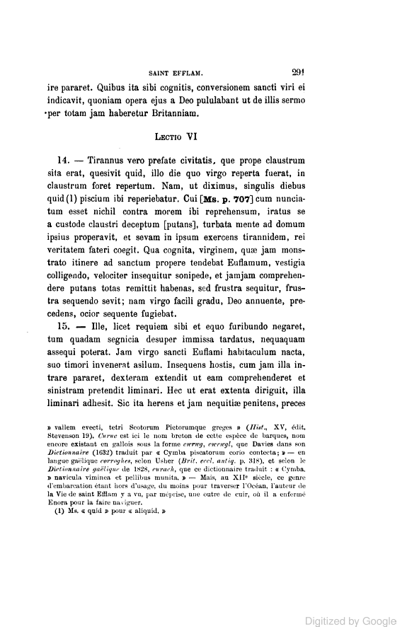

Found online: [books.google.com](https://books.google.com/books?id=jOAVAAAAYAAJ&pg=PA291)

### La Borderie, Saint Efflam (1892), 292

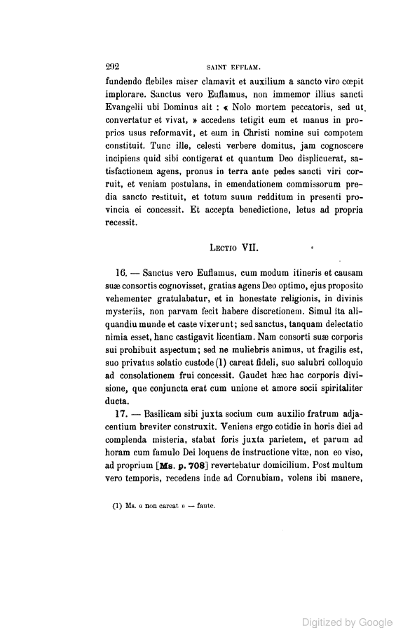

Found online: [books.google.com](https://books.google.com/books?id=jOAVAAAAYAAJ&pg=PA292)

### La Borderie, Saint Efflam (1892), 293

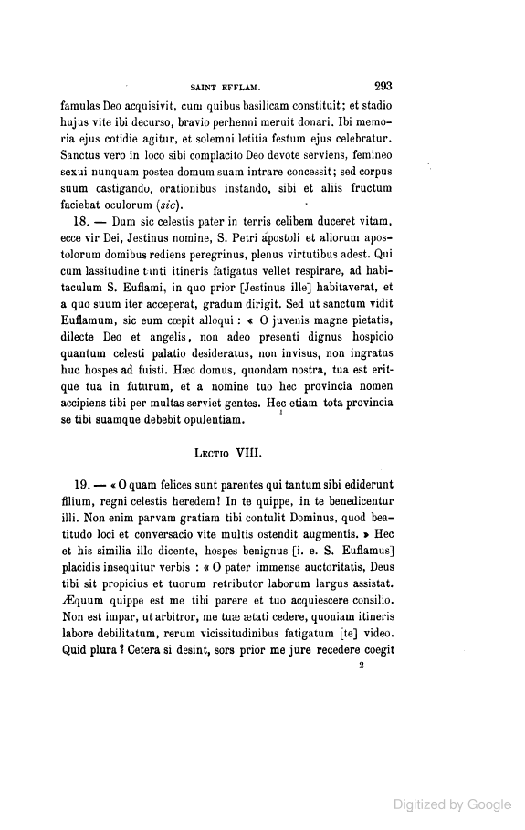

Found online: [books.google.com](https://books.google.com/books?id=jOAVAAAAYAAJ&pg=PA293)

### La Borderie, Saint Efflam (1892), 294

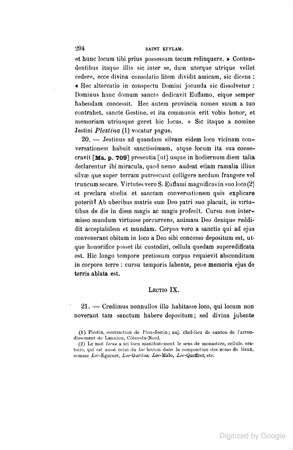

Found online: [books.google.com](https://books.google.com/books?id=jOAVAAAAYAAJ&pg=PA294)

### La Borderie, Saint Efflam (1892), 295

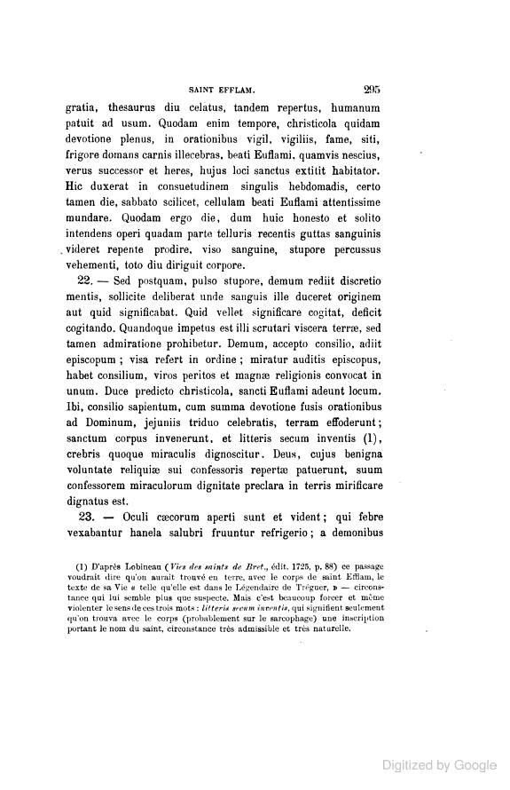

Found online: [books.google.com](https://books.google.com/books?id=jOAVAAAAYAAJ&pg=PA295)

### La Borderie, Saint Efflam (1892), 296

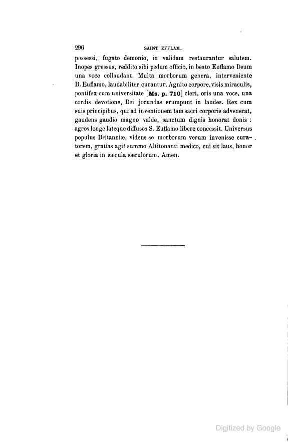

Found online: [books.google.com](https://books.google.com/books?id=jOAVAAAAYAAJ&pg=PA296)

## La Borderie, Goeznovius (1883)

### La Borderie, Goeznovius (1883), 91

Saved copy: [scans/la-borderie-1883.pdf, page 109](scans/la-borderie-1883.pdf#page=109)

Found online: [archive.org](https://archive.org/details/lhistoriabriton00bordgoog/page/n108)

### La Borderie, Goeznovius (1883), 92

Saved copy: [scans/la-borderie-1883.pdf, page 110](scans/la-borderie-1883.pdf#page=110)

Found online: [archive.org](https://archive.org/details/lhistoriabriton00bordgoog/page/n109)

### La Borderie, Goeznovius (1883), 93

Saved copy: [scans/la-borderie-1883.pdf, page 111](scans/la-borderie-1883.pdf#page=111)

Found online: [archive.org](https://archive.org/details/lhistoriabriton00bordgoog/page/n110)

### La Borderie, Goeznovius (1883), 94

Saved copy: [scans/la-borderie-1883.pdf, page 112](scans/la-borderie-1883.pdf#page=112)

Found online: [archive.org](https://archive.org/details/lhistoriabriton00bordgoog/page/n111)
