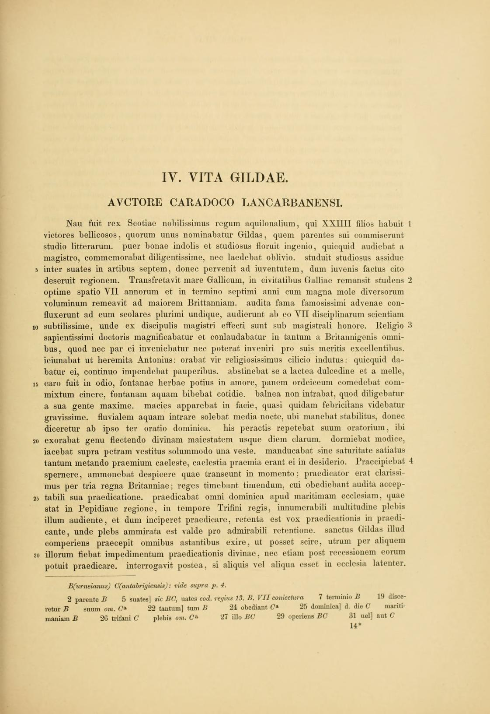
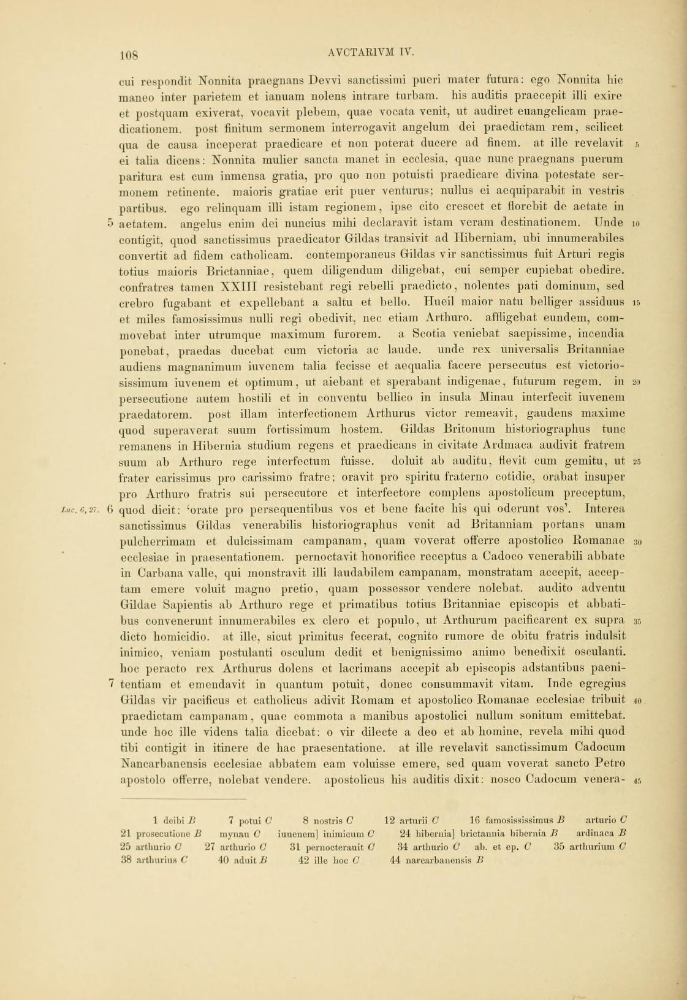
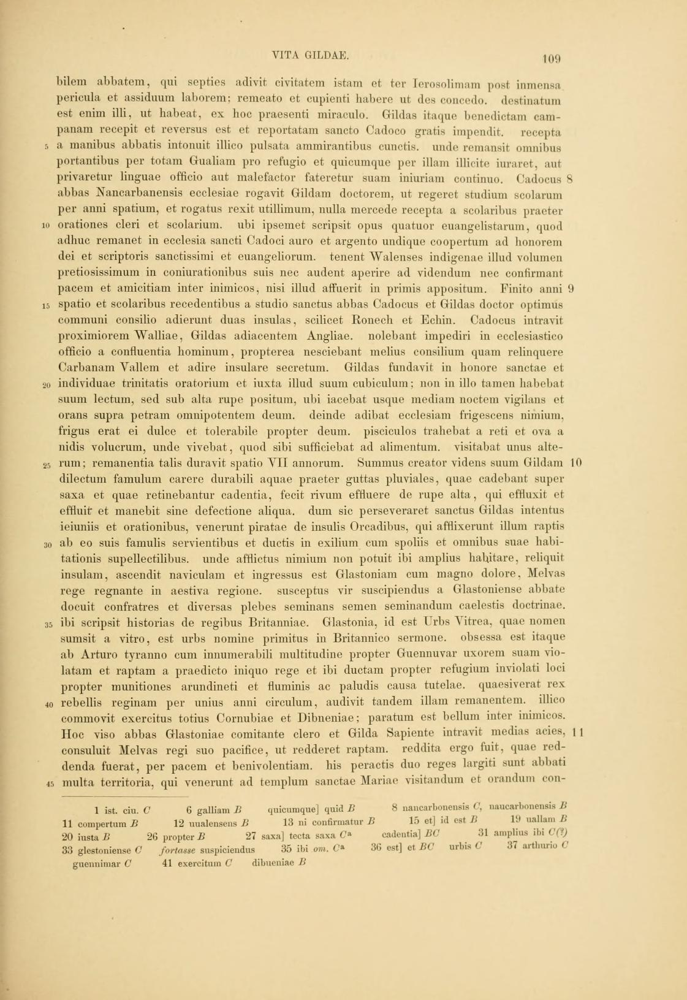
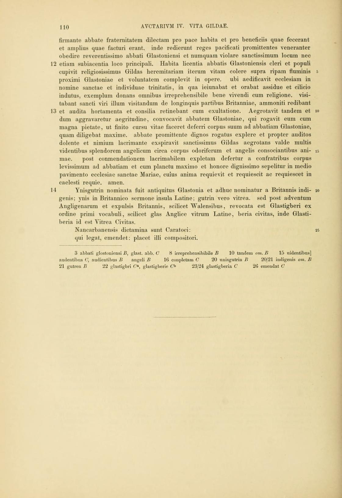

# Scans

Every page this book was read against, kept two ways: a link to the page where it was found online, and a copy saved beside the book, so every page can still be checked if the site that holds it goes down. Each page marker in the established source opens its page here. The full list, with where each copy was downloaded from and its SHA-256 fingerprint, is [vita-gildae-scans.tsv](vita-gildae-scans.tsv).

## Mommsen's Chronica minora, volume 3, University of Florida copy

### Page 107

Found online: [archive.org](https://archive.org/details/chronicaminorasa13momm/page/n122)

### Page 108

Found online: [archive.org](https://archive.org/details/chronicaminorasa13momm/page/n123)

### Page 109

Found online: [archive.org](https://archive.org/details/chronicaminorasa13momm/page/n124)

### Page 110

Found online: [archive.org](https://archive.org/details/chronicaminorasa13momm/page/n125)
