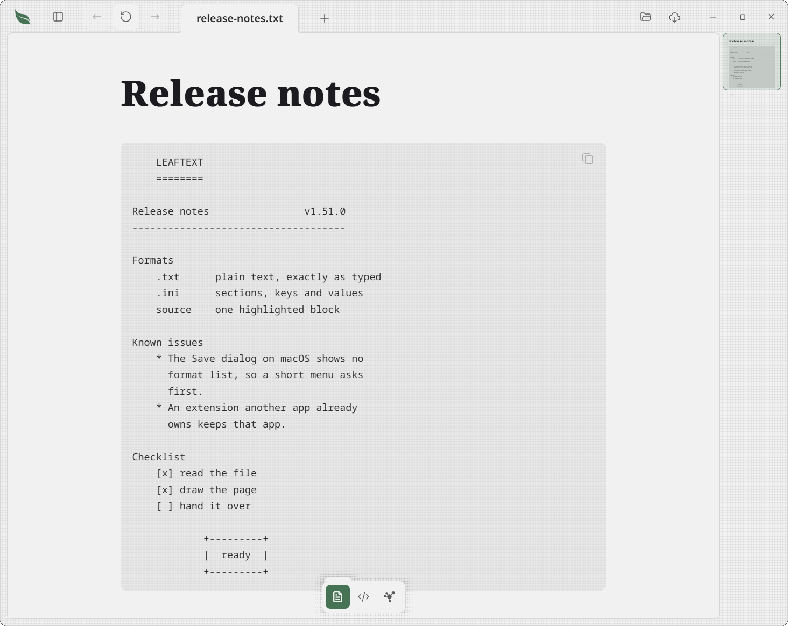
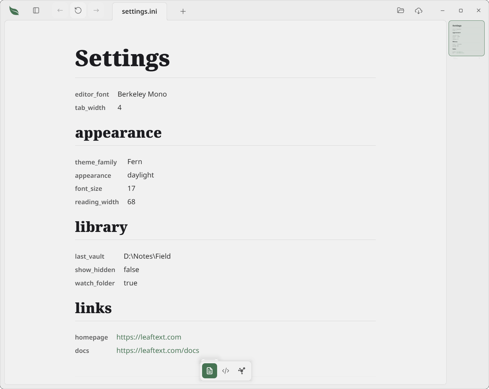
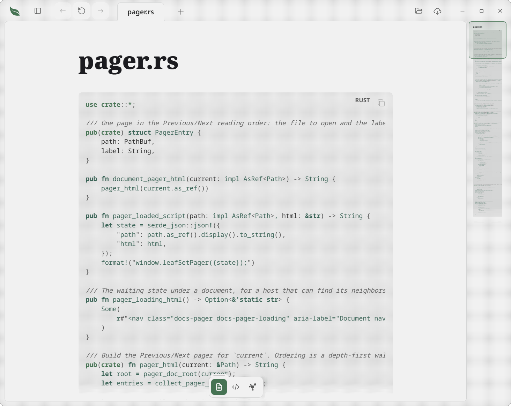
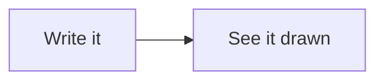
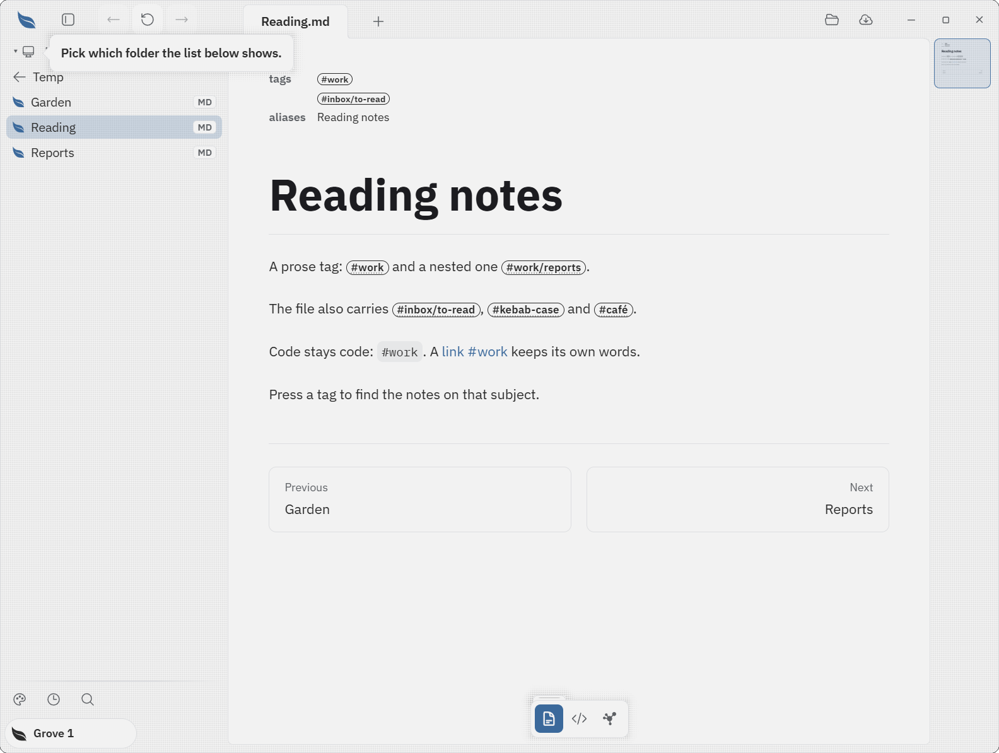
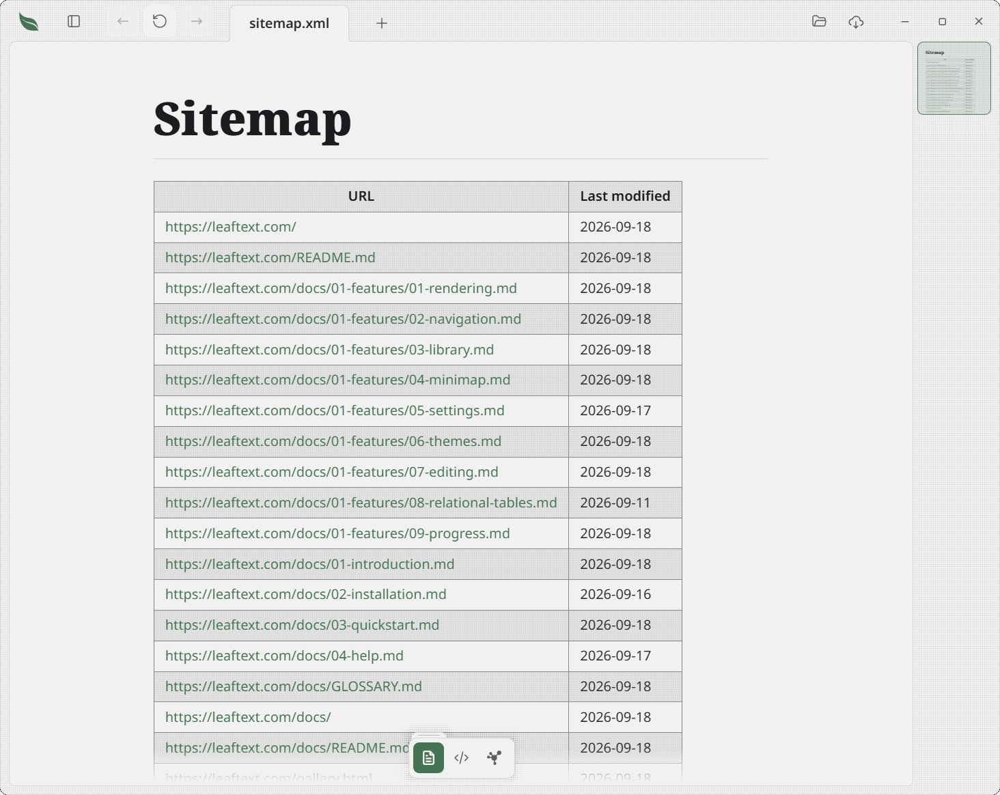
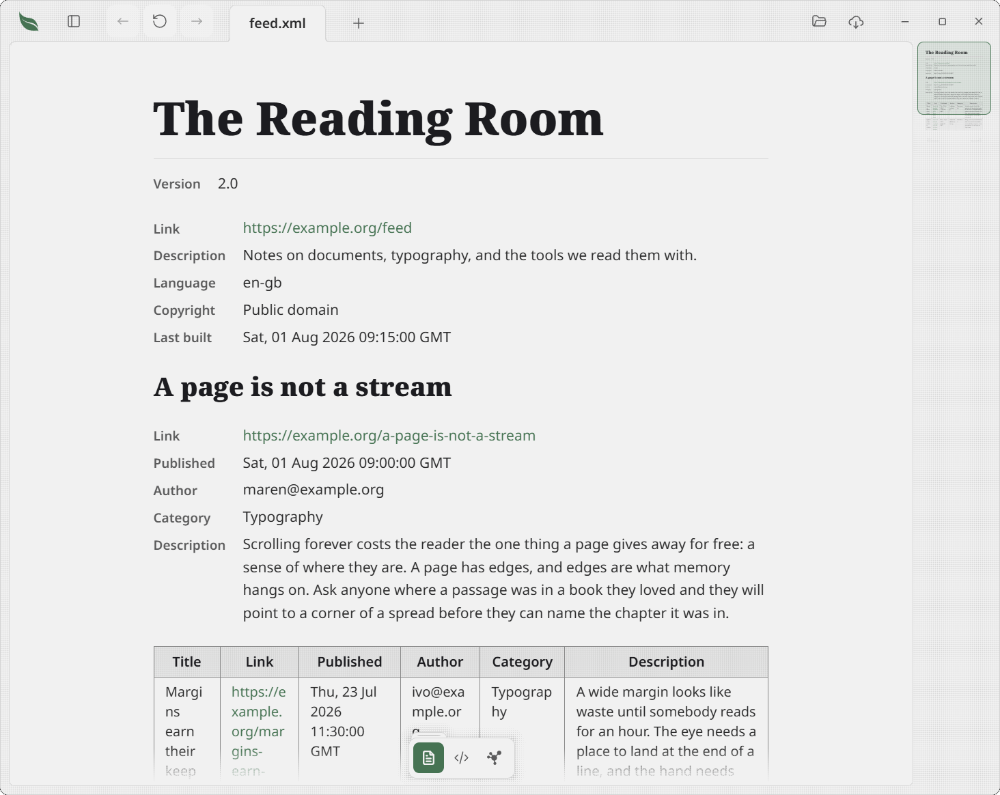
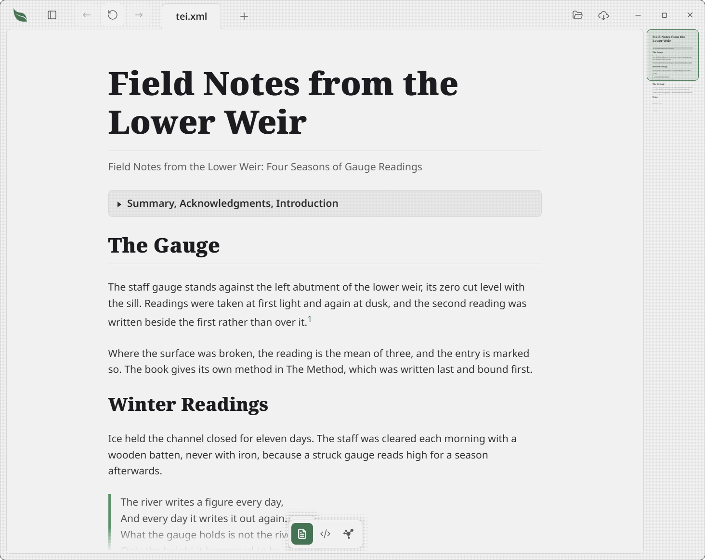
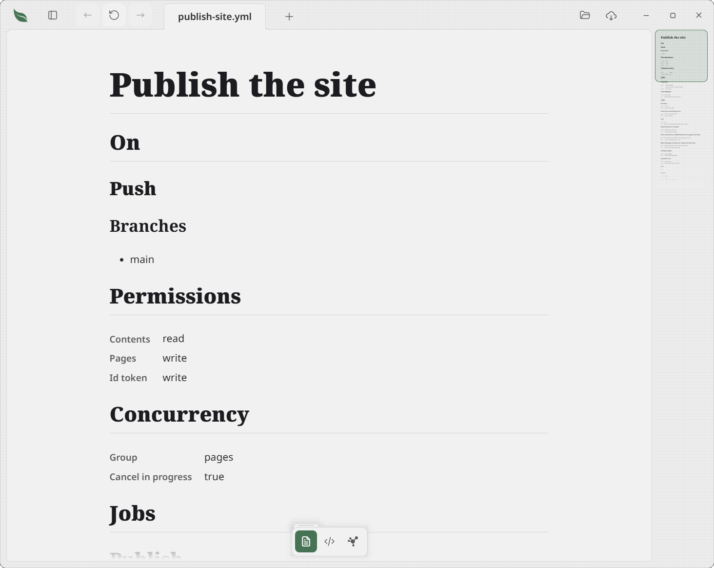
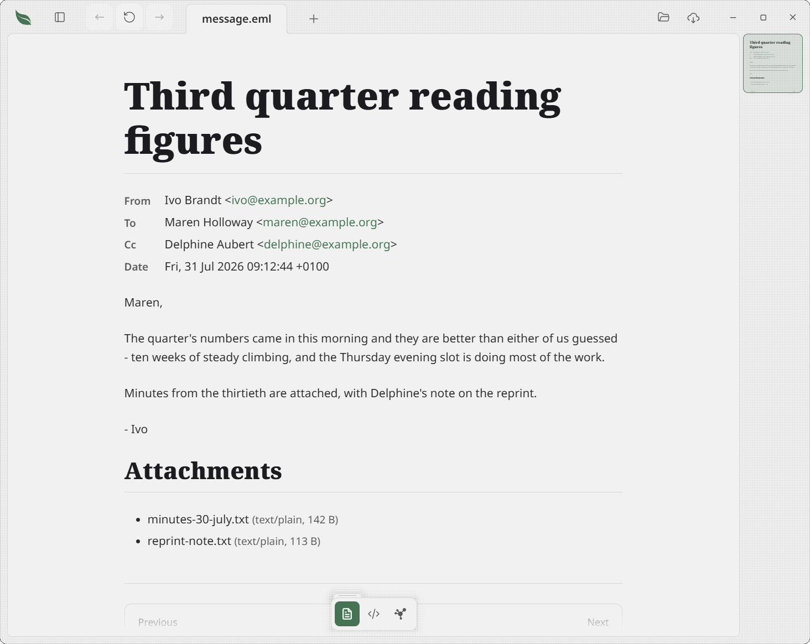

# Rendering

> Every kind of file you have, drawn as a page worth reading

Open a file and Leaftext draws it as a clean page in your theme. Markdown reads the way GitHub draws it, and data files, email, Office documents and books get pages of their own.

- **Notes:** Markdown with tables, diagrams, math and footnotes.
- **Data:** JSON, YAML, XML, INI and CSV as readable sections and tables.
- **Mail and documents:** saved emails, Word, Excel, PowerPoint and OpenDocument files.
- **Books:** EPUB and Kindle books, one chapter after another.
- **Code:** any source file, colored in your theme.

## Summary

| File | Drawn as |
| --- | --- |
| [Markdown](#markdown) | The page GitHub would draw, with diagrams and math |
| [XML](#xml) | Sections and tables; a sitemap becomes a table of addresses |
| [JSON and YAML](#data-files-json-and-yaml) | Headed sections and tables of records |
| [HTML](#html-files) | The page itself, scripts and all |
| [Email](#email-eml) | The message: headers, body, pictures and attachments |
| [Office files](#office-and-opendocument-files) | The document, sheet or slides, editable in place |
| [EPUB](#epub-books) and [Kindle](#kindle-books) books | The whole book, in reading order |
| [Text](#plain-text-files), [INI](#ini-files), [CSS](#css-files), [CSV](#csv-files) | The file name as a heading over its content |
| [Source code](#source-files) | Colored code in your theme |

[Every detail of rendering →](../09-details/rendering.md)

## Pipeline

Each file is read on your computer and drawn by the same renderer the website uses. Nothing is fetched from the internet to draw it.

[Details →](../09-details/rendering.md#pipeline)

## EPUB books

An EPUB opens as the whole book on one page: the cover, its contents page, then every chapter in order. Each book takes your theme's type, not its publisher's.

**[Read *Le Morte d'Arthur* here, with its glossary →](../08-examples/le-morte-darthur/le-morte-darthur.epub)**

[Details →](../09-details/rendering.md#epub-books)

## Kindle books

A Kindle book without copy protection opens the same way, as one document. Protected books say Leaftext cannot open them.

[Details →](../09-details/rendering.md#kindle-books)

## Plain text files



A `.txt` file is drawn as its file name over its text, with your lines kept as written.

[Details →](../09-details/rendering.md#plain-text-files)

## INI files



An `.ini` file shows each section as a heading, with its keys in a list beneath.

[Details →](../09-details/rendering.md#ini-files)

## CSS files

A stylesheet opens as colored code, with a small square beside each color it names.

[Details →](../09-details/rendering.md#css-files)

## CSV files

A `.csv` or `.tsv` file opens as a table you can sort, filter, and type in.

[Details →](../09-details/rendering.md#csv-files)

## Source files



Any source file opens as colored code in your theme, with its language named above it.

[Details →](../09-details/rendering.md#source-files)

## Reading at a prompt

Read any file in a terminal with `leaftext --print notes.md`, drawn in the terminal's own colors.

[Details →](../09-details/rendering.md#reading-at-a-prompt)

### A book a chapter at a time

`leaftext --print book.epub --contents` lists a book's chapters, so you can print one at a time.

[Details →](../09-details/rendering.md#a-book-a-chapter-at-a-time)

### Checking a file's diagrams

`leaftext --diagrams notes.md` checks every diagram in a file, and says which ones draw.

[Details →](../09-details/rendering.md#checking-a-files-diagrams)

## Markdown

Leaftext draws CommonMark and GitHub-flavored Markdown, plus a few extras of its own.

### Headings

Six levels, `#` to `######`, each one a step smaller.

### Text formatting

**Bold**, *italic*, ~~struck~~, `code` and <mark>highlighted</mark> words.

### Lists

Bulleted, numbered, and nested lists, drawn as you wrote them.

### Blockquotes and alerts

> [!TIP]
> Alerts like this one come in five kinds: note, tip, important, warning and caution.

### Code

Fenced code is colored in your theme, with a button to copy it.

```rust
fn main() {
    println!("Leaftext");
}
```

### Tables

Tables keep their alignment and scroll sideways when they are wide. On a narrow screen, each row becomes a card.

| Feature | Works |
| --- | :---: |
| Sorting | ✅ |
| Cards | ✅ |

### Task lists

- [x] Tick a box with a click
- [ ] Add a date, and it shows as a badge

### Links and autolinks

Links open in the app, and a bare web address becomes a link by itself.

### Wiki links

`[[Note name]]` links to a note by its name.

### Tabs (Leaf extension)

Leaftext can draw a group of tabs in a note, written as plain headings any other reader can still follow.

[Details →](../09-details/rendering.md#tabs-leaf-extension)

### Buttons (Leaf extension)

A link can be drawn as a button, with one of the app's own marks on it.

[Details →](../09-details/rendering.md#buttons-leaf-extension)

### Badges (Leaf extension)

`Done`<!--green--> `Waiting`<!--amber--> `Blocked`<!--red-->

A word in code with a color in a comment after it becomes a badge.

[Details →](../09-details/rendering.md#badges-leaf-extension)

### Bars (Leaf extension)

A list whose items end in an amount can be drawn as bars on one scale.

[Details →](../09-details/rendering.md#bars-leaf-extension)

### Framed figures (Leaf extension)

A titled box with a caption, for a figure or a worked example.

[Details →](../09-details/rendering.md#framed-figures-leaf-extension)

### Cards across the page (Leaf extension)

A row of cards, each with a title, a few words and a picture.

[Details →](../09-details/rendering.md#cards-across-the-page-leaf-extension)

### Images

Pictures beside the note are drawn in place. Hover one to open it on the whole window.

[Details →](../09-details/rendering.md#images)

### Math

Math is written between dollar signs: $E = mc^2$.

### Mermaid diagrams



Diagrams take your theme's colors. Hover one to open it big or to edit it.

[Details →](../09-details/rendering.md#mermaid-diagrams)

### Emoji

GitHub shortcodes such as `:rocket:` become :rocket:.

### GitHub references

Issue numbers stay as you wrote them, so a list item is never mistaken for an issue.

[Details →](../09-details/rendering.md#github-references)

### Footnotes

Footnotes collect at the foot of the page, and a press on one opens it over the page.

[Details →](../09-details/rendering.md#footnotes)

### Frontmatter



A note's fields at the top, such as its status and tags, are drawn as a tidy card.

[Details →](../09-details/rendering.md#frontmatter)

### Collapsible sections

<details>
<summary>Press to open</summary>

A section folded away until you need it.

</details>

### Inline HTML

A safe set of HTML tags works inside a note, kept in a box of its own.

[Details →](../09-details/rendering.md#inline-html)

### Horizontal rules

Three dashes draw a line across the page.

### Text in any language

Every script reads, including right-to-left languages.

[Details →](../09-details/rendering.md#text-in-any-language)

## XML



An XML file is drawn from its structure. A sitemap becomes a table of addresses, and a feed becomes its stories.

[Details →](../09-details/rendering.md#xml)

### Any XML



Tag names are read as words, so `lastBuildDate` reads as "Last build date".

[Details →](../09-details/rendering.md#any-xml)

### TEI XML



A scholarly TEI edition is drawn as an edition, with its front matter folded away.

[Details →](../09-details/rendering.md#tei-xml)

## Data files (JSON and YAML)



A JSON or YAML file is drawn as headed sections and tables of records, not punctuation.

[Details →](../09-details/rendering.md#data-files-json-and-yaml)

## HTML files

A web page runs as a browser runs it, so a page built by its own script opens finished.

[Details →](../09-details/rendering.md#html-files)

## Email (.eml)



A saved email opens as the message: its subject, who sent it, the body, pictures and attachments.

[Details →](../09-details/rendering.md#email-eml)

## Office and OpenDocument files

Word, Excel, PowerPoint and OpenDocument files open as the document, sheet or slides. You can type into them, and everything Leaftext never read is kept on save.

[Details →](../09-details/rendering.md#office-and-opendocument-files)

## File encodings

Files in older encodings are read correctly, and saved back the way they came.

[Details →](../09-details/rendering.md#file-encodings)

## Next

- [Editing](07-editing.md)
- [Navigation](02-navigation.md)
- [Themes](06-themes.md)
