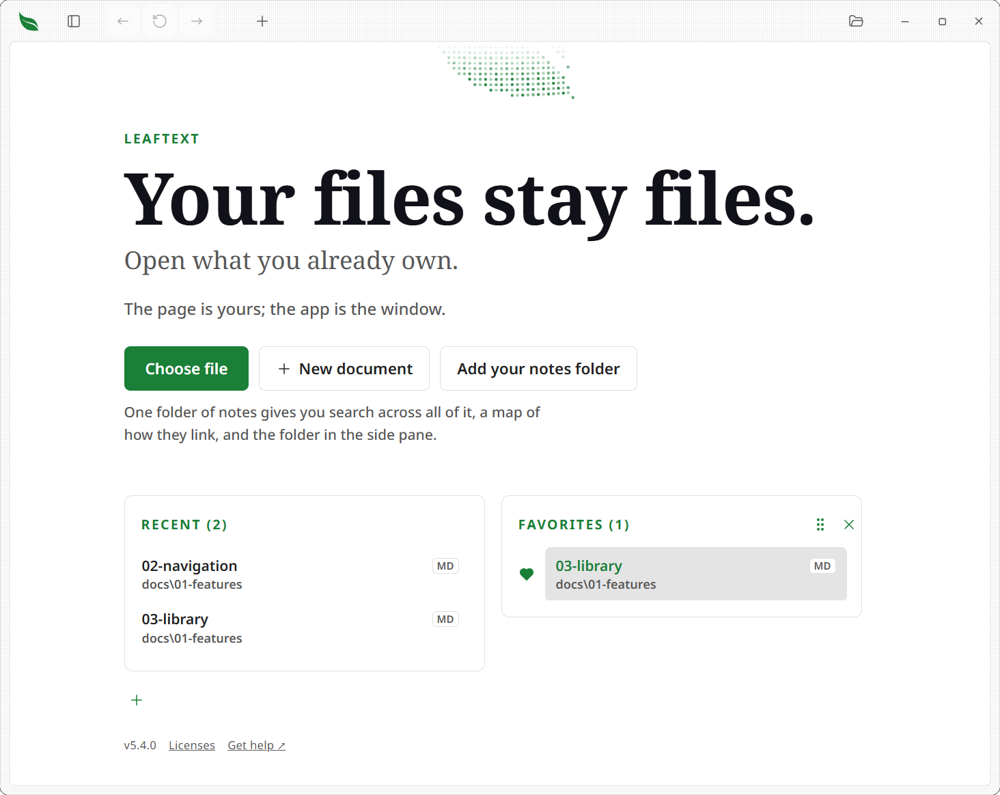
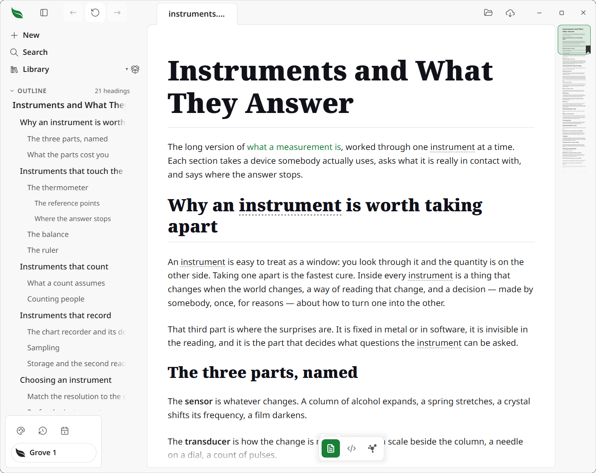
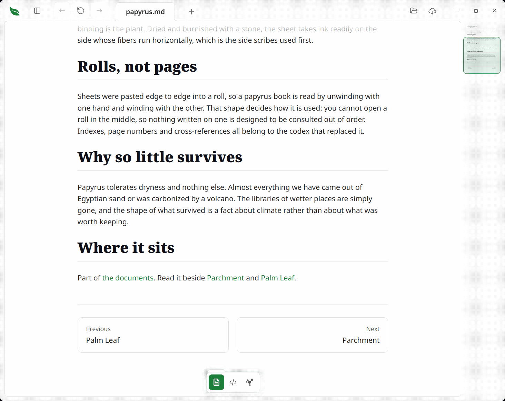
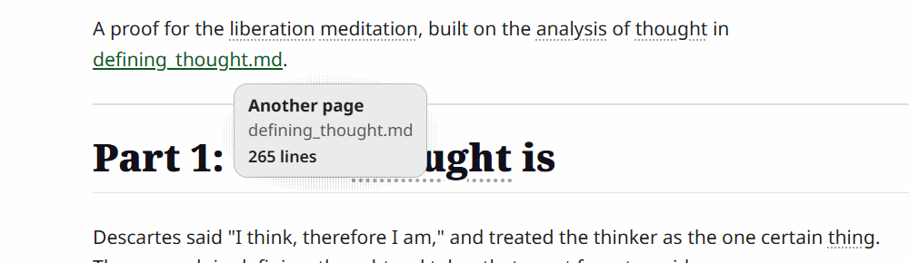
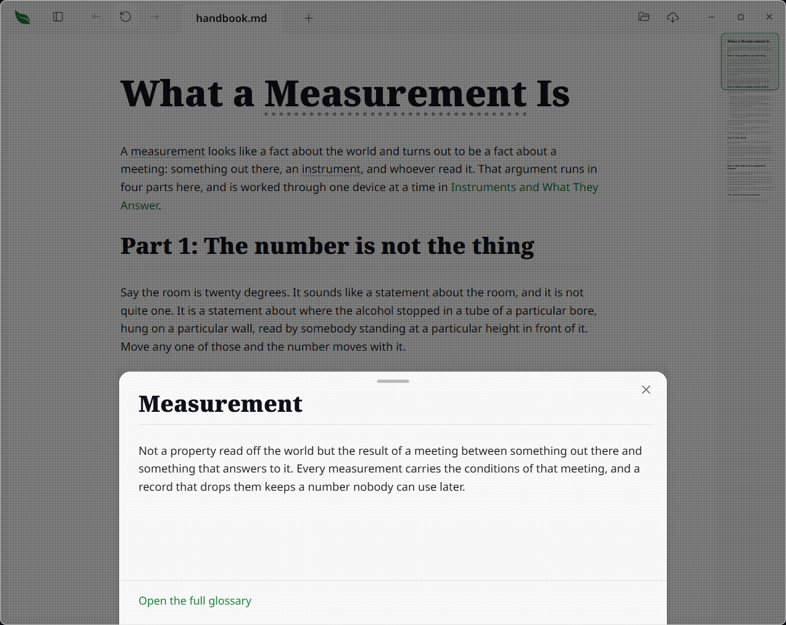

# Navigation

> Tabs, history, shortcuts, and finding your place in any document

Keep many documents open, move back and forth between them, and find your way around a long one. Leaftext remembers where you were in every tab.

- **Tabs** for documents, web pages and agent chats, two side by side if you like.
- **Back and Forward**, like a browser, for documents and jumps within them.
- **Find** in a document, with replace and many cursors.
- **The outline** and **the minimap** to jump to any part of a page.
- **Link hints** that show where a link goes before you press it.

## Summary

| You want to | Where |
| --- | --- |
| Open a web page beside your documents | [Web tabs](#web-tabs) |
| Keep several documents open | [Tabs](#tabs) |
| Read two at once | [Two documents side by side](#two-documents-side-by-side) |
| Go back | [History](#history) |
| Find words | [Find in this document](#find-in-this-document) |
| Save a page as a PDF or a book | [Export the page](#export-the-page) |
| Learn the keys | [Shortcuts](#shortcuts) |

See [every detail of navigation →](../09-details/navigation.md)

## Web tabs

Press **New**, choose New page, and type an address or a search. The page opens in a tab beside your documents, and Back and Forward work inside it.

See [the details →](../09-details/navigation.md#web-tabs)

## Model

Each tab has its own history. Opening a document or jumping to a heading adds a step that Back can return to.

See [the details →](../09-details/navigation.md#model)

## Shortcuts

| Action | Windows | macOS |
| --- | --- | --- |
| Open file | `Ctrl+O` | `Cmd+O` |
| [New window](#tabs), also a row in [More](#more) | `Ctrl+N` | `Cmd+N` |
| Close tab | `Ctrl+W` | `Cmd+W` |
| Quit, keeping your tabs and unsaved edits for next time | `Ctrl+Q` | `Cmd+Q` |
| Back | `Alt+Left` | `Cmd+Left` |
| Forward | `Alt+Right` | `Cmd+Right` |
| Next tab | `Ctrl+Tab` | `Ctrl+Tab` |
| Previous tab | `Ctrl+Shift+Tab` | `Ctrl+Shift+Tab` |
| [Stand the next tab beside this one](#two-documents-side-by-side), or bring back the page closed last | `Ctrl+\` | `Cmd+\` |
| [Full screen](06-themes.md#windows), the window's own button at the top right | `F11` | Green dot at the top left |
| Save (with [unsaved edits](07-editing.md#save), your own typing included) | `Ctrl+S` | `Cmd+S` |
| [Undo](07-editing.md#undo) — a word of your typing, then the last reading-view edit | `Ctrl+Z` | `Cmd+Z` |
| [Redo](07-editing.md#undo) a word of typing, or a whole edit, you took back | `Ctrl+Y` or `Ctrl+Shift+Z` | `Cmd+Shift+Z` |
| Select the page — or, with the caret in a block, [a step wider per press](07-editing.md#deleting) | `Ctrl+A` | `Cmd+A` |
| Copy the words highlighted in the document, keeping their headings, lists, bold and links when pasted into a mail, a word processor or a web editor; a plain paste gets the words alone, a table its rows with a tab between cells, and never the words on the buttons Leaftext draws over a table | `Ctrl+C` | `Cmd+C` |
| [Delete](07-editing.md#deleting) a selection that crosses blocks | `Delete` or `Backspace` | `Delete` or `Backspace` |
| [Find](#find-in-this-document) in this document, or across [all files](03-library.md#search) | `Ctrl+F` | `Cmd+F` |
| [Find and replace](#find-in-this-document) | `Ctrl+H` | `Cmd+H` |
| [Put a cursor on every match](#find-in-this-document), from the find field | `Alt+Enter` | `Alt+Enter` |
| [Add a cursor where you click](#find-in-this-document) | `Ctrl`+click | `Cmd`+click |
| [Bold](07-editing.md#the-format-bar) the highlighted words | `Ctrl+B` | `Cmd+B` |
| [Italic](07-editing.md#the-format-bar) the highlighted words | `Ctrl+I` | `Cmd+I` |
| [Link](07-editing.md#the-format-bar) the highlighted words | `Ctrl+K` | `Cmd+K` |
| [Open a link in a new page](#opening-a-link-in-a-new-page) | `Ctrl`+click | `Cmd`+click |

Tab cycling is `Ctrl`-based on every platform, including macOS. Mouse side buttons also trigger Back and Forward.

## The chrome

### The app bar

**New** is the first press in the icon rail. The page header under the tabs names where the document sits, with Open and [Export](#export-the-page) at its right.

The leaf takes you home. Beside it are the pane button, Back, Refresh and Forward, and the vault picker sits in the middle of the bar.

See [the details →](../09-details/navigation.md#the-app-bar)

### Export the page

**Export** saves the page you are reading as a PDF, a picture, a web page, a Markdown note with its pictures, or an EPUB book.

See [the details →](../09-details/navigation.md#export-the-page)

### When another app is in front

When you click into another app, the whole Leaftext window quietly steps back, so you can tell at a glance which window has your keys.

See [the details →](../09-details/navigation.md#when-another-app-is-in-front)

### The floating toolbar

The bar over the foot of the page switches between Read, Source and Graph. It also holds the padlock and each view's tools: point at Read, Source or Graph and that view's tools rise above it, and pressing one goes to that view.

See [the details →](../09-details/navigation.md#the-floating-toolbar)

### More

**More**, at the foot of the icon rail, holds themes, zoom, a new window and everything else that is not a control of the page.

See [the details →](../09-details/navigation.md#more)

### Tabs

Every document opens in a tab that keeps its own place and history. Drag a tab to reorder it, or off the window to open a second window.

See [the details →](../09-details/navigation.md#tabs)

#### Two documents side by side

Press `Ctrl+\` (`Cmd+\` on a Mac), or drag a tab onto the right half of the page, to read two documents at once.

See [the details →](../09-details/navigation.md#two-documents-side-by-side)

#### The chat column

An agent's chat can stand in a column beside your pages, so you read what it writes while you read the pages it works on.

See [the details →](../09-details/navigation.md#the-chat-column)

#### When the bar runs out of room

On a narrow window, the bar's buttons fold into a chevron menu one at a time.

See [the details →](../09-details/navigation.md#when-the-bar-runs-out-of-room)

## Moving between documents

#### Tabs inside a document

A document can carry tabs of its own, each a named part of the same file.

See [the details →](../09-details/navigation.md#tabs-inside-a-document)

### History

Back and Forward move through the documents you opened and the jumps you made within them. Mouse side buttons work too.

See [the details →](../09-details/navigation.md#history)

### Restore

Quit and reopen, and your tabs come back in order, each at its place, with unsaved edits still in them.

See [the details →](../09-details/navigation.md#restore)

### Recent files

The home screen lists the files you opened most recently. Press one to open it again.

See [the details →](../09-details/navigation.md#recent-files)

### Favorites

Keep the files you return to as favorites, and they get a list of their own on the home screen.

See [the details →](../09-details/navigation.md#favorites)

### Loading

A large document shows the shape of its page while it loads, so you are never left with a blank window.

See [the details →](../09-details/navigation.md#loading)

### When the page stops

If a window's page ever stops, Leaftext draws it again with your tabs and unsaved edits intact.

See [the details →](../09-details/navigation.md#when-the-page-stops)

## Moving within a document

### Scrollbars

Scrollbars appear while you scroll and fade when you stop. On a wide window, the minimap does that job instead.

See [the details →](../09-details/navigation.md#scrollbars)

### Find in this document

Press `Ctrl+F` (`Cmd+F` on a Mac) to find words, and `Ctrl+H` to replace them. **All** puts a cursor on every match, so you can type into all of them at once.

See [the details →](../09-details/navigation.md#find-in-this-document)

### Outline

The side pane lists the document's headings, and the one you are reading is lit. Click one to jump to it.

See [the details →](../09-details/navigation.md#outline)

### Pager

In a folder of documents joined by `README.md` files, a Previous and Next bar at the foot of the page reads them in order.

See [the details →](../09-details/navigation.md#pager)

### Link hints

Rest the pointer on a link, and a card shows where it goes, often with the opening of the page it leads to.

See [the details →](../09-details/navigation.md#link-hints)

### The pointer

The pointer turns to a hand only over something that takes you somewhere.

See [the details →](../09-details/navigation.md#the-pointer)

### What a control does under the pointer

A button fills with the theme's color when you point at it, and nothing moves.

See [the details →](../09-details/navigation.md#what-a-control-does-under-the-pointer)

### Opening a link in a new page

`Ctrl`+click a link (`Cmd`+click on a Mac) to open it in a tab behind the one you are reading. Right-click a link for more ways to open it.

See [the details →](../09-details/navigation.md#opening-a-link-in-a-new-page)

## Glossary

Put a `GLOSSARY.md` beside your documents, and every term in it is underlined wherever it appears. Press one, and its entry opens over the page.

See [the details →](../09-details/navigation.md#glossary)

### Author a glossary

Give each term a `##` heading and a short entry under it. An AI tool can write one for you.

See [the details →](../09-details/navigation.md#author-a-glossary)

## Reload

When a file changes on disk, the open document reloads by itself and keeps your place.

See [the details →](../09-details/navigation.md#reload)

## Next

- [Library](03-library.md)
- [Minimap](04-minimap.md)
- [Editing](07-editing.md)
