# Library

> Your folders, search, filters and a map of how your notes link

Point Leaftext at a folder, and it becomes a vault: a file tree to browse, text to search, and a map of how its documents link. Opening a vault adds no files to your folder.

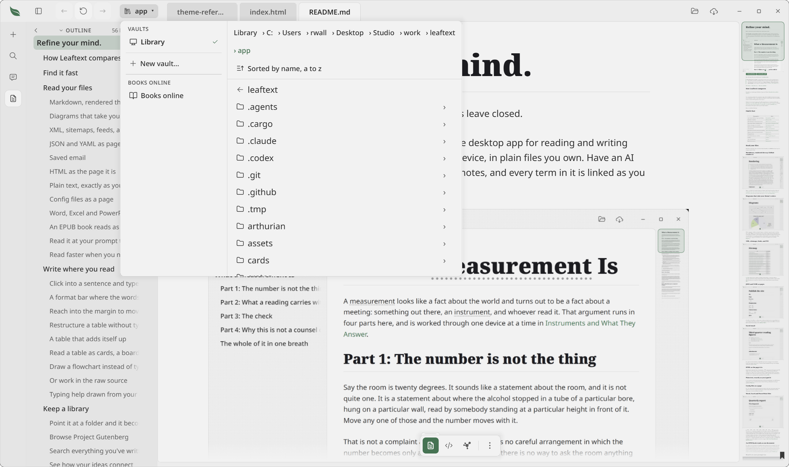

- **Browse** a folder at a time, with every file action you expect.
- **Search** names and words across the whole vault.
- **Filter** by tag, field or date.
- **See the map** of how your documents link.
- **Sync** a vault to GitHub.

## The icon rail and the side pane

The icon rail down the left opens the side pane on your conversations, your documents, or search.

[Every detail of the library →](../09-details/library.md)

### The vault picker

The picker in the middle of the app bar names the folder in front. Press it to switch vaults or browse folders.

[Details →](../09-details/library.md#the-vault-picker)

## Summary

| You want to | Where |
| --- | --- |
| Make a folder a vault | [Your first vault](#your-first-vault) |
| Browse files | [File tree](#file-tree) |
| Find words | [Search](#search) |
| Narrow by tag or date | [Filtering](#filtering) |
| See links between notes | [Graph](#graph) |
| Back up to GitHub | [GitHub sync](#github-sync) |

## Vaults

A vault is a folder you work in. Search, the map and sync all work across the whole vault.

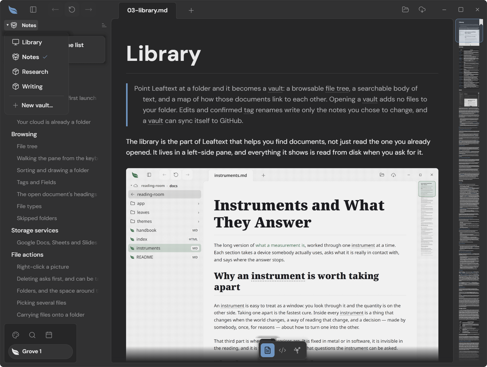

[Details →](../09-details/library.md#vaults)

### The bubble on your first launch

The first time you open Leaftext, a small bubble points to the vault picker.

[Details →](../09-details/library.md#the-bubble-on-your-first-launch)

### Your first vault

Press **Add your notes folder** on the start screen, and pick a folder.

[Details →](../09-details/library.md#your-first-vault)

### Your cloud is already a folder

Dropbox, OneDrive, iCloud Drive, Box, Nextcloud and Google Drive keep a real folder on your computer. Leaftext finds each one and makes it a vault for you.

[Details →](../09-details/library.md#your-cloud-is-already-a-folder)

#### Google Docs, Sheets and Slides

A Google Docs, Sheets or Slides shortcut opens its document in your browser.

[Details →](../09-details/library.md#google-docs-sheets-and-slides)

### Books online

Search free books from Internet Archive, Open Library, Project Gutenberg and Standard Ebooks, then read them offline.

[Details →](../09-details/library.md#books-online)

## Browsing

### File tree

The pane lists the folder you are in, like Explorer or Finder. Press a folder to step in, and the path above to step out.

[Details →](../09-details/library.md#file-tree)

### Walking the pane from the keyboard

Arrow keys move through the rows, and Enter opens one.

[Details →](../09-details/library.md#walking-the-pane-from-the-keyboard)

### Sorting and drawing a folder

Sort a folder by name, date or size, and choose whether rows show titles and previews.

[Details →](../09-details/library.md#sorting-and-drawing-a-folder)

### Tags and Fields

Group a folder's notes by tag or by any field in their front matter.

[Details →](../09-details/library.md#tags-and-fields)

### The open document's headings

With a document in front, the pane lists its headings, and the one you are reading is lit.

[Details →](../09-details/library.md#the-open-documents-headings)

### File types

Files Leaftext reads open normally. Any other file is listed, dimmed, with every file action still available.

[Details →](../09-details/library.md#file-types)

### Skipped folders

System folders at the top of a drive are skipped. Build and cache folders are listed, but search does not read inside them.

[Details →](../09-details/library.md#skipped-folders)

## File actions

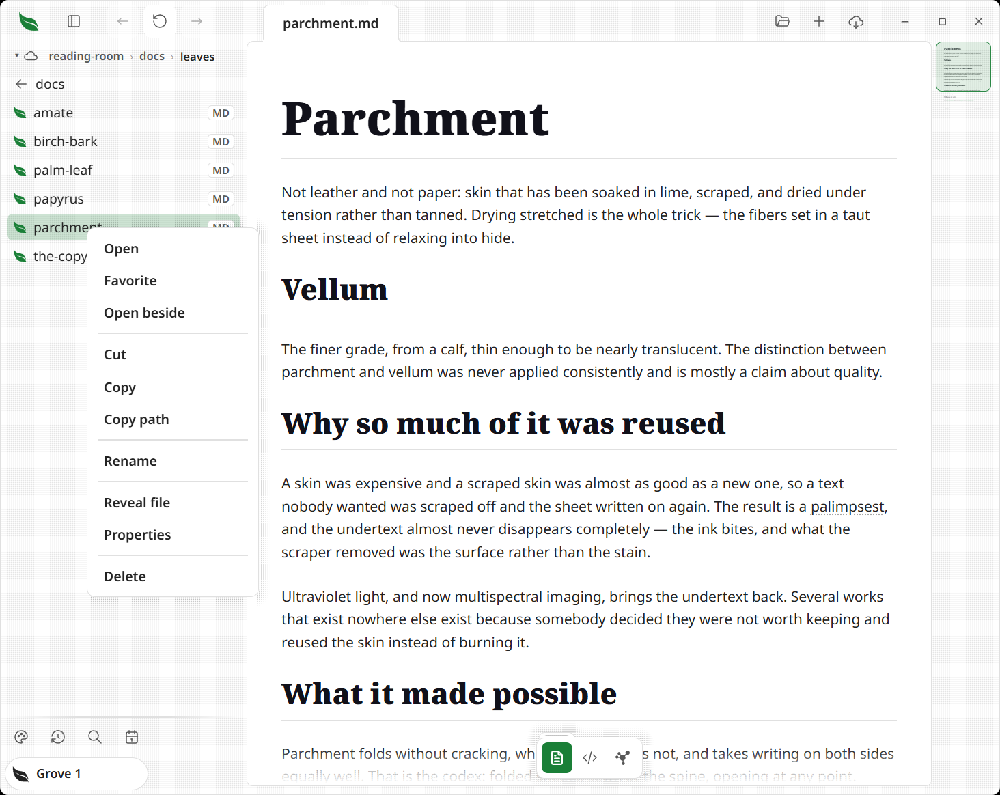

Right-click a file to open, rename, duplicate, reveal, copy or delete it.

[Details →](../09-details/library.md#file-actions)

### Right-click a picture

A picture in a document has its own menu: open it, copy it, or reveal its file.

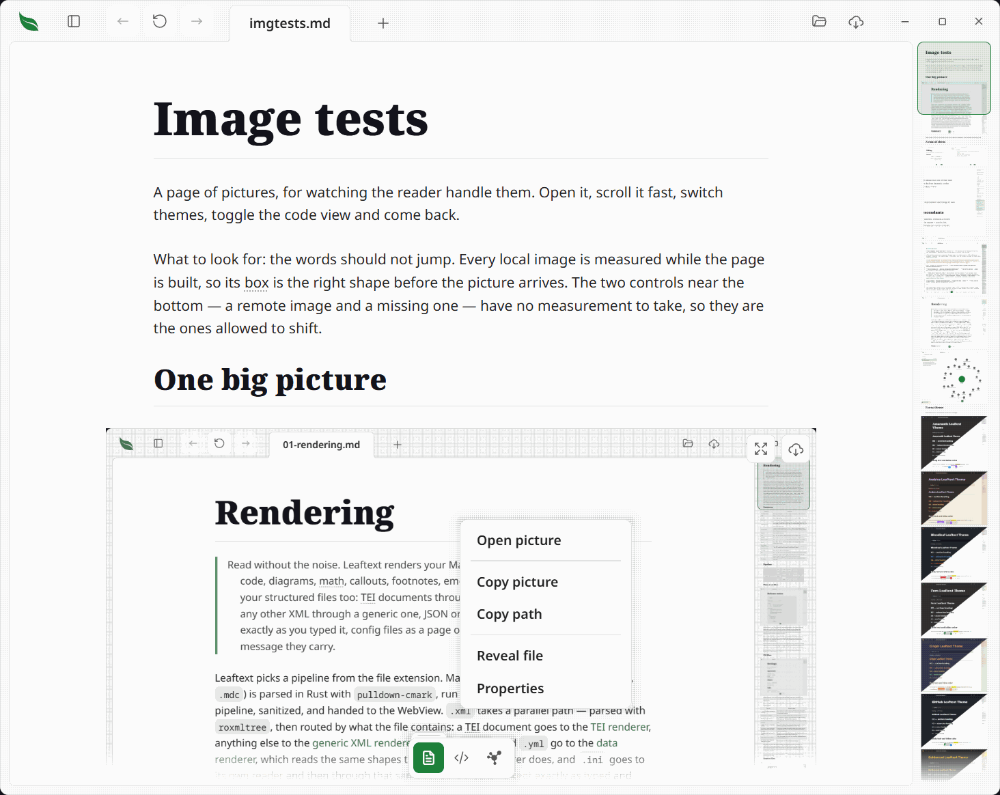

[Details →](../09-details/library.md#right-click-a-picture)

### Deleting asks first, and can be taken back

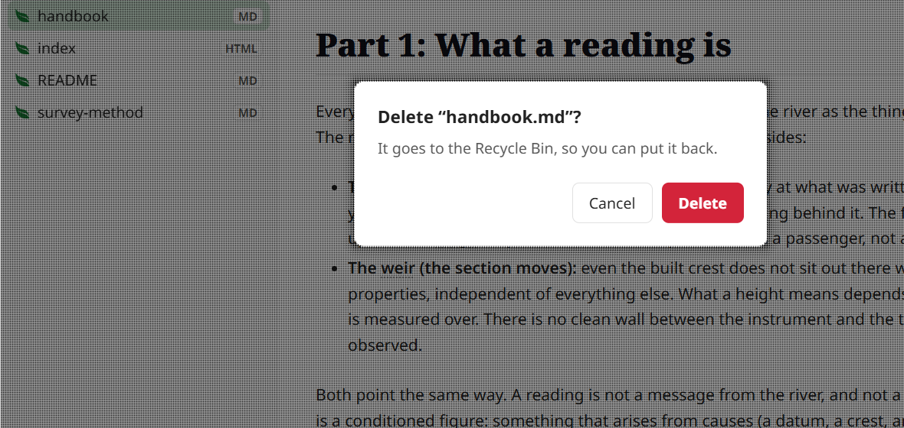

Delete asks first, and the file goes to the Recycle Bin or Trash. A message offers **Undo**.

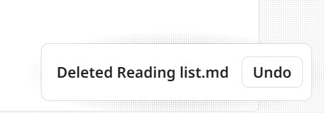

[Details →](../09-details/library.md#deleting-asks-first-and-can-be-taken-back)

### Folders, and the space around them

Right-click a folder, or the empty space under the rows, to make a new file or folder there.

[Details →](../09-details/library.md#folders-and-the-space-around-them)

### Picking several files

`Ctrl`+click picks rows one at a time, and `Shift`+click picks a range.

[Details →](../09-details/library.md#picking-several-files)

### Carrying files onto a folder

Drag files onto a folder in the pane to move them there.

[Details →](../09-details/library.md#carrying-files-onto-a-folder)

### Dropping files in from outside

Drop files from Explorer or Finder onto a folder to copy them in, or onto a document to link them.

[Details →](../09-details/library.md#dropping-files-in-from-outside)

### Cut, copy, paste

Cut, copy and paste files between folders, with the usual keys.

[Details →](../09-details/library.md#cut-copy-paste)

## Search

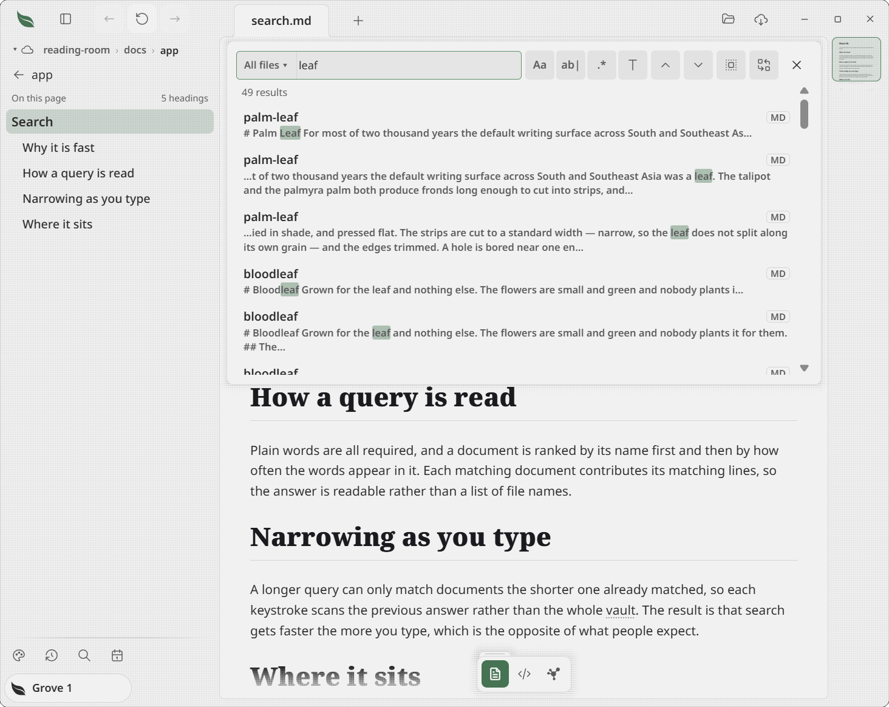

Press `Ctrl+F` and pick **All files** to search names and words across the vault. Results appear as you type, and nothing is uploaded or indexed on disk.

[Details →](../09-details/library.md#search)

## Filtering

Type `tag:`, a field name, or a date such as `due:friday` into the search box to narrow the results.

[Details →](../09-details/library.md#filtering)

## Scheduled tasks

Notes with dated checkboxes appear on a list of what is due.

[Details →](../09-details/library.md#scheduled-tasks)

## Calendar

A month view shows which documents belong to each day.

[Details →](../09-details/library.md#calendar)

## Other names

Give a note other names in its fields, and `[[links]]` using any of them reach it.

[Details →](../09-details/library.md#other-names)

## Tags

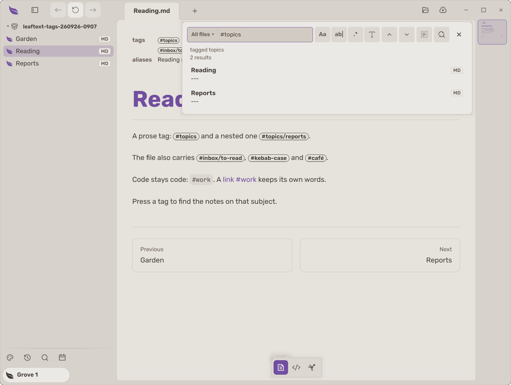

Press a tag to find its notes. Rename it across the whole vault after confirming how many files will change.

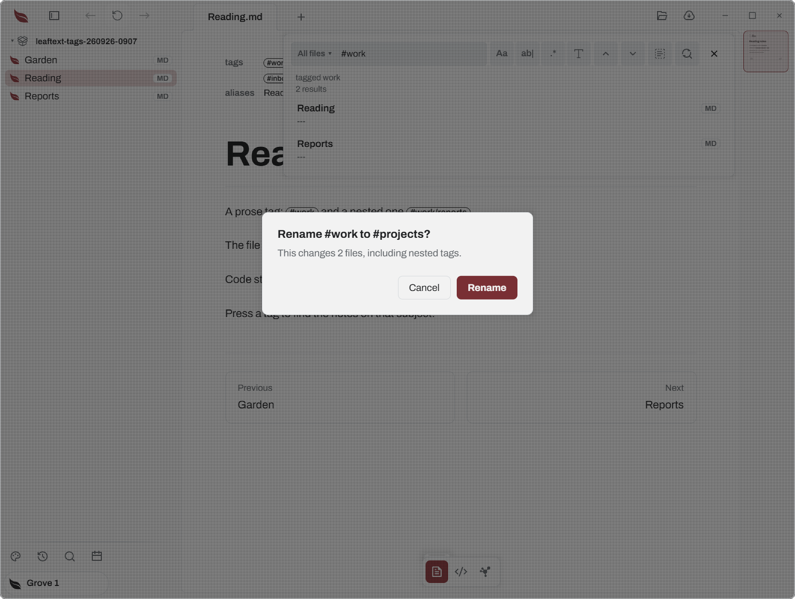

[Details →](../09-details/library.md#tags)

## Graph

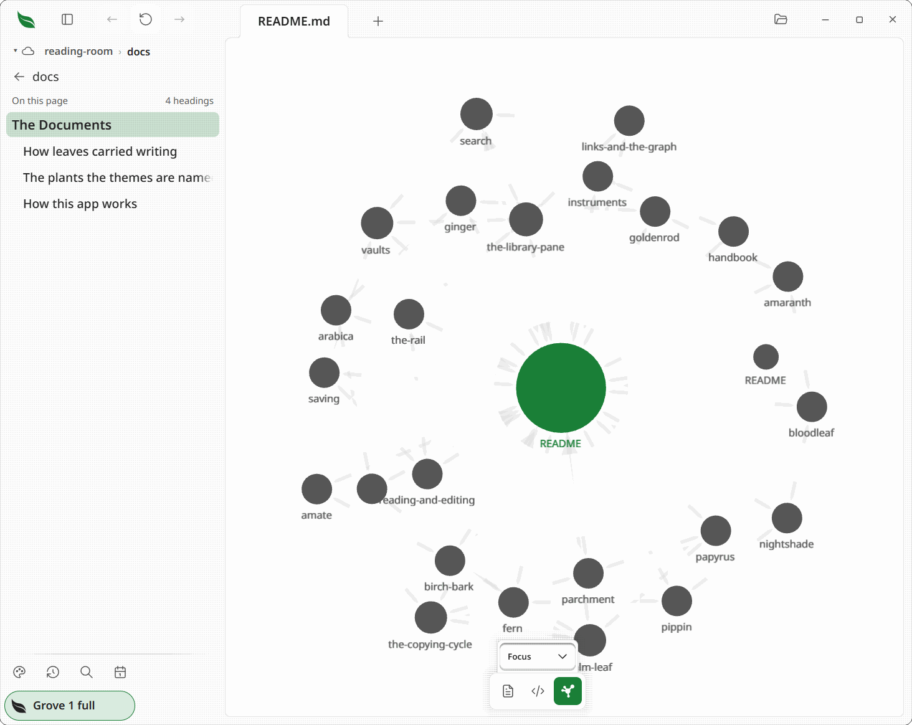

The graph draws your documents as dots and their links as lines. Click a dot to open that document.

[Details →](../09-details/library.md#graph)

### What it maps

Every document in the vault, the links between them, and the web addresses they cite.

[Details →](../09-details/library.md#what-it-maps)

### Moving around it

Drag to pan, scroll to zoom, and drag a dot to move it.

[Details →](../09-details/library.md#moving-around-it)

### How much it draws

Choose whether the map shows the whole vault or one document's neighbors.

[Details →](../09-details/library.md#how-much-it-draws)

### Web addresses

A web address a note links to appears as a ring, labeled by its site.

[Details →](../09-details/library.md#web-addresses)

## GitHub sync

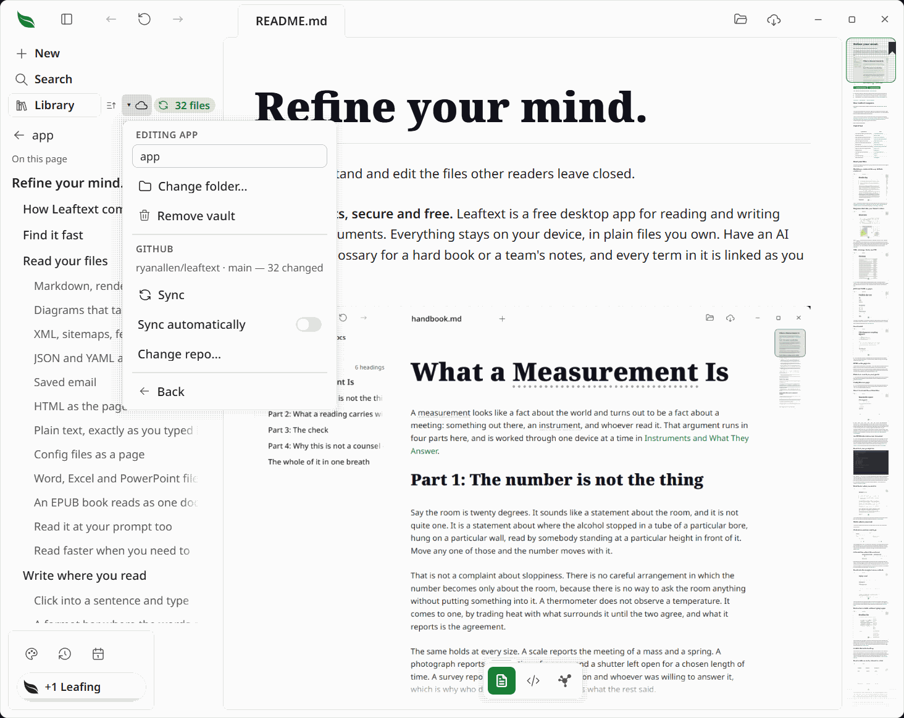

Connect a vault to a GitHub repository, and **Sync** sends your changes there and brings others back. It can also sync by itself.

[Details →](../09-details/library.md#github-sync)

### What it needs

The `git` already on your computer, signed in to GitHub.

[Details →](../09-details/library.md#what-it-needs)

### Clone a repository

Make a vault from a GitHub repository by its address.

[Details →](../09-details/library.md#clone-a-repository)

### Changing the repository

**Change repo…** points a vault at another repository.

[Details →](../09-details/library.md#changing-the-repository)

### Syncing

The sync button shows how many changes are waiting. A failed sync says why.

[Details →](../09-details/library.md#syncing)

### Repositories inside repositories

A project folder holding other repositories is warned about, so a sync does not swallow them.

[Details →](../09-details/library.md#repositories-inside-repositories)

## Live updates

When a file changes on disk, the pane and search update by themselves.

[Details →](../09-details/library.md#live-updates)

## Where the launchers went

Themes, the Calendar, Scheduled tasks and the Grove now live in **More** on the floating bar.

[Details →](../09-details/library.md#where-the-launchers-went)

### On a published site

A site made with Export as site keeps the folder trail at the top of its pane, with Themes and Search at the foot.

[Details →](../09-details/library.md#on-a-published-site)

## Console

A console is a terminal inside Leaftext, in the library's folder. Run any command there, or start an agent.

[Details →](../09-details/library.md#console)

### A finished console says so

A console's mark glows while it works and changes color when it finishes.

[Details →](../09-details/library.md#a-finished-console-says-so)

### Every agent in one list

**All chats** lists every running agent with what it is doing, such as Working or Needs you.

[Details →](../09-details/library.md#every-agent-in-one-list)

### Past conversations in the sidebar

Your past agent conversations are listed newest first. Press one to read it, or type to carry on.

[Details →](../09-details/library.md#past-conversations-in-the-sidebar)

### The command you ran stays at the top

A long-running command stays pinned at the top of the console while its output scrolls.

[Details →](../09-details/library.md#the-command-you-ran-stays-at-the-top)

### The prompt you sent an agent stays at the top

The prompt you sent stays pinned at the top while the agent works on it.

[Details →](../09-details/library.md#the-prompt-you-sent-an-agent-stays-at-the-top)

## Layout

The pane sits beside the icon rail, and you can widen it or close it.

[Details →](../09-details/library.md#layout)

### Narrow windows

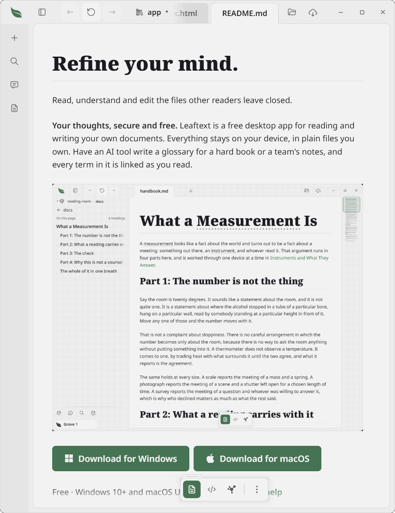

In a narrow window, the pane closes to the icon rail and opens over the page when you need it.

[Details →](../09-details/library.md#narrow-windows)

## Facts

Search returns the top 50 matches, and a vault reads up to 25,000 documents. A file past that is still found by its name.

[Every fact →](../09-details/library.md#facts)

## Next

- [Navigation](02-navigation.md)
- [Editing](07-editing.md)
- [Settings](05-settings.md)
