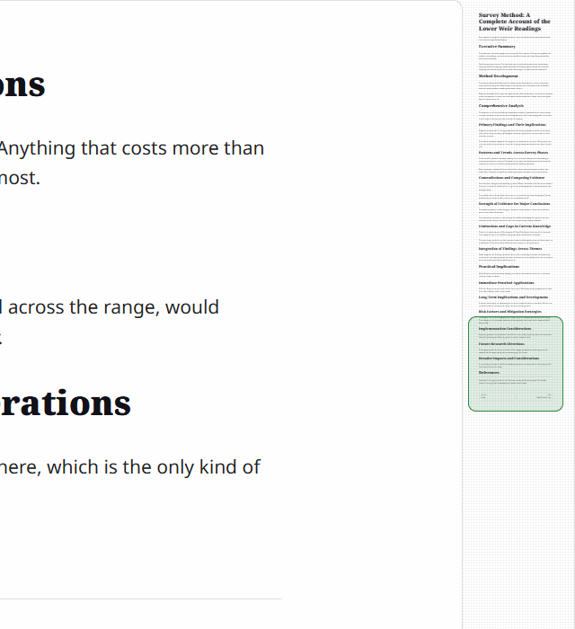
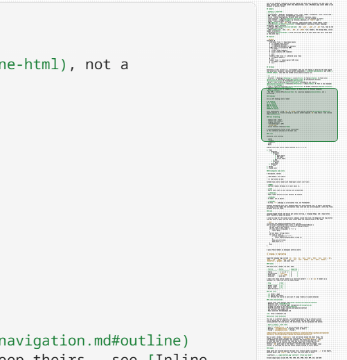

# Minimap

> The whole page, drawn small down the side, to see where you are and jump anywhere

A tiny copy of your document runs down the right edge, real text rather than bars, with a box showing what is on screen. Click to jump, drag the box to scroll, or turn the wheel over it.

## Summary

| You want to | Do this |
| --- | --- |
| Jump to a part of the page | Click it in the rail |
| Scroll quickly | Drag the box |
| Return to how far you read | Click the ribbon |
| Hide the rail | Drag the gap beside it to the right |

See [every detail of the minimap →](../09-details/minimap.md)

## What it is

The rail is a real, shrunk copy of the page. You can tell headings, code, verse and dense paragraphs apart by their shape, without reading a word.

See [the details →](../09-details/minimap.md#what-it-is)

## How it works

The rail draws the part of the document near what you are reading, and redraws as you move. So it stays quick on a document of any length.

See [the details →](../09-details/minimap.md#how-it-works)

## Web pages

A web tab keeps the same rail beside its live page.

See [the details →](../09-details/minimap.md#web-pages)

## Consoles

A console keeps a rail beside its output, so you can scroll back through what it printed.

See [the details →](../09-details/minimap.md#consoles)

## A deck's slides

Beside a slide deck, the rail marks where each slide starts, with its number.

See [the details →](../09-details/minimap.md#a-decks-slides)

## The ribbon bookmark

A ribbon on the rail marks how far you have read, and it is remembered after you quit. Click it to go back there.

See [the details →](../09-details/minimap.md#the-ribbon-bookmark)

## Whether the rail appears

The rail appears beside every document with something in it, as long as the window has room.

See [the details →](../09-details/minimap.md#whether-the-rail-appears)

## The code view's minimap

The code view has its own rail, drawn from the source, dressed the same way.

See [the details →](../09-details/minimap.md#the-code-views-minimap)

## On an exported page

A page you export carries the rail too, so whoever you send it to can see its shape and jump around.

See [the details →](../09-details/minimap.md#on-an-exported-page)

## Responsive behavior

In a window 720 pixels wide or narrower, the rail goes away, and the page uses an ordinary scrollbar.

See [the details →](../09-details/minimap.md#responsive-behavior)

## Always there

Drag the gap between the page and the rail to the right to put the rail away, and back to bring it out. Leaftext remembers your choice.

See [the details →](../09-details/minimap.md#always-there)

## Next

- [Navigation](02-navigation.md)
- [Library](03-library.md)
