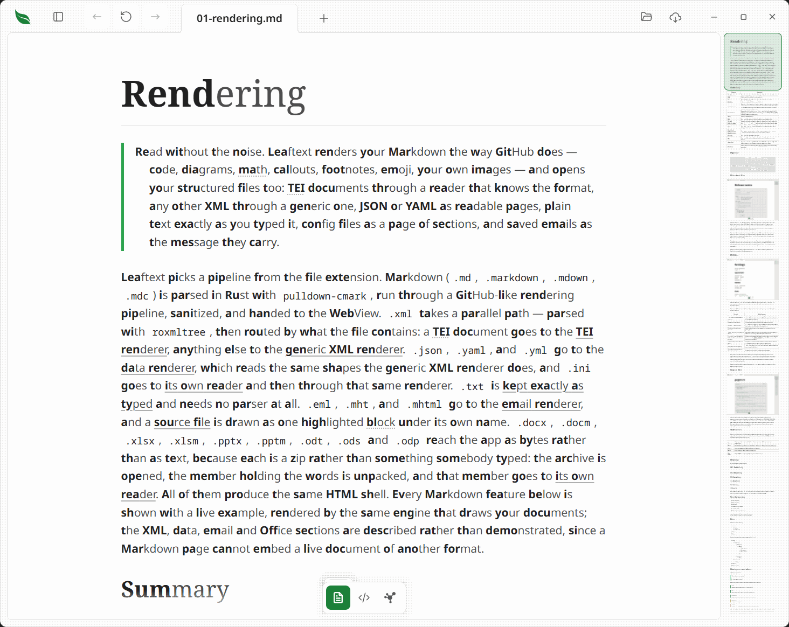

# Settings

> Every preference, where you set it, and the file it is kept in

There is no settings panel. Each control stands where it applies, and every choice is kept in a plain file on your computer that you can read.

- **Look:** themes, light and dark, and how the page reads.
- **Reading:** Speed Reader, Flash words and Read aloud.
- **Your wisp:** a bot of your own on Slack, Discord and iMessage.
- **Updates:** checked at launch, installed when you restart.
- **Where it is kept:** a settings file and a data folder in your user profile.

## Options

Preferences are saved to `settings.json` as you change them, wherever you change them.

See [every detail of settings →](../09-details/settings.md)

### The padlocks

The padlock on the floating toolbar decides whether a document can be typed into. The reading view and the source each have their own.

See [the details →](../09-details/settings.md#the-padlocks)

## Open

There is nothing to open: every control saves the moment you use it. The version you are running is at the foot of the home screen.

See [the details →](../09-details/settings.md#open)

## Files

Each file has one job: your preferences, your recent files, your reading places, your Grove and your vaults.

See [every file →](../09-details/settings.md#files)

## Example

An example `settings.json`, with every field explained, is on the details page.

See [the details →](../09-details/settings.md#example)

## Recents

The last 50 files you opened, and your favorites, are kept in `recent-files.json`.

See [the details →](../09-details/settings.md#recents)

## Behavior

### Theme

Pick a theme from **More** on the floating bar. Each window can wear its own.

See [the details →](../09-details/settings.md#theme)

### Graph size

Choose how much of the vault the graph draws.

See [the details →](../09-details/settings.md#graph-size)

### Calendar date

Choose which date the calendar counts by: when a note was changed, made, or a field such as Due.

See [the details →](../09-details/settings.md#calendar-date)

### Minimap

Drag the page's right edge to put the minimap away or bring it back, and the window remembers.

See [the details →](../09-details/settings.md#minimap)

### Home boxes

Drag the boxes on the home screen into the order you like.

See [the details →](../09-details/settings.md#home-boxes)

### Speed Reader

Speed Reader dims the page and marks the start of each word, so your eye follows the reading path.

See [the details →](../09-details/settings.md#speed-reader)

### Flash words

Flash words shows a passage a word or a few at a time, at the pace you set.

See [the details →](../09-details/settings.md#flash-words)

### Read aloud

Read aloud speaks the page from where you are, in a computer voice or an ElevenLabs voice. An ElevenLabs voice asks before it sends anything.

See [the details →](../09-details/settings.md#read-aloud)

### Typing help

The wand in the code view turns typing help on and off.

See [the details →](../09-details/settings.md#typing-help)

### Your wisp

Your wisp is a bot of your own. Talk to it in Leaftext, or on Slack, Discord and iMessage once you connect them. It runs on the AI account and folder you choose.

See [the details →](../09-details/settings.md#your-wisp)

### Pager

Previous and Next at the foot of a page are always on, with nothing to switch.

See [the details →](../09-details/settings.md#pager)

### Updates

Leaftext checks for a new version at launch. When one is ready, a bell appears, and the update installs the next time you start the app.

See [the details →](../09-details/settings.md#updates)

### Window size

Each window opens at the size and place you left it.

See [the details →](../09-details/settings.md#window-size)

### Unsaved edits

Close the window with unsaved edits, and they come back when you reopen it.

See [the details →](../09-details/settings.md#unsaved-edits)

### First-launch bubble

Each small hint bubble shows once, until you have met what it points at.

See [the details →](../09-details/settings.md#first-launch-bubble)

### Reduce Motion

Leaftext follows your system's reduce motion setting, with no switch of its own.

See [the details →](../09-details/settings.md#reduce-motion)

## Journal

Leaftext keeps a short journal of what went wrong. **Open the journal** in About Leaftext shows it.

See [the details →](../09-details/settings.md#journal)

## Paths

| Platform | Settings | Data |
| --- | --- | --- |
| macOS | `~/Library/Application Support/com.ryanallen.leaftext` | The same folder |
| Windows | `%APPDATA%\ryanallen\leaftext\config` | `%LOCALAPPDATA%\ryanallen\leaftext\data` |

Both live in your user profile, so Leaftext never needs administrator rights. Reinstalling or moving the app keeps your settings, recent files and vaults.

## Next

- [Themes](06-themes.md)
- [Installation](../02-installation.md)
