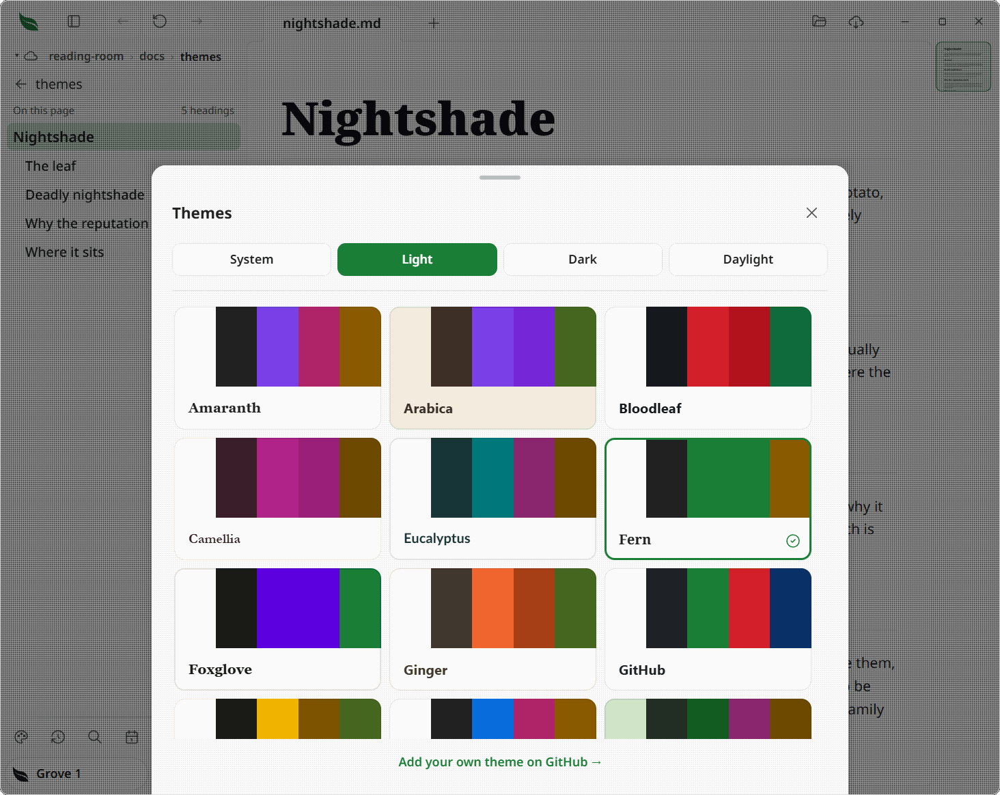
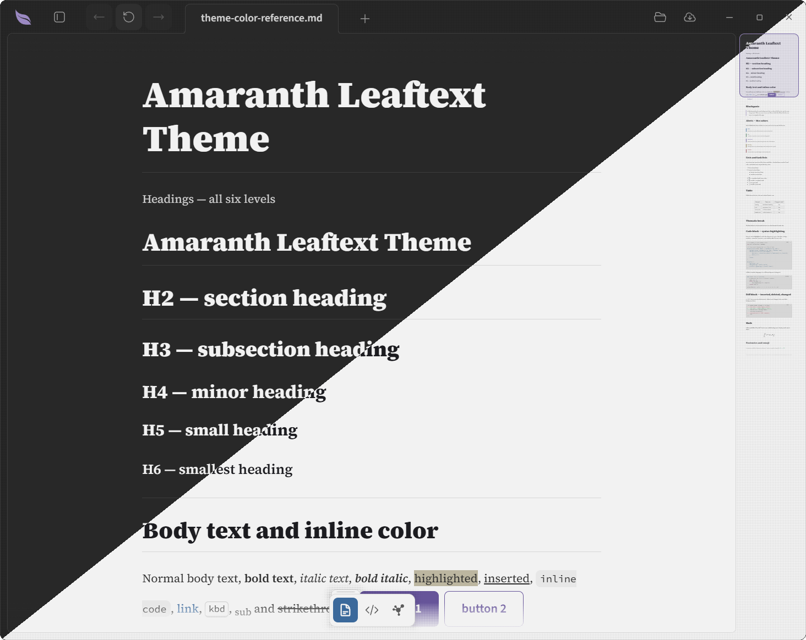
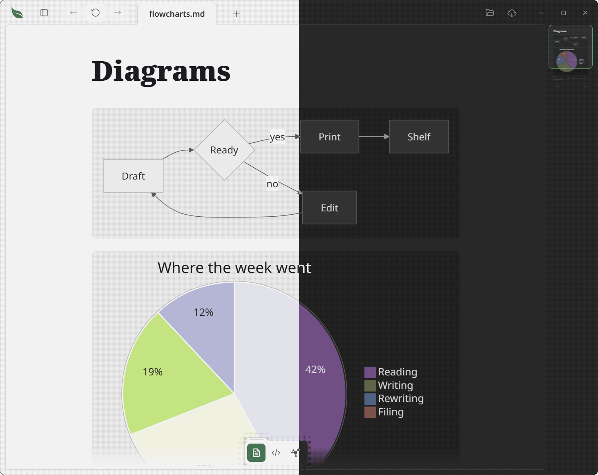

# Themes

> Twenty-four color families, each with its own type, in light and dark

Every theme changes the whole window: the page, the controls, code, diagrams and the minimap. Each family carries its own fonts, so it reads as a different book, not just a different color.

- **Pick a family** from the theme picker, or let **Random** pick one each time.
- **Choose light, dark, System or Daylight**, which follows the time of day.
- **Earn six more families** with seeds in the Grove.
- **See them all first** in the gallery at [leaftext.com/gallery.html](https://leaftext.com/gallery.html).

[Every detail of themes →](../09-details/themes.md)

## Families

Eighteen families ship free: Amaranth, Arabica, Artemisia, Bloodleaf, Bluebell, Camellia, Copperleaf, Eucalyptus, Fern, Ginger, GitHub, Goldenrod, Halcyon, Ivy, Nightshade, Pippin, Sage and Spearmint.

[Details →](../09-details/themes.md#families)

## Previews

Each family has a preview of the same document, in light and dark, on its details page.

[Every preview →](../09-details/themes.md#previews)

### Earned families

Birch, Laurel, Lavender, Saffron, Sumac and Woad are earned with seeds in [the Grove](09-progress.md). Until then, each shows dimmed in the picker with its price.

[Details →](../09-details/themes.md#earned-families)

## Random

Random wears a different family each time you open Leaftext, and the picker says which one it drew.

[Details →](../09-details/themes.md#random)

## Appearance

Choose Light or Dark, System to follow your computer, or Daylight: light from 9am to 6pm and dark otherwise.

[Details →](../09-details/themes.md#appearance)

## Model

A theme is a family and an appearance together.

[Details →](../09-details/themes.md#model)

## Choose

Press **More** at the foot of the icon rail and choose Themes. Each card wears its own theme, and a change applies at once.

[Details →](../09-details/themes.md#choose)

## Fonts

Each family brings its own type, loaded the first time you pick it.

[Details →](../09-details/themes.md#fonts)

## Icons

Every icon in the window changes with the family, with nothing to set.

[Details →](../09-details/themes.md#icons)

## Tokens

Every theme fills the same set of named colors, so text, code, callouts and diagrams all move together.

[Details →](../09-details/themes.md#tokens)

### What is under the pointer

A row or button under the pointer lights with one soft wash that suits every family.

[Details →](../09-details/themes.md#what-is-under-the-pointer)

## Diagrams

Diagrams take the theme's own colors and type, so a flowchart reads as part of the page.

[Details →](../09-details/themes.md#diagrams)

## Add your own

A theme is a plain file of colors and fonts. Add one, and it is checked before it ships.

[Details →](../09-details/themes.md#add-your-own)

## See them all

Every theme, color, icon and control is on one page at [leaftext.com/gallery.html](https://leaftext.com/gallery.html).

## CSS

A theme cannot inject its own CSS. It sets values, and the app does the drawing.

[Details →](../09-details/themes.md#css)

## Windows

The app bar is the title bar, with the window's buttons at its right. Press `F11` for full screen.

[Details →](../09-details/themes.md#windows)

## macOS

Three dots in the theme's own colors sit at the bar's left end. The green one goes full screen.

[Details →](../09-details/themes.md#macos)

## Next

- [Settings](05-settings.md)
- [Rendering](01-rendering.md)
