# Editing

> Write where you read, or in the raw source, and save only when you choose

Click into a sentence and type, and your change is written back into the file at that exact spot. When you would rather see the raw text, the code view shows the file's source. Both write to the same file, and nothing is saved until you press **Save**.

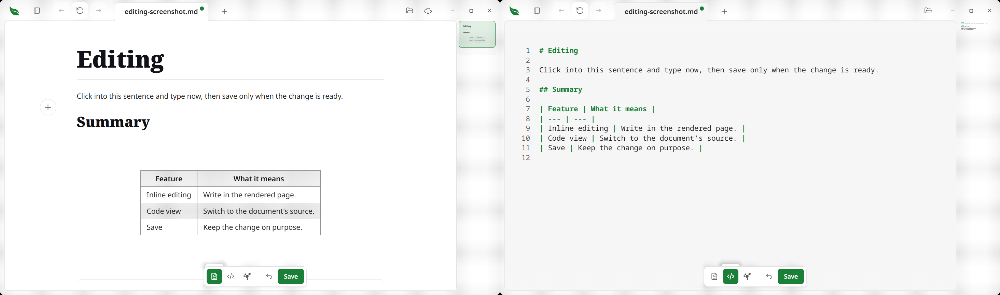

- **Type in the page**, with bold, links and tables kept as they are.
- **Rearrange blocks** by dragging them, and add new ones from the margin.
- **Format** highlighted words from a small bar over them.
- **Draw flowcharts** and sequence diagrams instead of typing them.
- **Edit the source** in a code view with colors and typing help.

## Summary

| You want to | Where |
| --- | --- |
| Type in the page | [Inline editing](#inline-editing-the-reading-view) |
| Move or add a block | [The block gutter](#the-block-gutter), [Adding a block](#adding-a-block) |
| Format words | [The format bar](#the-format-bar) |
| Leave a note on a passage | [Comments](#comments) |
| Draw a diagram | [The flowchart editor](#the-flowchart-editor) |
| See the raw text | [Code view](#code-view) |
| Save | [Save](#save) |

[Every detail of editing →](../09-details/editing.md)

## New document

Press **New** at the top of the library pane, and a blank document opens ready to type. Its first save asks where to put it.

[Details →](../09-details/editing.md#new-document)

## Writing in the page

### Inline editing (the reading view)

Open the [padlock](#the-padlock), then click into any sentence and type. Paragraphs, headings, lists, tables and quotes edit in place with their styling intact. `Enter` splits a block, and a checkbox ticks with a click.

A block the page cannot write back exactly, such as a code block, opens its own source in place instead.

[Details →](../09-details/editing.md#inline-editing-the-reading-view)

### Renaming from the heading

When a document has no title of its own, its heading is the file name. Press it to rename the file.

[Details →](../09-details/editing.md#renaming-from-the-heading)

### Editing an email

A saved email edits where you read it: the subject, every header and the body's lines.

[Details →](../09-details/editing.md#editing-an-email)

### Editing an HTML file

With the padlock open, type straight onto the words of a web page. The tags and styles stay as the file wrote them.

[Details →](../09-details/editing.md#editing-an-html-file)

### The fields at the top of a note

A note's fields, such as its status, date and tags, edit in a card above the title. A date opens a picker, and a tag is a chip you can add or remove.

[Details →](../09-details/editing.md#the-fields-at-the-top-of-a-note)

### Deleting

Delete across several blocks at once, and the halves that are left join together. `Ctrl+A` (`Cmd+A` on a Mac) selects the block, then its section, then the whole page.

[Details →](../09-details/editing.md#deleting)

### The block gutter

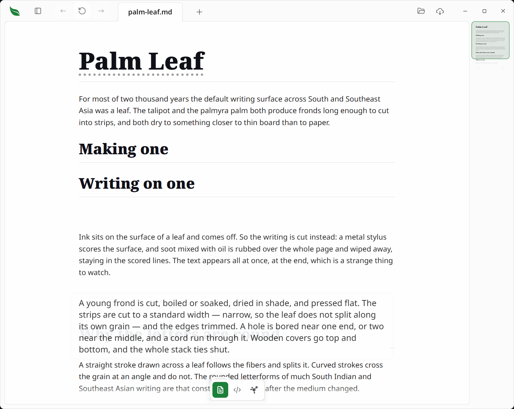

Point at a block, and a handle appears in the margin beside it. Drag the handle to move the block.

[Details →](../09-details/editing.md#the-block-gutter)

### Adding a block

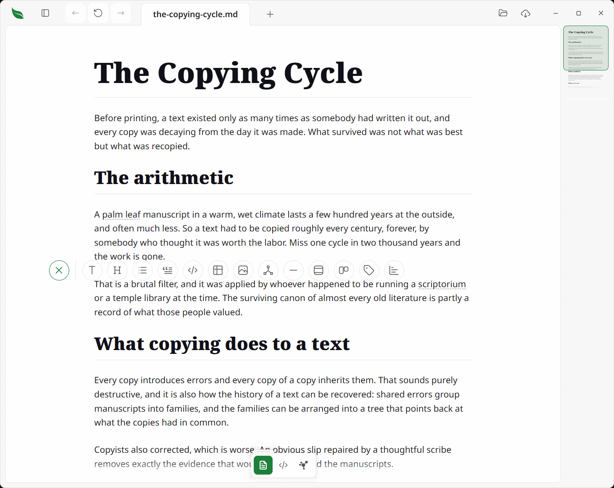

The **+** on an empty line opens a row of blocks to add: text, a heading, a list, a table, a picture, a flowchart and more.

[Details →](../09-details/editing.md#adding-a-block)

#### Images

Paste a screen clip, or pick a picture file, and it lands on the line below. A pasted picture is saved in an `imgs` folder beside the note.

[Details →](../09-details/editing.md#images)

#### Badges

A badge is a small colored label in a sentence. Pick its color, then type its words.

[Details →](../09-details/editing.md#badges)

#### Bars

A bar draws a number as a filled line, with its label beside it.

[Details →](../09-details/editing.md#bars)

### Editing a table

Type in any cell, and only that cell changes. Drag a row or column by its grip, and right-click a cell to add, delete, align or sort.

[Details →](../09-details/editing.md#editing-a-table)

### A table that adds itself up

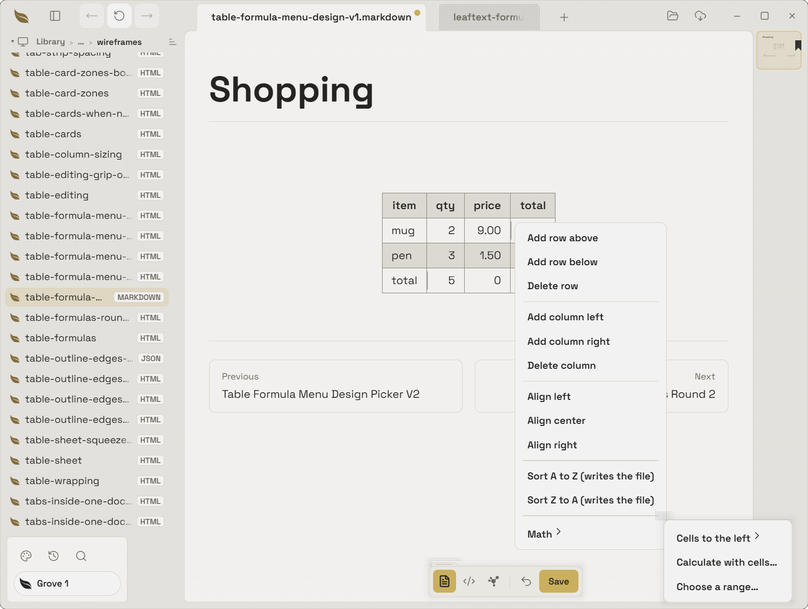

Right-click a cell to make it a total or a calculation. Leaftext keeps the answer right as the numbers above it change, and the table stays plain Markdown.

[Details →](../09-details/editing.md#a-table-that-adds-itself-up)

### The format bar

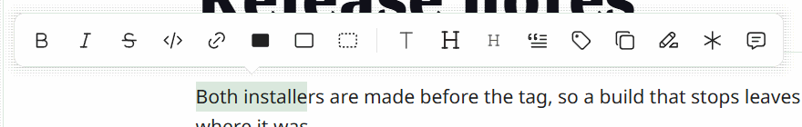

Highlight words, and a bar rises over them. It makes them bold, italic, code or a link, and turns a line into a heading or quote. Copy, highlight, annotate and comment work even on a locked page.

[Details →](../09-details/editing.md#the-format-bar)

### Comments

Comment on highlighted words to start a thread. Reply, and resolve it when it is done. Threads are kept inside the note, so it stays a plain file.

[Details →](../09-details/editing.md#comments)

### The padlock

Documents open locked, so a stray click never changes a file. The padlock on the floating toolbar opens the page for typing. The code view has its own padlock.

[Details →](../09-details/editing.md#the-padlock)

### Undo

`Ctrl+Z` takes back a word of typing, then the last edit. `Ctrl+Y` or `Ctrl+Shift+Z` brings it back.

[Details →](../09-details/editing.md#undo)

## The flowchart editor

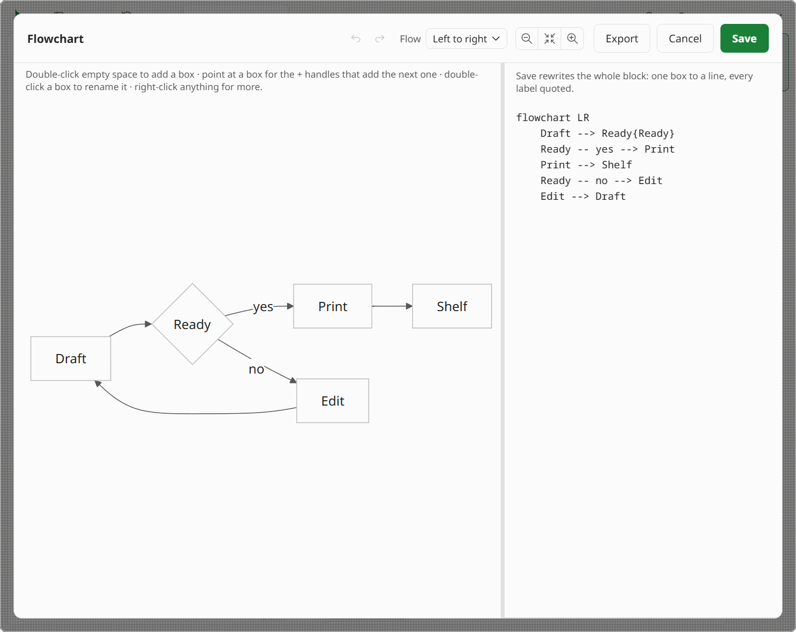

Open a flowchart on a canvas beside its Mermaid text, and both stay in step as you work.

[Details →](../09-details/editing.md#the-flowchart-editor)

### Drawing

Drag from a box's **+** to add the next step. Click a box to rename it or change its shape.

[Details →](../09-details/editing.md#drawing)

### Which way it runs

A chart runs one way, set by the first box's handle you drag.

[Details →](../09-details/editing.md#which-way-it-runs)

### Where the boxes go

Mermaid places the boxes. Dragging a box changes its order rather than its exact position.

[Details →](../09-details/editing.md#where-the-boxes-go)

### Export

Save the diagram on its own as Markdown, PNG, WebP, PDF or JPEG.

[Details →](../09-details/editing.md#export)

### What it can draw

Flowcharts, state diagrams, mind maps, timelines, boards and more open on the canvas. Charts such as pies and Gantt charts edit as rows beside a live picture.

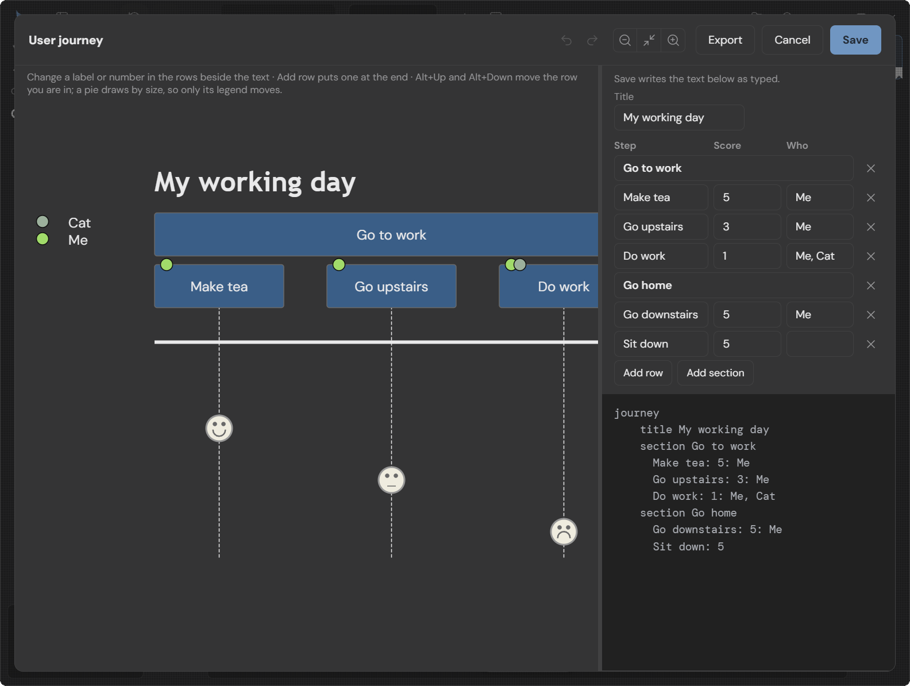

[Details →](../09-details/editing.md#what-it-can-draw)

### What it refuses

A diagram Mermaid cannot draw says why under the canvas.

[Details →](../09-details/editing.md#what-it-refuses)

## The sequence diagram editor

Press participants and messages to build a sequence diagram, with its text kept beside it.

[Details →](../09-details/editing.md#the-sequence-diagram-editor)

## Working in the source

### Source beside the page

Open the source beside the page, and both stay in step as you type.

[Details →](../09-details/editing.md#source-beside-the-page)

### Code view

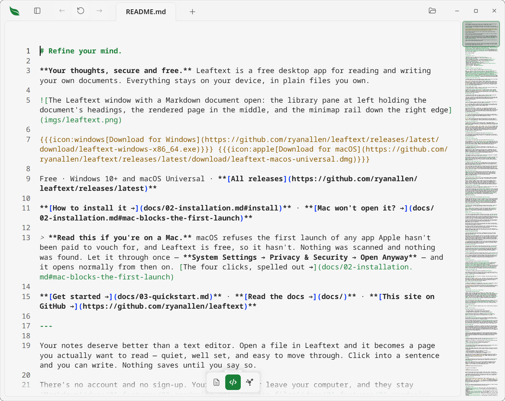

The code view shows a file's raw source, with line numbers and the theme's colors. Switch to it from the floating toolbar.

[Details →](../09-details/editing.md#code-view)

### Editing the source

Open the code view's own padlock, then type. Your place is kept when you switch views.

[Details →](../09-details/editing.md#editing-the-source)

### Pinned headings

In a Markdown file, the heading you are under stays pinned at the top as you scroll.

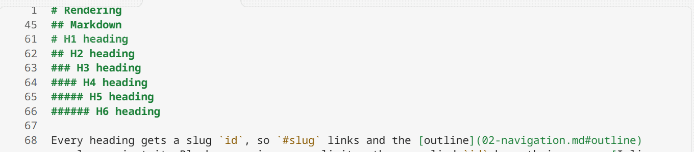

[Details →](../09-details/editing.md#pinned-headings)

### Typing help

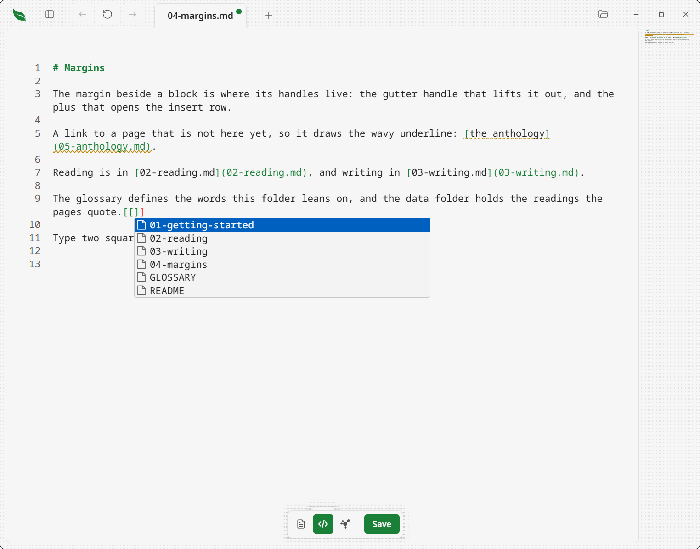

Type `[[` to pick a note name, or `#` for a heading. A broken link gets a wavy underline.

[Details →](../09-details/editing.md#typing-help)

### YAML schemas

A YAML file named in your project's schema settings offers its field names as you type.

[Details →](../09-details/editing.md#yaml-schemas)

## Saving

### Save

The green **Save** button appears with your first change. Press it, or `Ctrl+S` (`Cmd+S` on a Mac), to write the file.

[Details →](../09-details/editing.md#save)

### When the app cannot write it

If the disk refuses the write, a message says why, and your edits stay.

[Details →](../09-details/editing.md#when-the-app-cannot-write-it)

### External changes

When another app changes the file, Leaftext reloads it, unless you have unsaved edits.

[Details →](../09-details/editing.md#external-changes)

## Formats

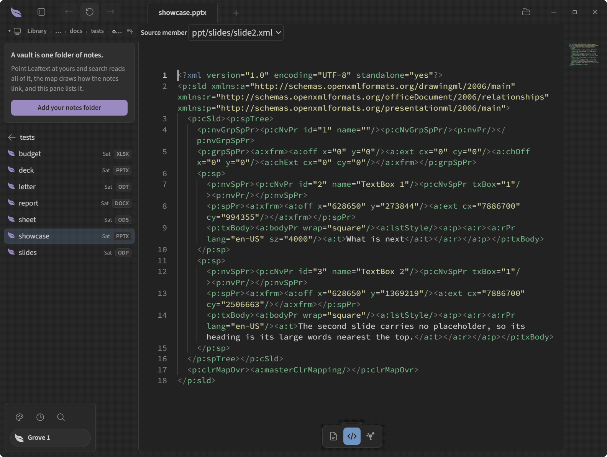

The code view edits every format Leaftext opens. What you can type in the page depends on the format, because a block is editable in place only when Leaftext knows its exact bytes.

[Format by format →](../09-details/editing.md#formats)

### Editing data files

In JSON, YAML, INI and CSV files you edit values as source, never as drawn text. Where a value's place in the file cannot be proven, it stays read-only and says why.

[Details →](../09-details/editing.md#editing-data-files)

## Next

- [Rendering](01-rendering.md)
- [Navigation](02-navigation.md)
- [Minimap](04-minimap.md#the-code-views-minimap)
