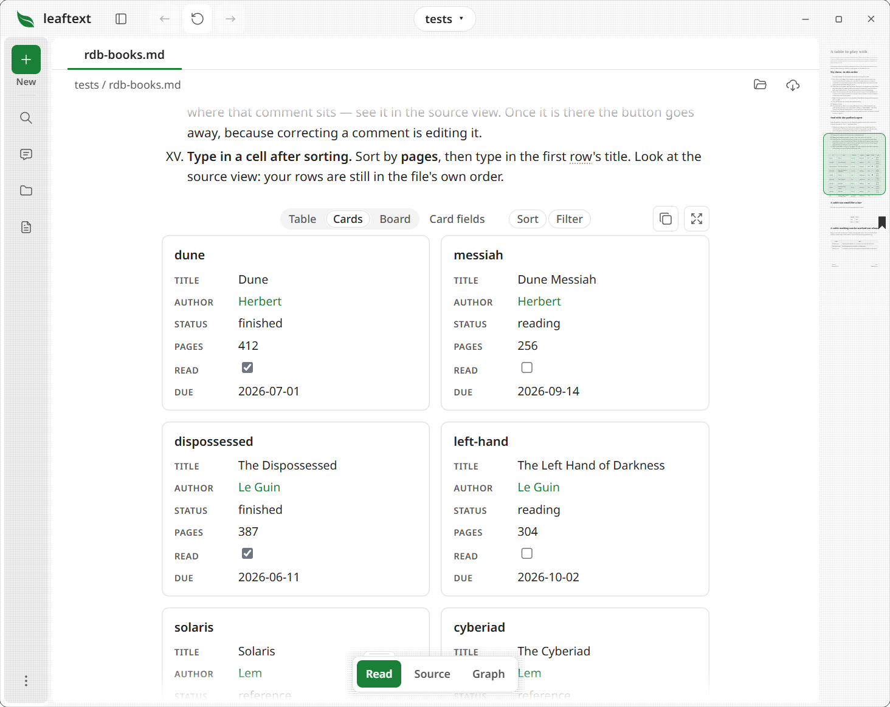

# Relational tables

> Turn an ordinary Markdown table into cards or linked records

Put each row's name in the first column, and Leaftext can show the table as records. Lay it out as cards, sort and filter it, and link rows across notes. The table stays plain Markdown, so it opens everywhere it did before.

- **Cards** from the same table.
- **Sort and filter** by any column.
- **Relations** that link a row to a row in another note.
- **Nothing extra** on disk: your table is the record.

See [every detail of relational tables →](../09-details/relational-tables.md)

## Open a relational table

Point at a table with a header row and at least two rows. A quiet bar appears above it with Table, Cards, Sort, Filter and Describe.

See [the details →](../09-details/relational-tables.md#open-a-relational-table)

## Views, sort and filter

Show the records as cards. Sort and filter without changing the file.

See [the details →](../09-details/relational-tables.md#views-sort-and-filter)

## Relations

Link a cell to a row in another note, written `[name](other.md#name)`, and it becomes a relation. Point at it to see the row; press it to open it.

See [the details →](../09-details/relational-tables.md#relations)

## Show a row in another note

A link to a row, alone on its own line, draws that row's words in place.

See [the details →](../09-details/relational-tables.md#show-a-row-in-another-note)

## Describe a table

If Leaftext guesses a column wrong, **Describe** corrects it with a comment above the table that other apps never show.

See [the details →](../09-details/relational-tables.md#describe-a-table)

## Editing a relational table

Type in any cell, as in any table. The view you chose comes back after each edit.

See [the details →](../09-details/relational-tables.md#editing-a-relational-table)

### Point at a row without typing its address

In a relation column, start typing a row's name and pick it from a list.

See [the details →](../09-details/relational-tables.md#point-at-a-row-without-typing-its-address)

## On a published site and in an embed

The same bar, views and relations work on a published Leaftext site and in an embedded document.

See [the details →](../09-details/relational-tables.md#on-a-published-site-and-in-an-embed)

## Next

- [Editing](07-editing.md)
- [Rendering → Tables](01-rendering.md#tables)
