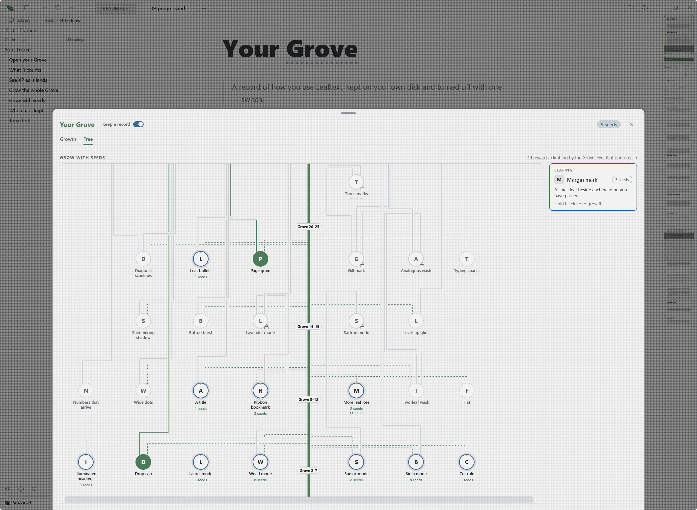

# Your Grove

> A record of how you use Leaftext, kept on your own computer and turned off with one switch

Leaftext keeps a quiet record of what you do and shows it as your Grove. Reading, writing, searching and the rest each grow their own area, and everything fills one Grove level. Each level brings seeds to spend on new themes and touches for the page.

![The Grove sheet risen over a document: Your Grove with six seeds and the Keep a record switch on in its header, the Growth and Tree tabs under it drawn as the tabs over a document, Growth framed and open into the sheet and Tree a darker grain cell, Grove 2 with the line saying everything you do in Leaftext fills this one bar, and in place of the thin bar a wide green press reading Hold to grow to Grove 3 over the line saying the bar is full and that Grove 3 brings six seeds, then a year of days with the last few weeks shaded, the Growth areas in two columns one even gap apart, each at its own level with its own bar, and a column beside them holding Earned lately with a See all XP button on its heading and a Today block counting the words read today](../../imgs/grove-sheet-5-v2.png)

- **Thirteen Growth areas**, each leveled by its own kind of use.
- **One Grove level** that everything you do fills.
- **Seeds** to grow rewards on the Grove's tree.
- **Nothing leaves your computer**, and one switch turns it all off.

[Every detail of the Grove →](../09-details/progress.md)

## Open your Grove

The Grove is a row of [More](02-navigation.md#more), at the foot of the icon rail. Press it, and a sheet rises with your level, a year of days and every Growth area.

[Details →](../09-details/progress.md#open-your-grove)

## What it counts

Each area lists exactly what pays it and how much, such as every 500 words read. A window left open with nobody there earns nothing.

[Details →](../09-details/progress.md#what-it-counts)

## See XP as it lands

When something pays, the Grove row says so for a moment, such as **+1 Leafing**. The sheet keeps a list of everything you have earned.

[Details →](../09-details/progress.md#see-xp-as-it-lands)

## Grow the whole Grove

When the Grove's bar fills, press and hold to grow to the next level and take its seeds.

[Details →](../09-details/progress.md#grow-the-whole-grove)

## Grow with seeds

The Tree tab lays out the rewards your seeds can grow: more themes, a drop cap, leaf bullets and other touches for the page. A reward asks for a Grove level, its earlier rewards, and its seeds.

[Details →](../09-details/progress.md#grow-with-seeds)

## Where it is kept

Your Grove is kept in `profile.json` beside your settings. It holds counts only, never a file name or a word of a document.

[Details →](../09-details/progress.md#where-it-is-kept)

## Turn it off

Press **Keep a record** in the Grove sheet's header to turn the record off. Nothing is counted while it is off, and the published site keeps no record at all.

[Details →](../09-details/progress.md#turn-it-off)

## Next

- [Themes](06-themes.md)
- [Settings](05-settings.md)
