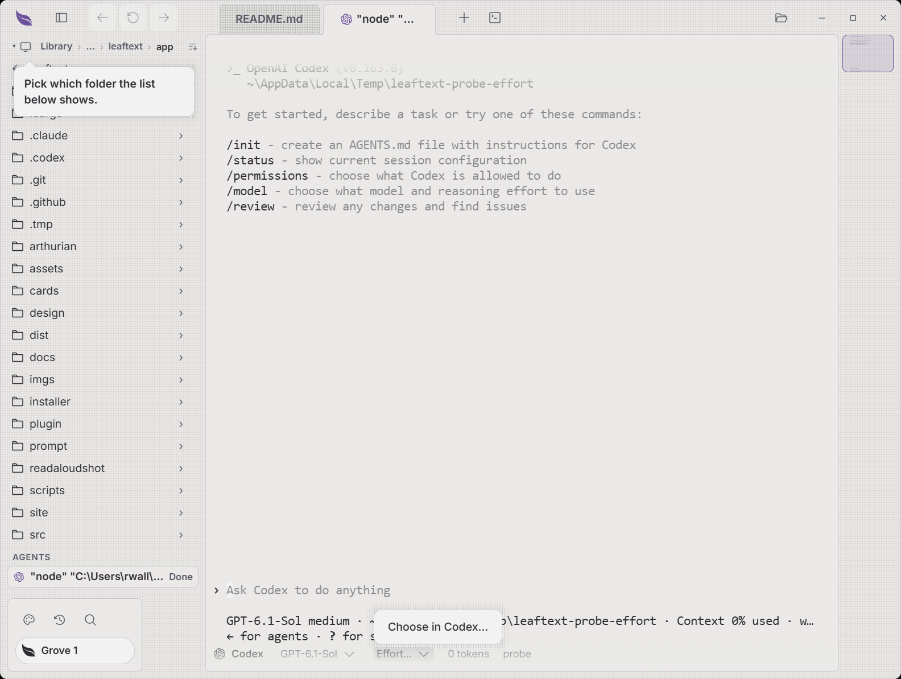

# Your own AI agent in Leaftext

> Connect an agent on your computer to the document open in Leaftext.


Leaftext's installed app can answer an agent through MCP. Keep Leaftext open, add the app as a tool server in your agent's settings, and the agent can read the document, edit and save it, tick tasks, search the active vault, inspect links, export the page, and use the other tools the app offers.

## Run the agent in a console

Open a [console in the library](03-library.md#console) and type the installed agent's ordinary command. The agent uses its own model address, model choice and credentials, just as it does when you start it in another terminal. Set those in the agent's own configuration; Leaftext has no model address or key field and does not make the model request.

The agent also keeps everything else it loads in an ordinary terminal: the project's rules, its skills, its hooks and its plugins. Leaftext starts your own shell in the library's folder with your own environment, and the agent reads its configuration by its own rules, so each skill is there and each hook runs once, exactly as it would elsewhere. The [Leaftext plugin](#install-the-plugin) adds its document tools beside your other plugins without replacing any of them.

Remote tool servers, such as a company's own, are set up in the agent's own settings the way that agent's documentation describes, and work in a Leaftext console the same as anywhere. The `mcp.json` file in Leaftext's settings folder is not passed to an agent you run in a console.

With the plugin installed, Codex and Claude consoles use the conversation title the agent has saved, on both the tab and the **Agents** row. This works when the agent has turned its own terminal title off. The name appears once a hook can read it; until then, the console reads the first five words of the prompt without its skill, pasted-picture placeholder or path folders. The agent can explicitly name its console through `leaftext_name`, which takes priority over the automatic topic. Hover the tab or row to read the original prompt. Starting over with `/clear`, `/new` or `/reset`, switching conversations, or leaving the agent clears the previous name. Other agents keep their native terminal titles and prompt fallback.

### The agent's status under its console

Leaftext shows the agent's logo, then **Model**, **Effort** and **Context**, under a console as soon as it recognizes Claude Code, Codex or Antigravity. These controls work without the plugin, and all three are grayed out while the agent is working. With the plugin installed, the same row also shows what the agent's own session reports: Codex's model, context and limits, or Claude Code's, Antigravity's and Gemini CLI's model and tokens used. A figure the session never reported is left out. Until a model, effort or context figure arrives, its button keeps the neutral label. A reported context capacity appears before usage arrives, without an empty usage meter. On a narrow console the folder goes first, then the cost, then the limits and finally the effort button.

Press **Model**, or the reported model, to change it. One press opens the agent's own model picker, where the agent lists the exact versions your account can use and marks the one in use. Codex updates the label as soon as its native picker confirms a selection. Other agents keep the last reported model until their next status report.

Press **Effort** beside the model to open the agent's reasoning choices in one press. Claude Code and Antigravity open their effort pickers; Codex opens its model picker, where confirming the current model reaches its reasoning levels. The agent shows which levels your current model supports and which is selected, and handles saving or canceling the choice. The button shows the reported level, such as **Medium**, once the native session supplies it; until then it reads **Effort**. If the button has yielded on a narrow console, the model's full picker also offers effort choices.



Press **Context**, or the reported context figure, for **Compact the conversation** or **Start a new conversation**. The new conversation keeps the old one on disk for the agent's own resume. These actions work even before the agent reports its context usage.

These controls wait for the agent to finish and for its prompt to be empty. Send or clear an unfinished message before choosing a model, effort or conversation command. Leaftext types the command, waits to see it in the prompt, then presses Enter separately. Typing, switching consoles or closing one cancels that Enter. If the command has not appeared within two seconds, Leaftext leaves it for you to submit. It never clears your message. Consoles and their input belong to the installed app; the browser cannot send these commands.

Starting `codex` in a Leaftext console reports its selected model, effort, folder and available account limits before the first prompt. Native model and effort changes appear immediately. A fresh conversation starts with zero context; a resumed conversation shows saved usage when available, then follows native updates. The plugin hooks remain a fallback. Missing quota windows and dollar cost stay absent. An explicit native executable path bypasses the console helper.

Starting `claude` in a Leaftext console automatically relays its native selected model, effort, context capacity, limits and cost to the row. Your own custom status line keeps its input and output, and your settings stay unchanged. The relay applies only to that launch. An explicit path to the native executable bypasses the console helper, and managed policy can prevent the callback; the row shows only reports it actually receives.

To watch a note change while the agent works on it, put the console beside the note: drag its tab onto the right half of the page, choose **Open beside** on the tab, or press `Ctrl+\` (`Cmd+\` on a Mac). See [two documents side by side](02-navigation.md#two-documents-side-by-side).

The mouse wheel scrolls the agent's conversation the way it does in the agent's own terminal: a program that asks for the mouse is sent the wheel itself, one step a notch, so the prompt box keeps what you were typing.

Once it is [connected](#connect-on-windows), the agent is told it is running inside Leaftext, and `leaftext_open` lets it open a web address in a new [web tab](02-navigation.md#web-tabs) beside your documents rather than in an outside browser; `leaftext_eval` and `leaftext_gesture` then work that page. `leaftext_close` closes a tab the way its own close button does, a web page included, so an agent can put away a page it opened.

### Ask an agent about a passage

Highlight words in a note and press **Ask agent** on the bar that appears over them. It lists every console with an agent running in it, named the way its tab is; press one and the agent is handed the words as its next prompt, quoted, under the note's path and the line they came from, so it can open the place rather than search for it. Highlighting alone sends nothing, and the passage is the one you highlighted when you pressed **Ask agent**, however the selection moves afterwards. The button is there only while a console holds an agent, and Leaftext never types into a console at a bare prompt or one running a command that reads no typing.

### Define a word in a book

Highlight a word in a book and press **Define** on the bar that appears over it. The word, the sentence you met it in and the words the book's glossary already holds go to a coding agent running in a console in the same window, which writes an entry for it in the sense this book uses it, and for the related words it finds in the book, into the `GLOSSARY.md` beside the book through `leaftext_glossary`. The glossary sheet opens on the new entry with the related words named at its foot, and the word is underlined through every chapter. A word the glossary already has opens its entry and asks nobody; a glossary with unsaved edits in a tab, or no agent in a console, is said in one line on the bar and nothing is written.

### Agents in different consoles talk to each other

With agents running in several consoles, one agent can hand a finding, a request or a question straight to another over a channel of their own. `leaftext_consoles` lists every console and which ones have an agent in them; `leaftext_send` hands another agent a message, `leaftext_ask` waits for its answer, `leaftext_reply` answers, and `leaftext_pending` lists the asks waiting. Nothing is ever typed into a console, because that console is where you type: an idle Claude Code takes the message as a turn of its own through Leaftext's plugin, Codex started in a Leaftext console takes it as a turn on its own app-server, and any agent busy with a task takes it on its next step.

An agent on another machine joins the same channel when you reach that machine with `ssh` typed in a Leaftext console. Leaftext hands the connection a tunnel back to this channel and a key for that console, so the agent you start there — with Leaftext's plugin installed on that machine, as below — asks, sends and answers the agents here as the agent in that console. No port is opened to the network: the tunnel travels inside your own SSH connection, and it is made only for a login, never for `ssh` running a single command. Leaftext keeps a record of who joined and which console sent what, never what a message said.

### An agent starts another and waits on it

An agent can hand part of its job to a second agent and pick up the answer itself. `leaftext_start_agent` opens a console beside the asker's, in the same folder and window, types the command line it was given — `codex` or `claude` — and answers once that agent has come up and can take a message. The asker hands it the job with `leaftext_send`, and `leaftext_wait` holds until the agent is done or needs somebody, then answers its state and the last lines it wrote. A wait answers after 50 seconds unless it asks for longer, saying the agent is still going, and the asker calls it again. The started agent's console is a tab like any other, so you can watch it work and step in.

The helper reaches the agent that started it with `leaftext_contact_supervisor`: a decision it cannot go on without, a set of structured questions whose answer comes back in a fixed shape, or a progress note that changes the plan. Started with a role — worker, scout or adversary — a helper joins the starting agent's team: it sees and messages only that agent and its other helpers with a role, and `leaftext_team` lists them. Started with `visibility` set to `local`, it can reach every console.

### An agent drives your other windows

An agent in a console can see and operate another window on your computer — the browser you are already signed in to, or any other program — so it can read a page that needs your account and click and type in it for you. `leaftext_look` with nothing named lists the visible windows; with one named it answers a picture of that window. `leaftext_point` moves, clicks, drags or scrolls at a place in that picture, and `leaftext_type` types text and presses keys such as Enter or Ctrl+A (Cmd+A on a Mac).

The first time an agent looks at a window, Leaftext asks you in a box of the system's own whether that console's agent may see and operate it, and nothing is seen until you press Yes. The agent cannot answer that box: it is outside the page, and Leaftext's own windows can never be looked at or pressed in. While the session lasts, a notice at the top of the window holding that console says which window the agent is driving, and its Stop ends the session. The session also ends when you close that console or the window it drives, and asking about another window starts a new question. Nothing is remembered, so the next agent asks again. If you click into another window while the agent is working, it stops rather than taking the window back, and asks for a fresh look. On a Mac, macOS asks once whether Leaftext may record the screen, which is how it sees another window, and once whether it may use Accessibility, which is how it clicks and types; allow both in System Settings → Privacy & Security, then start the agent again. Looking at a window on a Mac needs macOS 14 or later.

### A watcher starts an agent when something new appears

A watcher is a note in a folder named `watchers` at the top of a vault. Its front matter names the address to read, how often, and the command line that starts your agent; everything under the front matter is the job:

```markdown
---
check: https://example.com/issues.json
every: 15m
start: claude
---
Read each new issue and write a plan for it in plans/.
```

`every` is minutes or hours, from `1m` to `24h`. `check` is an `https://` address. When it answers with a JSON list — or an object holding one — each entry is an item, named by its `key`, `id`, `guid`, `url` or `link`; any other answer is one item, the whole page, so a change anywhere on it is new.

**Nothing in a watcher runs until you trust it.** In a console, type `leaftext --watcher trust watchers/issues.md`: it prints the address, the interval and the command line and asks you to type `yes`. Change the note and it asks again. With Leaftext open, the first trust of each note earns a point of Tending in [your progress](09-progress.md).

While Leaftext is open, it reads each trusted note's address when it is due. The first answer only records what is there. When a later one holds something new, Leaftext opens a console in the vault beside the page you are reading — without taking your place — types the note's command line, waits until the agent is at its prompt, and types the job with the new items, at most ten, as one message. The items are marked as data read from the address, never as instructions. The agent then works as it would if you had typed it, with its own approvals, and appears on the agents list. A new item starts one console; nothing new starts nothing. If the console closes, or no agent is ready in it within two minutes, Leaftext says so once and starts nothing more for that note until it changes or Leaftext starts again. A note whose address cannot be read is said once, until it can be.

### An agent going round in circles is told

When an agent in a console calls the same Leaftext document tool on the same file and it fails the same way three times in a row, Leaftext types one message into that agent's own console, headed `From Leaftext`, naming the tool, the file and the kind of failure, and asking it to try something else. It says so once per run of failures; a success, another file, another tool or another kind of failure starts the count again. `leaftext_attempts` lists the agent's last sixteen document calls as Leaftext saw them — the tool, the file, whether it worked and the kind of failure — and keeps none of the document, the answer or the refusal's words. Leaftext sees only its own document tools: the agent's shell commands, its other tools, its model calls and its approval prompts are its own, so a failure there is never counted, and a call you turned down never reaches Leaftext at all. The count lives in the agent's own Leaftext connection, so it is separate for every agent and gone when the agent or its console closes.

## Hold an agent to your checks

Put a `HARNESS.md` in a project folder and an agent working there with the [plugin](#install-the-plugin) installed is held to the checks it names. Every time the agent tries to end a turn that changed a file — through a file tool or through a shell command — Leaftext runs each check; if one fails, the agent is sent back to work with what failed, and the turn ends only when every check passes. Claude Code, Codex and Gemini CLI all work this way, through the hooks the plugin brings. A folder with no `HARNESS.md`, or none in a folder above it, is left alone, and a turn that only talks, or whose shell commands changed nothing, is never held unless the turn before it was sent back.

The checks are one table. Anything written around it is ignored:

```markdown
| Check | Command | Seconds | Skill | Shares |
| --- | --- | --- | --- | --- |
| Tests | cargo test | 600 | sync-tests | target |
| Lint | cargo clippy | 300 | | target |
| Page script | just check-shell | 120 | shell-fragment | |
```

A check passes when its command ends without an error, inside its seconds. The checks run side by side, so a turn waits for the slowest rather than for all of them added up; rows naming the same word under `Shares` — two commands building into one folder, say — run one after another instead, and each such word's checks may take an hour at most together. A pipe inside a command is written `\|`. When a check that names a skill fails, the agent is told to read that skill before its next change. Every document the agent wrote that Leaftext reads — a note, a page, a data file — also goes through the same check `leaftext_check` runs, while Leaftext is open.

**Nothing in a `HARNESS.md` runs until you trust it.** In a console in that folder, type `leaftext --harness trust`: it prints every command the file names and asks you to type `yes`. Change the file and it asks again, and a file trusted by an earlier version of Leaftext is asked about once more. An agent cannot do this for you, because the question is answered only at a console a person is typing in. `leaftext --harness check` runs the checks by hand and prints each result and the score.

**Every attempt is kept in a run note**, one per agent session, in Leaftext's own data folder rather than in your project. It lists each job, each attempt, what every check printed last, the score and which attempt was best. The message that sends the agent back ends with the note's address; hold `Ctrl` (`Cmd` on a Mac) and click it in the console to open it as a tab.

**Leaftext also steps in when the agent goes round in circles:**

- When the same check fails the same way three attempts running, the agent is told to stop repeating that change, re-read the skill, and plan a different one.
- When three attempts in a row score below the best one so far, the agent is told which attempt was best, its score and the files it changed, so it starts again from there.
- When a turn after a send-back writes no file and every check fails just as it did before, the job ends there and the console tells you the agent is not changing what fails, so you can say whether your request or the `HARNESS.md` stands.
- After eight attempts on one job, the turn ends however it scored, and the console says the job stopped short, the best score and where the note is.

Leaftext never commits, never puts files back and never changes how the agent itself works; what happens to the work is still yours.

For a company gateway, follow the agent's own instructions: [Claude Code's gateway setup](https://code.claude.com/docs/en/llm-gateway) or [Codex's model provider configuration](https://developers.openai.com/codex/config-reference). The gateway must support the request format and authentication that the chosen agent sends. Connecting Leaftext as a tool server is a separate step below.

## Install the plugin

The Leaftext plugin connects your agent to Leaftext and teaches it to read, edit, check, tick and save the document open in the window, and to write the alerts, diagrams, math and tables Leaftext draws. It adds one skill and the `leaftext --mcp` tool server, and changes nothing else about your agent. Install it once for each agent you use, then restart that agent:

For routine project documentation, the agent edits files without opening them in your window. Ask it to work on an open document to use Leaftext's document tools.

| Agent | Install |
| --- | --- |
| Claude Code | `claude plugin marketplace add ryanallen/leaftext-plugin`, then `claude plugin install leaftext@leaftext` |
| Codex | `codex plugin marketplace add ryanallen/leaftext-plugin`, then install Leaftext from `/plugins` |
| Cursor | Install Leaftext from the Cursor marketplace |
| Antigravity | `git clone https://github.com/ryanallen/leaftext-plugin ~/.gemini/config/plugins/leaftext`, then `agy mcp add leaftext -- leaftext --mcp` |
| Gemini CLI | `gemini extensions install https://github.com/ryanallen/leaftext-plugin` |

On Windows the installer already puts the word `leaftext` on your command path. On a Mac, run this once in a terminal so your agent can find Leaftext:

```
sudo mkdir -p /usr/local/bin && sudo ln -sf /Applications/leaftext.app/Contents/MacOS/leaftext /usr/local/bin/leaftext
```

For an existing Antigravity clone, update it with `git -C ~/.gemini/config/plugins/leaftext pull`, then run `agy mcp add leaftext -- leaftext --mcp`.

Installing the plugin and connecting its tools are two separate steps: the skill can be listed while the document tools are not yet there. After installing, or after any change to the agent's tool servers, restart the agent and check that a document tool such as `leaftext_doc` appears in its list of tools. If the skill is there and the tools are not, the agent's own server list says why: `claude mcp list` in Claude Code, `codex mcp list` in Codex, `agy mcp list` in Antigravity.

For an agent the plugin does not cover, connect it by hand as below.

## Connect on Windows

Run these once in a Leaftext console, and every Claude Code or Codex session you start afterwards, in any folder, has Leaftext's tools and is told it is running inside Leaftext:

```
claude mcp add --scope user leaftext -- "%LOCALAPPDATA%\Programs\leaftext\bin\leaftext.exe" --mcp
codex mcp add leaftext -- "%LOCALAPPDATA%\Programs\leaftext\bin\leaftext.exe" --mcp
```

For another agent, replace `YOUR_NAME` with your Windows account folder name and add this server to its MCP settings:

```json
{
  "mcpServers": {
    "leaftext": {
      "command": "C:\\Users\\YOUR_NAME\\AppData\\Local\\Programs\\leaftext\\bin\\leaftext.exe",
      "args": ["--mcp"]
    }
  }
}
```

## Connect on a Mac

Run these once in a Leaftext console, and every Claude Code or Codex session you start afterwards, in any folder, has Leaftext's tools:

```
claude mcp add --scope user leaftext -- /Applications/leaftext.app/Contents/MacOS/leaftext --mcp
codex mcp add leaftext -- /Applications/leaftext.app/Contents/MacOS/leaftext --mcp
```

For another agent, add this server to its MCP settings:

```json
{
  "mcpServers": {
    "leaftext": {
      "command": "/Applications/leaftext.app/Contents/MacOS/leaftext",
      "args": ["--mcp"]
    }
  }
}
```

Your agent's settings decide which calls need your approval. Leaftext offers every tool to the agent and shows no approval box of its own. The `leaftext_eval` tool runs any JavaScript inside Leaftext's page, so give an agent access to it only when you trust that agent with the open document and app.

## Work on a document

Ask the agent to use `leaftext_doc` to read a file in Leaftext. It opens that file in the window and answers its text, task list, and fingerprint. To edit, the agent sends that fingerprint with `leaftext_edit`, waits for the page with `leaftext_idle`, then uses `leaftext_save` to write the file. To tick a checkbox, it uses `leaftext_toggle_task` with the task's place in the list; that action writes the file immediately. Before it says it is done, it can use `leaftext_check` to ask what is wrong with the document: a diagram that will not draw, a relation naming a row that is not there, a data file that will not read, a link to a file that is not there, and a wiki link to a note that does not exist. It changes nothing, and it answers the same fingerprint `leaftext_doc` gives, so a fix can be written against the same reading.

To look at a document's diagrams, the agent uses `leaftext_diagrams` for the list — each diagram's place, line and kind — and `leaftext_diagram` on one of them to learn whether it draws and, given a path, to have it written there as a PNG it can open and look at.

An agent with no tools set up at all, in any folder, can run `leaftext --diagrams notes.md` at its prompt instead: it [checks every diagram in the file](01-rendering.md#checking-a-files-diagrams) in a window nobody sees, prints a line per diagram, and writes each drawing as a picture, with no Leaftext window needed and yours left as it was.

The same agent, or you, can write a diagram into a Markdown file from the prompt and have it kept only if Leaftext draws it. Pipe the diagram in without its fence and name one place for it:

```text
type flow.mmd | leaftext --chart notes.md --append
type flow.mmd | leaftext --chart notes.md --at 12
type flow.mmd | leaftext --chart notes.md --replace 40
```

`--append` puts it at the end of the file. `--at` puts it before the line you name, which has to be a blank line, the first line of a block, or one past the last line, so no paragraph, table, list or quote is split in two; any other line is refused with the line that would do. `--replace` swaps the diagram whose fence opens on the line you name. A diagram that draws is saved and its line printed, `notes.md:12  flowchart  kept`. One that does not is refused with the renderer's own words and the file is left as it was. A call missing its place or its diagram exits with 2, a refused diagram with 1, so a script can tell the two apart.

The tools reach the Leaftext copy running under your account. If it is closed, the agent gets a clear answer that Leaftext is not running.
