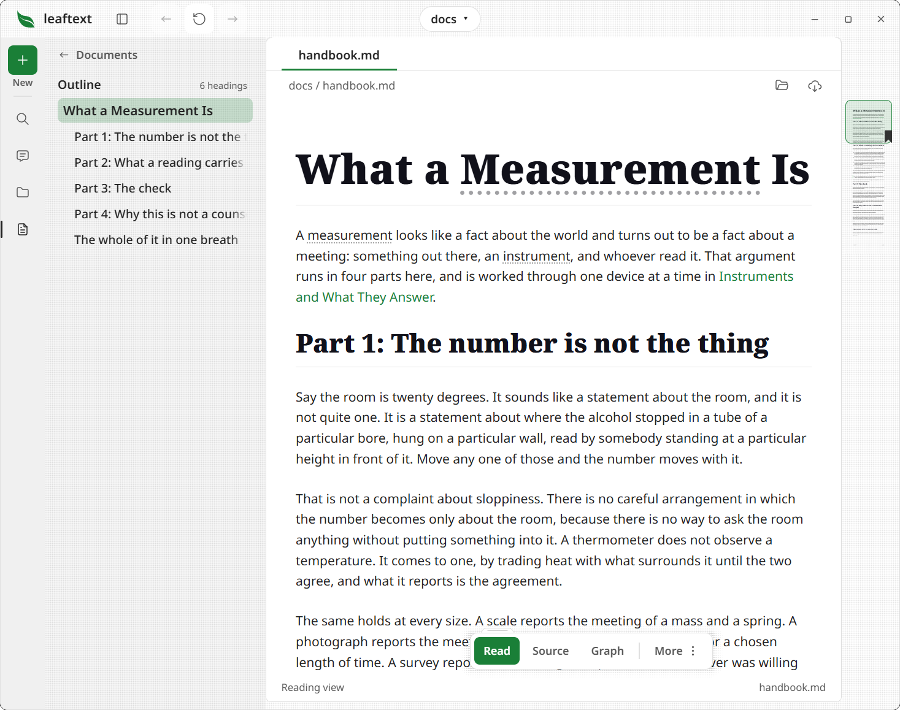
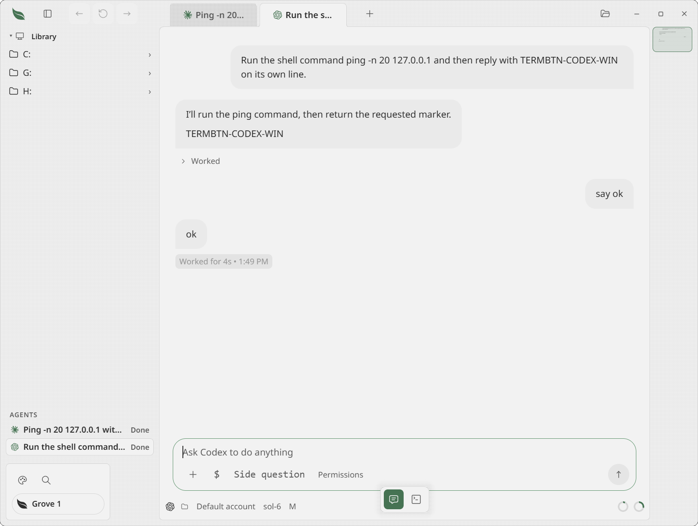

# Your own AI agent in Leaftext

> Connect an agent on your computer to the document open in Leaftext.



Leaftext's installed app can answer an agent through MCP. Keep Leaftext open, add the app as a tool server in your agent's settings, and the agent can read the document, edit and save it, tick tasks, search the active vault, inspect links, export the page, and use the other tools the app offers.

## Run the agent in a console

Open a [console in the library](03-library.md#console) and type the installed agent's ordinary command. The agent uses its own model address, model choice and credentials, just as it does when you start it in another terminal. Set those in the agent's own configuration; Leaftext has no model address or key field and does not make the model request.

Or press **New** at the top of the library pane. Every account is its own row there: the agent's logo, then the name you gave the account, so two Claude accounts are two rows. Drag a row up or down to put the agents in the order you reach for them; the order is kept across restarts. One press starts that account; nothing changes for the next start. Leaftext lets your terminal run its own startup files first, then starts the installed agent straight onto a new console in the folder the menu names under **New page**: **Starts in** and the folder, the library's own when the **+** opens. Press that row to start somewhere else without moving the library: the menu shows the folder, the folder above it and each folder inside, a press steps in, **Start here** takes the folder shown, and **Choose another folder…** opens the system's folder window. Console, every agent row and **Compare agents** then start there; the console's row names the account it started under, a press on that name renames it, and **Prompts skipped** shows where you chose it. The settings button beside each row opens that account's own view in the same menu:

- **Rename** changes only the name you see. The agent's own setup — whatever your terminal already signs in with — is a row too, named after the agent until you rename it, and it is left out where an account already is that same folder.
- **Skip permission prompts** starts every account of that agent without asking before each action — for Codex, also without its sandbox. It is remembered for the next start and never changes a console already running.
- **Launch settings** belong to that one account: how it signs in, the terminal whose setup is read, an optional launch command of your own, and an optional **key command** — a command run before each start that prints the account's connection settings as JSON, such as a key and an HTTPS address. Only the settings that agent reads for its connection are taken from the answer, and the answer is never shown or saved.
- **Remove from list** leaves the folder, its sign-in and any console using it as they are.

**Add account** sits at the foot of the list. Pick the agent, name the account, and for Claude or Codex Leaftext makes a new, empty account folder and opens the agent's own sign-in in a new console; **Use existing account folder…** adds a folder you already sign in with, copying nothing out of it. Every Claude or Codex sign-in already in your home folder is listed for you under the email it signs in as, and one you remove stays off the list. Each account keeps its own sign-in and history, so two can run side by side. An Antigravity account is a profile: its own folder of history, settings, plugins and tool servers. On Windows Antigravity keeps one Google sign-in for the whole computer, so every profile shares it; on a Mac each profile signs in to Google on its own the first time it starts, and its view opens that profile's sign-in.

Drag a file, picture or folder from the library, Explorer or Finder onto the console to type its full path into the line you are writing. Pick several library rows to insert their paths together. The console lights while it can take the drop, quotes the paths and adds a space so you can keep typing. Dropping a path never sends the line or moves the file. This also works in a console's own window.

When the console shows a message box, the path goes into that box at the cursor and keeps the rest of your draft.

The agent also keeps everything else it loads in an ordinary terminal: the project's rules, its skills, its hooks and its plugins. Leaftext starts your own shell in the library's folder with your own environment, and the agent reads its configuration by its own rules, so each skill is there and each hook runs once, exactly as it would elsewhere. The [Leaftext plugin](#install-the-plugin) adds its document tools beside your other plugins without replacing any of them.

Remote tool servers, such as a company's own, are set up in the agent's own settings the way that agent's documentation describes, and work in a Leaftext console the same as anywhere. The `mcp.json` file in Leaftext's settings folder is not passed to an agent you run in a console.

With the plugin installed, Codex and Claude consoles use the conversation title the agent has saved, on its row in **All chats**. This works when the agent has turned its own terminal title off. The name appears once a hook can read it; until then, the console reads the first five words of the prompt without its skill, pasted-picture placeholder or path folders. The agent can explicitly name its console through `leaftext_name`, which takes priority over the automatic topic. Hover the tab or row to read the original prompt. Starting over with `/clear`, `/new` or `/reset`, switching conversations, or leaving the agent clears the previous name. Other agents keep their native terminal titles and prompt fallback.

While Codex or Antigravity reports **Working** on its row in **All chats**, the row keeps its working glow as you type in the terminal or send a message from the chat box. When the agent reports **Done** or **Needs you**, the tab follows that state, including after the tab strip is redrawn.

For Codex, **Needs you** also appears when Codex refuses the Leaftext plugin's hooks after the plugin changes. Open `/hooks` in Codex to review and trust those hooks; the next completed turn reads **Done** when they run without a refusal.

On Windows, trusting changed Codex hooks reconnects that console to the same conversation. The **Agents** row reads **Working** while it reconnects, and the next message waits in the box until Codex can take it. A failed reconnect reads **Needs you** and keeps those words in the box.

When an agent turns **Done** or **Needs you** while its window is behind another program, a system notice names it and says **Finished** or **Is asking for you** — a Windows notification, or on a Mac a banner with one bounce of the Dock icon and a badge counting the notices still standing. On a Mac the first one asks macOS whether Leaftext may show notifications. Pressing the notice brings that console's window forward with its tab in front, and looking at the console takes the notice back. **Tell me when an agent is done or asking**, a switch on the **+** menu, turns them off and on, remembered across launches.

### The conversation as a chat

While Claude Code, Codex or Antigravity sits at its own prompt or works on an answer, the console shows the conversation as a chat: what you sent in a bubble on the right, the agent's answer as plain text on the left, and the agent's opening lines above the first message. The chat is drawn from the session record the agent writes as it works, so every turn stays as it was sent and answered however far the terminal scrolls; until the agent names its record, the chat reads the terminal's screen. While Codex streams an answer, its chat and message box stay visible through redraws where the typing cursor moves into the answer and the empty input box remains at the foot. The tools the agent ran and what it said along the way fold under its **Worked for** line, with a command that failed said so; press the line to open them. Every edit the agent makes to a file is drawn as a diff, the file's name over its removed lines in red and its added lines in green. Long lines wrap inside the diff so the chat scrolls down when you wheel over it. A change that is only formatting is left out of the diff and counted in its header instead — a paragraph re-wrapped, a list re-marked or a table re-padded in Markdown, keys re-indented or re-quoted in JSON and YAML, and in code a re-indent or a formatter's run, a string's quotes, a trailing comma or a statement's last semicolon in TypeScript, JavaScript, Rust, Python, HTML and CSS — so a re-wrapped paragraph with one word changed shows only that word, and an edit that changed nothing else reads as one **formatting only** row. A hunk inside a Markdown code block is always compared as lines. A **⋯ unchanged lines** row in a diff opens twenty lines at a press from the side nearest the edit and counts what is left; between two edits it reads those lines from the file, and says **The file has changed since this edit** where the file no longer matches. A block of lines the agent moved is drawn once, with **↕ moved from line** and **↕ moved to line** notes at its two ends, whether the agent moved it in one edit or in two edits of one file in one turn, and counted in the header as a move rather than as lines removed and added; press either note to bring the other into view, and **Hide moves** on the card hides the move's notes and lines. The header ends in one word for the most serious kind of change the card holds — **identical**, **formatting**, **comments**, **moved** or **logic** — **logic** in the header's own color and the rest muted, so a long turn can be skimmed for the edits that change behavior. A message sent while Claude Code is still working waits as a dashed bubble under the running turn until Claude Code takes it, and then becomes a turn of its own. In Codex, a message sent while your last one still sits in Codex's own input line stays in the message box with **Wait for your last message to go in.**, so two messages never run together into one; send it again once the first has gone in. Once a prompt's bubble has scrolled off the top of the chat, the prompt is held at the chat's top edge while you read its answer; press it to scroll back to its bubble. With more than one prompt sent, **Previous prompt** and **Next prompt** arrows at its ends step between them, the chat scrolling to each one's bubble with where you are between them, such as **2 of 3**. Point at an answer to copy it. The three dots after **/** in the message box, **More**, open a menu holding four lists that open over the box, Repeat, Fork, Rewind and Side question. **Rules** lists the rules files the agent reads — `CLAUDE.md` for Claude Code, `AGENTS.md` for Codex — in the console's folder and each folder above it, nearest first; a row opens its file in a tab, and with none, **Make CLAUDE.md here** writes an empty one and opens it. **Tools** lists the tool servers the agent is connected to, each with its tool count where the agent says, a failed one in the warning color with the agent's own words, and when the list was read. **History** searches the prompts sent before to Claude Code, Codex and Antigravity on this machine, those sent in this console's folder first; **Saved** lists the prompts you keep, each a `##` heading in a note beside your settings, which **Edit the list…** opens. Choosing a prompt from either puts it in the box whole, waiting for you to send it. **Repeat** sends what is in the box again on a timer: type the prompt, choose **Repeat**, then **5 minutes**, **10 minutes**, **30 minutes** or **Hour**, and on Claude Code **Let Claude pick the pace**. Claude Code takes it as its own `/loop` and keeps the timer itself. For Codex and Antigravity, Leaftext sends the prompt at once and again at each interval, letting a turn go by while the agent is still working or while you have words in the box; a chip beside **More** says how often and when next, and pressing it stops the repeat. A repeat ends when its console closes and does not come back after a restart. A **chain** runs several skills one after another on its own: a note in a `chains` folder at the top of a vault, its front matter naming `starts: by hand`, the `start` command line and an optional `stuck after`, and its body a numbered list of steps such as `1. /design {ticket}` and `2. /dev {ticket}`, a step ending `(fresh)` getting a console of its own. Nothing in it runs until you trust it at a terminal with `leaftext --chain trust` and the note's path, and a changed note asks again. An agent starts it with the `leaftext_chain` tool and the values for its `{name}` slots; Leaftext opens one console in the vault, types each step as your own prompt once the step before has finished, writes a run note in the vault's `runs` folder, and says in the window when the chain finishes or is stuck. The first time Leaftext starts with Claude Code, Codex or Antigravity signed in on this computer and saving never set up, a window walks you through keeping every conversation: it lists each agent with its accounts and how many earlier conversations it has, and **Next** on each of its four screens walks you through it: the agents found, then where — **Inside Leaftext** or **In a folder you can open**, filled in as `Documents\Leaftext Sessions` on Windows and `~/Leaftext Sessions` on a Mac — and what each keeps: what the agent thought, everything its tools printed, and the earlier conversations, all recommended and filled in — then saving, which carries on while you keep working, the count showing beside **Conversations** until it is done, and a last screen naming where they are kept, with **Show in Explorer** (**Show in Finder** on a Mac). Nothing is kept until the third screen is answered. Untick an agent on the first screen to leave it out. **Not now** asks again at the next launch. Each account gets its own place, the agent's own setup named **Main** and every other account by its name in the New menu. Each time an agent comes to rest its session is kept as a note — the prompt, the thinking, every tool it ran with its whole output, and the replies — with pages for each project and each day that list them. In a folder, the notes sit under the agent and the account, beside the agent's own record copied untouched; every turn that wrote a file also gets a decision record under `decisions/`, its prompt, the agent's own thinking, what the checks said and the commit that later carried the change, and every file it wrote a page under `files/` listing those records newest first, so a file can be followed back to why it changed. Later, the **⋯** button at the foot of the side bar, then **Saved conversations** — or, in the **New** menu, an agent's row, then **Save sessions** — names where they are kept with the same **Show in Explorer**, and offers **Open them**, which opens every conversation by project and by day; **Export to a folder…**, which writes the same notes into a folder you choose, one subfolder per account; and **Change where and what**, which walks the second and third screens again and switches between inside Leaftext and a folder, moving every saved conversation across and removing it from the first place only once each copy reads back whole. A tool's output can hold anything it printed, so only you should open where these are kept. When Claude Code or Codex reports its 5-hour or weekly limit used up — 99% or more — a message you send is not typed into it: a note over the message box names the limit and when it resets, with **Send at** that time and **Send anyway**. **Send at** leaves the words in the box and sends them once the limit has reset and the agent is at rest, the chip beside **More** reading **Sends at** and the time; press the chip, or empty the box, to let it go. While any console's agent is working, Leaftext holds the computer awake so its own sleep timer cannot stop the turn; the screen may still turn off, and the hold goes the moment no agent is working or the window closes. The last row, **At a time of day…**, sends it at a clock time instead, on every agent: set the time, choose **Every day**, **Weekdays**, **Weekends** or the days themselves, or **Once**, choose whether each run goes **In this chat** or **In a new chat each time**, and press **Set** or Enter. Leaftext keeps that clock itself, for Claude Code too; a run that comes due while the agent is working is sent as soon as it rests, a run in a new chat starts the same agent beside the page and sends the prompt once it is ready, and the chip says the schedule and when it runs next. To ask an agent something on the side while it works, choose **Side question** in the message box's **More** menu: it puts `/btw ` at the front of the box, its row wears a check while the box opens with it, and choosing it again takes it off. Type the question and send it as usual; Claude Code, Codex and Antigravity each answer it on the side and leave the conversation they are working on as it was. While the answer stands, the console gives the whole view to it, with a **Close side question** button over it; press that and the chat and the message box come back, and the side question and its answer stay out of the conversation. Codex takes a side question only once its conversation has started, so before your first message the row says to send a message first and puts nothing in the box. While the console shows the terminal instead of the chat, as it does for the whole of an Antigravity turn on Windows, the context ring → **Ask a side question** puts `/btw ` at the agent's own prompt; the ring stays pressable while the agent works, its other commands grayed until it finishes. Tables, banners and boxes keep the terminal's own lettering, and web addresses open through Leaftext.

At the foot is a message box in place of the agent's own input line. Type there and press Enter to send, or Shift+Enter for a new line. What you type is sent as typed: straight quotes and two hyphens stay as they are, so a command reaches the agent unchanged, and the box does not underline spelling. Escape empties the box, and Ctrl+Z (Command+Z on a Mac) brings the words back. While the agent works, the round button stops it, and so does Escape once the box is empty. Up in an empty box brings back what you sent before. While Claude Code holds messages waiting behind its turn, the box says so, and Up brings them back into Claude Code's own line to edit; Enter puts them back in line and the chat returns. A message waiting under the running turn carries **Send now** beside its **Waiting** note, with its key written beside it: press it, or Ctrl+S (Command+S on a Mac) in the box, and Claude Code, Codex or Antigravity takes the message at once rather than at the end of the turn. Clicking on the conversation leaves the keys in the box with the cursor where it was, unless the click highlighted words to copy. The box carries:

- **+** to attach a file, and a pasted picture, each riding with the message as its path. Nothing is put on a message you did not put there yourself; an open document goes only when you attach it. The file window stands over the Leaftext window that asked for it — on a Mac it is a sheet on that window — and while it is open every console keeps drawing, agents keep answering, and your other Leaftext windows work as usual.
- `@` at the start of a word to pick a file from the console's folder, one folder at a time.
- The **$** button in Codex opens its local skills and apps list; the **/** button in Claude opens its local commands and skills list. The button keeps any draft as arguments and sends nothing until you press Enter. Type `/` at the start of the message box to list commands, or `$` in Codex to list skills and apps. Keep typing to narrow the list, move with Up and Down, and choose with Tab, Enter or a click. Escape closes the list and keeps your words. A recognized name takes the theme's action color. A name typed in full sends on the first Enter. After choosing, add your words and press Enter to send. Slash commands and Codex skills carry attached files after their words.
- The microphone starts the system's own dictation in the box: Windows voice typing, or dictation on a Mac. The keys go to the box first, so the words you speak land there unsent, ready to read over and send. On Windows it starts only while the Leaftext window is in front.
- For Claude Code, its permission mode; press it, or Shift+Tab in the box, to step to the next mode. Beside it sit the notes Claude Code shows under its own input line: a background shell still running, as `1 shell`, and a stop hook that failed. For Codex, its permissions, which opens Codex's own list.

Whenever the agent shows something of its own — a question before it runs a command, a list, a sign-in, a picker — or you type into the agent's own line, the chat steps aside and the whole terminal comes back with the keys in it. Answer there, and the chat returns when the agent is back at its prompt, with whatever you had typed in the message box still in it. Other agents and ordinary shells always show the terminal, and so does Antigravity while it works with no session record named, as it does where the Leaftext plugin is not installed for it.

**Chat** and **Console** stand in the [floating toolbar](02-navigation.md#the-floating-toolbar) at the console's foot whenever the console holds Claude Code, Codex or Antigravity. Press **Console** to take the chat and the message box away and get the agent's own terminal with the keys in it, at any moment, working or not. It stays until you press **Chat**, whatever the agent does in between, so a chat that has gone wrong never locks you out of your agent. Each console keeps its own choice.

### Fork and compare

Under each finished turn, beside **Worked for** and Copy:

- **N files changed** lists the files the agent's edit tools wrote that turn, in the order it first wrote them. **Open** opens a file in a tab beside the console, and **Diff** scrolls the chat to that file's first edit. A file written by a shell command is not listed.

**Fork**, in the **More** menu of a Claude Code or Codex message box while the agent is at rest, copies the conversation into a new console beside the first, under the same account and in the same folder. Each console then goes on with its own answers and its own record, and the first is left as it was. Antigravity has no fork.

**Compare agents** in the **+** menu sends one prompt to two agents side by side: type the prompt, pick the two agents — Claude Code and Codex at first — and press **Send to both**. Both open in the folder the **+** menu names in the two halves of a split, and each is sent the prompt once its agent is ready.

### The agent's status under its console

Leaftext shows a row under a console as soon as it recognizes Claude Code, Codex or Antigravity. On the left: the agent's logo, the account name, the model and the effort as one letter. On the right: three rings for context, the shorter usage limit and the weekly limit, each filling with what is used; point at one for the whole reading, such as **Context: 28k of 258k used (11%)** or **5-hour limit: 17% used, resets in 14m**. Point at the logo for the agent's name, the cost and whether prompts are skipped. These controls work without the plugin, and the model and effort are grayed out while the agent is working. With the plugin installed, the same row also shows what the agent's own session reports: Codex's model, context and limits, or Claude Code's and Antigravity's model and tokens used. A figure the session never reported is left out. Until a model, effort or context figure arrives, its button keeps the neutral label. A reported context capacity appears in the context ring's reading before usage arrives, with the ring left empty. On a narrow console the weekly ring goes first, then the shorter limit's ring, then the account name, then the effort button and last the folder button.

Claude Code and Codex also report which account folder they use. Its name appears after the logo: **Default account** for the default folder, or the folder name for another account. Press the name to rename it in Leaftext. Enter or leaving the field saves; Escape cancels. Empty or unchanged names save nothing. The name stays pressable while the agent works, and the saved name appears in every console and window using that same agent and account folder, including after restarting Leaftext. These names are [kept on this machine](05-settings.md#files).

The model drops its brand and leads with its named word, so **gpt-6-sol** reads **sol-6**; point at it for the full name. Press **Model**, or the reported model, to change it. One press opens the agent's own model picker, where the agent lists the exact versions your account can use and marks the one in use. Codex updates the label as soon as its native picker confirms a selection. Other agents keep the last reported model until their next status report.

Press **Effort** beside the model to open the agent's reasoning choices in one press. Claude Code and Antigravity open their effort pickers; Codex opens its model picker, where confirming the current model reaches its reasoning levels. The agent shows which levels your current model supports and which is selected, and handles saving or canceling the choice. The button shows the reported level as one letter — **L**, **M**, **H**, **X** for extra high, **Mn** for minimal and **Mx** for max — with the full word when you point at it, once the native session supplies it; until then it reads **Effort**. If the button has yielded on a narrow console, the model's full picker also offers effort choices.



Press the context ring for **Compact the conversation** or **Start a new conversation**. The new conversation keeps the old one on disk for the agent's own resume. For Claude Code and Codex the same menu has **Resume a conversation**, which opens the agent's own list of past conversations. Under a rule it has **Ask a side question**, which puts `/btw ` where you type, the same as the [Side question button](#the-conversation-as-a-chat) in the message box. These actions work even before the agent reports its context usage.

Model, Effort and the conversation commands wait for the agent to finish and for its prompt to be empty; while it works they stay grayed and the context ring stays pressable for **Ask a side question**, which refuses only while the agent asks you something or a message you sent has not gone in yet. Antigravity's own mode hint counts as an empty prompt, including when the console cuts it short. Send or clear an unfinished message before choosing a model, effort or conversation command. Leaftext types the command, waits to see it in the prompt, then presses Enter separately. Typing, switching consoles or closing one cancels that Enter. If the command has not appeared within two seconds, Leaftext leaves it for you to submit. It never clears your message. Consoles and their input belong to the installed app; the browser cannot send these commands.

**Choose the folder an agent works in.** Over a running Claude Code, Codex or Antigravity chat, every folder in the trail at the top of the page is a button: press one for a menu of the folders in it, dropped under that folder. Right-click the agent's row in **All chats** for the same menu on the folder the agent last said it works in, or the folder the console opened in until it says. In the menu, press a folder to look inside it, or the arrow row to go up, and **Choose another folder…** to pick one in the system's folder window. Only the folder you are looking at is read, and the library pane stays where it was.

- **Claude Code** — **Move this conversation here** types Claude's own `/cd` with that folder, and the same conversation goes on there. The trail and the chat's row change only once Claude itself reports working in the new folder; if it does not say so, they keep the old folder and Leaftext tells you.
- **Codex and Antigravity** — Codex refuses to change folder in the session Leaftext starts, and Antigravity keeps a conversation in its own project, so **New conversation in this folder** opens a new console in that folder and starts the agent there with its usual settings. The conversation you were in stays open in its own console, untouched.

Starting `codex` in a Leaftext console reports its selected model, effort, folder and available account limits before the first prompt. Native model and effort changes appear immediately. A fresh conversation starts with zero context; a resumed conversation shows saved usage when available, then follows native updates. The plugin hooks remain a fallback. Missing quota windows and dollar cost stay absent. An explicit native executable path bypasses the console helper.

Starting `claude` in a Leaftext console automatically relays its native selected model, effort, context capacity, limits and cost to the row. Your own custom status line keeps its input and output, and your settings stay unchanged. The relay applies only to that launch. An explicit path to the native executable bypasses the console helper, and managed policy can prevent the callback; the row shows only reports it actually receives.

To watch a note change while the agent works on it, press the chat's row in **All chats** with the note in front: the chat stands in [the chat column](02-navigation.md#the-chat-column) beside the note, and a document the agent opens lands beside it. Press the close in the chat's top row to put it away again; the agent keeps running.

A console moved into another window keeps its readable prompt and status. Choose **Move to a new window** on its row's menu in **All chats** to move it, then use Model or Effort on its status row without redrawing the terminal.

The mouse wheel scrolls the agent's conversation the way it does in the agent's own terminal: a program that asks for the mouse is sent the wheel itself, one step a notch, so the prompt box keeps what you were typing.

Once it is [connected](#connect-on-windows), the agent is told it is running inside Leaftext, and `leaftext_open` lets it open a web address in a new [web tab](02-navigation.md#web-tabs) beside your documents rather than in an outside browser; `leaftext_eval` and `leaftext_gesture` then work that page. `leaftext_close` closes a tab the way its own close button does, a web page included, so an agent can put away a page it opened.

### Ask an agent about a passage

Highlight words in a note and press **Ask agent** on the bar that appears over them. It lists every console with an agent running in it, named the way its row is; press one and the agent is handed the words as its next prompt, quoted, under the note's path and the line they came from, so it can open the place rather than search for it. Highlighting alone sends nothing, and the passage is the one you highlighted when you pressed **Ask agent**, however the selection moves afterwards. The button is there only while a console holds an agent, and Leaftext never types into a console at a bare prompt or one running a command that reads no typing.

### Define a word in a book

Highlight a word in a book and press **Define** on the bar that appears over it. The word, the sentence you met it in and the words the book's glossary already holds go to a coding agent running in a console in the same window, which writes an entry for it in the sense this book uses it, and for the related words it finds in the book, into the `GLOSSARY.md` beside the book through `leaftext_glossary`. The glossary sheet opens on the new entry with the related words named at its foot, and the word is underlined through every chapter. A word the glossary already has opens its entry and asks nobody; a glossary with unsaved edits in a tab, or no agent in a console, is said in one line on the bar and nothing is written.

### Agents in different consoles talk to each other

With agents running in several consoles, one agent can hand a finding, a request or a question straight to another over a channel of their own. `leaftext_consoles` lists every console and which ones have an agent in them; `leaftext_send` hands another agent a message, `leaftext_ask` waits for its answer, `leaftext_reply` answers, and `leaftext_pending` lists the asks waiting. Nothing is ever typed into a console, because that console is where you type: an idle Claude Code takes the message as a turn of its own through the listener Leaftext hands every Claude Code it starts in a console, whichever version of the plugin is installed, Codex started in a Leaftext console takes it as a turn on its own app-server, and any agent busy with a task takes it on its next step. Antigravity with the plugin installed takes it at once in its own conversation, idle or mid-task, through its own agent connection; the first ordinary prompt of each conversation asks once to run Leaftext's setup command, and where that is declined or the plugin is off, a message waits for the end of that agent's next turn. Nothing typed in its message box is touched. A message to a Claude Code whose listener is not running is refused and the sender told so, rather than reported delivered and never heard; starting Claude Code again in a Leaftext console brings its listener back, and a listener stops when its Claude Code ends. A chat Leaftext stopped for sitting idle stays in `leaftext_consoles` under the number it had, marked stopped; a message to it starts that chat again behind whatever you are reading and reaches it once its agent can take it — an Antigravity on a first prompt from Leaftext, since it takes a message only through the connection its own turn makes — and its answer names the number the sender wrote to. Where it cannot start, Leaftext tells the sender why.

An agent on another machine joins the same channel when you reach that machine with `ssh` typed in a Leaftext console. Leaftext hands the connection a tunnel back to this channel and a key for that console, so the agent you start there — with Leaftext's plugin installed on that machine, as below — asks, sends and answers the agents here as the agent in that console. No port is opened to the network: the tunnel travels inside your own SSH connection, and it is made only for a login, never for `ssh` running a single command. Leaftext keeps a record of who joined and which console sent what, never what a message said.

### An agent starts another and waits on it

An agent can hand part of its job to a second agent and pick up the answer itself. `leaftext_start_agent` opens a console beside the asker's, in the same folder and window, types the command line it was given — `codex` or `claude` — and answers once that agent has come up and can take a message — for Claude Code, once its listener has been heard asking for messages, and where it never is, the start says the listener did not start rather than answering ready over a helper that would sit idle. The asker hands it the job with `leaftext_send`, and `leaftext_wait` holds until the agent is done or needs somebody, then answers its state and the last lines it wrote. A wait answers after 50 seconds unless it asks for longer, saying the agent is still going, and the asker calls it again. The started agent's console is a tab like any other, so you can watch it work and step in.

The helper reaches the agent that started it with `leaftext_contact_supervisor`: a decision it cannot go on without, a set of structured questions whose answer comes back in a fixed shape, or a progress note that changes the plan. Started with a role — worker, scout or adversary — a helper joins the starting agent's team: it sees and messages only that agent and its other helpers with a role, and `leaftext_team` lists them. Started with `visibility` set to `local`, it can reach every console.

### An agent drives your other windows

An agent in a console can see and operate another window on your computer — the browser you are already signed in to, or any other program — so it can read a page that needs your account and click and type in it for you. `leaftext_look` with nothing named lists the visible windows; with one named it answers a picture of that window. `leaftext_point` moves, clicks, drags or scrolls at a place in that picture, and `leaftext_type` types text and presses keys such as Enter or Ctrl+A (Cmd+A on a Mac).

The first time an agent looks at a window, Leaftext asks you in a box of the system's own whether that console's agent may see and operate it, and nothing is seen until you press Yes. The agent cannot answer that box: it is outside the page, and Leaftext's own windows can never be looked at or pressed in. While the session lasts, a notice at the top of the window holding that console says which window the agent is driving, and its Stop ends the session. The session also ends when you close that console or the window it drives, and asking about another window starts a new question. Nothing is remembered, so the next agent asks again. If you click into another window while the agent is working, it stops rather than taking the window back, and asks for a fresh look. On a Mac, macOS asks once whether Leaftext may record the screen, which is how it sees another window, and once whether it may use Accessibility, which is how it clicks and types; allow both in System Settings → Privacy & Security, then start the agent again. Looking at a window on a Mac needs macOS 14 or later.

### A watcher starts an agent when something new appears

A watcher is a note in a folder named `watchers` at the top of a vault. Its front matter names the address to read, how often, and the command line that starts your agent; everything under the front matter is the job:

```markdown
---
check: https://example.com/issues.json
every: 15m
start: claude
---
Read each new issue and write a plan for it in plans/.
```

`every` is minutes or hours, from `1m` to `24h`. `check` is an `https://` address. When it answers with a JSON list — or an object holding one — each entry is an item, named by its `key`, `id`, `guid`, `url` or `link`; any other answer is one item, the whole page, so a change anywhere on it is new.

**Nothing in a watcher runs until you trust it.** In a console, type `leaftext --watcher trust watchers/issues.md`: it prints the address, the interval and the command line and asks you to type `yes`. Change the note and it asks again. With Leaftext open, the first trust of each note earns a point of Tending in [your progress](09-progress.md).

While Leaftext is open, it reads each trusted note's address when it is due. The first answer only records what is there. When a later one holds something new, Leaftext opens a console in the vault beside the page you are reading — without taking your place — types the note's command line, waits until the agent is at its prompt, and types the job with the new items, at most ten, as one message. The items are marked as data read from the address, never as instructions. The agent then works as it would if you had typed it, with its own approvals, and appears at the top of All chats. A new item starts one console; nothing new starts nothing. If the console closes, or no agent is ready in it within two minutes, Leaftext says so once and starts nothing more for that note until it changes or Leaftext starts again. A note whose address cannot be read is said once, until it can be.

**Closing the last window keeps your watchers running.** While a trusted watcher exists, closing Leaftext's last window hides it instead, and a Leaftext icon sits in the notification area on Windows and the menu bar on a Mac. When a watcher finds something new, the window comes back with the new agent's console in front, without taking your keyboard. The icon's menu reads Open Leaftext and Quit; on Windows a click on the icon opens it too, and so does starting Leaftext again or opening a document with it. Quit saves the window's size and place the way the close button always has. With no trusted watcher, closing the last window quits as it always has.

### An agent going round in circles is told

When an agent in a console calls the same Leaftext document tool on the same file and it fails the same way three times in a row, Leaftext types one message into that agent's own console, headed `From Leaftext`, naming the tool, the file and the kind of failure, and asking it to try something else. It says so once per run of failures; a success, another file, another tool or another kind of failure starts the count again. `leaftext_attempts` lists the agent's last sixteen document calls as Leaftext saw them — the tool, the file, whether it worked and the kind of failure — and keeps none of the document, the answer or the refusal's words. Leaftext sees only its own document tools: the agent's shell commands, its other tools, its model calls and its approval prompts are its own, so a failure there is never counted, and a call you turned down never reaches Leaftext at all. The count lives in the agent's own Leaftext connection, so it is separate for every agent and gone when the agent or its console closes.

### Design on a canvas with comments

The **New** menu lists, under **Designs**, every canvas in the folder New starts in, newest first, and the menu's own filter searches them. **New slides**, **New design** and **New design system** each write an empty canvas there, named for its kind and numbered past any already there, and open it in a web page tab. A canvas is one HTML page holding its boards: drag or scroll to pan, Ctrl and the wheel to zoom, **F** to fit everything, and **Play** to see a screen at a phone, tablet, laptop or the window's own width. **C** or **Comment** drops a pin on a screen; a thread takes replies, can be resolved and deleted, and every comment is kept as one line at the end of the canvas file itself, so the canvas is the whole record and a canvas made in another tool that writes the same lines reads the same. An agent in a console beside it can read the open comments and write its answer into the thread: Claude Code, Codex and Antigravity each do, and the canvas redraws with the reply under the comment it answers.

## Hold an agent to your checks

Put a `HARNESS.md` in a project folder and an agent working there with the [plugin](#install-the-plugin) installed is held to the checks it names. Every time the agent tries to end a turn that changed a file — through a file tool or through a shell command — Leaftext runs each check; if one fails, the agent is sent back to work with what failed, and the turn ends only when every check passes. Claude Code, Codex and Antigravity all work this way, through the hooks the plugin brings. A folder with no `HARNESS.md`, or none in a folder above it, is left alone, and a turn that only talks, or whose shell commands changed nothing, is never held unless the turn before it was sent back.

The checks are one table. Anything written around it is ignored:

```markdown
| Check | Command | Seconds | Skill | Shares |
| --- | --- | --- | --- | --- |
| Tests | cargo test | 600 | sync-tests | target |
| Lint | cargo clippy | 300 | | target |
| Page script | just check-shell | 120 | shell-fragment | |
```

A check passes when its command ends without an error, inside its seconds. The checks run side by side, so a turn waits for the slowest rather than for all of them added up; rows naming the same word under `Shares` — two commands building into one folder, say — run one after another instead, and each such word's checks may take an hour at most together. A pipe inside a command is written `\|`. When a check that names a skill fails, the agent is told to read that skill before its next change. Every document the agent wrote that Leaftext reads — a note, a page, a data file — also goes through the same check `leaftext_check` runs, while Leaftext is open.

**Nothing in a `HARNESS.md` runs until you trust it.** In a console in that folder, type `leaftext --harness trust`: it prints every command the file names and asks you to type `yes`. Change the file and it asks again, and a file trusted by an earlier version of Leaftext is asked about once more. An agent cannot do this for you, because the question is answered only at a console a person is typing in. `leaftext --harness check` runs the checks by hand and prints each result and the score.

**Every attempt is kept in a run note**, one per agent session, in Leaftext's own data folder rather than in your project. It lists each job, each attempt, what every check printed last, the score and which attempt was best. The message that sends the agent back ends with the note's address; hold `Ctrl` (`Cmd` on a Mac) and click it in the console to open it as a tab.

**Leaftext also steps in when the agent goes round in circles:**

- When the same check fails the same way three attempts running, the agent is told to stop repeating that change, re-read the skill, and plan a different one.
- The harness reads the run records it kept for earlier sessions too. A check that has failed the same way in three sessions, or a skill you have stopped or turned the agent back on three times, is written at the top of the run note as a suggestion for you to take or leave; nothing in a skill or a check is changed. Put a `pointers: on` line in `HARNESS.md` and the agent is also handed, when a prompt names a file, links to the run notes of up to three earlier sessions in the project that worked on it.
- When three attempts in a row score below the best one so far, the agent is told which attempt was best, its score and the files it changed, so it starts again from there.
- When a turn after a send-back writes no file and every check fails just as it did before, the job ends there and the console tells you the agent is not changing what fails, so you can say whether your request or the `HARNESS.md` stands.
- After eight attempts on one job, the turn ends however it scored, and the console says the job stopped short, the best score and where the note is.

Leaftext never commits, never puts files back and never changes how the agent itself works; what happens to the work is still yours.

For a company gateway, follow the agent's own instructions: [Claude Code's gateway setup](https://code.claude.com/docs/en/llm-gateway) or [Codex's model provider configuration](https://developers.openai.com/codex/config-reference). The gateway must support the request format and authentication that the chosen agent sends. Connecting Leaftext as a tool server is a separate step below.

## Install the plugin

The Leaftext plugin connects your agent to Leaftext and teaches it to read, edit, check, tick and save the document open in the window, and to write the alerts, diagrams, math and tables Leaftext draws. It also teaches the agent to browse the web in Leaftext's own tabs, search your vault, name its console, talk to the agents in your other consoles and start helper agents beside it. It adds one skill and the `leaftext --mcp` tool server, and changes nothing else about your agent. Install it once for each agent you use, then restart that agent:

When Claude Code or Codex starts with an older Leaftext plugin installed, Leaftext starts that agent's own plugin update and tells it that the new instructions load after a restart.

For routine project documentation, the agent edits files without opening them in your window. Ask it to work on an open document to use Leaftext's document tools.

| Agent | Install |
| --- | --- |
| Claude Code | `claude plugin marketplace add ryanallen/leaftext-plugin`, then `claude plugin install leaftext@leaftext` |
| Codex | `codex plugin marketplace add ryanallen/leaftext-plugin`, then install Leaftext from `/plugins` |
| Cursor | Install Leaftext from the Cursor marketplace |
| Antigravity | `git clone https://github.com/ryanallen/leaftext-plugin ~/.gemini/config/plugins/leaftext`, then `agy mcp add leaftext -- leaftext --mcp` |

On Windows the installer already puts the word `leaftext` on your command path. On a Mac, opening Leaftext puts it in `~/.local/bin`, so open Leaftext once before you start the agent; an agent started before that says its Leaftext server failed, and a restart after opening Leaftext finds it. A `leaftext` command of your own already in that folder is left as it is.

For an existing Antigravity clone, update it with `git -C ~/.gemini/config/plugins/leaftext pull`, then run `agy mcp add leaftext -- leaftext --mcp`.

Installing the plugin and connecting its tools are two separate steps: the skill can be listed while the document tools are not yet there. After installing, or after any change to the agent's tool servers, restart the agent and check that a document tool such as `leaftext_doc` appears in its list of tools. If the skill is there and the tools are not, the agent's own server list says why: `claude mcp list` in Claude Code, `codex mcp list` in Codex, `agy mcp list` in Antigravity.

Claude Code started in a Leaftext console has Leaftext's tools in any folder even before the plugin is installed: where no settings switch the plugin on and the folder lists no `leaftext` server of its own, Leaftext hands that one launch its own tool server, and it goes when the session ends. Once the plugin is on, the plugin supplies them instead.

For an agent the plugin does not cover, connect it by hand as below.

## Connect on Windows

Run these once in a Leaftext console, and every Claude Code or Codex session you start afterwards, in any folder, has Leaftext's tools and is told it is running inside Leaftext:

```
claude mcp add --scope user leaftext -- "%LOCALAPPDATA%\Programs\leaftext\bin\leaftext.exe" --mcp
codex mcp add leaftext -- "%LOCALAPPDATA%\Programs\leaftext\bin\leaftext.exe" --mcp
```

For another agent, replace `YOUR_NAME` with your Windows account folder name and add this server to its MCP settings:

```json
{
  "mcpServers": {
    "leaftext": {
      "command": "C:\\Users\\YOUR_NAME\\AppData\\Local\\Programs\\leaftext\\bin\\leaftext.exe",
      "args": ["--mcp"]
    }
  }
}
```

## Connect on a Mac

Run these once in a Leaftext console, and every Claude Code or Codex session you start afterwards, in any folder, has Leaftext's tools:

```
claude mcp add --scope user leaftext -- /Applications/leaftext.app/Contents/MacOS/leaftext --mcp
codex mcp add leaftext -- /Applications/leaftext.app/Contents/MacOS/leaftext --mcp
```

For another agent, add this server to its MCP settings:

```json
{
  "mcpServers": {
    "leaftext": {
      "command": "/Applications/leaftext.app/Contents/MacOS/leaftext",
      "args": ["--mcp"]
    }
  }
}
```

Your agent's settings decide which calls need your approval. Leaftext offers every tool to the agent and shows no approval box of its own. The `leaftext_eval` tool runs any JavaScript inside Leaftext's page, so give an agent access to it only when you trust that agent with the open document and app.

## Work on a document

Ask the agent to use `leaftext_doc` to read a file in Leaftext. It opens that file in the window and answers its text, task list, and fingerprint. To edit, the agent sends that fingerprint with `leaftext_edit`, waits for the page with `leaftext_idle`, then uses `leaftext_save` to write the file. To tick a checkbox, it uses `leaftext_toggle_task` with the task's place in the list; that action writes the file immediately. Before it says it is done, it can use `leaftext_check` to ask what is wrong with the document: a diagram that will not draw, a relation naming a row that is not there, a data file that will not read, a link to a file that is not there, and a wiki link to a note that does not exist. It changes nothing, and it answers the same fingerprint `leaftext_doc` gives, so a fix can be written against the same reading.

To look at a document's diagrams, the agent uses `leaftext_diagrams` for the list — each diagram's place, line and kind — and `leaftext_diagram` on one of them to learn whether it draws and, given a path, to have it written there as a PNG it can open and look at.

An agent with no tools set up at all, in any folder, can run `leaftext --diagrams notes.md` at its prompt instead: it [checks every diagram in the file](01-rendering.md#checking-a-files-diagrams) in a window nobody sees, prints a line per diagram, and writes each drawing as a picture, with no Leaftext window needed and yours left as it was.

The same agent, or you, can write a diagram into a Markdown file from the prompt and have it kept only if Leaftext draws it. Pipe the diagram in without its fence and name one place for it:

```text
type flow.mmd | leaftext --chart notes.md --append
type flow.mmd | leaftext --chart notes.md --at 12
type flow.mmd | leaftext --chart notes.md --replace 40
```

`--append` puts it at the end of the file. `--at` puts it before the line you name, which has to be a blank line, the first line of a block, or one past the last line, so no paragraph, table, list or quote is split in two; any other line is refused with the line that would do. `--replace` swaps the diagram whose fence opens on the line you name. A diagram that draws is saved and its line printed, `notes.md:12  flowchart  kept`. One that does not is refused with the renderer's own words and the file is left as it was. A call missing its place or its diagram exits with 2, a refused diagram with 1, so a script can tell the two apart.

The tools reach the Leaftext copy running under your account. If it is closed, the agent gets a clear answer that Leaftext is not running.
