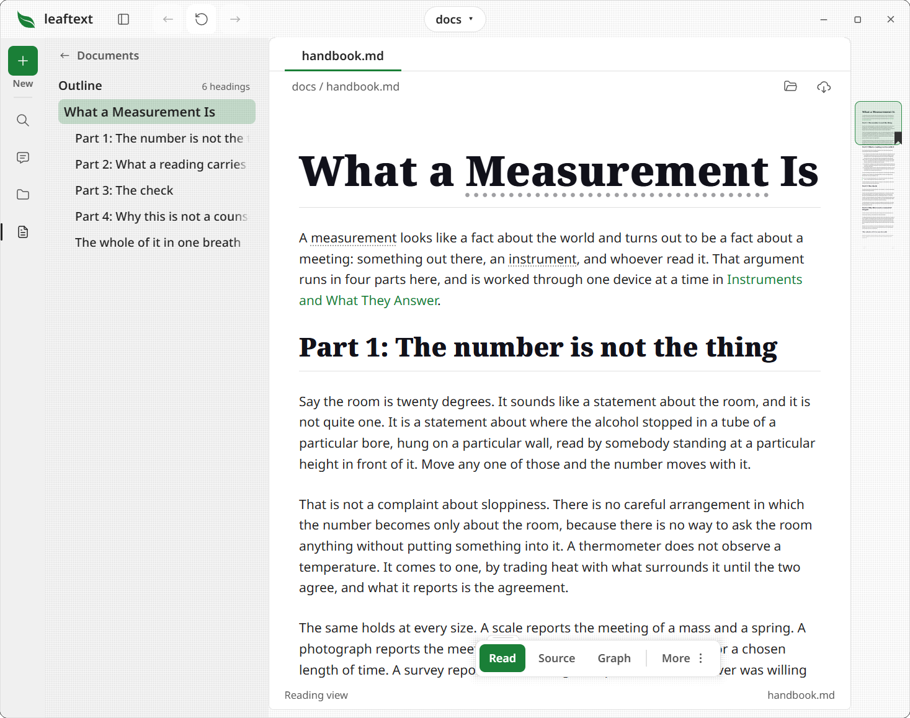
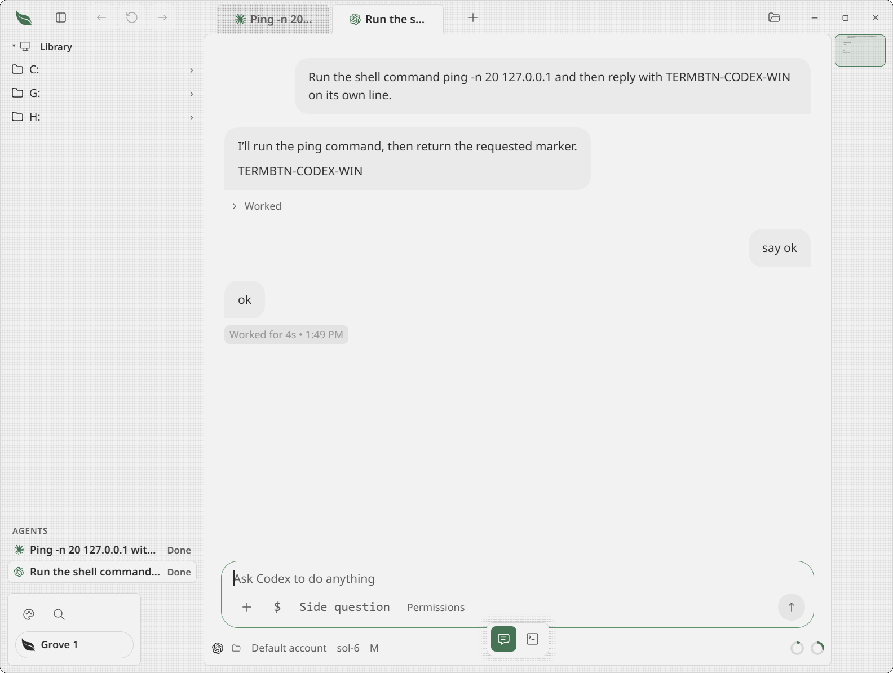

# Your own AI agent in Leaftext

> Run Claude Code, Codex or Antigravity beside your files, as one agent or a whole team



Each agent runs in a console next to the page you are reading. It uses your own account and model, sees what you see, and can read, edit and check the open document with you.

- **Chat** — your messages and its answers, kept as they were sent.
- **Diffs** — every edit it makes, shown before you save.
- **Teams** — agents message each other, start helpers and wait on them.
- **Schedules** — an agent started on a clock, every morning or once.
- **Checks** — a turn ends only when your project's checks pass.

## Run the agent in a console

Press **New** at the top of the library pane and pick an agent. Each account you use is its own row, so two Claude accounts are two rows. The agent starts in a new console in the folder the menu names.

The agent works exactly as it does in your own terminal. It uses its own model, its own sign-in, and your project's rules, skills and hooks. Leaftext never makes the model request itself.

Drag a file or folder onto a console to type its path. When an agent finishes or needs you while its window is behind another program, a system notice says so.

See [every detail of the console →](../09-details/agents.md#run-the-agent-in-a-console)

### The conversation as a chat



Claude Code, Codex and Antigravity show the conversation as a chat. Your messages sit on the right, the agent's answers on the left, and every turn stays as it was sent.

Each edit the agent makes appears as a diff, with removed lines in red and added lines in green. The tools it ran fold under its Worked for line. Press **Console** on the floating toolbar at any time to get the agent's own terminal back.

Type in the message box at the foot and press Enter. The **+** attaches files — pick as many as you want in its window with Shift-click or Ctrl-click (Command-click on a Mac), and each one becomes a chip — the microphone starts dictation, and More opens repeats, forks, rewinds and side questions.

See [every detail of the chat →](../09-details/agents.md#the-conversation-as-a-chat)

### Fork and compare

**Fork** copies a conversation into a new console, so you can try two directions from the same point. Compare agents sends one prompt to two agents side by side.

See [the details →](../09-details/agents.md#fork-and-compare)

### The agent's status under its console

A row under each console shows the account, the model and its effort. Three rings show how much context and how much of each usage limit is used. Press the model or the effort to change it, or the context ring to compact or start a new conversation.

See [the details →](../09-details/agents.md#the-agents-status-under-its-console)

### Ask an agent about a passage

Highlight words in a note and press **Ask agent**. Pick a console, and the agent gets the passage with the note's path and line, ready to open the place.

See [the details →](../09-details/agents.md#ask-an-agent-about-a-passage)

### Define a word in a book

Highlight a word in a book and press **Define**. An agent writes an entry for it into the book's glossary, in the sense this book uses it. The word is then underlined in every chapter.

See [the details →](../09-details/agents.md#define-a-word-in-a-book)

### Agents in different consoles talk to each other

Agents in different consoles can send each other a finding, a request or a question. Nothing is typed into a console you are using; each agent takes the message when it can. An agent on another machine joins over `ssh` typed in a Leaftext console.

See [the details →](../09-details/agents.md#agents-in-different-consoles-talk-to-each-other)

#### A planner, a builder, reviewers and a scout

Ask one agent to plan the work, and it starts a builder, reviewers and a scout beside it. They can be from different companies. When a change is ready, the builder asks the reviewers and keeps working while they answer.

Everything stays on your machine. Leaftext records who sent what to whom, never the words.

See [the details →](../09-details/agents.md#a-planner-a-builder-reviewers-and-a-scout)

### An agent starts another and waits on it

An agent can hand part of its job to a helper in a console beside it, then wait for the answer. You can watch the helper work and step in at any time.

See [the details →](../09-details/agents.md#an-agent-starts-another-and-waits-on-it)

### An agent drives your other windows

An agent can look at another window on your computer and click and type in it, such as a browser you are signed in to. It asks you first, in a box only you can answer. A notice says which window it is driving, with a Stop button.

See [the details →](../09-details/agents.md#an-agent-drives-your-other-windows)

### Closing the last window

Closing Leaftext's last window keeps it running in the notification area or the menu bar, so your wisp and your agents keep working. Quit from that icon, or with `Ctrl+Q` (`Cmd+Q` on a Mac).

See [the details →](../09-details/agents.md#closing-the-last-window)

### Scheduled

**Scheduled**, the alarm clock in the icon rail, starts an agent on a timetable: hourly, daily, weekdays, weekly or once. When a task is due, Leaftext opens a console, starts the agent and sends your prompt. Any agent can set one up when you ask.

See [the details →](../09-details/agents.md#scheduled)

### An agent going round in circles is told

When an agent fails the same way three times on the same file, Leaftext tells it so and asks it to try something else.

See [the details →](../09-details/agents.md#an-agent-going-round-in-circles-is-told)

### Design on a canvas with comments

**New design** in the New menu opens a canvas of boards you can pan, zoom and play at a phone's width. Drop a comment pin anywhere, and an agent beside it can answer in the thread.

See [the details →](../09-details/agents.md#design-on-a-canvas-with-comments)

## Hold an agent to your checks

Put a `HARNESS.md` in a project, naming its checks in one table. When an agent tries to end a turn that changed a file, Leaftext runs them. If one fails, the agent goes back to work with what failed.

Nothing in the file runs until you trust it by typing `leaftext --harness trust` in a console. Every attempt is kept in a run note, and Leaftext never commits for you.

See [the details →](../09-details/agents.md#hold-an-agent-to-your-checks)

## Install the plugin

The Leaftext plugin teaches your agent to work with the open document, browse in Leaftext's tabs and talk to your other agents. Install it once for each agent, then restart the agent.

| Agent | Install |
| --- | --- |
| Claude Code | `claude plugin marketplace add ryanallen/leaftext-plugin`, then `claude plugin install leaftext@leaftext` |
| Codex | `codex plugin marketplace add ryanallen/leaftext-plugin`, then install Leaftext from `/plugins` |
| Cursor | Install Leaftext from the Cursor marketplace |
| Antigravity | `git clone https://github.com/ryanallen/leaftext-plugin ~/.gemini/config/plugins/leaftext`, then `agy mcp add leaftext -- leaftext --mcp` |

On a Mac, open Leaftext once before you start the agent. After installing, check that a tool such as `leaftext_doc` appears in the agent's tool list.

See [the details →](../09-details/agents.md#install-the-plugin)

## Connect on Windows

For an agent the plugin does not cover, run these once in a Leaftext console:

```
claude mcp add --scope user leaftext -- "%LOCALAPPDATA%\Programs\leaftext\bin\leaftext.exe" --mcp
codex mcp add leaftext -- "%LOCALAPPDATA%\Programs\leaftext\bin\leaftext.exe" --mcp
```

Set up [another agent →](../09-details/agents.md#connect-on-windows)

## Connect on a Mac

```
claude mcp add --scope user leaftext -- /Applications/leaftext.app/Contents/MacOS/leaftext --mcp
codex mcp add leaftext -- /Applications/leaftext.app/Contents/MacOS/leaftext --mcp
```

Your agent's own settings decide which calls need your approval. Give an agent `leaftext_eval` only if you trust it with the open document.

Set up [another agent →](../09-details/agents.md#connect-on-a-mac)

## Work on a document

Ask the agent to open a file with `leaftext_doc`. It can then edit it, tick a task, check it for problems and save it, always against the version it read. It can also check every diagram in a file from its own prompt with `leaftext --diagrams notes.md`.

See [every tool, step by step →](../09-details/agents.md#work-on-a-document)
