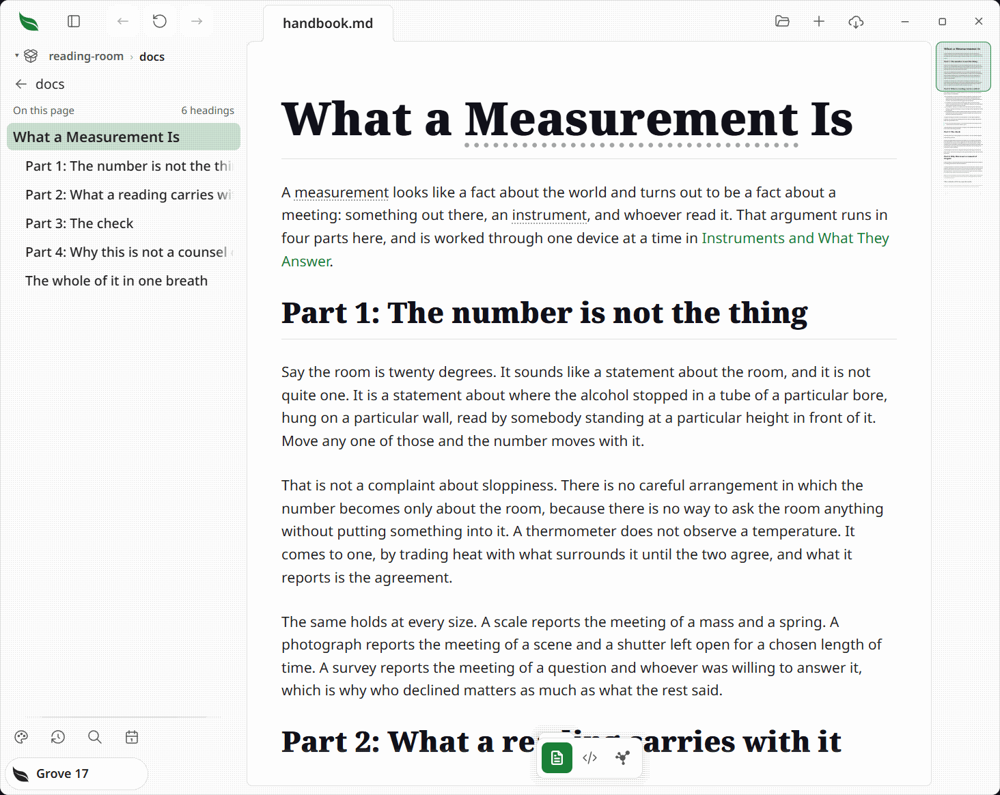

# Your own AI agent in Leaftext

> Connect an agent on your computer to the document open in Leaftext.



Leaftext's installed app can answer an agent through MCP. Keep Leaftext open, add the app as a tool server in your agent's settings, and the agent can read the document, edit and save it, tick tasks, search the active vault, inspect links, export the page, and use the other tools the app offers.

## Run the agent in a console

Open a [console in the library](03-library.md#console) and type the installed agent's ordinary command. The agent uses its own model address, model choice and credentials, just as it does when you start it in another terminal. Set those in the agent's own configuration; Leaftext has no model address or key field and does not make the model request.

To watch a note change while the agent works on it, put the console beside the note: drag its tab onto the right half of the page, choose **Open beside** on the tab, or press `Ctrl+\` (`Cmd+\` on a Mac). See [two documents side by side](02-navigation.md#two-documents-side-by-side).

The mouse wheel scrolls the agent's conversation the way it does in the agent's own terminal: a program that asks for the mouse is sent the wheel itself, one step a notch, so the prompt box keeps what you were typing.

Once it is [connected](#connect-on-windows), the agent is told it is running inside Leaftext, and `leaftext_open` lets it open a web address in a new [web tab](02-navigation.md#web-tabs) beside your documents rather than in an outside browser; `leaftext_eval` and `leaftext_gesture` then work that page. `leaftext_close` closes a tab the way its own close button does, a web page included, so an agent can put away a page it opened.

### Agents in different consoles talk to each other

With agents running in several consoles, in one window or several, one agent can hand a finding, a request or an answer straight to another. `leaftext_consoles` lists every console, which ones have an agent running in them and which one is the asker's own; `leaftext_tell` types a message into another console's agent as its next prompt, headed with the sender's console title and the console to reply to. Leaftext tells which console an agent is in by itself, so nothing needs setting up, and it never types into a console whose program is not waiting for a message.

### An agent going round in circles is told

When an agent in a console calls the same Leaftext document tool on the same file and it fails the same way three times in a row, Leaftext types one message into that agent's own console, headed `From Leaftext`, naming the tool, the file and the kind of failure, and asking it to try something else. It says so once per run of failures; a success, another file, another tool or another kind of failure starts the count again. `leaftext_attempts` lists the agent's last sixteen document calls as Leaftext saw them — the tool, the file, whether it worked and the kind of failure — and keeps none of the document, the answer or the refusal's words. Leaftext sees only its own document tools: the agent's shell commands, its other tools, its model calls and its approval prompts are its own, so a failure there is never counted, and a call you turned down never reaches Leaftext at all. The count lives in the agent's own Leaftext connection, so it is separate for every agent and gone when the agent or its console closes.

For a company gateway, follow the agent's own instructions: [Claude Code's gateway setup](https://code.claude.com/docs/en/llm-gateway) or [Codex's model provider configuration](https://developers.openai.com/codex/config-reference). The gateway must support the request format and authentication that the chosen agent sends. Connecting Leaftext as a tool server is a separate step below.

## Install the plugin

The Leaftext plugin connects your agent to Leaftext and teaches it to read, edit, check, tick and save the document open in the window, and to write the alerts, diagrams, math and tables Leaftext draws. It adds one skill and the `leaftext --mcp` tool server, and changes nothing else about your agent. Install it once for each agent you use, then restart that agent:

| Agent | Install |
| --- | --- |
| Claude Code | `claude plugin marketplace add ryanallen/leaftext-plugin`, then `claude plugin install leaftext@leaftext` |
| Codex | `codex plugin marketplace add ryanallen/leaftext-plugin`, then install Leaftext from `/plugins` |
| Cursor | Install Leaftext from the Cursor marketplace |
| Antigravity | `git clone https://github.com/ryanallen/leaftext-plugin ~/.gemini/config/plugins/leaftext` |
| Gemini CLI | `gemini extensions install https://github.com/ryanallen/leaftext-plugin` |

On Windows the installer already puts the word `leaftext` on your command path. On a Mac, run this once in a terminal so your agent can find Leaftext:

```
sudo mkdir -p /usr/local/bin && sudo ln -sf /Applications/leaftext.app/Contents/MacOS/leaftext /usr/local/bin/leaftext
```

For an agent the plugin does not cover, connect it by hand as below.

## Connect on Windows

Run these once in a Leaftext console, and every Claude Code or Codex session you start afterwards, in any folder, has Leaftext's tools and is told it is running inside Leaftext:

```
claude mcp add --scope user leaftext -- "%LOCALAPPDATA%\Programs\leaftext\bin\leaftext.exe" --mcp
codex mcp add leaftext -- "%LOCALAPPDATA%\Programs\leaftext\bin\leaftext.exe" --mcp
```

For another agent, replace `YOUR_NAME` with your Windows account folder name and add this server to its MCP settings:

```json
{
  "mcpServers": {
    "leaftext": {
      "command": "C:\\Users\\YOUR_NAME\\AppData\\Local\\Programs\\leaftext\\bin\\leaftext.exe",
      "args": ["--mcp"]
    }
  }
}
```

## Connect on a Mac

Run these once in a Leaftext console, and every Claude Code or Codex session you start afterwards, in any folder, has Leaftext's tools:

```
claude mcp add --scope user leaftext -- /Applications/leaftext.app/Contents/MacOS/leaftext --mcp
codex mcp add leaftext -- /Applications/leaftext.app/Contents/MacOS/leaftext --mcp
```

For another agent, add this server to its MCP settings:

```json
{
  "mcpServers": {
    "leaftext": {
      "command": "/Applications/leaftext.app/Contents/MacOS/leaftext",
      "args": ["--mcp"]
    }
  }
}
```

Your agent's settings decide which calls need your approval. Leaftext offers every tool to the agent and shows no approval box of its own. The `leaftext_eval` tool runs any JavaScript inside Leaftext's page, so give an agent access to it only when you trust that agent with the open document and app.

## Work on a document

Ask the agent to use `leaftext_doc` to read a file in Leaftext. It opens that file in the window and answers its text, task list, and fingerprint. To edit, the agent sends that fingerprint with `leaftext_edit`, waits for the page with `leaftext_idle`, then uses `leaftext_save` to write the file. To tick a checkbox, it uses `leaftext_toggle_task` with the task's place in the list; that action writes the file immediately. Before it says it is done, it can use `leaftext_check` to ask what is wrong with the document: a diagram that will not draw, a relation naming a row that is not there, a data file that will not read, a link to a file that is not there, and a wiki link to a note that does not exist. It changes nothing, and it answers the same fingerprint `leaftext_doc` gives, so a fix can be written against the same reading.

The tools reach the Leaftext copy running under your account. If it is closed, the agent gets a clear answer that Leaftext is not running.
