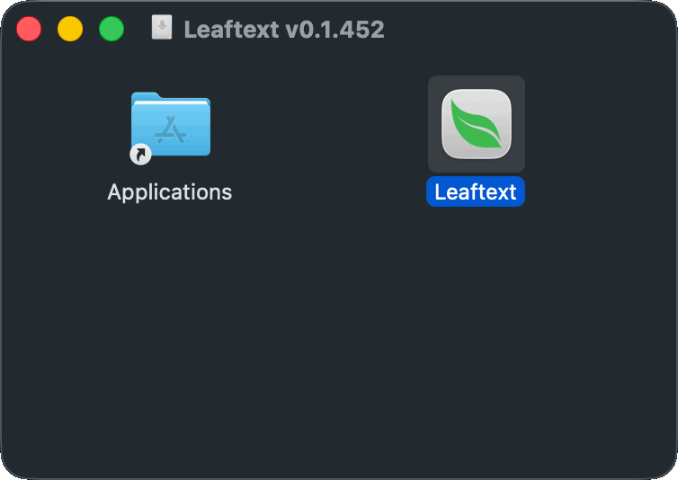
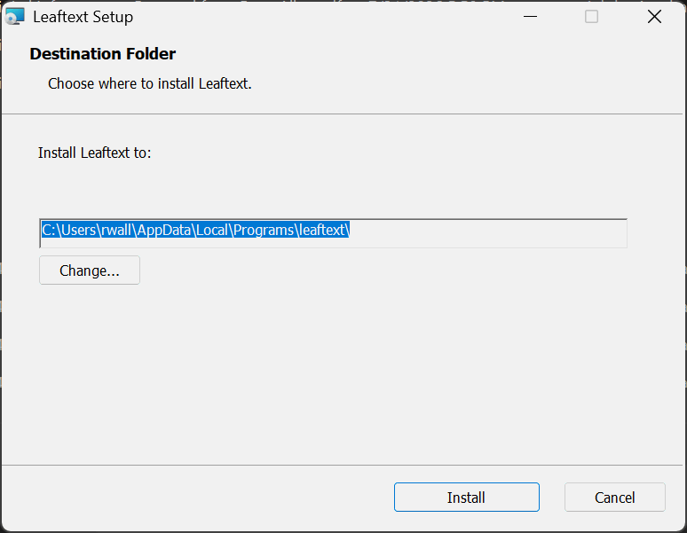
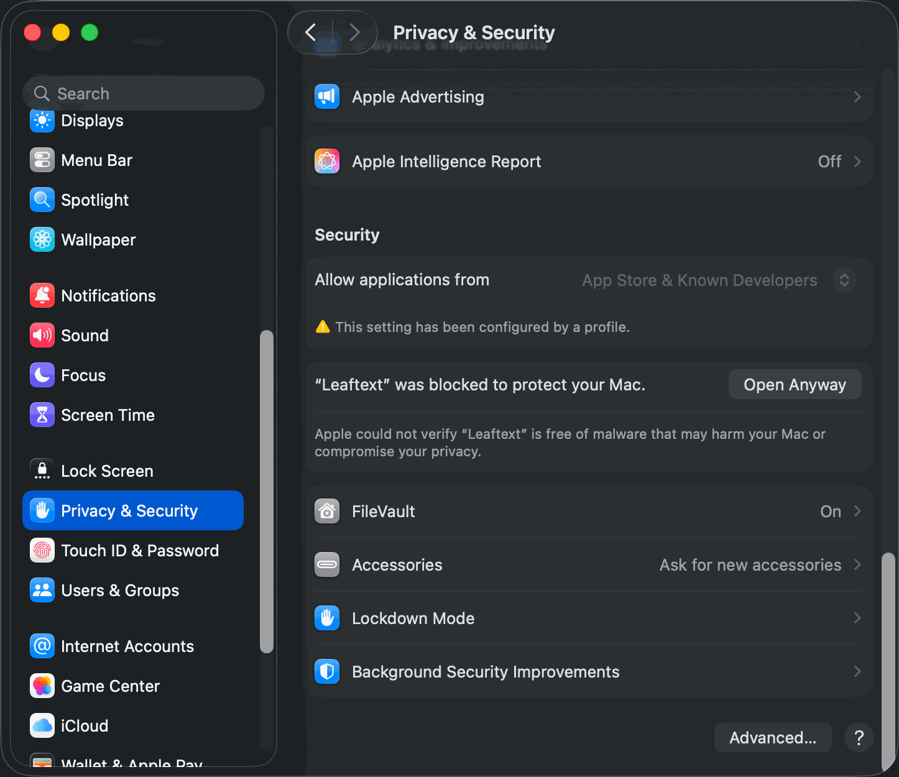
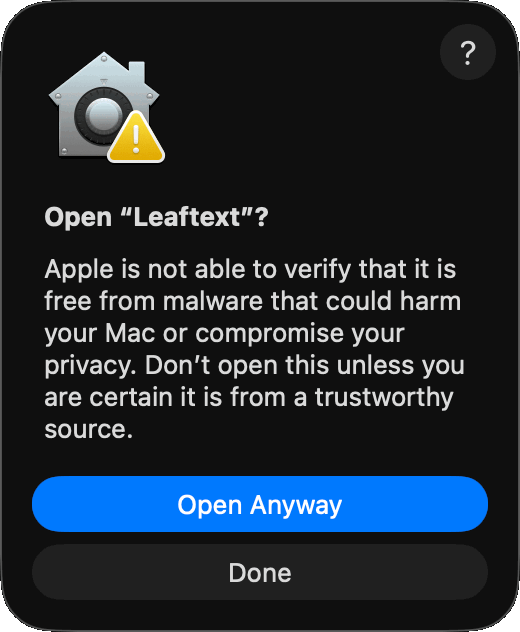
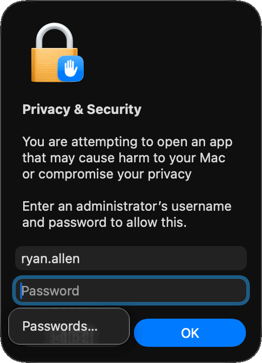
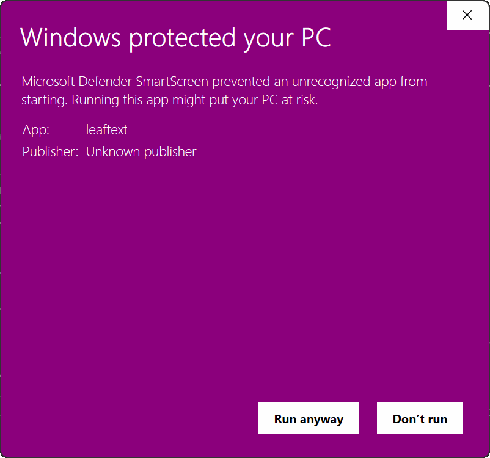
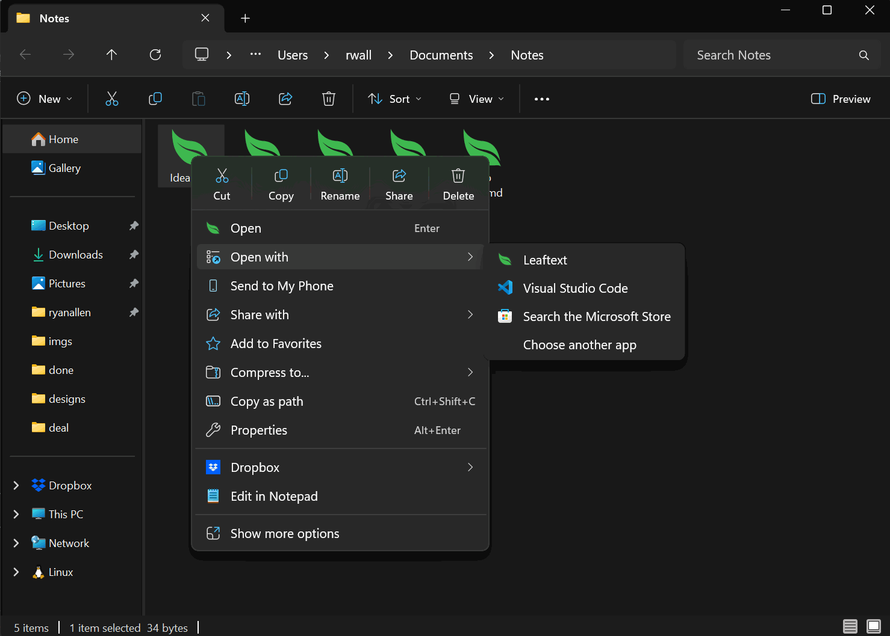

# Installation

> Download Leaftext for Windows or macOS, run it, and open a file

Leaftext is free. There is no account to create and nothing else to install first. The first time you open it, macOS or Windows warns you once, and the steps below clear that in a few clicks.

## Platforms

| Platform | Download | Needs |
| --- | --- | --- |
| Windows | [leaftext-windows-x86_64.exe](https://github.com/ryanallen/leaftext/releases/latest/download/leaftext-windows-x86_64.exe) | 64-bit Windows 10 or later |
| macOS | [leaftext-macos-universal.dmg](https://github.com/ryanallen/leaftext/releases/latest/download/leaftext-macos-universal.dmg) | Any Mac, Apple Silicon or Intel |

The Windows download is an `.exe` and the Mac download a `.dmg`. Older versions are under [All releases](https://github.com/ryanallen/leaftext/releases/latest).

## Install

### macOS



1. Download [the disk image](https://github.com/ryanallen/leaftext/releases/latest/download/leaftext-macos-universal.dmg) and open it.
2. Drag the leaf app onto **Applications**.
3. Eject the disk image from the Finder sidebar.
4. Open Leaftext from Applications. The first time, macOS refuses; [let it through once](#mac-blocks-the-first-launch).

### Windows



1. Download [the installer](https://github.com/ryanallen/leaftext/releases/latest/download/leaftext-windows-x86_64.exe) and run it.
2. If **Windows protected your PC** appears, [click past it](#windows-warns-before-it-runs).
3. Click **Install**. Leaftext opens as soon as it is done.

After that, open it from the Start Menu.

## The first-launch warnings

Both systems warn about an app that has not paid for a developer certificate. Nothing was scanned and nothing was found.

### Mac blocks the first launch



macOS says Leaftext "cannot be opened" the first time. Let it through once and it opens normally from then on.

1. Open Leaftext, and click **Done** when macOS refuses.
2. Open **System Settings → Privacy & Security**.
3. Scroll to Security and click **Open Anyway** beside Leaftext.
4. Click **Open Anyway** again in the box that asks.
5. Enter your password or use Touch ID.





On macOS 12 or earlier, right-click the app in Applications and choose **Open** instead.

If there is no Open Anyway button, paste this into Terminal and press Return:

```sh
xattr -cr /Applications/leaftext.app
```

### Windows warns before it runs



Click **More info**, then Run anyway. Your browser may also ask you to keep the download; choose Keep.

If Windows refuses the installer outright, the computer has a rule against unsigned programs. Only whoever manages it can let Leaftext through.

## Where it goes

Leaftext installs for you alone, so it never needs administrator rights.

| Platform | The app | Its data |
| --- | --- | --- |
| macOS | `/Applications/leaftext.app` | `~/Library/Application Support/com.ryanallen.leaftext` |
| Windows | `%LOCALAPPDATA%\Programs\leaftext\bin\leaftext.exe` | `%APPDATA%\ryanallen\leaftext\config` and `%LOCALAPPDATA%\ryanallen\leaftext\data` |

Reinstalling or moving the app keeps your settings and recent files. [Settings → Paths](01-features/05-settings.md#paths) lists every file.

> [!IMPORTANT]
> Upgrading from v0.1.364 or earlier on Windows? Uninstall that copy from **Settings → Apps** first, or you will have two.

## File associations



Installing adds Leaftext to **Open with** for every kind of file it reads. A file no other app has claimed opens in Leaftext on its own. A file that already has a default app keeps it until you choose:

- Windows: right-click a file, choose **Open with → Choose another app → Leaftext**, and tick *Always use this app*.
- macOS: select a file, choose **Get Info → Open with → Leaftext**, then Change All.

A file opened while Leaftext is running joins it as a new tab.

## Launch

Press `Ctrl+O` on Windows or `Cmd+O` on macOS to open your first file. The [Quickstart](03-quickstart.md) takes it from there.

## Updates


Leaftext checks for a new version when it starts. When one is ready, a bell appears in the app bar. The update installs the next time you open the app, or straight away if you press **Restart to update**.

There is nothing to set. When there is nothing to do, the bell stays away.

## Uninstall

- macOS: drag `leaftext.app` from Applications to the Trash.
- Windows: **Settings → Apps → Leaftext → Uninstall**.

Your documents are untouched either way. To remove your settings too, delete the data folder in [Where it goes](#where-it-goes).

## FAQ

### Is the warning a virus alert

No. It means the app carries no paid certificate, not that anything was found.

### Why do I have two Leaftext entries

Leaftext was once installed from an older `.msi` installer, and each installer adds its own row to **Installed apps**. There is still only one copy. Remove the row with the older version; the newer one is the version shown on the home screen.

### Does it need administrator rights

No. It installs and updates inside your own user folder.

### Does it need an internet connection

Only to check for updates and to fetch a [theme's font](01-features/06-themes.md#fonts) the first time. Reading, writing and search all work offline. [GitHub sync](01-features/03-library.md#github-sync) and [ElevenLabs read aloud](01-features/05-settings.md#read-aloud) go online when you use them.

### Where are my settings stored

See [Settings → Paths](01-features/05-settings.md#paths).

### Can I install it on Linux

No. Leaftext is for macOS and Windows.

## Next

- [Quickstart](03-quickstart.md)
- [Settings](01-features/05-settings.md)
