# Editing in detail

> Everything about writing in Leaftext, one fact at a time

This page holds the full behavior behind [Editing](../01-features/07-editing.md). Each section matches a section there.

## Overview

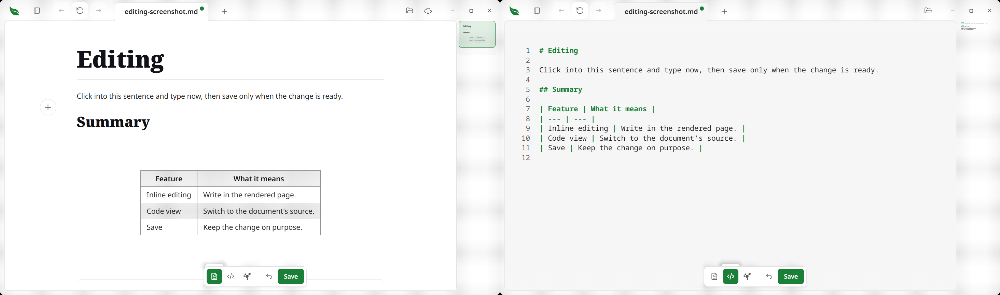

- Leaftext is reading-first, but also editable. Click into a sentence and type, or tick a checkbox, and the change is written back into the source at that spot.
- When you would rather work in raw text, the **code view** swaps the page for the file's source, for every format the app opens.
- Both paths share one source of truth and one green **Save** button.
- There is no autosave for text edits; nothing touches your file until you say so. The one exception is ticking a checkbox, which saves on the spot.

## Summary

| Feature | What it means |
| --- | --- |
| [New document](#new-document) | **New** at the top of the library pane (and on the home screen) starts a blank page, its reading view unlocked and ready to type |
| [Save As](#new-document) | A new document has no file until its first save, which asks where to put it |
| [Inline editing](#inline-editing-the-reading-view) | Click into the rendered page and edit it directly — see [Formats](#formats) for what each one allows |
| [Typing in a Word file or a spreadsheet](#formats) | Type into a paragraph of a `.docx`, `.docm` or `.odt`, or a cell of an `.xlsx`, `.xlsm` or `.ods`, where it is drawn — and everything the app never read stays byte for byte what it was on save |
| [Typing on XML as words](#inline-editing-the-reading-view) | Press a sentence in an [XML](../01-features/01-rendering.md#xml) document and type on it where it is drawn, with the tags left alone; a block whose drawn words are not the file's own bytes opens its source instead and says why |
| [Typing in a cell of an XML table](#inline-editing-the-reading-view) | Press a value and type on it where it is drawn — one of two values joined by a comma as readily as a cell holding one — and press a column heading to rename that element in every record at once; the rest of the file is untouched, and the grid never swaps for markup |
| [Typing on a value inside an XML tag](#inline-editing-the-reading-view) | Press a value written inside a tag — in the element's own list, in a table cell, as one of several drawn together, or as the lone value an empty element is drawn by — and type on it where it is drawn; only what sits between the quotes is written, and the quote that closes it is refused |
| [Typing on an HTML page](#editing-an-html-file) | Open the reading padlock on an HTML file of your own and type on its words where they are drawn; its tags, links and styles are left as they were |
| [Block editing](#inline-editing-the-reading-view) | `Enter` splits a block or starts a new one; `Backspace` at the start merges into the block above |
| [Taking a block away](#deleting) | Clear a paragraph or heading of its text and the whole line goes — no bare `##` left standing |
| [Taking several away](#deleting) | Highlight across blocks and `Delete` removes the lot; whatever survives at each end joins into one block |
| [Picking a section](#deleting) | `Ctrl+A` with the caret in a block widens a step per press: the block, then the heading and everything under it, then the page |
| [The fields at the top](#the-fields-at-the-top-of-a-note) | Click a value in a note's field block and change it, pick a date, tick a box, add and drop tag chips, rename a key, add a field or take one away — and start a block on a note that has none |
| [Renaming from the heading](#renaming-from-the-heading) | A document that names no title of its own is headed with its file name; press that heading to rename the file |
| [Renaming a config key or section](#editing-data-files) | Press the name to the left of a value in an [INI](../01-features/01-rendering.md#ini-files) file, or a `[section]` heading, and type the new name where it is drawn; only that word is rewritten, and the brackets and the spacing around a key stay as the file had them |
| [The title a data file names](#editing-data-files) | A [JSON, YAML](../01-features/01-rendering.md#data-files-json-and-yaml) or [INI](../01-features/01-rendering.md#ini-files) file that names its own title heads the page with it; press that heading and the value itself opens for editing, quotes and all |
| [A quoted YAML value](#editing-data-files) | A value written in quotes opens its own source at a press, quotes and all, the way the same value in JSON does |
| [A press that cannot open says why](#editing-data-files) | Where a data file is written a way the page cannot place exactly, pressing it raises a line naming the source view rather than answering with nothing |
| [The block gutter](#the-block-gutter) | A handle and a plus in the page's left margin: drag a block to reorder it, or add one on the empty line |
| [Pasting a picture](#images) | `Ctrl+V` / `Cmd+V` with a picture on the clipboard puts it in the note: the picture is written into an `imgs` folder beside the file and drawn on the line below |
| [Dropping a picture](#images) | Drag a picture file from the file manager onto an unlocked Markdown note to put it on the line below the block where it lands |
| [Adding a block](#adding-a-block) | The plus opens a row of kinds — text, heading, list, quote, code, table, image, flowchart, divider, framed figure, cards, badge, bars |
| [Inserting an image](#images) | The image button asks for a file or an address; nothing is copied, and the picture stays where you keep it |
| [Drawing a flowchart](#the-flowchart-editor) | The flowchart button, and the one in any drawn diagram's corner, open a canvas beside the Mermaid text |
| [Editing a sequence diagram](#the-sequence-diagram-editor) | Press a participant, message, note or region on its timeline to edit that source statement in the bottom picker |
| [A box's link, icon or picture](#what-it-can-draw) | A selected box has a field for each: where clicking it goes, one of the app's own drawings by name, and a picture beside the document or at an address |
| [Exporting a diagram](#export) | The diagram's own corner, and the diagram sheet, write it out as its own file — Markdown, PNG, WebP, PDF or JPEG |
| [The format bar](#the-format-bar) | Highlight words and a bar appears over them, or under them where there is no room above: copy, highlight, annotate and comment on any page, and on an unlocked one bold, italic, strikethrough, code, link, three button styles and badge as well, then text, bigger/smaller heading and quote for the whole block |
| [Comments](#comments) | Select words and press **Comment** to start a thread beside that block: a marker with a dot while it is open, replies with their times, and a check that moves it to the Resolved list at the foot of the page |
| [Interactive checkboxes](#inline-editing-the-reading-view) | Click a task checkbox — in a list or a table cell — to check or uncheck it; it saves on the spot, dims the line's words while it is ticked, and works even with editing off |
| [A date on a checkbox](../01-features/01-rendering.md#task-lists) | A task line's `📅 09/16/2026` is drawn as a short colored badge; press it for today, tomorrow, next Monday, a box for any other date, or a row that clears it |
| [A table keeps its spacing](#inline-editing-the-reading-view) | Type in one cell and only that cell is rewritten, so a table you lined up by hand stays lined up |
| [Walking a table's cells](#editing-a-table) | `Tab` and `Shift+Tab` step through the cells of an open table and `Enter` drops one row down; `Tab` at the last cell writes one more row and lands in it |
| [Row and column grips](#editing-a-table) | Point at a table and a grip appears beside the row and above the column: drag either to reorder it |
| [Sorting a column](#editing-a-table) | Sort the body rows by any column, A to Z or Z to A — numbers and ISO dates by value, everything else as text; the header, the divider and a row of totals never move |
| [A date, a choice or a link, picked rather than typed](../01-features/01-rendering.md#tables) | With editing on, a cell holding a date, one of a short list of values, or a link to a row of another table opens a small picker instead of a caret; whatever you pick rewrites that one cell and leaves the rest of the table's spacing exactly as you set it |
| [Relational tables](../01-features/08-relational-tables.md) | A table can be viewed as cards or a board, filtered, sorted and linked to a row in another table without leaving Markdown |
| [Dragging a card between a board's columns](../01-features/08-relational-tables.md#editing-a-relational-table) | With editing on, moving a card from one board column to another writes that row's own cell — one change, one press of undo |
| [Sorting and filtering what is drawn](../01-features/08-relational-tables.md#views-sort-and-filter) | Point at a table and its own bar offers a sort and a filter that change what you are looking at and never the file; the sort on the cell's right-click menu above is the one that writes |
| [The table's right-click menu](#editing-a-table) | Right-click a cell to add, delete, align or sort a row or column, and to say how that cell gets its value |
| [A table that adds itself up](#a-table-that-adds-itself-up) | Right-click a cell and open Math for the sum, average, count, smallest or largest of the rows above it or the cells to its left, arithmetic on two cells you press, or a range you pick; the number is written into the file and stays right as the rows under it change |
| [Copy as CSV](#editing-a-table) | The copy button in the row above a table copies it as a spreadsheet reads it, on a locked page as readily as an unlocked one |
| [Full-window tables](#inline-editing-the-reading-view) | Open a safe Markdown table on the whole window; it keeps the same look, takes the room the window has, folds long cells rather than running off the right edge, never squeezes a short column until its words break in half, and follows its own links the way the page does |
| [Undo](#undo) | An Undo button (and `Ctrl+Z` / `Cmd+Z`) steps back through reading-view edits, a word at a time while you are typing; a Redo button beside it (and `Ctrl+Y` or `Ctrl+Shift+Z`) brings back what you took back |
| [When the app cannot write it](#when-the-app-cannot-write-it) | A file that has gone takes the tab dot, Save and Undo down and raises a message naming it; the flowchart editor keeps the drawing and the image box keeps the address you typed, rather than closing over them |
| [The padlock](#the-padlock) | Two padlocks, one for the reading view and one for the source, each remembered. Both start locked, except in a [new document](#new-document) — and checkboxes toggle either way |
| [Replacing text](../01-features/02-navigation.md#find-in-this-document) | The find bar's Replace and All write through the same padlock as typing does — in the reading view as one edit carrying only the blocks that changed, so one Undo puts it all back |
| [Code view](#code-view) | Toggle the rendered page to the raw source and back |
| [A source view that will not open](#code-view) | Where the editor cannot be brought up, the app says so and puts you back on the document at the place you were reading, and pressing the button again is a fresh attempt |
| [Your place is kept](#code-view) | Toggling between the two views holds your position, and toggling back and forth returns you to the exact spot |
| [Highlighting](#code-view) | The source is colored in the active [theme](../01-features/06-themes.md)'s syntax colors — Markdown, HTML, XML, YAML, JSON, and the XML of the part an [Office file](../01-features/01-rendering.md#office-and-opendocument-files) is anchored to; raw [email](../01-features/01-rendering.md#email-eml), [plain text](../01-features/01-rendering.md#plain-text-files), [INI](../01-features/01-rendering.md#ini-files) and [source files](../01-features/01-rendering.md#source-files) show as uncolored text |
| [Color squares](#code-view) | A color written in the source carries a small square of itself in the line beside it — hex, `rgb()` or `hsl()` |
| [Line numbers](#code-view) | A gutter numbers each source line, staying pinned when long lines wrap |
| [Wrapped lines](#code-view) | Long lines wrap; the code view never scrolls sideways |
| [Minimap](../01-features/04-minimap.md#the-code-views-minimap) | The editor's own minimap rail, drawn on the window's chrome beside the page |
| [Pinned headings](#pinned-headings) | In Markdown source, the headings you are reading under stay at the top edge as you scroll; click one to jump to it |
| [Editing the source](#editing-the-source) | Type directly; undo/redo, selection, clipboard, and IME all work, and `Tab` indents instead of moving focus. A multi-megabyte file stays responsive |
| [Typing help](#typing-help) | Monaco's IntelliSense, answered from your own notes: type `[[` to see them, `#` for headings, hover a wikilink for a preview — and broken links get a wavy underline |
| [A YAML file held to its schema](#yaml-schemas) | A YAML file the folder's `.vscode/settings.json` maps to a JSON Schema has a field the schema refuses underlined, in the code view and on the page, and the field names it allows offered as a key is typed |
| [Save](#save) | A green **Save** button (or `Ctrl+S` / `Cmd+S`) appears from the first keystroke, and writes the words on screen without clicking out of them |
| [Unsaved marker](#save) | A tab with unsaved edits shows a dot beside its name, from the first keystroke |

## New document

**New** at the top of the library pane starts a blank document in a new tab from its first row, **New page**. The home screen carries the same button beside **Choose file**.

- It opens in the reading view, whose [padlock](#the-padlock) is turned off for you, with the caret on the first line — there is nothing to click before you type. `Enter` starts the next paragraph, as it does anywhere else in the reading view.
- It has **no file** yet. The tab is called *Untitled* (*Untitled 2*, and so on, when one is already open), and nothing reaches your folders until you say so.

  Closing the window with words in it keeps them in the [saved session](../01-features/05-settings.md#unsaved-edits). The next launch puts the note back under the same name with its dot lit. A note you never typed into does not come back, since there is nothing to keep.
- Previous and Next navigation stays off this page until it has a saved file with neighboring pages.
- The first **Save** opens your operating system's Save dialog: choose a folder and a name, and from then on it saves like any other document.

  On Windows that dialog lists every format the app reads. On a Mac it shows none, so a short menu asks which one first, and the dialog then suggests a name ending in it. Close the dialog without choosing and nothing is written.
- Once it is saved, the tab, the window title and [Recent files](../01-features/02-navigation.md#recent-files) all take the real name. You can keep typing; the padlock is a setting, and the new name does not reset it.
- To put the file in a folder you are already looking at, right-click that folder in the library pane and pick [**New file**](../01-features/03-library.md#folders-and-the-space-around-them). It is made on the disk at once, under the name you type, and opens in the tab in front.

## Writing in the page

### Inline editing (the reading view)

The rendered page is a live editor. The **source stays the single source of truth**. Every edit is anchored to the exact byte range it came from and spliced back there, so what you see and what is saved never drift apart.

Editing is intentional per block and never rewrites parts of the file you did not touch.

Every line break an edit writes takes the ending the file already uses. A note written on Windows keeps its Windows line endings through typing, a new block, a pasted table or an agent's diagram. A file with no line break yet takes the one its first break is given.

- **Click into a sentence and type.** Paragraphs, headings, lists, tables and block quotes edit in place with their styling intact. Bold stays bold and links stay links, and table pipes, list markers and `>` prefixes are rewritten for you. Your change is written back into the Markdown at that spot.

  Interactive **checkboxes** toggle their `[ ]` / `[x]` marker in the source, in task lists and [table cells](../01-features/01-rendering.md#tables) alike. A checkbox is a quick action rather than an edit: it saves to disk immediately, records no undo step, and stays clickable even when reading-view editing is turned off.

  A ticked box's own words are drawn dimmed, the way a finished item reads, and return to full strength when unticked. A box already ticked in the file opens dimmed. A nested task under it keeps its own strength, and a date badge on the line stays as it is.

  Nothing about the dimming is written into the file; only the tick is. In a table, a cell that starts with `[ ]` or `[x]` followed by words draws the box in front of them. Ticking it dims that cell's words and nothing else in the row.
- **Cut, copy, paste and select all take the usual keys**: `Ctrl+X`, `C`, `V` and `A`, or `Cmd` on a Mac. They work in a block, the code view, the find and replace boxes, the address bar and every other box you type in. In a box of its own, `Ctrl+Z` / `Cmd+Z` undoes what you typed there.
- **A date on a task line is picked rather than typed.** A checkbox whose line ends in a date such as `📅 09/16/2026` draws it as a short badge, `Sep 16`. It is red once past, green on the day, amber through the next seven days, and gray later or once ticked.

  Press the badge, and the same menu every other picker uses offers today, tomorrow and next Monday. It also has a box for any other date, and a row that takes the date off the line.

  Whichever you pick rewrites only that date's own characters. The rest of the line and every other line stay exactly as you wrote them, and one undo puts the old date back. It is an ordinary edit, so it waits for Save. See [Task lists](../01-features/01-rendering.md#task-lists).
- **A table keeps the spacing you gave it.** Type in one cell, and only that cell's text changes. Every other row, and the `| --- |` divider under the header, stays exactly as written, so a table lined up by hand stays lined up.

  The cell keeps its own padding too. The pipe to its left never moves, and the one to its right moves only by the change in your text's length. Clicking a checkbox in a cell works the same way.

  An edit that changes the table's shape, adding or dropping a column, still rewrites the whole table. The `:---`, `:---:` and `---:` alignment markers survive, rebuilt from the alignment each column is already drawn with. See [Tables](../01-features/01-rendering.md#tables).

- **Character boxes in a table keep their spelling.** A body cell holding only `☐` or `☑`, with optional surrounding space, draws the same clickable checkbox. Pressing it saves `☑` or `☐` immediately, with either padlock state and no undo step. Character boxes in headings, prose, code or cells with additional words stay text.
- **A saved table checkbox keeps the reading page visible.** The page stays in place while the same document is redrawn. If raw cell markup makes a row disagree with its columns, the attempted check returns to its previous value and a message explains why the change was refused.

  Keyboard focus on a checkbox does not open a text edit for the whole table.
- **Size a table from any outline edge or cell divider.** Drag the left, right, top or bottom outline to move that side, bigger or smaller, while the opposite side holds still. The visible edges remain available after scrolling sideways, including on one-column tables. Double-click a strip to reset only its boundary.

  The [held shape](../01-features/01-rendering.md#tables) survives typing elsewhere in the document and changes no file bytes or undo history. Refreshing, closing and reopening the document, or restarting Leaftext returns every table to its automatic widths, heights and placement. If unsaved changes prompt a refresh choice, sizing stays until you press **Refresh anyway**.
- **A table opens on the whole window.** Point at it and press the expand button at the right end of the row above it, lined up with the table's right edge. The larger copy keeps the original cells' borders, fills and spacing, and does not change the file.

  Any width or height you dragged in the page stays in the page. The copy is measured against the whole window, not the reading column. It offers no divider to drag, since a size set on a copy that closes has nowhere to go.

  A [cards](../01-features/08-relational-tables.md#views-sort-and-filter) layout you chose yourself opens as cards; one the narrow reading column chose for you opens as the grid.

  It takes the room the window has, not the room its longest cell wants, so every column stays on screen. A long cell folds inside its own column. Columns still share the width by how much each asks for, so the column of sentences keeps most of it.

  A heading is never broken mid-word, and no column is drawn narrower than about seven characters. So a short cell, like a weekday or a year, reads as one word. Where something in a cell cannot fold at all, such as a picture, hold `Ctrl` or `Cmd` while using the wheel to scroll it sideways.

  Its links work the way the page's do. A [glossary](../01-features/02-navigation.md#glossary) word slides its term up over the table and dims the table, as every [bottom sheet](../GLOSSARY.md#bottom-sheet) dims what it covers. Closing the term, by its button or by clicking the dimmed table, puts you back on the table. Closing the table takes the term with it.

  Anything that leaves the document — another page, an address away from it, a jump to a heading — closes the table first and then opens. Hold `Ctrl` or `Cmd`, or use the middle button, and the page opens behind the one you are reading with the table left exactly where it is.

  Press `Escape`, click the dimmed page, or use the close button to return to the document. The header still moves or double-clicks the window on a custom title bar.
- **Blocks behave like a block editor.** `Enter` splits a block at the caret, and a split heading stays a heading at the same level. Pressed at the end, it starts a fresh paragraph; keep pressing to keep writing.

  `Shift+Enter` inserts a line break, and `Backspace` at the very start of a block merges it into the one above, with the caret staying put. In a list, `Enter` adds an item and `Backspace` joins items.
- **Every other block edits its exact source.** Code blocks, [alerts](../01-features/01-rendering.md#blockquotes-and-alerts), a paragraph that is only a picture, a picture inside a link, footnotes and math open their raw source in place when clicked. They splice back on the way out. So do blocks with raw HTML outside a small safe set. That set is links, line breaks, bold, italic, strikethrough, inline code, `<abbr>`, `<kbd>`, `<mark>`, `<ins>`, ``, ``, `` and `
`.

  A list spaced out with blank lines, between its items or inside one step's own list, is typed in as it looks wherever it can write back exactly. Where it cannot, it keeps its source editor.

  A list item, quote or paragraph with a picture beside its words is typed in as it looks too. Each picture writes back as exactly the line it was written with, so the pictures stay where they are drawn.
- **[XML](../01-features/01-rendering.md#xml) types on its words wherever the words are the file's own bytes.** Press a sentence and a caret lands in it. What you type is spliced between that element's own tags, and the tags are never part of the edit.

  Some drawn words are not the file's bytes: inline markup the page flattened, an entity the file spells another way, or spacing the renderer tidied. Those blocks open their exact source instead, and a line says why the markup appeared.

  `Enter` ends the element at the caret and carries on in another of the same, its tags and attributes included. Pressed at the end of the words, it opens a blank line inside another of the same element.

  A section heading and a document's alternate-language title line take a caret but no `Enter`, because a second one of either is not drawn.
- **A cell of an XML table types on its words as well.** A table drawn from records, such as a sitemap's addresses and dates or a feed's entries, takes a caret in any cell holding one element's own bytes. What you type is written into that element alone, and no other row moves.

  Where a record holds several elements of one name, the cell draws them joined by a comma, and each takes its own caret. Typing on one leaves the others as they were. The comma between them belongs to neither, and a press on it does nothing.

  A cell drawn from a value inside a tag types the same way, on the bytes between that value's quotes. A column a record has nothing for is not the file's own words, so it answers a press with nothing.
- **A column heading renames that element in every record.** The words across the top are not in the file; they are the tag spelled out, so `lastmod` reads as "Last modified". There is no way back from one to the other.

  So pressing a heading puts the tag the file actually holds under the caret, in place of the label. Typing a new name renames that element in every record at once, and one undo takes it all back.

  Every other byte of those records comes back exactly as it was, the comment and the spacing included, and a folded column renames each of the elements folded into it. Leaving without typing puts the label back and writes nothing, and a name no XML element could carry is refused where you typed it.

  A heading over a column drawn from a value inside a tag has no element to rename, so it takes no caret. The table itself is never swapped for its markup, whatever you press — the whole file's text is in the code view.
- **A value written inside a tag types on its words as well.** An XML file keeps much of what it says inside tags, such as `<entry id="chapter-4" updated="2026-08-13">`, and the page draws every value. Values appear under the element's heading, as table columns, several together on one line, or alone. A feed's `<link href="…"/>`, for example, reads as `Link: https://leaftext.com/`.

  Press any of them, and a caret lands where it is drawn. What you type is written between that value's quotes alone. The name, the equals sign and both quotes are never part of the edit.

  A value the page did not draw exactly as the file spells it cannot be written back without adding bytes that were never there. This happens when spacing was tidied or the file uses an entity. Pressing it raises a line naming the source view instead.

  The quote that closes the value is the one thing it cannot hold. Typing one is refused with a line saying so, and the words go back, as two dashes in a comment are.

  A lone value drawn as an address still takes a caret on a press, since nothing stands beside it. The blank part of its row opens the element's whole markup.
- **A comment types on its words too.** The [fold](../01-features/01-rendering.md#xml) holding a note in an XML file takes a caret in its words. The `<!--` and `-->` marks stay off the page and untouched in the file. Nothing is escaped either way, so an ampersand you type is an ampersand in the file.

  Two dashes in a row would end the comment early and stop the file opening. So typing them, or leaving a dash at the end, is refused with a line saying so, and the words go back.
- **A code block hands you the code, not the fences.** Click into one, and you get what sits inside the fence lines. The fences and language tag stay out of reach, so you cannot backspace through them and lose the block. Delete every line and you still have an empty code block.

  An indented code block has no fences to hide, and neither does an unterminated one — those open whole, as before.
- **A tall block opens its source where you press.** A picture's source line appears at the press, with the caret at its start. A block with several source lines places the caret by its height in the block.

  Clicking away returns the corresponding point in the rendered block to that line's current height, including after scrolling during the edit or a picture finishing loading. At the beginning or end of the document, the nearest available scroll position wins.
- **A diagram edits as its diagram.** A rendered [Mermaid diagram](../01-features/01-rendering.md#mermaid-diagrams) shows two buttons in its corner on hover. One swaps it for its Mermaid source, on the same tint as other source blocks. The other opens it in [the flowchart editor](#the-flowchart-editor). The source button puts its first line and caret beside the press.

  Click away from the source and it is drawn again. A press on the drawing itself moves it — see [zoom and pan](../01-features/01-rendering.md#mermaid-diagrams) — which is why the source opens from a button rather than from a click.
- **The field block at the top edits too**, in its own way — see [the fields at the top of a note](#the-fields-at-the-top-of-a-note).

  The field card is drawn by the reader, not as a block of the document, so it takes no caret and no gutter handle. Every block below it edits exactly as in a note with no fields.
- **A cursor can be in more than one place.** Hold `Ctrl` (`Cmd` on a Mac) and click to add another, or take every match of a search from the [find bar](../01-features/02-navigation.md#find-in-this-document). What you type lands at all of them, and one undo takes it all back.
- **A right-click asks, it does not edit.** Only the left button opens a block for typing. Right-click a picture, a code block or any block showing its source, and the block stays drawn with the menu over it. See [Right-click a picture](../01-features/03-library.md#right-click-a-picture).
- **Nothing is ever mangled.** A block only edits WYSIWYG when its rendered form can be turned back into the identical source; anything else edits its source directly. Either way the edit is a precise splice, and the [live reload](../01-features/02-navigation.md#reload) watcher recognizes your own save so it never fights it.
- **Nothing is drawn around the line you are typing in.** No ring, no box. The caret says where you are, and a page whose whole point is that it is a page should not turn into a form when you touch it. A block showing its raw source is the exception: its code tint is what says *this is source*.

  It is set in the [theme](../01-features/06-themes.md#tokens)'s own code face, the one every other code surface uses. So a fenced block does not change face when a click opens it.
- Edits raise the same green **Save** button and unsaved dot as the code view, and save the same way. That starts from your first keystroke, without clicking out of what you are typing.

  **Save**, Undo and `Ctrl+S` all act on the words on screen. Your typing reaches the document at every pause, so an outside change arriving mid-sentence no longer takes it away.

  Clicking out of a paragraph or heading turns the marks you typed into what they mean: `*stars*` into emphasis, an address into a link. Only that one block is drawn again, so moving from line to line in a long note costs no wait.

  The whole page is drawn again for a heading with a competing section link, or a block of any other kind. It is also redrawn when your words now reach past the block, as a new blank line, a list marker or an unmatched bracket would.
- The reading view opens **locked**: clicks do not enter edit mode until you say so. See [The padlock](#the-padlock).

### Renaming from the heading

A document that names no title of its own is headed with its file name. That covers a sitemap, a feed, a `package.json`, or an [email](../01-features/01-rendering.md#email-eml) with no subject.

That heading is the file's name, so pressing it opens the same rename box as the [library pane](../01-features/03-library.md#file-actions). The box sits over the heading, holding the real file name with everything before the extension selected. `Enter` renames the file; `Escape` leaves it alone.

An empty name, one already taken, and one carrying a folder separator are all refused, exactly as they are in the pane.

The heading, the tab and the pane all move to the new name, unsaved typing stays where it was, and every [history step](../01-features/02-navigation.md#history) standing on that file follows it too. With the [source view](#code-view) open, it stays at the place you were reading rather than going back to line one.

A heading the document writes for itself is not a file name, so pressing it edits that value instead. Such headings are an XML `<title>` or a message's `Subject`. They also include a [JSON, YAML or INI](#editing-data-files) `title` or `name` key, and the title of a [Word file, deck or OpenDocument file](../01-features/01-rendering.md#office-and-opendocument-files).

The XML and email headings take a caret in the words. A data file's heading opens the value's own source, as its other values do, and an office file's opens its own paragraph. In an OpenDocument spreadsheet or presentation, the heading is the first sheet's or slide's name. Pressing it opens just that name, and typing renames the sheet or slide.

A sheet or slide the file gives no name is headed with a word of the app's own, which no bytes of the file hold, so pressing it opens nothing.

### Editing an email

An [email](../01-features/01-rendering.md#email-eml) edits where you read it too. That covers the subject, every header in its header card, every block of a plain-text body, and each line of an HTML body the page can write back. A body packed in quoted-printable, plain text or HTML, opens on its decoded words; only the coded lines you change are written again.

- **The header card is a note's field card.** Click a value to type over it, press a header's name to rename it, and take one out with the cross at its row's end. **Add a field** offers `To`, `Cc`, `Bcc` and `Reply-To`. `To`, `Cc`, `Bcc` and `Reply-To` are chips, one address each.

  Each change is written as one line of the message. A folded header goes whole, and a value outside plain letters is written the way mail codes it. Only a name beside an address is ever coded.

  The headers that say how the rest of the file is read, and the ones a server signed on the way through, are left to the [code view](#code-view).
- **A plain-text body is written as note syntax.** Its lists, quoted replies and bold words draw as a note draws them, and a single line break stays a line. Click a block and type; what you type is written over that block and nothing else, and line endings survive: a message written the Windows way stays written that way.
- **`Enter` splits a paragraph** and leaves a blank line between the halves, and `Shift`+`Enter` adds one more line to the same paragraph.
- **A line of an HTML body is typed on where it is drawn.** A paragraph, box, heading, list item, cell or quote holding only words, bold, italic, underline, struck words, code, breaks and plain links counts as a line. What you type is written between its own tags, and its colors and settings stay as the message wrote them.

  Both `Enter` and `Shift`+`Enter` add a break inside the line. Some words cannot be typed on there: words beside other boxes, such as a greeting above a message's lines, and anything from markup the page cannot repeat exactly. They say so when pressed and open in the [code view](#code-view).

  This reaches a body written into the message as it is and one packed in quoted-printable alike.
- **The margin handle moves a block** within one plain-text body, and the **+** on an empty line adds another. Neither is offered on a header row.
- **What cannot be opened says why.** A base64 body, and a quoted-printable body in a charset other than UTF-8 or ASCII, are drawn but not editable here. Clicking one says so and points to the [code view](#code-view), which edits the whole message.
- **A message that can prove nothing and has no header card has no reading padlock at all** — see [The padlock](#the-padlock).
- **The bar over selected text answers in a plain-text body** with bold, italic, strikethrough, code, a link, the text, heading and quote row, and copy, each written as note syntax. The badge, the highlight and the note are left off, since no mail program reads them.

  **Over a line of an HTML body** it offers bold, italic, strikethrough, code, a link and copy, each written as a plain tag inside that line. A packed plain-text paragraph has no bar.
- **A message in a legacy charset is saved back byte for byte.** Its words are read from the file's own bytes, and a save writes those bytes rather than re-spelling them. So the body you read is the body on the disk.

  Type a character that charset has no room for, such as an emoji in a Shift_JIS message, and the save is refused. A sentence names the character, since writing it would take the rest of the words with it.

### Editing an HTML file

On the desktop, an [HTML file](../01-features/01-rendering.md#html-files) stays live with the reading [padlock](#the-padlock) open or shut, so its scripts and controls keep working. Open the padlock, click a proved run of words written in the file, and type there. Save writes the change to the file; Undo and Redo update those same words on the running page.

Opening or closing the padlock keeps the page running.

Only unchanged, unambiguous authored text can take the caret. Words built by a script, repeated text that cannot be paired uniquely, native fields and words a script has moved or replaced keep their existing behavior. Paste adds plain text within that run; typing changes no tags or styles. Use the [code view](#code-view) for the rest of the file.

Where the live page cannot start, or in a browser, the file opens as a contained copy. Open the reading padlock to type on that copy's words where they are drawn — a heading, a linked title, a badge, a table cell, a paragraph. The following rules apply to that copy.

- **Only the words change.** What you type is written between the file's own tags. A link keeps its address, a badge its class and a row its style, and a word repeated elsewhere is left alone.
- **Some words cannot be typed on here.** Words the page draws differently from the file, and anything the app does not draw at all, say so when you type on them. Change those in the [code view](#code-view). `Enter` adds no new line, because a new line would be a new element.
- **A press on a link puts the caret in its words.** `Ctrl`+click (`Cmd`+click on macOS) still follows it.
- **Nothing is written until Save**, and Save keeps the padlock open and the caret where it was. Shutting the padlock leaves the contained copy on screen; unsaved typing waits for the padlock to open again.
- **A web address has no padlock.** Only a file of your own has somewhere to save to.

### The fields at the top of a note

A note's [field block](../01-features/01-rendering.md#frontmatter), the `title`, `status`, `due` and `tags` between the two `---` lines, is edited where you read it. It opens in the sheet under the `Frontmatter` edge above the title, with the reading padlock open.

There is no save button of its own: a change raises the same green **Save** as any other edit in the page, and `Ctrl+Z` steps back through them.

- **Click a value and type.** `Enter` keeps it, `Escape` abandons it, and clicking away keeps it. `Ctrl+S` from inside the box keeps it and saves the file with it.
- **The control matches the field.** A date opens a calendar. A checkbox is a real box you tick. A list draws one chip per item, each with a cross, and a `+` for the next one. Everything else is a plain box.

  The app never guesses a control for a value it cannot read. A field pinned as a date but holding `sometime` keeps its plain box, rather than opening a picker that would blank it.
- **A field the vault shares a few words for is picked from a list.** In a [vault](../01-features/03-library.md#vaults), a text field like `status` or `priority` becomes a list box of the words the vault already uses. That happens when it holds two to twelve different words across your notes, one of them used twice. So the fourth note never gets `In Progres`.

  The last row, *Type a value…*, opens the plain box for anything the list does not have. A note's own spelling is always in the list, so the file never changes just by being shown. A `title` every note has its own of, a number, and every field outside a vault stay plain boxes.
- **Click a field's name to rename it.** The value, its quoting and its place in the block all stay where they were. A name the block already uses is refused, since two fields of one name is a note that half reads.
- **A cross at the end of a row takes the field away**, shown when you point at the row. `Ctrl+Z` puts it back.
- **"Add a field" under the last row** asks for a name and a value side by side. Four names are offered as you type — `aliases`, `cssclasses`, `tags` and `leaftext-types`, the four the app itself reads — and anything else is still typed freely.
- **A note with no fields can start one.** Rest the pointer in the strip above the first line and the [gutter](#the-block-gutter)'s plus appears, reading *Add frontmatter*. Press it and the same name-and-value pair opens; filling it writes the two `---` lines and the first field together, and leaving it empty writes nothing at all.
- **A chip can hold a comma.** Type `Smith, John` and it is one chip and one name.

  On a list written `[a, b]`, the app wraps an item in quotes so it reads back as one, leaving the other items as they were. It will not write an item holding a comma, a `"` and a `'` together, since no quote can wrap that. Put such an item in a list written one per line.
- **Your file keeps its shape.** Every change is a splice over that one field's own bytes. Comments, blank lines, field order, the case of each key and the quotes around a value all survive exactly.

  A list stays in the form it was written in: `[a, b]` stays on one line, and a `- item` list keeps its own indent. Removing the last field takes the two `---` lines with it rather than leaving an empty pair.
- **A locked page shows none of it** — no edit box, no cross, no add row, and the block reads exactly as it did before.

### Deleting

Taking something out of a document is not the same as emptying it of words. Clear the text out of a paragraph and there should be no paragraph left — not an empty one, and certainly not the leftovers of the one that was there.

- **An emptied block goes.** Delete the last word of a paragraph or heading and click away. The whole line is removed from the file, along with the blank line that separated it from the next. A heading does not leave its `##` behind.

  The blank lines either side do not stack up. The two neighbors end up exactly one apart, and an extra blank line someone put above the block stays where it was.
- **A highlight can cross blocks.** Drag from one paragraph into the next, and the selection follows through headings, code blocks and tables alike. It can then be copied or deleted in one go.

  A block becomes typable only when you click into it, which is what lets a drag leave it. Click into one and it is an editor again; click away and the page is selectable once more.

  A drag that starts and ends inside one line opens that line for typing where you let go. The highlighted words can then be deleted or typed over at once.
- **`Delete` and `Backspace` work across blocks.** Highlight from the middle of one paragraph to the middle of another and press either. Everything between goes, and the two remaining halves join into one block. It keeps the kind of whichever end kept its own words, so a heading cut part way is still a heading.

  The caret lands at the join.
- **Anything that cannot be cut in half goes whole.** A selection touching a code block, a table, a list, a picture or a diagram takes all of it. That avoids leaving a half the app cannot write back. That is what somebody dragging across a code block means anyway.
- **It is one edit.** However many blocks the highlight covered, one press of [Undo](#undo) — the button or `Ctrl+Z` — puts all of it back.
- **The whole document can go.** Empty the last block and the file is empty. The page returns as a blank one, with a title and a line to type on, like a [new document](#new-document).
- **Selecting a section takes two presses.** With the caret in a block, `Ctrl+A` (`Cmd+A`) widens a step at a time. The first press selects the block, and the third the whole page. The second selects the **section**: the nearest heading at or above you and everything under it, down to the next heading of any size.

  Move the caret and the next press starts at the block again. From outside a block it is one press and the whole page, as it always was.
- **A code block's inside is not a block.** Clear the code out of a fence and you have an empty fence, not a missing one — see [above](#inline-editing-the-reading-view).
- Deleting is behind the same [padlock](#the-padlock) as typing. A locked page can still be selected, copied, [highlighted and annotated](#the-format-bar), and [commented on](#comments), and `Ctrl+A` on one selects the page in one press.

### The block gutter

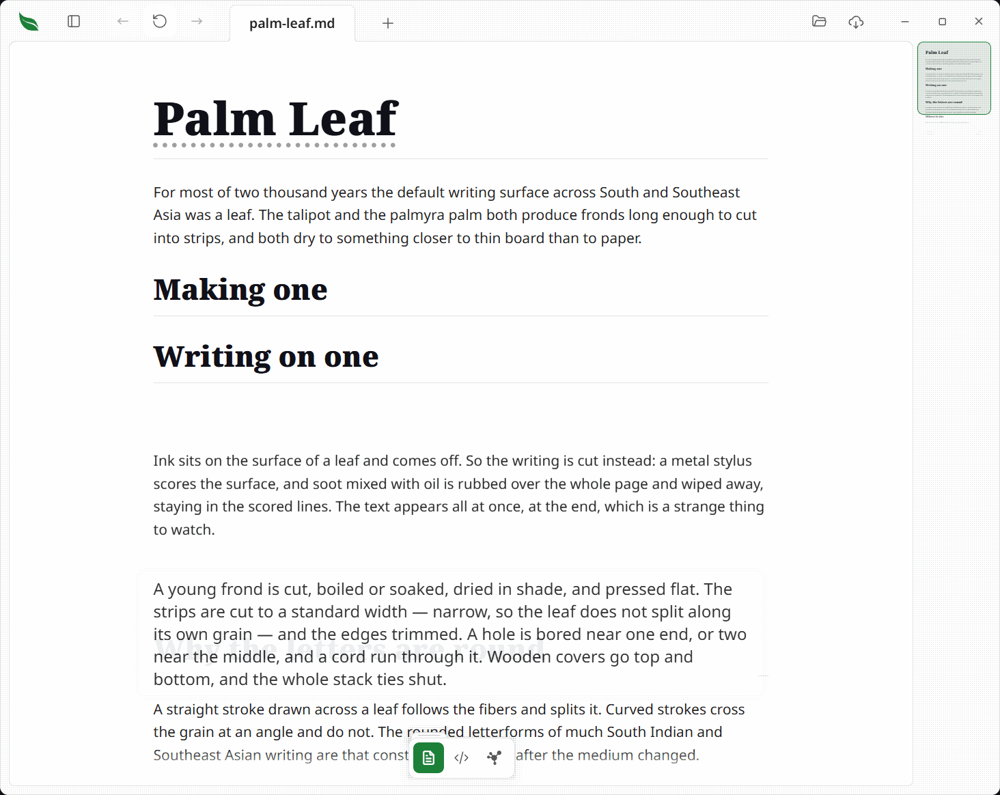

Hover a block and two controls appear in the page's left margin: a **handle** to drag it by, and a **plus** for adding one.

They act through the same source ranges every other edit uses, so this is a view onto your file, not a second copy of it. That is why one gutter serves every format that qualifies.

- **The margin is live.** Run the pointer down the gutter strip itself and the controls follow whichever line you are level with, blocks and the spaces between them alike. You never have to hover the words first and slide left.
- **Drag to reorder.** Take the handle and the block lifts off the page and follows the pointer, while its neighbors slide aside to open the gap it will land in. Drop it there. `Escape` puts it back. A comment line written on a block, or beside a table, moves with it.

  Shared comments and comments keeping paragraphs apart stay in place, as do the blank lines, indentation and punctuation between blocks.
- **It stays available while you write.** Hover any other block mid-edit and its handle is there. The margin reaches the line you are typing in too, so that one can be dragged as well. Drag after typing and the line you were on is saved first, then moved — one gesture, both edits.
- **Markdown and XML only.** A block can only be moved when its recorded range is the whole block. In JSON and YAML a range covers a value, not its key, so moving one would leave the key behind. Those formats get no gutter, only the click-to-edit they already had.

### Adding a block

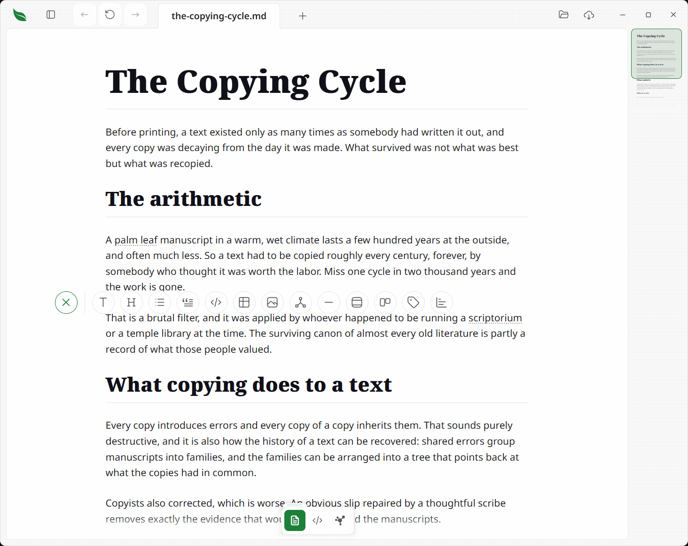

The plus stands on empty lines, never on a line that already says something — beside a written line it would be offering to write over it. So:

- **On a blank line**, the plus is right there.
- **While you are typing**, it waits on the line below. Press it to save the line you are on and choose what the next one is, in one go — no `Enter`, no clicking out first. Clicking that empty space instead just starts typing there, as body text.
- **Between any two blocks**, hover the space and the plus appears in it. Clicking the space starts a line there too.
- **Never over something the page drew.** The pager is not part of your document, so no clickable space is offered across it.

Press it and a row of kinds fans out over the empty line, unfurling rather than appearing — the same motion as [everything else that folds open](../01-features/01-rendering.md#collapsible-sections):

| | What you get |
| --- | --- |
| Text | An empty paragraph |
| Heading | An empty `##` heading |
| List | An empty list item |
| Quote | An empty block quote |
| Code block | An empty fence, edited as source |
| Table | A two-column table with empty cells |
| Image | [The image box](#images) |
| Flowchart | [The flowchart editor](#the-flowchart-editor) |
| Divider | A horizontal rule |
| Framed figure | A [framed figure](../01-features/01-rendering.md#framed-figures-leaf-extension) with its title selected, so the first keystroke replaces it |
| Cards | A choice of two [prose or four compact cards](../01-features/01-rendering.md#cards-across-the-page-leaf-extension), each opening on an empty heading with the caret in the first, or two **Picture cards**: each an empty title with an empty line under it for its words, one for its picture and one for its More link. Type the title and the words, choose **Image** from the plus on the picture's line, and write the link on the last line. Nothing is written into any of them until you do |
| Badge | [The badge box](#badges) |
| Bars | [The bars box](#bars) |

The first four **open** a block rather than writing one. You get an empty block of that kind with gray placeholder words, and **nothing reaches the file until your first keystroke**. Pick Heading and change your mind and the page is as it was — no stray word left in the document.

Picking a kind on a line that is already empty just changes what that line is, rather than adding a second one.

In [XML](../01-features/01-rendering.md#xml) the row offers what the renderer for your file can draw. A TEI document has verse and no tables; other XML has tables and no verse. Offering a kind the page will not draw is how a click lands nothing.

| | TEI | Every other XML |
| --- | --- | --- |
| Text | A paragraph | An element under the name of the block you pressed the plus beside |
| Heading | A section with its heading | A section with its heading |
| Row | — | One more record on the table above, when the plus is under one |
| Verse | A line of verse | — |
| Comment | A comment | A comment |

Every one of them but the comment **opens** a line to type on, like the first four above. What you type is committed inside the tags on your first keystroke, and typing nothing writes nothing.

`Enter` carries on with whatever comes next there — another verse line, another row, another element of the same name, and a paragraph under a heading. A heading is written as the section its own heading names, because that is the only shape either renderer draws as a heading.

Row is offered only under a table, and writes another record like those already there, with your words in its first column. A table whose columns are all attributes is offered no row, since there is nothing to type into. The comment is written straight in and drawn as [a comment fold](../01-features/01-rendering.md#xml).

#### Images

The image button does not write a placeholder path for you to correct. It asks:

- **Choose file** opens your operating system's picker, filtered to what a page can draw.
- Or paste an **address** for a picture on the web and press `Enter`. Where the app [cannot write the line](#when-the-app-cannot-write-it), the box comes back with the address still in it.

**A picture on the clipboard goes in with `Ctrl+V`** (`Cmd+V` on macOS), with the padlock open.

Take a screen clip, or copy a picture file in your file manager, then click the line you want it under and press the button. The picture is written into an **`imgs` folder beside the note**, the folder [a picture taken out as Markdown](../01-features/01-rendering.md#images) fills. It is drawn on its own line below yours, as one undo step.

- **The file takes the note's own name**: `release-notes.png` beside `release-notes.md`, then `release-notes-2.png` for the next. So an `imgs` folder shared by several notes says which note each picture belongs to.
- **The picture keeps its own format.** A screen clip stays the PNG your system made. A JPEG, WebP or GIF copied from your file manager stays what it was, at its own bytes. Anything that is not one of those four is refused and nothing is written.
- **Pasting the same picture twice leaves one file**, addressed twice. A different picture landing on a name already there is written beside it, numbered, and the file already there is left alone.
- **A note you have never saved is told to save first** — there is no folder beside it yet for the picture to go in, so nothing is written.
- **A paste carrying words is still a paste of words.** Copying from a word processor puts a picture of the copy on the clipboard beside its text, and the text is what goes in.

**Drag a picture file from the file manager onto the page of an unlocked Markdown note** to place it on a new line below the block where you let go. Several pictures land in drop order, one line each, as one undo step. The files stay where they already sit; the note records their addresses.

A drop beside the words in the reading column counts as a drop on that line. A drop over the tabs says to drop onto the page; a drop over a folder in the pane copies the file into that folder.

A locked note says to unlock it, and another document format says pictures can only be dropped into Markdown. A note with no saved file says to save it first. A drop carrying both documents and pictures opens the documents and says to drop the pictures on their own.

A picked file is **never copied anywhere** — the picture stays where you keep it.

That is the difference between the two ways in. A picture with a file of its own is addressed where it sits. A picture only on the clipboard is written beside the note, because it has nowhere else to be.

What goes into the document is where the picture already is. It is written relative to the document when it sits under the same folder, so the pair survive a move together. Otherwise it is a full path. A path holding a space or a bracket is written in Markdown's `<…>` form, so it cannot end early.

A note you have never saved can take a picked picture and draw it at once, unlike one from the clipboard. Nothing is written beside the note, so no folder is needed.

**Taking a picture out again is a right-click on it.** With the padlock open, a picture on its own line carries **Delete picture**. It removes the picture from the document as one undo step and writes nothing until you save. The picture stays on your disk where it is.

A picture inside a sentence has no such row, because the only piece of source it belongs to is the sentence around it. See [Picture actions](../01-features/03-library.md#right-click-a-picture).

#### Badges

The badge button asks before it writes anything. Press it, and the row swaps for the tones: green, amber, red, gray and the theme's own primary. Each is drawn as a badge of that color rather than named in words.

- Pick a tone, and a box opens for the badge's words, with a live badge of that tone beside the field. So what is being written is on screen as you type. `Enter` writes it; `Enter` with nothing typed writes nothing.
- The box also offers a **mark**: a check, a cross, a tag or an update arrow, each drawn as itself. Picking one puts it in the badge beside the words, and pressing the one already on removes it.
- What lands is one [badge](../01-features/01-rendering.md#badges-leaf-extension) on the line, and never a list item: a status list is a list you write as a list.

#### Bars

The bars button asks the same way. Press it, and the row swaps for the same tones the badge offers. Pick one and a box opens with two fields, what the bar is and how much, under a live bar that redraws on every keystroke.

- The live bar is drawn full, because one amount on its own is its own scale. In the document a run of bars shares one scale, so the largest amount fills its track and every other bar is drawn against it.
- `Enter` in either field writes the row once both fields hold something, and writes nothing otherwise. `Escape` folds the row away.
- What lands is one [bar](../01-features/01-rendering.md#bars-leaf-extension): a label, the amount as inline code, and the marker that sets its tone. So a reader in an app that has never heard of Leaftext still sees the label and its number.

### Editing a table

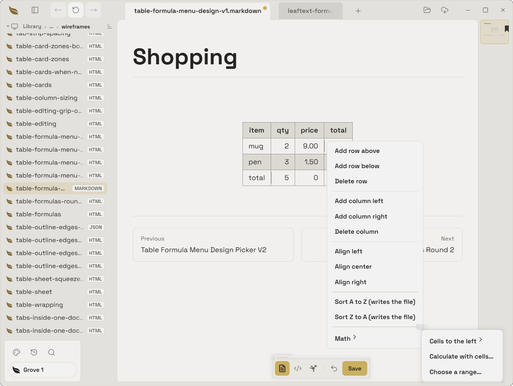

A safe Markdown table — one the app can write back out whole — is more than a block you can type in. Point at it and its own controls appear, so a table in a note can be restructured without typing a pipe.

- **The keyboard walks the cells.** Click into a table and `Tab` moves to the next cell, `Shift+Tab` to the previous, and `Enter` one row down in the same column.

  Each end stands still rather than wrapping to the other, so the caret never lands off screen. The exception is `Tab` at the very last cell, which writes one more body row and puts the caret in its first cell.

  Arriving in a cell leaves the caret at the end of its words rather than selecting them, so passing through cannot wipe a cell. It also closes the last cell's typing as its own undo step.
- **A grip beside the row and above the column, and it drags.** Run the pointer over a table, and one handle stands at the body row you are level with. Another stands above the column you are in. Move from the cell across the left outline to the dots; they stay beside that row as you cross.

  Drag the outline itself to resize. Take the row grip and carry it up or down. The row lifts and follows the pointer, the rows it passes step aside to open its landing place, and letting go drops it there. The column grip does the same sideways, and the columns it crosses step aside for it.

  The space they open inside the table accepts the drop. A release anywhere outside that table cancels, leaving it exactly as it was, so a drag that wanders into the document never moves a row out of the table. The dots mean that one thing and nothing else — a press that never becomes a drag does nothing.

  The header row has no grip of its own — the pipes are keyed off it.
- **Align a column.** Left, center and right write the `:---`, `:---:` and `---:` markers into the divider row and nothing else. Every other line of the table stays as you wrote it.
- **Sort by a column, and it writes the file.** A cell that is entirely a number sorts as a number, and one that is an ISO date sorts as a date. So 9 comes before 10, and last March before this one. Everything else sorts as text, and equal cells keep your order.

  The header and the divider never move. Sorting is labeled as a write because it is one — it changes the document rather than the view — and sorting a column already in that order writes nothing at all.
- **Everything else is on a right-click.** Right-click any cell of an open table, and its menu adds a row above or below, deletes the row, adds a column left or right, and deletes the column. It also aligns and sorts by that column. Under those sit [the five that say how that cell gets its value](#a-table-that-adds-itself-up).
- **The last row and the last column stay.** Deleting either is refused: a table with nothing under its header, or with no header cell, has nothing left to point at.
- **Copy as CSV.** The row above a table carries a copy button just before the [full-window opener](#inline-editing-the-reading-view), at the table's right edge. It copies the table as a spreadsheet reads it, quoting a cell only where it holds a comma, a quote or a line break.

  It only reads, so it is there on a locked page too, and it copies the words as they are drawn rather than the Markdown behind them.
- **Markdown only, and only unlocked.** The grips, the keys and the menu appear on a safe Markdown table with the [reading padlock](#the-padlock) lifted. A table the app could not write back keeps the editor it already had, and a locked page keeps everything but Copy as CSV out of the way.

### A table that adds itself up

A total in a table stops being true the moment anything above it changes. The usual answer is to move the table into a spreadsheet. Leaftext keeps it right in the note.

- **Ask for it from the cell.** Right-click the cell the number belongs in and open **Math**. **Rows above** and **Cells to the left** each offer Sum, Average, Count, Smallest and Largest. A direction with no cells to read is left out. The header row has no Math menu.
- **Calculate with cells.** Choose **Math → Calculate with cells**, pick an operation, then press two body cells in the table. The panel names the inputs and shows the rule before **Use formula** writes it to the destination. A first-row total can multiply quantity 2 by price 9.00 to make 18.00 without typing a reference.

  Arrow keys and Enter can pick a cell from either input button; Escape leaves the selection.
- **Choose a range.** Choose **Math → Choose a range**, pick one of the five functions and press its first and last cells. The range includes both ends and can run across one row or down one column. It cannot include the destination. This lets a total skip a text label and read only numeric cells.

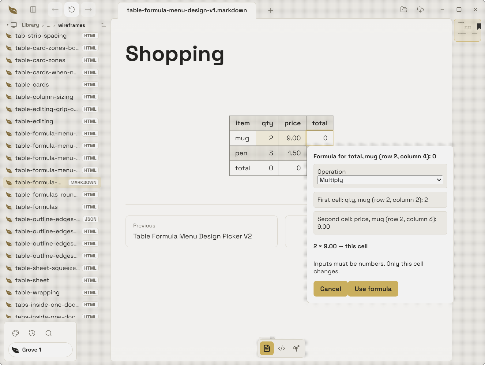
- **The number and the rule are written together.** One press writes the answer into the cell and a [formula line](../GLOSSARY.md#formula-line) under the table saying what that cell is. They are a single edit, so one undo takes both back.

  The line is an ordinary [HTML comment](../01-features/01-rendering.md#inline-html), so the file stays plain Markdown any program can read. Asking the same cell again replaces its rule rather than adding a second.
- **It stays right as you edit.** Change a quantity, and the totals that read it are rewritten in the same edit. The table is never half updated, and one undo takes back the change and its totals together.

  Only the cells the rule names are written; every other byte of the table, its spacing and its divider row included, is left exactly as you wrote it. Opening a document whose totals are already right writes nothing at all.
- **A kept number wears a quiet mark.** A cell the app keeps right carries a thin bar on its leading edge, the edge a right-aligned number never reaches. It reads as a number the file answers for, not one somebody typed.
- **A row of totals holds its place in a sort.** [Sorting a column](#editing-a-table) moves every body row except one whose cells are all kept numbers. So a totals row cannot be carried into the middle of the data. A row of ordinary data with one kept number in it is not one of these and moves like any other.
- **Writing the rule by hand.** The line is `<!-- TBLFM: ... -->` under the table, in org-mode's syntax. `$4=$2*$3` gives every row's fourth column the product of its second and third. `@>$4=sum(@2..@-1)` gives the last row's fourth column the sum of the body rows above.

  `$n` is a column and `@n` a row, with the header as `@1`. `@>` is the last row and `@-1` one back from it, and a range between two of them reads the cells between. It has `+ - * /`, parentheses, a leading minus, and `sum`, `average` (or `avg` / `mean`), `min`, `max` and `count`.

  A cell whose inputs are not all numbers is left as you wrote it. An answer carries as many decimal places as the widest number it read. A line the app cannot parse is ignored whole, so the table stays ordinary rather than half computing.

### The format bar

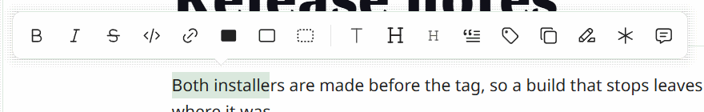

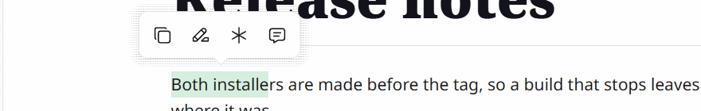

Highlight words in a Markdown page and a small bar appears over them. What it holds follows the [padlock](#the-padlock). Four buttons read the words aloud, mark them up or [comment](#comments) on them on any page. The formatting buttons stand in front of those once the page is unlocked.

- **The bar waits for you to let go.** While you hold the button to drag out a highlight, no bar stands over the page. A drag that wanders into the margin keeps only the words you dragged, and the bar rises over them on release.
- **The bar goes under the words where there is no room above them**, with its point on its top edge. So a highlight on a page's first line is not handed a bar hidden behind the tab strip.

  It hangs off the last line of the highlight there, rather than the first, so the rest of what you chose stays visible. It is the same answer the bar already gives sideways: it stops short of either edge of the page and slides its point along to keep pointing at the words.

- **Bold**, *italic*, ~~strikethrough~~, `code`, and **link** apply to the highlighted words. A button lights up when the words already carry that format, so the bar says what they are as well as what they could be. Press it again to take the format off.

  **The light is about the whole highlight.** Drag past the end of a bold phrase into plain words, and Bold goes out. Those words are not all bold, so the press would add the format, not remove it.
- **Coding out of a code span leaves one code span.** Highlight from inside `code` into the plain words beside it, and the two runs join into one span. Only the words you chose stay highlighted.
- **Taking a format off leaves the same words highlighted**, wherever the phrase sits in its sentence. The bar goes on answering for them, and a third press puts the format back. Nothing has to be highlighted again by hand.
- **Link** opens a box for the address, filled in with the link already there if there is one. `Enter` applies it; an empty box takes the link away, and the words stay highlighted. `Escape`, or a press anywhere off the box, leaves the link as it was.
- **Filled button**, **Outline button** and **Flat button** sit after Link. Each opens the same address box, with its style named beside it. A link or button already under the highlight fills in its address. `Enter` makes the selected words a button linking there. Press the lit style again to turn the button back into a link without losing its address.

  The three styles write `{{{[text](../01-features/address)}}}`, `{{[text](../01-features/address)}}` and `{[text](../01-features/address)}`; later edits to the paragraph keep those braces.
- **Badge** turns the highlighted words into a [badge](../01-features/01-rendering.md#badges-leaf-extension). The bar swaps in a row of tones, each drawn as a badge of its own color, so you choose by looking. A tone pressed on words already in a badge re-tones that badge instead of wrapping it again.

  It appears only on an unlocked page, beside the inline formats.
- **Text**, a **bigger** and a **smaller** heading, and **Quote** act on the whole block the highlight sits in. They appear only where the block is a paragraph, heading, or quote.
- These don't toggle — **a button with nowhere to go grays out**, so every press is a straight answer. **Text** is the way out of a heading or a quote, and grays out on body text.
- The two **H**s are the same glyph at two sizes, and they move **one level per press**: `######` → `#####` → … → `#`. All six levels are reachable, so a document can carry as many `#` headings as you want. The bigger H grays out at `#` and the smaller at `######`.
- On body text or a quote, the bigger H makes it a `##` heading — the ordinary section heading, with `#` one more press away. The smaller H grays out there, since body text has no size to shrink.
- **Copy** puts the highlighted words on the clipboard as they read, not as the Markdown behind them. Pasted into a mail, a word processor or a web editor, they keep their headings, lists, bold and links.
- **Highlight** washes the words in the [theme](../01-features/06-themes.md)'s own warning color, so a marked passage reads the same in every family and in both modes. Press it on words already marked and the highlight comes off.
- **Highlighting out of a highlight leaves one highlight.** Drag from marked words into the plain ones beside them and press it. The whole run comes back as one even wash, and a second press takes it off in one go.
- **Annotate** opens a box for a note. `Enter` writes it as a footnote: a marker after the highlighted words, and the note itself at the foot of the document. `Escape`, or a press off the box, leaves it alone. Press **Annotate** again on a passage that already carries a marker and the marker and its note come off together.
- **A note hangs off words, and only off words.** Highlight the passage the marker should follow and press **Annotate**. A click on its own leaves the page alone, so nothing stands over the pointer on a locked page.
- **A note goes when the last marker pointing at it goes**, however that happened. Backspacing over it, deleting its block or passage, or a [Replace All](../01-features/02-navigation.md#find-in-this-document) that rewrote the words around it all count.

  The note's own line at the foot of the document leaves in the same edit, so one press of [Undo](#undo) brings both halves back. A note something else still points at stays where it is.
- **These three write into the document and wait for Save**, like any other edit. Each goes in as one [Undo](#undo) step, a note's marker and its line included, though they sit at opposite ends of the file. None of them opens a block for typing, which is why they are offered with the padlock shut.
- `Ctrl+B` / `Cmd+B`, `Ctrl+I` / `Cmd+I` and `Ctrl+K` / `Cmd+K` do bold, italic and the link box without the bar, on an unlocked page. `Escape` dismisses it.

The formatting is written as Markdown: `**bold**`, `*italic*`, `~~strikethrough~~`, `` `code` ``, and `[text](../01-features/address)` for a link. A highlight is `<mark>…</mark>`, and a note is a [footnote](../01-features/01-rendering.md#footnotes). It is saved with the block, by the same splice as any inline edit.

**Code holding backticks of its own is fenced with a longer run of them**, so the file still reads as one span. Code with a single backtick is written between two. Code that begins or ends with one takes a space inside each end, which the next render removes.

**A formatted phrase emptied of its words leaves nothing behind.** Delete everything inside bold, italic, strikethrough or code, and the file keeps no stranded marks to be drawn as text.

### Comments

A comment is a conversation about one part of a Markdown note, kept beside the block it is about and in the file itself.

- **Starting one.** Select words and press **Comment** at the end of the [format bar](#the-format-bar). A panel opens under the block; write the first message and press `Enter` or the arrow. Comment is offered on a locked page as readily as an unlocked one, because commenting is part of reading.
- **The marker.** A block with a thread wears a small comment marker in the right margin, level with its first line, with a dot while the thread is open. Several threads on one block stand one under another.

  Press a marker to open its thread: the words it was started on, every message with the time it was written, a Reply field, and a check. `Escape`, or a press anywhere else, closes it.
- **Resolving.** The check stamps the time and takes the dot away. The thread moves into the **Resolved** list at the foot of the page, above the Previous and Next strip, oldest first. Nothing is deleted: every message stays, with its time and the time it was resolved.
- **Words that are gone.** A thread whose words were edited out of the block, or that no longer sits on one, is listed at the foot of the page saying so. It does not vanish.
- **What is written.** Each thread is one line directly above its block — an [HTML comment](../01-features/01-rendering.md#inline-html) beginning `<!-- leaf:thread`, which no other reader draws — so the note stays a plain Markdown file. Starting, replying and resolving each write the document like any other edit: one press of [Undo](#undo), and nothing reaches the disk until [Save](#save).

  Dragging a block by its [handle](#the-block-gutter) carries its threads with it.
- Comments are on Markdown notes only; other formats offer no Comment button.

### The padlock

Whether a document can be typed into is set by a padlock. It sits in the recess riding above the current view's button on the [floating toolbar](../01-features/02-navigation.md#the-floating-toolbar). A shut padlock means read-only; an open one means you can type.

- **In the desktop app there are two, one per editable view.** The reading view and the [code view](#code-view) each have their own, and they are independent. Unlocking the page is not consent to rewrite the file by hand, and unlocking the source does not open the page.

  The button in the bar holds whichever one the view you are in belongs to, and its tooltip says which: *the page* or *the source*.
- **Both open locked**, and both are remembered ([settings](../01-features/05-settings.md#the-padlocks)). Reading is the default posture, and one click is a cheap price for not editing a file by brushing it. A [new document](#new-document) is the exception: it was created to be written in, so it opens with the reading view already unlocked. The source keeps its own answer.
- **Checkboxes toggle either way**, and so do copy, highlight, annotate and comment on the [format bar](#the-format-bar). Ticking a box is a quick action that auto-saves and records no undo; the other three are ordinary edits that wait for Save. What the shut padlock refuses is typing, not marking the words up.
- **The reading view's padlock is absent on a page nothing can be typed into.** In an [email](../01-features/01-rendering.md#email-eml) whose every part is coded, there is nothing to open. So the button leaves the recess instead of answering a press with nothing. In the desktop app, the source keeps its padlock on every document.
- **On leaftext.com and Emptyguru, the source can be edited.** Its padlock starts shut in a new tab; unlock it to type, then Save downloads your edited copy. The reading view's padlock also starts shut in a new tab.

  A refresh, or a walk to another page and back in the same tab, brings back your typed words and both padlocks as you left them, with Save still lit.

  Opening the reading view on leaftext.com's front page keeps the page exactly as laid out. The words the page draws from the README take a caret where they are drawn. That covers the title, its line, the small print, the comparison's heading and line, each card's title and words, the install line and the foot. What you type is written into the README that Save hands you.

  Click beside the download buttons in their line to type there; a click on a button follows it. A download button stays a button in that file, braces and mark and all. The comparison chart, whose words come from the comparison pages, and each card's More link stay as they are.
- **A click on a link or a button follows it with the padlock open or shut.** The pointer over it is a hand. Click the words beside it or the blank part of its line to put a caret there and type; a [tag](../01-features/03-library.md#tags) still searches on a press.

  A lone address value in an XML file is the exception: clicking it puts a caret in the value.
- Flipping the reading view's padlock commits whatever block was mid-edit rather than discarding it, and leaves you where you were reading — the same words are on screen either way.
- Typing into a locked source is refused rather than swallowed: the keystroke does nothing and a message in the corner says the source is locked and where the padlock is.

The recess holds the tools of the current view, standing in the tray over that view's own button. Both editable views hold the padlock. The reading view adds the [speed reader](../01-features/05-settings.md#speed-reader), [Flash words](../01-features/05-settings.md#flash-words) and the [Read aloud](../01-features/05-settings.md#read-aloud) speaker. The source holds the [typing help](#typing-help) wand, and the [graph](../01-features/03-library.md#graph) holds how big a graph to draw.

It is there only while it holds something, so a view whose every tool has stood down loses the tray and the nub it stands as. Point at that button to bring it out with a mouse, or tap it on a touchscreen and it stays out until you tap it again.

None of them is filled in the accent color: that treatment means "this is the view you are in", and a setting inside a view must not wear it.

### Undo

Reading-view edits are undoable, step by step.

- Every inline edit, whether a typed change or a block split or merge, records one undo step. A run of typing is one step, however long you pause in the middle. An **Undo** button appears beside Save whenever there is a step to take back, and disappears when there is nothing left to undo.

  A **Redo** button appears beside it whenever an undo has left an edit to bring back, and goes as soon as there is nothing waiting. (Checkbox toggles are the exception: they auto-save and are not undoable.)
- Click it, or press `Ctrl+Z` (`Cmd+Z` on macOS), to revert the most recent edit. With the caret in a block you are typing in, undo takes back a word at a time, not a letter. A group ends at a space or punctuation mark, when the caret moves, and after two seconds of stillness.

  `Ctrl+Y` or `Ctrl+Shift+Z` (`Cmd+Shift+Z`) walks those groups forward again, up to the newest words you typed; typing something new drops whatever was ahead. Once a block's groups are spent, each key means a whole edit. `Ctrl+Z` takes the last back, including a [delete](#deleting) of several blocks. `Ctrl+Y` or `Ctrl+Shift+Z` brings back what an undo took.

  The **Undo** and **Redo** buttons always mean a whole edit, so Undo pressed mid-sentence takes back the whole run of typing.
- A successful **Save** makes the current text the new baseline and clears the history both ways. Undo then steps back only through edits since that save, never below saved text, and there is nothing to redo.
- [The diagram sheet](#the-flowchart-editor) keeps its own history while it is open, because everything you do in a flowchart or sequence diagram arrives here as a single edit.
- A file you just deleted from the [library pane](../01-features/03-library.md#deleting-asks-first-and-can-be-taken-back) takes the key first, while the message offering it back is still on screen. That is a file coming out of the Recycle Bin, not a text edit, and it is the only thing here that does not touch the document you are reading.

## The flowchart editor

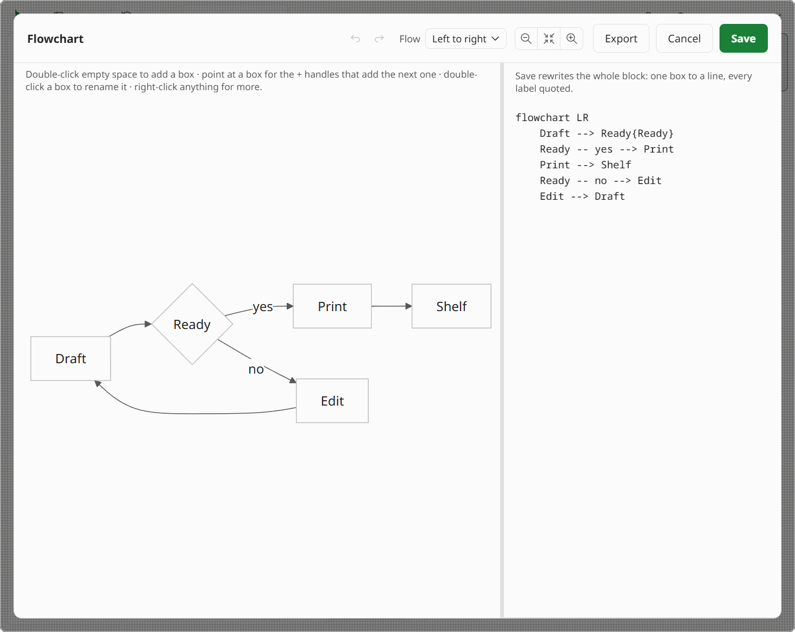

A flowchart is a [Mermaid](../01-features/01-rendering.md#mermaid-diagrams) block like any other, and it can always be written as text. It can also be drawn. There are two ways in:

- The **flowchart** button in the [insert row](#adding-a-block), which starts a new one.
- The **flowchart button** on a diagram already in the page, shown when you hover it. The button beside it opens the same diagram as Mermaid text instead.

Either opens a full-window sheet with two panes: a **canvas** on the left and the **Mermaid text** on the right. They are peers over one diagram — draw on the canvas and the text follows; type in the text and the canvas follows.

Drag the bar between them to give either pane more room; arrow keys move it too, and a double-click puts it back.

The canvas keeps a minimum width however the window moves. A smaller window takes room from the text pane, not the picture, and your dragged width returns when the window widens.

**Nothing is written until Save**, which writes the whole block as one edit, so the document's [Undo](#undo) puts the diagram back in one press.

**Cancel writes nothing.** Save asks where the diagram goes at the moment you press it, so a change to the file underneath moves the write with it. If the place it was going is gone, Save says so and leaves the sheet standing, with everything you drew still in the text pane.

The canvas is Mermaid's own drawing of your diagram, made by the same renderer the page uses. So what you work on is exactly what the document will show. Selection rings and **+** handles are laid over it.

When Mermaid refuses a diagram, it says why under the canvas. That is the one difference from a page: a document marks a failed diagram and moves on, but an editor has to tell you.

### Drawing

Everything is done on the canvas itself.

State diagrams use the same canvas. Double-click empty space to add a state, drag a state’s **+** onto another state to connect them, and double-click a state, transition or composite state to change its name. Delete removes a selected state and its transitions and notes, or a selected transition.

Composite states can be renamed on the canvas; change their contents in the Mermaid text pane. The canvas keeps comments, notes, regions, classes and other lines you do not edit exactly as you wrote them. The text pane and Save button say **Save changes only the lines you edit here or on the canvas.** for a state diagram.

Mind maps, timelines, kanban boards, block diagrams, git graphs, requirement diagrams, C4 diagrams and architecture diagrams open on the canvas too. Like a state diagram, they keep every line you do not edit exactly as written.

Double-click a part, or press `Enter` with it selected, to rename it; what else each kind takes is what its parts are:

- **Mind map** — a node's **+** adds a branch under it and opens its name for typing. Delete removes a node and everything that hangs from it; the root stays. A shaped node keeps its shape when renamed. Moving a branch, icons and classes are changed in the text.
- **Timeline** — rename a period or an event. A period's **+** adds an event under its last one. Delete removes an event, or a period with all its events. The title and sections are changed in the text.
- **Kanban board** — rename a card or a column. A card's **+** adds a card at the end of its column, and a column's right-click menu adds one there too. Drag a card onto another column, or onto a card in it, to move it there. Delete removes a card with its metadata, or a column with its cards.

  Every card and column needs an id in front of its words, which is how the canvas finds it in the drawing.
- **Block diagram** — rename a block or label an arrow. Drag a block's **+** onto another block to draw an arrow between them. Delete removes a block from its row along with every arrow naming it, or an arrow. Columns, widths, spaces and nested blocks are changed in the text.
- **Git graph** — rename a branch everywhere it is named, a commit's id (one is added where none was written) everywhere it is cherry-picked, or a tag's words. History itself — adding, removing or reordering commits — is changed in the text, so a git graph has no **+** and Delete does nothing.
- **Requirement diagram**: rename a requirement or element, which changes its name everywhere it is written. Or change a relationship's type: contains, copies, derives, satisfies, verifies, refines or traces. Drag a part's **+** onto another to add a `traces` relationship and type its kind straight away. Delete removes a part with every relationship naming it, or a relationship.

  Its fields — id, text, risk, verify method, type and doc reference — and its classes and styles are changed in the text. Only the last relationship written between two parts is drawn, so that is the one the canvas points at.
- **C4 diagram** — rename a person, system, container, component or boundary, or a relationship's label. A name cannot hold a double quote. Drag an element's **+** onto another to add a relationship and type its label straight away.

  Delete removes an element with every relationship naming it, or a relationship; a boundary stays, because taking it away means deciding what happens to everything inside it. Descriptions, technologies, the title, styles and layout are changed in the text.

  Mermaid draws no name on a C4 part, so the canvas finds each by the order it is drawn and checks the label inside it. Where they disagree, the canvas adds no handles and says to edit it as text.
- **Architecture diagram** — rename a service or a group. Drag a service's **+** onto another service to join them from the side facing it. Two services already joined cannot be joined again, since a second line between them stops the diagram drawing. Delete removes a service or junction with every edge naming it, or an edge; a group stays.

  Icons, placement, edge sides and arrows and the title are changed in the text.

Each kind's line at the top of the canvas names only what that kind can do, and the shape picker and **Flow** control stay flowchart-only. A line any of these kinds cannot read switches the canvas off and says which line, and the text pane still edits it.

- **Double-click empty space** to add a box.

  The picker slides up from the bottom of the sheet, a quarter of the editor tall, over a dimmed editor. It holds a field for the name, then every shape under headings: basics, steps, start and stop, in and out, by hand, data, documents and notes. Shapes are alphabetical within each heading.

  Pull its grab bar up for more of the list at once, or push it down to park it; either height lasts as long as the sheet is open. Type the name first or leave it and rename later; picking a shape never overwrites what you typed.

  A press on the dimmed part puts the sheet away: the empty canvas, the text pane or the line above it. The sheet's header and the bar between the panes keep working with it standing, since zooming and widening work on the diagram.
- **Hover a box** for its **+** handles. Click one and the same picker opens; the box you choose arrives already joined on that side.

  Drag a handle onto another box instead, and it connects the two. Drop it back on the box you started from for a line to itself, which is how a retry or a poll looks. The box you are over lights up either way, so a drop is never a guess.
- **Select a box or a line**, and the picker opens on it, holding its name and every shape it could be instead. Choosing a shape and changing one use the same sheet.

  A box's other three fields sit beside its name in one form at the top of the sheet. They are where clicking it goes, the icon on it, and the picture in it. Drag the sheet's grab bar down to park it out of the way, or close it with the **X**.
- **Double-click a box** — or press `Enter` with it selected — to rename it in place.
- **Drag a box onto a line** to move it into that line: `A → B` becomes `A → this → B`, and the chain it came from closes up behind it. Drop it on another box to move it beside that one, inside a group's box to put it in that group, or outside one to take it out.
- **Point at a line** and it brightens. A drawn line is a hair of ink, so each carries a wide invisible copy of itself. A click, a hover or a drop lands anywhere along it, not only on the ink.

  **Select** one and both its ends become handles: drag either onto a different box to point it somewhere else.
- **Right-click anything** for the same actions in words. It adds duplicate, flip a line, add a second line between the same two boxes, take a box out of its chain, and change a box's id. The id is the name every arrow in the text uses, kept apart from the words drawn on it. 

  Every group action is there too: put a box in a new group, move it, take it out, rename the group, or remove it and keep the boxes.
- **Press a group's title or its border** to select the group itself. The sheet then holds its name, which way it runs — its own direction, or the chart's — its colors, and a button that removes the group and keeps its boxes. Right-click it to rename it or add a box inside it.
- **Color a box, a group or a line** from the sheet under it. **Fill** and **Edge** lead with the colors the chart already uses, then a color window for a new one; a box filled here gets black or white lettering, whichever reads.

  A line has **Color** and **Weight**, alongside its **Length** — how many ranks it reaches across — and its **Motion**: still, slow or fast.
- **Shift-click** to choose several boxes, lines and groups, or **Shift-drag** across empty space to choose every box the drawn box touches; a plain drag still moves the picture.

  The sheet counts chosen boxes and colors them together. **Group them** gathers them into a new group when they all sit in the same one, and Delete removes the lot in one step.
- **Right-click empty space** to add a box there, or open **Diagram settings**. Those hold the title drawn over it, how its lines curve, a clean or hand-drawn look, and what a screen reader says.
- **Delete** removes whatever is selected. `Ctrl+Z` / `Cmd+Z` steps back inside the sheet, and `Ctrl+Shift+Z` or `Ctrl+Y` steps forward — separate from the document's own undo, which only sees the finished diagram.

A line at the top of the pane says what the thing under your pointer is for, and what letting go of a drag would do.

### Which way it runs

A chart has one direction, and the first box decides it. While there is only one box it carries **four** + handles, and the one you take sets the chart running that way. From the second box on it carries **two** — the next step and the one before — so nothing can spin a settled diagram round by accident.

**Flow** at the top of the sheet turns it after that.

### Where the boxes go

**Nothing about position is stored in your document**, so Mermaid lays the diagram out fresh every time. Dragging a box still moves it under your pointer and still means something: it changes the box's place in the order. On release it settles back into place rather than staying where dropped.

Since Mermaid does the placing here and in the page, what you see is what the document will draw.

The canvas fits the diagram when it opens and centers it. Drag empty space to move any diagram, so a picture can be pushed out from under the picker. Use the zoom buttons or `Ctrl` and scroll to zoom.

They are the same lens, frame and lens buttons a [drawn diagram](../01-features/01-rendering.md#mermaid-diagrams) carries in the page, and the middle one puts it back where it started.

The sheet is the whole window, so its header stands in for the app bar while open. Drag empty space along it to move the window, and double-click to maximize.

### Export

**Export** at the top of the sheet writes the diagram out as a file of its own.

It never touches the document you opened it from; Save is still the only thing that writes into the page. It asks where the file goes. On Windows the save window offers Markdown, PNG, WebP, PDF and JPEG, and the name's ending sets the format. On a Mac a short menu asks first, since that window shows none.

**The name you type has the last word.** Pick one format, then type an ending for another, and you get the one you typed. The earlier pick only decides the suggested name. Markdown answers to `.md`, `.markdown` and `.mdown`, and a name with no ending at all comes out `.md`.

Not `.mdc`: Leaftext [opens](../01-features/03-library.md#file-types) a Cursor rule, and what this window writes is an ordinary document with no field block, so a rule is never what comes out of it. An ending it does not write — `.svg`, say — writes nothing and says which five it does.

A quiet note in the bottom-right corner names the file when it is written, and the name is a press that opens it. The same button is in the corner of every [drawn diagram](../01-features/01-rendering.md#mermaid-diagrams) in a page, with no need to open this sheet and with the padlock shut.

- **Markdown** — the Mermaid text in a `mermaid` fence, as a document of its own.
- **PNG** — the drawing as a picture, at twice life size, on the page color behind it. The page hands the host raw pixels and the host writes the file.
- **WebP** — the same picture at about half the file, which is what a chat, a slide or a web page wants. On Windows the page writes this one itself and hands over finished bytes; on a Mac, whose web view cannot write WebP, Leaftext makes it from the drawing's pixels.

  It is lossy, and a drawing over 16,383 pixels a side is more than the format holds. That one is refused out loud, and the PNG row takes it.
- **PDF** — the drawing printed on a page of its own, at its own size, so the lines and the lettering stay sharp however far you zoom in. That is what a slide, a projector or a print wants.

  What gets printed is a freshly drawn copy, the same one the picture rows use, so a diagram you have zoomed or dragged still comes out whole.
- **JPEG** — the same picture again, for anything that will not take a WebP: an older presentation program, an upload form that lists `.jpg` and nothing else. It is the biggest of the three pictures on a drawing and the only lossy one that shows it, so pick it for reach rather than for size.

  Either ending works, `.jpg` or `.jpeg`. A drawing over 65,500 pixels a side is more than this window can encode, so it is refused out loud and the PNG row takes it.

There is no SVG. Mermaid's SVG is really a web page: a stylesheet keyed to a generated id, labels that are HTML, and a font list of CSS keywords. Drawing programs read those as instructions they cannot follow.

### What it can draw

The canvas models the whole of Mermaid's flowchart language:

- **Forty-seven shapes** — the fourteen the brackets spell, and the thirty-three only `A@{ shape: … }` can reach. The picker groups them by what they are for and hovering one says what it means. Both spellings are read, along with every other name Mermaid answers to for a shape, and a box is written back the shorter of its two ways.
- **Connectors** — solid, dotted, thick or invisible, with an arrow, nothing, a circle or a cross at the end, or the same at both ends. Any of them can carry a label, be stretched to push a box further down the layout (`A ---> B`), be given a name, and be animated.

  A line can leave a box and come straight back to it, drawn as an arc over the box, and it selects, takes a label and deletes like any other.
- **Subgraphs** — nesting, a `direction` of their own, and arrows pointing at the group itself. A box says which group it is in, so reordering never moves it out of one.
- **Labels** — quoted, unquoted, with Markdown inside the quotes, and broken across two lines. A line's label field in the sheet takes two lines, written as Mermaid's ` `.
- **Color**: `classDef`, `class`, `:::name`, `style` and `linkStyle` are read onto the box or line they paint and written back from it. Deleting a box takes its color with it.

  A color chosen in the sheet changes only the declarations it owns. A new fill becomes one `classDef` shared by every box of that color, and a class you wrote stays defined even when unused.
- **A link, an icon or a picture on a box** — a selected box has a field for each. The link is where clicking the box goes, written back as `click A "…"`. The icon is one of the app's own drawings by name, such as `leaf:back`. The picture is a file beside the document, or an address.

  A box carrying a link wears a dotted ring on the canvas, because a link is the one of the three that shows nothing.
- **Front matter, `%%{init}%%` directives and comments** written in the block are carried through a save untouched. Diagram settings change only the title, `config.look`, `config.flowchart.curve`, `accTitle` and `accDescr` lines, and leave every other key where it was.

### What it refuses

The canvas fails closed: a diagram it cannot fully model opens with the canvas switched off, and the **text pane still edits it normally**. It never quietly drops the half it did not understand, and one unmodeled line switches the canvas off for the whole diagram rather than half of it. One thing does that:

| In the diagram | Example |
| --- | --- |
| A box given a size or a place of its own | `A@{ shape: rect, w: 40, h: 20 }`, `A@{ pos: "t" }` |

The canvas does not keep a layout, so a save would drop those two silently. `click A call fn()` is the other thing it will not act on: it is read and written back, but does nothing. The page renders diagrams at Mermaid's strict level with no `unsafe-eval`, so a document cannot run a function inside the app.

When the canvas does switch off it names the line that stopped it and what on that line did, rather than leaving you to find it.

**Other kinds of Mermaid diagram**, such as class, state, pie and Gantt, open the same sheet as a **live preview** beside their text. It draws as you type and pans and zooms, but has no editing handles. [Sequence diagrams](#the-sequence-diagram-editor) also let you edit their timeline there.

A **pie chart** or an **xy chart** puts its numbers in rows above the text. A pie has a label and value per slice; an xy chart has a category and one column per bar and line series.

Change a number, and the picture and text follow a moment later, one undo step per change. **Add row** adds one at the end, the × on a row removes it, and `Alt+Up` and `Alt+Down` move the row you are in.

A field holding something the chart cannot draw — a negative slice, a word, a label with a straight double quote — turns red and writes nothing until it is fixed. A chart whose lists cannot line up as rows, such as an x-axis naming more points than its series hold, is left to the text, and the sheet says why.

Seven more kinds open in rows the same way, each row one line of the diagram's text, and every line no row changed is saved exactly as it was written:

| kind | the fields above the rows | one row |
|---|---|---|
| Sankey | — | a connection: **From**, **To** and **Amount**; typing a name another row uses joins that node |
| Journey | **Title** | a step: **Step**, **Score** and **Who**, under a section row of its own; **Add section** puts one at the end |
| Quadrant | **Title**, both ends of each axis, and the four quadrant names | a point: its name and an **X** and **Y** from 0 to 1; its color and size stay in the text |
| Packet | **Title** | a field: its **Label** and **Width**, with the bits it covers worked out from the widths above it, so changing one width moves every range below it |
| Radar | **Title**, **Max** and **Min** | a curve, with one column per axis; **Add axis** adds a column and a value of 0 to every curve |
| Treemap | — | an item: **Name**, **Level** and **Value**; the name stands in by its level, and a section takes no value because what it holds sizes it |
| Gantt | — | a task: **Task**, **Id**, **Starts** and **Length**, under a section row of its own; **Add task** puts one under the row you were last in and **Add section** puts one at the end |

In a Gantt chart, a start is a date, `after` with the ids it waits on, or empty to follow the task above. A length is a whole number with `h`, `m`, `d`, `w`, `M` or `y`, an end date, or `until` and an id.

A task written `after` another moves with it when that one's start changes, so the picture shows the whole schedule shifting. Renaming an id renames every `after` and `until` that names it. A task's **Id** is open only beside a start, since the text cannot carry one without it. The × is off on a task another one names.

A field turns red and writes nothing where the chart would silently draw wrong. That means an id no task has or two tasks share, a start waiting on itself, or a length like `1.5d` or `2x`. It also means a day that does not exist, or an end before its start.

Tags such as `done`, `crit` and `milestone`, and the chart's own lines — `title`, `excludes` and the rest — stay exactly as written.

Some charts stay in the text alone, and the sheet names the line. That covers a radar written `radar` rather than `radar-beta`, a packet with a gap between fields, and a Gantt chart whose `dateFormat` is not `YYYY-MM-DD`. It also covers a line the rows cannot read.

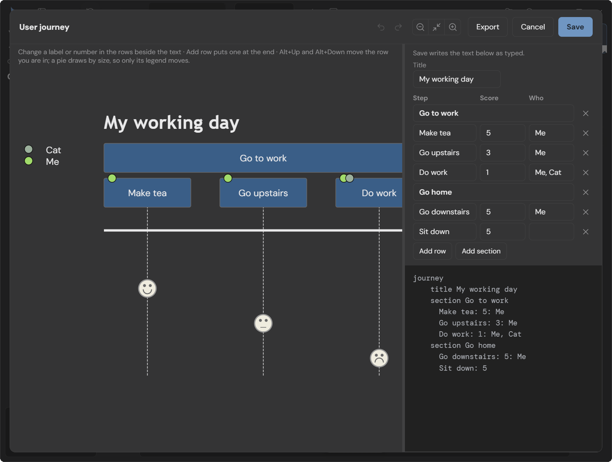

The sheet is named for what it holds, such as **Sankey**, **Pie chart** or **Quadrant chart**, or **Diagram** for an unnamed kind. The name follows the text if you retype its first line. The **Flow** picker stands in the bar only while the canvas holds a flowchart it can draw on.

Export works on all of them.

> [!NOTE]
> Saving a flowchart the canvas draws rewrites the block in one spelling. It always writes `flowchart`, not `graph`, quotes every label, declares every box on its own line, and spells each shape the shorter way. It is the same diagram and it renders identically anywhere Mermaid runs — but a file you hand-wrote will come back tidied.
>
> Every other diagram, and a flowchart the canvas cannot draw, is saved exactly as typed. The sheet says which of the two Save will do, above the text pane and on the Save button.

## The sequence diagram editor

Open a drawn sequence diagram with the button in its corner. The sheet shows Mermaid's timeline beside its source. Press a drawn participant, message, note, loop or alternative label to edit it in the bottom picker. Drag empty canvas to pan and use the zoom buttons or `Ctrl` + scroll to change the view.

- **Participants:** Add a declaration, change its identifier or displayed name, or move it left or right beside another declaration. Changing an identifier updates its messages and notes. A duplicate identifier is refused. If an unsupported source line names that participant, change its identifier in the source pane instead.
- **Messages:** Add one after the selected message, choose its sender and receiver, change its words, remove it, or move it up or down. A move works only beside another message in the same loop or alternative branch; an unsupported line between them blocks it.
- **Notes and regions:** Add a note and choose its words, placement and participants. Wrap a selected message in a loop or alternative, change a region's label without changing its contents, and add or remove an alternative branch. Removing a branch keeps its messages.

  Removing a whole region removes its contents; a region containing an unsupported line cannot be removed from the drawing.

Each committed change is one Undo step inside the sheet. Save writes the changed Mermaid source through the diagram's guarded write; Cancel leaves the document alone. When a drawn part cannot be matched to one source statement, the sheet explains why it is source-only and leaves the Mermaid pane available. Export uses the sheet's current diagram.

## Working in the source

### Source beside the page

The switch beside the padlock opens the source and its rendered page together. Move the wheel over either side to move both, with each drawn block level with the source line that starts it. Type in the source and the page redraws beside it. Press the switch again to return to one view.

The pair keeps one document and one Save button.

### Code view

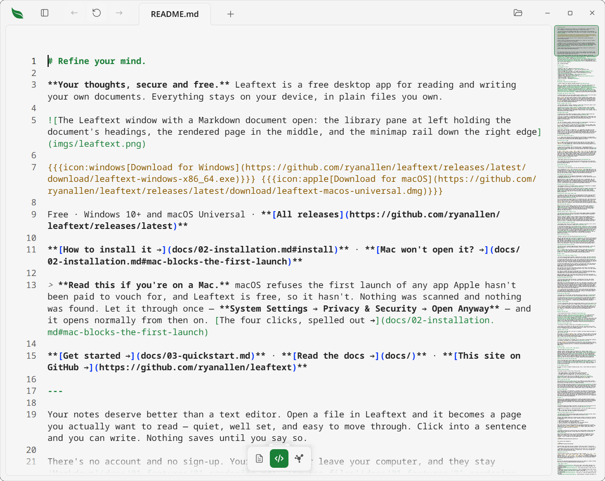

The toggle is the code-brackets button on the [floating toolbar](../01-features/02-navigation.md#the-floating-toolbar) under the page, beside reading and the [graph](../01-features/03-library.md#graph). Click it and the rendered page is replaced by the file's raw source; click the reading button to come back.

On leaftext.com and Emptyguru, the same button shows the published document's source read-only. The reading button returns to the page held beneath the source view, keeping its reading edits and position.

Opening another document while you are in the source view opens **that** document in the source view. The view is where you are working, not a property of the file you picked.

- The source is colored in the active [theme](../01-features/06-themes.md#tokens)'s own syntax colors, so the code view matches the rest of the app. Headings and list markers take the keyword color in bold, and bold and italic text keep their weight and slant. Code takes the string color, links the link color, and quotes the comment color.

  [HTML](../01-features/01-rendering.md#html-files) and [XML](../01-features/01-rendering.md#xml) files show their tags and attribute names in their own colors, and a [YAML](../01-features/01-rendering.md#data-files-json-and-yaml) file its keys, values and punctuation.

  A [JSON](../01-features/01-rendering.md#data-files-json-and-yaml) file is colored like YAML, with a key the same color in both. Its `//` and `/* */` comments are colored too, though JSON has none. A file carrying one is exactly what the reading view refuses to parse, so its author lands here.

  The editor has grammars for those five formats only, so every other format opens here as plain text. That covers raw [email](../01-features/01-rendering.md#email-eml), [plain text](../01-features/01-rendering.md#plain-text-files), [INI](../01-features/01-rendering.md#ini-files) and every [source file](../01-features/01-rendering.md#source-files), which the reading view does color. They all still edit, wrap, and get the rail and the line numbers.

  Switching theme or flipping light/dark re-colors the open source in place.
- **A color carries a small square of itself**, drawn just before the value. So a palette reads as colors rather than as six characters at a time. Hex in its three-, four-, six- and eight-digit forms, including `#000` and `#1234`, and `rgb()`, `rgba()`, `hsl()` and `hsla()` written with commas or with spaces.

  A word that happens to name a color draws nothing on purpose. "Red", "gold" and "orange" are ordinary English, and a square beside each in prose would be noise. The square is a mark, not a button — there is no color picker behind it, and a value is changed by typing it.
- Long lines wrap instead of scrolling sideways, and the gutter numbers *source* lines — a wrapped line keeps one number, pinned to its first row. The gutter widens to fit the highest number in the file, and the numbers stand clear of the page's left border rather than against it.
- **Where it cannot be opened, it says so and gives the document back.** The editor starts the first time you ask for the source. If that fails, the app says so and returns you to the document, at the place you were reading.

  Pressing the button again is a fresh attempt rather than the same refusal.
- The rail on the right is the editor's own [minimap](../01-features/04-minimap.md#the-code-views-minimap): a scaled drawing of the source, with the same viewport box the reading view's rail uses. Drag the box or click the rail to move. It stands on the window's textured chrome, not on the page — the page's right border is the line between them.
- Toggling keeps your place: the code view opens on the source line of the block you were reading, and toggling back lands the reading view on that same block. Switching to another tab and back does too — a tab left in the code view comes back in the code view, scrolled to where you left it.
- **Toggling back and forth stays put.** Finding your place in the other view can only be approximate, since the two views wrap the same file to different heights. A position is rounded to the nearest block or line, and rounding twice can drift.

  So when you toggle away and straight back without scrolling, the view you return to takes back the exact position it handed over. Scroll while you are there and the block-for-line landing takes over again, which is what you want then.

### Editing the source

The code view is a real editor surface: unlock it with the [padlock](#the-padlock), then click anywhere and type. It is Monaco — the editor Visual Studio Code is built on — compiled into the app rather than fetched from anywhere, and loaded the first time you open the source view.

That first toggle spends a moment on the spinner; every one after it is immediate.

- Locked, it still scrolls, selects and copies — it only refuses the typing, and says so in the corner rather than letting the keystroke vanish.
- Selection, caret movement, undo and redo (`Ctrl+Z` / `Cmd+Z`, `Ctrl+Y` / `Cmd+Shift+Z`), clipboard (`Ctrl+C` / `X` / `V`, `Cmd` on a Mac), and your platform's IME are the editor's own. `Tab` indents at the caret rather than moving focus.
- Color follows your typing: the source is tokenized as you go, so a construct takes its color the moment you finish typing it.
- A multi-megabyte file types and scrolls like a short one, because only the lines on screen are ever drawn. Earlier versions carried a hand-built surface to manage that; the editor does it now.
- What reaches the host is the edit, not the file: the offset, how much was removed, and what was typed. Sending a multi-megabyte buffer on every pause in typing cost a fifth of a second of it.

  The message carries the buffer's new length too. If the host's copy ever disagreed, it would ask for the whole text again rather than splice into a buffer it no longer understood.
- Each tab keeps its own edit buffer. Words typed just before another document opens are written into their own document first. Switching tabs, returning to the reading view or closing the window never loses unsaved work.

  Closing carries the words into the [saved session](../01-features/05-settings.md#example), and the next launch puts them back. One undo stands between them and the file as you last saved it. A [new document](#new-document) that never got a file comes back the same way, and its one press of undo takes it back to the empty page it started as.

  Where the file has gone from the disk meanwhile, the words return as a note with no file, under the name it had. Undo still stands between them and the last saved file, and nothing is written to the old place unless you choose it.

  Following a link out of a document you were typing in keeps the buffer too; press Back and the words are there. Closing the window then brings the tab back on the document holding the words.
- The reading view renders the *buffer*, not the disk — toggle back before saving and you see your edits rendered.

### Pinned headings

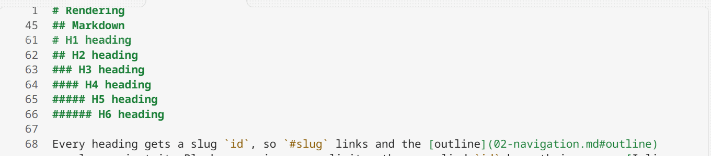

Scroll a Markdown file in the [code view](#code-view), and the heading you are under stays at the top edge. So you can always see where you are.

- A **deeper** heading stacks below the one above it: inside `## Why this exists` under `# Architectural opportunities`, both are pinned, in that order — the trail down to where you are. A heading at the **same level or above** replaces the one it matches rather than stacking, so the trail never repeats itself. Five rows is the limit.
- Each row is the source line itself — its own line number, its own syntax colors — so what is pinned reads exactly as it does in the file. As a section ends, its row is pushed up and off by the next heading arriving beneath it.
- **Click a row to jump to it.** The heading lands where its row was standing, so the line you clicked does not move.
- The rows sit above the page's top fade, with a soft dissolve of their own for the text sliding under them.
- Markdown only. [XML, JSON, and YAML](../01-features/01-rendering.md#xml) have no headings, and their structure is nesting rather than a trail.

### Typing help

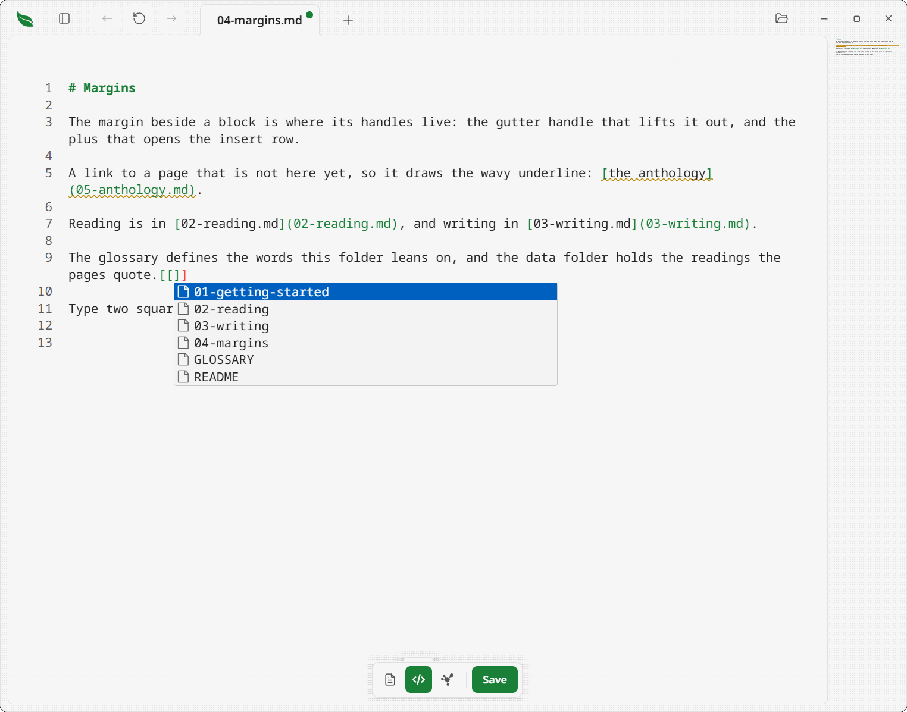

While you type Markdown in the code view, the editor can offer what Leaftext already knows. It uses the same knowledge as the [graph](../01-features/03-library.md#graph) and [search](../01-features/03-library.md#search). It sees only the active [vault](../01-features/03-library.md#vaults), or the document's own folder when no vault holds it.

This is **IntelliSense** — the completion popup, hover card and squiggly underline [Monaco](#editing-the-source) brings from Visual Studio Code. Monaco draws them; Leaftext supplies the answers, and they are your notes rather than code. The docs call it *typing help* because that is what it does for prose.

- **Type `[[`** and a popup lists your notes — the whole vault, or the folder beside the document. A note's [other names](../01-features/03-library.md#other-names) are listed too, each saying which file it opens. Keep typing to filter; pick one and the link closes itself.
- **Type `[[Note#`** for that note's headings, or **`](#`** for the open document's own anchors. Anchors are the exact ones the [reading view](../01-features/01-rendering.md#headings) gives its headings, so a completed link always lands.
- **Hover a `[[wikilink]]`** for a card with the note's opening lines.
- **Broken links get a wavy underline.** A moment after you stop typing, links to missing files and wiki names no note answers to are marked, with a plain message on hover. The same underline says when two notes answer to one name, and when a note lists more [other names](../01-features/03-library.md#other-names) than are used.

**`[[` in the reading view.** Type `[[` in a paragraph you are [editing in the page](#inline-editing-the-reading-view), and a list opens under it. Notes that link here come first under **Near this note**, then every note. Keep typing to narrow it, move with the arrow keys and press **Enter** to pick.

The `[[` and what followed it become an ordinary link, such as `[Weir crest](../01-features/Weir%20crest.md)`, a path from this note's folder. So the words read and follow in the page, on a published site and in any editor. **Escape** closes the list and leaves what you typed.

It never interrupts prose: suggestions appear only on those triggers, never as you type ordinary words. The **wand** on the [floating toolbar](../01-features/02-navigation.md#the-floating-toolbar) turns typing help on and off. It sits in the recess above the code view's button, the code view's counterpart to the reading view's [padlock](#the-padlock). On by default, remembered across restarts ([settings](../01-features/05-settings.md#typing-help)).

### YAML schemas

A YAML file can be held to a JSON Schema the way Visual Studio Code's YAML extension holds it, from the same mapping, so one setting serves both editors.

Leaftext looks up from the file for the nearest `.vscode/settings.json`, stopping there or at a repository root. It reads the `yaml.schemas` table, pairing each schema path with the globs of the files it describes, both read from the folder holding `.vscode`.

A schema path that climbs out of that folder is refused, and a settings file or schema over 4 MB is not read.

- **A field the schema refuses is underlined** with a wavy line in the danger color, and hovering it says why — a misspelled key names the field it most likely meant. A required field that is missing, a value of the wrong type, a list too short and a value that breaks its `pattern` are marked the same way.

  The code view checks a moment after you stop typing and again on save.
- **The reading view marks the same fields** on the [data page](../01-features/01-rendering.md#data-files-json-and-yaml), so a misspelling shows without opening the source.
- **Typing a key offers the field names** the schema allows at that place: at the top of the file, inside a nested mapping, or after a list dash. Each comes with its description or type.

The schema keywords read are the ones a file's structure needs. They are `type`, `properties`, `required`, `additionalProperties`, `items`, `minItems`, `minLength`, `minProperties`, `maxProperties`, `propertyNames` and `pattern`. `title`, `description` and the `$` keywords are read as words. A schema using any other keyword is still applied, and the keyword it cannot check is named once rather than passed over in silence.

A file no mapping covers is drawn and edited as before. A published page has no settings file to read, so it marks nothing.

## Saving

### Save

Saving is always explicit.

- With no unsaved changes there is no save control at all. From your first keystroke, a green **Save** button appears on the [floating toolbar](../01-features/02-navigation.md#the-floating-toolbar) without moving the view buttons. The tab shows a dot beside its name. Typing in the page counts, with nothing clicked out of.

  Take that typing back to where it started and both go out again.
- On leaftext.com and Emptyguru, every page opens locked. Open the padlock and you can type in the page to try the editor; the edits stay in that tab. **Save** appears once you have typed and downloads the edited file under its own name, and a refresh brings back the published words under a closed padlock.

  A book on a site is typed into one chapter at a time, as in the app. **Save** downloads the whole book with every chapter you typed in. `Ctrl+S` sends no save request for a clean page.
- Click **Save** or press `Ctrl+S` (`Cmd+S` on macOS) to write the buffer to disk. Whatever you are typing goes in first, so what is written is the words on screen. The button and dot clear on success.
- Where the disk refuses the write, such as a read-only file, a folder that has gone, or another program holding the file, a message in the corner says so. It names the file, says it was not saved and why, and says your edits are still here. The **Save** button and the tab's dot stay up, because nothing was lost.

  A refusal that arrives with no reason attached still raises that message, saying no reason was given, so a save that did not happen is never a silent one.
- A [new document](#new-document) has no file yet, so its first save asks where to put it before writing anything — and on a Mac which format, since that dialog shows none. That menu opens under the **Save** button whichever way you asked, so the keyboard shortcut and the button land in the same place.
- Closing the window does not save, and does not throw the edits away either: they travel in the [saved session](../01-features/05-settings.md#example) and are back, with the dot, at the next launch. Only the close carries them — a window left open writes nothing of what you have typed.
- A save does not bounce the view: the file watcher recognizes the app's own write and skips the [live reload](../01-features/02-navigation.md#reload) it would otherwise trigger.
- A file is written in the [encoding it was read in](../01-features/01-rendering.md#file-encodings). A UTF-16 document stays UTF-16; a file with no byte order mark does not gain one.

### When the app cannot write it

A file can go while its document is open — deleted, its folder moved, a drive unplugged, a permission changed. The first thing you type after that cannot be written, and the app says so rather than letting it look as though it worked.

- **A message in the corner names the file and says nothing was changed**, with the reason beside it. Your words stay on screen: they are the only copy left, and taking them away would lose them.
- **The dot on the tab, Save and Undo all stay up**, because the app is still holding the edits. A Save button lit over a file nothing reached would be a promise with nothing behind it.
- **Pressing Save then says the same thing** rather than answering with silence.
- **A checkbox says it too, and comes back off.** A box the app cannot write raises the same message, in a list or a table cell. The tick the browser drew on your click is taken back, so the box is not left ticked beside the message.

  A tick the app took but failed to write to disk keeps its tick instead. That change is real and unsaved, so the box stays on, the dot and Save stay up, and the message says it changed and was not saved.
- **[The flowchart editor](#the-flowchart-editor) keeps the drawing.** Its Save waits for the app to confirm the write. A refused one leaves the sheet open with the diagram and the message, instead of closing over minutes of work.
- **[The image box](#images) keeps the address you typed.** An address is the only copy of itself while in that field, so `Enter` waits for the write to land. A refused one returns the box to the same line with the address and the message.

  Where the line it was going onto has gone as well, the message carries the address itself, so it is still there to copy. A picture chosen through the file picker needs none of this — the picker opens again.

### External changes

The [live reload](../01-features/02-navigation.md#reload) watcher keeps working alongside editing:

- With a **clean** buffer, an outside change reloads as usual. If the code view is open, the source refreshes at the place you were reading, not at line one.
- With a **clean** buffer on a tab that is **not** in front, the change is picked up when you switch back. That holds in the reading view and the source view alike.
- A **[Word, Excel, PowerPoint or OpenDocument file](../01-features/01-rendering.md#office-and-opendocument-files)** reloads its whole archive, not only the part on screen. So a save after an outside change writes the file that arrived, not the one it replaced. An **[EPUB book](../01-features/01-rendering.md#epub-books)** is read whole again the same way, so the chapters it carries are the ones that arrived.
- A **[new document](#new-document)** has no file, so no change on disk is a change to it. That includes a change to a same-named file in the folder Leaftext started in.
- With **unsaved edits**, an outside change never clobbers the buffer: your edits stay, and saving writes them over the file. Typing in the page is an unsaved edit as you type it, so a change landing mid-sentence leaves your words alone.

## Formats

The [code view](#code-view) edits the whole source of every format Leaftext opens. That covers Markdown (`.md`, `.markdown`, `.mdown`, `.mdc`), [HTML](../01-features/01-rendering.md#html-files) (`.html`, `.htm`), [XML](../01-features/01-rendering.md#xml) (`.xml`), and [JSON and YAML](../01-features/01-rendering.md#data-files-json-and-yaml) (`.json`, `.yaml`, `.yml`). It also covers [plain text](../01-features/01-rendering.md#plain-text-files) (`.txt`), [INI](../01-features/01-rendering.md#ini-files) (`.ini`), [CSS](../01-features/01-rendering.md#css-files) (`.css`) and [CSV](../01-features/01-rendering.md#csv-files) (`.csv`, `.tsv`). And it covers [email](../01-features/01-rendering.md#email-eml) (`.eml`, `.mht`, `.mhtml`) and every [source file](../01-features/01-rendering.md#source-files).

A [Word, Excel, PowerPoint or OpenDocument file](../01-features/01-rendering.md#office-and-opendocument-files) is the one exception to whole-file, because it is a zip, not one text file. That covers `.docx`, `.docm`, `.xlsx`, `.xlsm`, `.pptx`, `.pptm`, `.odt`, `.ods` and `.odp`. The code view names the XML part above the editor.

A workbook or deck lists its readable sheets or slides there, in the file's own order. A workbook's selected sheet is also the one you type into in the reading view, its blocks wearing a thin accent bar while the padlock is open. A deck is typed into on whichever slide you press.

A slide's build is set in the reading view, with the padlock open, from the list under the slide. It is written where PowerPoint reads it, so PowerPoint plays it. Save or undo an edit before choosing another part. A refused choice leaves the source and selection where they were.

Each save rewrites the selected part and carries the rest of the package forward. A Word or OpenDocument file shows its one source part without a picker.

An [EPUB book](../01-features/01-rendering.md#epub-books) (`.epub`) has one source file per chapter. So the code view opens the chapter at the top of the reading view, named above the editor, and leaving returns to the same place. Move to another chapter and press the button again to open that one.

A [Kindle book](../01-features/01-rendering.md#kindle-books) (`.azw`, `.mobi`, `.azw3`) is stored as compressed records rather than text anybody typed, so the code view does not open it. A Google Drive app shortcut ending `.gsheet`, `.gdoc` or `.gslides` is a link to a document in Google's browser apps, so the code view does not edit it.

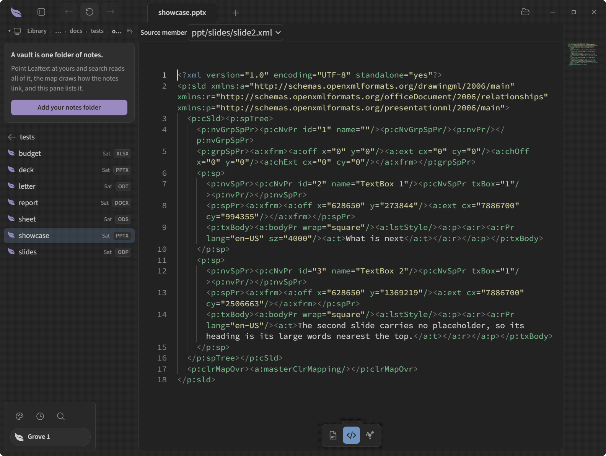

What the *reading view* offers differs by format, because a block can only be edited in place when the app knows the exact bytes it came from:

| Format | In the reading view |
|---|---|
| Markdown text blocks | Edit WYSIWYG — type in the rendered page, styling intact. [Block gutter](#the-block-gutter) and [format bar](#the-format-bar) |
| A safe Markdown table | Type in any cell, drag a row or column by its grip, and restructure it from its right-click menu: rows and columns added and deleted, a column aligned or sorted, the whole table copied as CSV. [Editing a table](#editing-a-table) |
| Markdown blocks that cannot round-trip losslessly | Edit their exact source in place. [Block gutter](#the-block-gutter). A checkbox in such a table is the exception: it ticks where it sits, whatever else the table holds |
| Markdown blocks the page never draws — an HTML comment, a `<script>` or `<style>` block | Nothing is drawn for them, so there is nothing to click; edited in the code view. Every other block in the document stays editable around them |
| A block of raw HTML the page does draw — a `<figure>` holding its caption, a wrapper written with its content inside it | Read-only where it is drawn, because the file gives that whole block one range and the markup inside it none; edited in the code view. Every other block in the note stays editable around it, and a wrapper written with a blank line before and after its content leaves the Markdown inside it editable as ordinary blocks |
| HTML | Open the reading padlock to type on unchanged, unambiguous words authored in the live desktop file. Script-built or changed words use the code view. A contained copy keeps its existing text editing — see [Editing an HTML file](#editing-an-html-file) |
| XML blocks whose drawn words are the file's own bytes | Type on the words where they are drawn; the edit is spliced between the element's own tags. A comment is the same, between its `<!--` marks. [Block gutter](#the-block-gutter) |
| An XML table's cells and column headings | Type on any value whose words are the file's own bytes, including one of several joined by a comma and one drawn from inside a tag; a column heading opens onto the tag itself and renames that element in every record |
| A value written inside an XML tag | Type on the words where they are drawn, including the lone value an empty element is drawn by; only the bytes between that value's quotes are written, and the quote that closes it is refused |
| Every other XML block | Edit its exact source in place, with a line saying why the markup appeared. [Block gutter](#the-block-gutter) |
| An XML field name, a section heading with no element behind it, and a value the page cannot place | Read-only, and a press says why; edited in the code view |
| JSON values | Edit their exact source in place; names stay read-only because their humanized labels are not the file's bytes |
| YAML plain and quoted values | Edit their exact source in place — a quoted one with its quotes, the way a JSON string opens |
| YAML lists, tables, block scalars, and a quoted value the file spells another way | Read-only, and a press says why; edited in the code view |
| YAML aliases (`*name`) and keys with no value | Read-only, and a press says why; edited in the code view |
| INI values, key names and section headings | Edit their exact source in place — a key opens without the spacing around it, and a section opens without its brackets |
| A paragraph, heading or list item in a Word or OpenDocument text file | Edit its exact source in place, spliced into the part it came from. Everything the app never read — styles, themes, comments, tracked changes, charts, macros — is copied across untouched |
| A cell in a spreadsheet | Type on the words where they are drawn. Excel keeps almost every cell's text in one shared table, so what is written is the cell itself carrying its own words, and a cell that shared that text with another one stops sharing it while the other reads what it always read |
| A box on a slide of a deck | Type on its words where they are drawn, each run keeping its own formatting — a title set on two lines too, where each line's words stay in their own line and the break between the two lines cannot be typed over; press the box and drag the strip round it to move it or a corner to size it, held inside the slide. The margin handle beside a slide drags it to a new place and opens Duplicate slide and Delete slide. Pressing a box on another slide holds that slide, and every slide you changed is written at Save |
| Any block in a workbook outside the selected sheet | Read-only in the page; choose that part above the code view, save or undo changes before switching, then edit its source. With the padlock open, the blocks that can be typed in wear a thin accent bar on their leading edge, and the app says once as the padlock opens that the rest is edited in the source view |
| A block in an [EPUB book](../01-features/01-rendering.md#epub-books) | Typed into one chapter at a time. A paragraph or heading whose words match its chapter's source opens for typing in the book's own type, keeping italics and links. A block whose source cannot be placed opens its exact markup with a line saying why. Pressing a paragraph or heading holds its chapter, and its edits change only that chapter's source file. Nothing is inserted, dragged or rewritten across the line between two chapters. Undo and redo walk back across chapters in the order you typed in them, and Save writes every chapter you typed in at once, in one pass over the book. Closing the window keeps every unsaved chapter for the next launch. On a published site the same presses work, and **Save** downloads the whole book with every typed chapter in it; inside another product, the product is handed the book to write |
| Email lines and paragraphs the page can write back byte for byte | Type on the words where they are drawn |
| A line of an HTML body written as it is, whose markup the page can repeat byte for byte | Type on the words where they are drawn; what you write goes between that line's own tags as markup |
| A quoted-printable body in UTF-8 or ASCII | Type on its decoded paragraphs or HTML lines; only changed coded lines are written again |
| Every other part of a message — a base64 body, a folded or coded header line | Read-only in the page, and a press says so; edited in the code view |

### Editing data files

A data file is edited as *source*, never as rendered text, and a YAML file can be [held to its schema](#yaml-schemas). Click a JSON value in the reading view and you get the real thing, such as `"0.1.380"` with its quotes. That keeps an edit from turning a string into something the file no longer parses as.

The big heading is one of those values wherever the file names its own title with a root `title` or `name` key. That key is left out of the body, so the heading is the only place its value appears. Pressing it opens that value's source, as pressing a field does.

A YAML title written in quotes opens the same way, quotes and all; one written as a block scalar stays read-only, like the value itself. A heading standing in for a file that names no title of its own is the file's name instead — pressing that one [renames the file](#renaming-from-the-heading).

That only works where the byte range is certain, so Leaftext offers it only where it is:

- **JSON values** — everywhere. The reader knows precisely where each value begins and ends, so every value is click-to-edit. A name stays read-only because the humanized label on the page is not the file's own bytes.
- **[INI](../01-features/01-rendering.md#ini-files)** — every drawn value, key name and section heading. The reader holds the exact bytes after the `=`, around the key without its spacing, and inside the section's brackets. Nothing is unquoted, unescaped, joined or relabeled on the way to the page, so what you see is what the file says.

  A key with nothing after it is not drawn, so there is nothing there to press.
- **[CSV](../01-features/01-rendering.md#csv-files) cells** — every cell the file holds. Each is typed on as the words it shows, and the save writes that one field back, quoted as the file needs. A cell a short record never wrote has no field to write into, and the table itself opens nothing when pressed.
- **YAML plain and quoted values** — where proven. A scalar's source text is checked character by character against the value it parsed to; a quoted one is checked with its quotes. When they match, the range is exact and the value is editable. The quotes are part of what opens, exactly as they are for a JSON string.
- **Everything else in YAML** — read-only in the reading view.

  Some values cannot be placed. A block scalar (`|`, `>`) carries an indicator and indent its value lacks. A quoted value with an escape, a doubled quote or several lines is spelled differently from its meaning. And nothing proves where a YAML list or mapping ends, since its closing position points at the next token.

  Rather than splice an edit over a guessed range and corrupt the file, Leaftext offers no inline editor and leaves these to the code view.
- **An alias, and a key with nothing after it** — read-only for the same reason. `b: *x` shows the value written up at `&x`, so the only text an edit could replace is on the anchor's line, not the alias's.

  A key with no value has no text at all. Typing into the gap after `key:` would write `key:x`, which is one scalar rather than a key and a value.
- **A press on any of those says why.** The page raises a line naming the source view. It says the file does not mark where a list or table ends, or that a JSON or YAML heading or name comes from the file. Or it says a value is written in a way the page cannot place.

  A value written as two quotes with nothing between them is not drawn at all, the way every empty value is, so there is nothing there to press.
- **No [block gutter](#the-block-gutter) in any data file.** Its ranges name bytes to type over, not standalone pieces of syntax. Dragging or inserting around one would split a key from its value, or land outside the syntax that gives it meaning.

> [!NOTE]
> This is a deliberate floor, not a gap to work around: a range that is off by one byte writes an edit into the wrong place silently. Where the range cannot be proved, the code view edits the file with the full source in front of you.

## Next

- [Rendering](../01-features/01-rendering.md) for what the saved Markdown renders as
- [Navigation](../01-features/02-navigation.md) for tabs, history, and live reload
- [Minimap](../01-features/04-minimap.md#the-code-views-minimap) for the rail beside the source
