# Library in detail

> Everything about the library pane, search and vaults, one fact at a time

This page holds the full behavior behind [Library](../01-features/03-library.md). Each section matches a section there.

## Overview

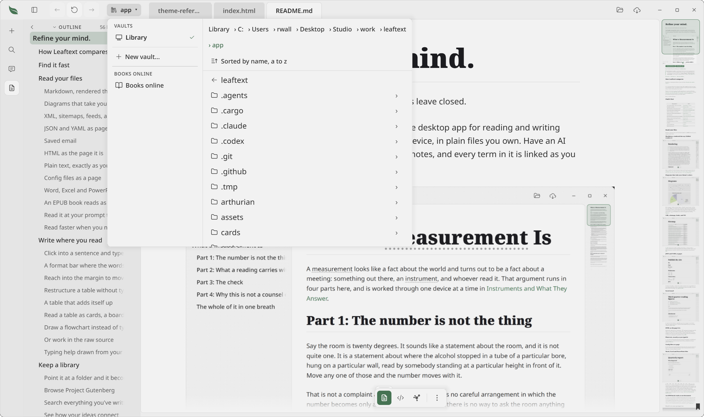

- The library helps you find documents, not just read the one already open.
- It lives in the vault picker at the top of the window, and in the side pane beside the icon rail.
- Everything it shows is read from disk when you ask for it.

## The icon rail and the side pane

A narrow rail runs down the window's left edge whether the pane is open or shut, each press an icon. The rail, the pane, a [chat](../01-features/10-agents.md) and the page each stand as a card with the page's rounded corners, 4 pixels from each other and from the window's edges:

- **New** opens the menu for a new page, a console or an agent. Its **Starts in** row names the folder the new chat starts in. That is the folder of the document or chat in front, or one you browsed to in the [vault picker](#the-vault-picker) since. Press it to pick another before you start.
- **Search** opens the find bar on the whole vault, or on the document when there is no vault. With an agent in front, it puts the keyboard in the chat list's own filter. There is no search field standing in the pane.
- **Conversations**, a speech bubble, opens the pane on your chats. [Pinned chats](#past-conversations-in-the-sidebar) come first, then **All chats**, with running agents at the top and each chat's folder beside its name. Press a chat to bring it forward or pick a saved one up again; agents have no tabs.
- **Scheduled**, an alarm clock, opens the [Scheduled page](../01-features/10-agents.md#scheduled) in the main area: the tasks Leaftext starts an agent for on a clock, and the form that makes one.
- **Documents** opens the pane on the **Outline** of the document in front, [its headings](#the-open-documents-headings). Its Back shows **Pinned** and **Recent**: your favorite documents and folders and what you opened last, as on the home screen.

The pane holds one list at a time. A document opens it on its Outline, a page with no headings on Pinned and Recent, and a chat on the chats. The rail, the pane and the page are three different tones in every [theme](../01-features/06-themes.md#families).

### The vault picker

The one vault control stands in the app bar after Forward. It names the folder of whatever is in front: `vault · folder` inside a vault, or the folder's own name outside one. Its tooltip gives the whole place on disk. It moves as you switch between documents and chats in different folders, without moving any of them.

While work has not reached GitHub, the closed picker wears its count.

Press it and the **browse sheet** hangs under the bar. Down its left are your vaults, the one you are in ticked, each with its settings, then **New vault**, which offers a folder, Clone and Google Drive, and Books online.

Across the top are the path to the folder you are in, each step a press, and the row saying [how the folder is sorted](#sorting-and-drawing-a-folder), which opens its view menu. **Sync** sits there with its count while there is work to send. Under them are the folder's own rows. They carry every [file action](#file-actions), picking several files, cut, copy and paste, dragging out and walking with the keys.

A folder steps in right there, the sheet staying open, and New then starts in it; a file opens in a tab and the sheet closes. A folder of more than 400 items is drawn a window at a time, every row reachable. Press the picker again, press Escape or press anywhere else to close it.

## Summary

| Feature | What you get |
| --- | --- |
| [The icon rail and the side pane](#the-icon-rail-and-the-side-pane) | **New**, **Search**, **Conversations**, **Scheduled** and **Documents** stand in a rail down the left edge; the pane beside it holds the document's Outline, your Pinned and Recent documents, or your chats, one list at a time |
| [The vault picker](#the-vault-picker) | One control in the app bar names the folder of whatever is in front and opens a browse sheet holding your vaults, the folder's trail, View and Sync, and its rows |
| [Vaults](#vaults) | A folder you name as a library root. The vault picker's browse sheet creates, edits and moves between them |
| [First-launch bubble](#the-bubble-on-your-first-launch) | One bubble points at the vault picker the first time you open the pane, and goes for good the moment you point at it. A sheet takes it down, unmet, and it returns once the last one closes |
| [Your first vault](#your-first-vault) | With no vault yet, the start screen offers to add your notes folder, and the pane says once what a vault buys you |
| [File tree](#file-tree) | One folder at a time, with a row that steps back out; every folder you open appears at once |
| [The open document's headings](#the-open-documents-headings) | Open a document and the sidebar holds its outline above the chats, the page's own title first and the heading you are reading lit; its heading folds it away |
| [Breadcrumb](#file-tree) | On a published site, the page's path under the app bar; every crumb steps back to that level, and what does not fit collapses into a `…` menu |
| [Search](#search) | Filename and content search across the active vault, from the [find bar](../01-features/02-navigation.md#find-in-this-document)'s **All files** |
| [Books online](#books-online) | One vault searches Internet Archive, Open Library, Project Gutenberg and Standard Ebooks, and opens available EPUBs |
| [Skipped folders](#skipped-folders) | A folder a machine filled — build output, a package cache — is listed and openable, and not read or watched. The search line says when one was left out |
| [Filtering](#filtering) | More than words in the search field: `#work status:open due:<friday -draft` |
| [Tags](#tags) | Press a tag in a Markdown note to find its notes; right-click to rename it across the vault after confirming the file count |
| [Other names](#other-names) | A note's `aliases` field: every name in it works wherever the file's own name works |
| [Graph](#graph) | A force-directed map of how documents link to each other, shown on the page rather than in the pane |
| [Cloud folders](#your-cloud-is-already-a-folder) | Dropbox, OneDrive, iCloud Drive, Box, Nextcloud, Google Drive and the Kindle app's books become vaults on their own when their app is on this machine, and their rows wear a cloud |
| [GitHub sync](#github-sync) | A vault can be a git repository that pushes to GitHub, manually from its header or automatically once local changes stop when that vault opts in — and a repository can be [cloned](#clone-a-repository) into a new vault |
| [File actions](#file-actions) | Right-click a file or the page you are reading for the actions that fit it |
| [Picture actions](#right-click-a-picture) | Right-click a picture for its own actions: open it big, copy it, find its file, and take it out of an unlocked page |
| [Deleting](#deleting-asks-first-and-can-be-taken-back) | Delete asks before it goes, and offers the file back for a few seconds afterward — on the message, or with Ctrl+Z |
| [Folder actions](#folders-and-the-space-around-them) | Right-click a folder on this computer — or the empty space in its pane — to make a file or a folder in it, paste, export it as a site, reveal it, or see its properties. A Books online category offers Open folder only |
| [Calendar](#calendar) | A month, week or day of the vault's documents by when they were changed, made or dated; pick a day and its documents are listed under the month |
| [Where the launchers went](#where-the-launchers-went) | Themes, Scheduled tasks, Calendar and your Grove are rows of More on the floating bar; Favorites and Recent are the pane's Pinned and Recent |
| [Console](#console) | A command line for the folder shown in the library, opened from the + menu above the tabs |
| [Narrow windows](#narrow-windows) | Too tight for a pane beside the page? The library slides in over it as a full-width sheet |

## Vaults

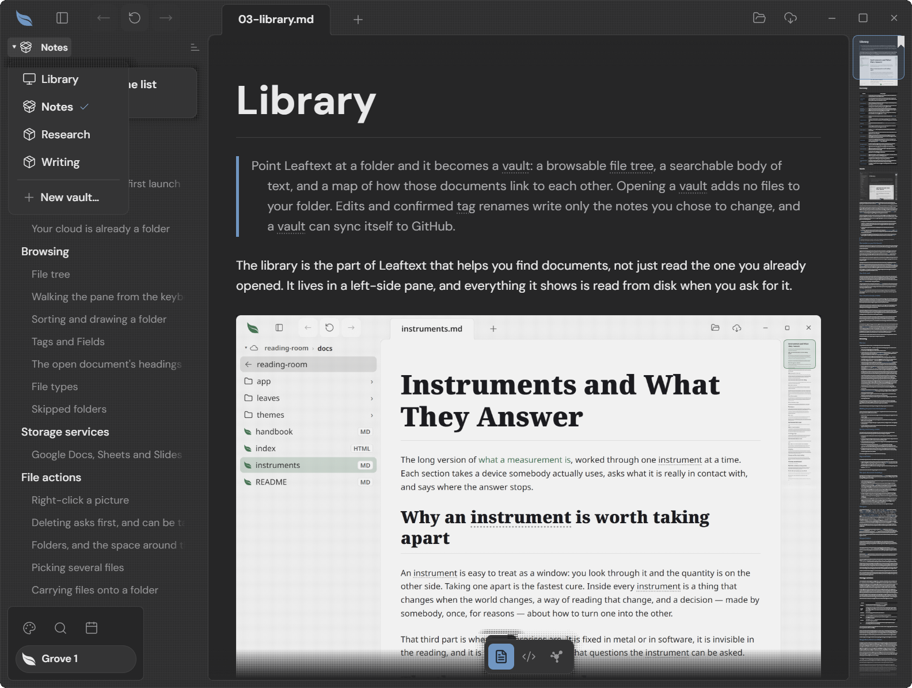

A **vault** is a folder you have told Leaftext to treat as a library root. It is the unit that search and syncing work over, and it is what makes the [graph](#graph) bigger — but not what makes the graph possible.

Press the [vault picker](#the-vault-picker), which names the folder you are in and its vault, to open its browse sheet; the vaults stand down its left. Press the picker again to close it; moving the pointer past it or away from the open sheet leaves the sheet as it is.

A switch button appears over the start screen whenever a vault exists, so switching to Library never leaves you there.

What that button wears says what you are in. **This machine** is the whole library, and a **box** is a vault whose files live only here. A **cloud** means saving in that vault also reaches [GitHub](#github-sync) or a [cloud folder](#your-cloud-is-already-a-folder). Its mark stays the regular weight and sits apart from its name.

While the list is open, the button stays lit. Vaults read A to Z, ignoring capitals.

Each Leaftext window opens its own vault. Picking one in a window changes that window's pane, search and map, and leaves other windows where they were. The list of vaults is the same everywhere. One added, renamed or removed shows in every window, and a window in a removed vault goes back to Library.

A window dragged out of another starts in the vault it came from, and two windows in the same vault read its files once between them. The vault the next launch opens on is the first window's; every other window comes back on its own.

- **Library** is the no-vault state, marked with the machine rather than a box because it is not a collection — the pane starts at your drive roots and browses anywhere. Search is unavailable, because it has no bounded set of words to read. The graph still works: it maps the open document instead of a vault.
- **A vault** roots the pane at that folder. Everything below it is browsable, searchable and mappable.
- **New vault…** opens the kinds of vault: a folder on this computer, a [cloned repository](#clone-a-repository), or [Google Drive](#your-cloud-is-already-a-folder). Drive appears when its app is missing or an account needs adding back. Under **New vault…** the switcher has a [Books online](#books-online) section of its own. Press **Back** to return to your vaults.

  Choosing a folder opens the folder picker; its name becomes the vault's name.
- The settings button appears when you point at a vault row or reach it with the keyboard. It opens a panel to rename the vault, point it at another folder, remove it, or connect it to [GitHub](#github-sync).

  A [sync app's own folder](#your-cloud-is-already-a-folder) cannot be pointed elsewhere or made a repository, since the sync app already copies it, and [Books online](#books-online) offers only Refresh the catalog.

> [!NOTE]
> **Nothing is written into your folder.** A vault is a row in Leaftext's own database, not a marker file. Removing a vault forgets it; the folder and its files are untouched.

### The bubble on your first launch

A name and a caret is not much to go on. So the first time you open Leaftext with the pane showing, a small bubble points a chevron at the vault picker. It says **"Choose a vault and browse its folders here."**

It goes the moment you point at the row, and it never comes back — pressing the row does the same.

The bubble ignores the pointer, so moving across it neither removes the words nor gets in the way. A [menu](#file-actions) opened where it stands is drawn over it. There is no close button and no timer.

One bubble per launch at most, with a quiet launch in between, and nothing at all once you have met them. With the pane shut there is no bubble, and that launch is not spent — you get it the next time the pane is open.

Anything that stands over the whole window takes it down while it is up.

The glossary, the theme picker, the start screen's list and the flowchart editor all slide over the window. A [picture](../01-features/01-rendering.md#images), [table](../01-features/07-editing.md#inline-editing-the-reading-view) or [diagram](../01-features/01-rendering.md#mermaid-diagrams) opened on the whole window covers it too. A bubble left standing would point at a covered button, with no way to reach it.

So the bubble steps aside, unmet, and returns beside its button once the last cover has gone. One cover opened over another keeps it away until both have gone. The launch is not spent, and the promise is still there to meet.

### Your first vault

Until there is a vault, the start screen carries a third button beside Choose file and New document: **Add your notes folder**. A line under the row says what a folder buys: search across all of it, a map of how the notes link, and the folder in the pane. It opens the folder picker directly.

Once a vault exists the button goes, because from then on the name over the headline is the [switcher](#vaults) and **New vault…** opens its kinds there.

The pane says it once too. A reader who has met the [bubble](#the-bubble-on-your-first-launch) and still has no vault finds a short box at the top of the file list. It says what a vault is and what it buys, with the same button. It sits inside the list, so nothing above it moves.

Picking a folder retires it, and so does opening the vault list — either way it never comes back.

A [cloud folder](#your-cloud-is-already-a-folder) that made itself a vault does not count as one you made, so the box still shows. A folder you picked yourself out of your Dropbox reads the same way, so that one reader may meet the box once.

### Your cloud is already a folder

If you have the Dropbox, OneDrive, iCloud Drive, Box, Nextcloud, Google Drive or Kindle app installed, that cloud is a real folder on this machine. So **Leaftext makes it a vault for you**.

There is nothing to press: the folders are in the switcher the first time you open it, named after themselves. Each wears a cloud, because saving in one goes wherever that client sends it.

Leaftext holds no account and no password for any of them. **Their app does the syncing; Leaftext only reads and writes the files.** So there is no refresh to wait for here. A file that has not arrived yet is one their app has not finished with.

Only what is really there is added: a client you do not have is not listed, and neither is one whose folder has been deleted. Where a client records having been moved — Dropbox, OneDrive, Nextcloud — that record is what gets read, so a Dropbox living somewhere other than the default is still found.

Nothing is scanned to do it; each is a named place, checked.

Leaftext looks when it starts and whenever you return to its window. So a client installed while Leaftext is open is found on your return, since leaving the window is how you installed it. Remove one and it stays removed: Leaftext remembers the folder.

Add it yourself with **Folder on this computer…**, or use **Google Drive…** for a detected Google Drive account.

On Windows the Google Drive app mounts each signed-in account as a drive of its own, labeled with the account. Leaftext finds every Google Drive account and adds its **My Drive** as a vault named for the account, such as **My Drive (you@example.com)**. Two accounts are two vaults you can tell apart. Shared drives and Other computers stay in the library.

A name you give one is kept. These drives download a file the moment anything reads it. So Leaftext lists every note there by name, time and size without reading it. Rows carry no title or preview, and a field rule hides nothing. Search, the map, fields and Home's tasks do not look inside them.

A note is fetched when you open it. On a Mac, the same holds for a file Google Drive keeps only in the cloud. The first open asks macOS to fetch it, and the document appears once it arrives.

No Google Drive app yet? **New vault… → Google Drive…** gets it for you. Leaftext downloads Google's own installer from Google and opens it, and your computer asks whether to let it install. Then you sign in to Google Drive in its own window. Your **My Drive** opens in Leaftext the moment its folder appears.

If the app is already installed but signed out, the same row just starts it. If the download fails, Google's download page opens in your browser instead. Cancel stops the wait. On Windows and Mac, if you removed an account's vault while its Drive remains mounted, **New vault… → Google Drive…** adds it back without an installer.

When several accounts are missing, choose the one to restore by its account name. The other removed accounts stay removed. When every detected account is already a vault, the setup row is hidden.

A vault *inside* one of these folders wears the cloud too. Where the files end up is what the mark is about, and a folder under Dropbox syncs exactly as Dropbox does.

#### Google Docs, Sheets and Slides

The Google Drive app keeps Google Docs, Sheets and Slides in its folder as shortcuts ending `.gdoc`, `.gsheet` and `.gslides`. When you open one, Leaftext says what it is and offers **Open in Google Docs**, **Open in Google Sheets** or **Open in Google Slides**. The press opens that document in your browser.

Leaftext does not sign in to Google or fetch the document through Google's API. If the shortcut does not identify a document, the message says so without an open button.

### Books online

**Books online** is one vault for free libraries on the web, Internet Archive, Open Library, Project Gutenberg and Standard Ebooks together. The Books online box on Home can be moved or closed from its [heading controls](../01-features/02-navigation.md#recent-files). Choose **Books online** in the vault switcher, under **New vault…**, to open the list of libraries, then choose a library.

**Browse free books** on an [empty new page](../01-features/02-navigation.md#web-tabs) opens Gutenberg directly, and each library's card in the [Books online box on Home](../01-features/02-navigation.md#recent-files) opens that library. Each entry adds or switches to the same Books online vault. It is not listed among your own vaults, and the Books online row's own button opens its settings.

- **Libraries.** The top of the vault lists every library it holds, in name order, each with how many books it has where the library can say. Each library added later takes its place by name.
- **Browsing.** Opening Internet Archive shows 25 EPUB candidates not marked access-restricted at a time in the chosen order, most downloaded first by default, with **Next page** below the list. No item's files are fetched while browsing or searching. The first 10,000 items can be browsed; use **All files** to narrow a larger list.

  A failed page says why, and returning to Books online and opening Internet Archive again retries it. Project Gutenberg lists its categories, each with how many books it holds, and **All books**, which includes the books no category names.

  A category shows a hundred books at a time, most popular first, with a row to the next hundred. Gutenberg's most downloaded books over the last 30 days come first. A book with no count comes after every counted one. Each book row shows its title and author.

  Standard Ebooks opens directly on 48 books at a time, with **Next page** after the books when another page is available. Its library row has no count because its public listings do not give a whole-catalog total. Loading or a failed request keeps the way back to Books online; go back and open Standard Ebooks again to retry.
- **Searching.** With the vault open, the find bar's **All files** searches every library at once from the top of the vault, and only that library from inside one of its rows.

  Each library's matches arrive on their own, under a line naming the library and its count. The same title from two libraries is two rows, because what a press does can differ. A library that fails or takes longer than ten seconds says so in its own place and the others stay.

  In Project Gutenberg plain words look in the title and the author, and `title:` and `author:` look in one. Standard Ebooks searches its public book listings as you type; it does not use the patrons-only catalog feed. Internet Archive searches titles and creators in pages of 25 items; `title:` and `author:` narrow the words to one.

  Up to a hundred matches from each other library are shown, in the same order the folders list in, so the best-known matches come first.
- **Order.** The button at the end of the folder trail picks the order for the whole of Books online: **Most popular**, or **Title** **A to Z** or **Z to A**. The choice is kept, and every library and the find bar answer in it. A library that publishes no reader count lists its own best matches first under Most popular.

  Standard Ebooks offers popularity and relevance sorts; because it has no title sort, both title directions use relevance. Internet Archive asks for most downloaded first, or title in the chosen direction.
- **Internet Archive.** A result says **Check this item** until pressed. The press checks that item's files for a public, unencrypted EPUB under the download limit, preferring an original EPUB. An eligible file is downloaded and checked as a readable EPUB before it is saved.

  A missing first cover page leaves a short sentence in its place while the rest of the book opens. A private item, an item without an eligible EPUB, or a failed check or download shows its explanation in Leaftext; press the row again to retry. The catalog does not offer borrowing or sign-in pages. A saved copy opens offline.
- **Open Library.** Open Library shows 20 works at a time in the chosen order, most read first by default, with **Next page** below. The first 10,000 can be browsed. Only works whose best edition Open Library says is free and held by the Internet Archive are listed, so borrow-only books never appear.

  Title **Z to A** has no Open Library order, so it shows the library's best match.

  Each row is named after that edition's Internet Archive item and says **Check this item**. A press checks it exactly as an Internet Archive press does. An audio recording or a scan with no EPUB says so, and a readable EPUB is saved and opened.

  Leaftext asks Open Library at most once a second and reuses a page it already fetched in the same session.
- **Reading.** Each match says its library and what a press does. It reads **Read in Leaftext**, **On this computer** once fetched, or **Check this item** while Internet Archive checks its files. Press a book Leaftext can read and it fetches its EPUB and opens it.

  The row says **on this computer** once it has been fetched, and the Books online box on Home lists every book you have fetched, newest first. With a fetched book open, the pane stays with its own library, including Standard Ebooks.

  A fetched book opens without the internet; a book that could not be fetched leaves nothing behind and can be pressed again.
- **The catalog.** Gutenberg publishes its catalog once a week for apps to read. Leaftext fetches that one file, plus the weekly download counts leaftext.com reads from Gutenberg. It does so when the vault is added, and again once its copy is a week old. Searching and browsing it needs no internet after that.

  **Refresh the catalog** in the vault's settings fetches it straight away. A fetch that fails leaves the catalog you had; with none held, the pane says why and opening Project Gutenberg again tries once more. Download counts that cannot be had leave the books in title order.

Books online is the app's own, so it cannot be renamed, removed or put on GitHub; its settings hold **Refresh the catalog** alone.

## Browsing

### File tree

The browse sheet lists one folder at a time — the folder you are in, not a whole hierarchy.

- Click a folder row — or its `›` chevron — to go into it. The folder you open is on screen in one frame, with nothing fading and nothing sliding.
- The row above the list steps back out one level.
- A folder whose name Windows keeps but cannot spell as ordinary text shows `�` where the odd letter is, and still opens and keeps its own [sort and grouping](#sorting-and-drawing-a-folder). Two such folders spelled alike in one place are both left shut rather than one opening in the other's place.
- Folders sort before files, each alphabetized unless you [sort the folder another way](#sorting-and-drawing-a-folder). Every folder is listed, including the ones whose names start with a dot and the ones a shortcut points at.
- A folder starts with one line a row, the name and nothing else.

  With **Show details** on, each file sits in a softly filled card saying what it is. It shows the name on disk and when it last changed. Then comes its title, a `title` in its [field block](../01-features/07-editing.md#the-fields-at-the-top-of-a-note), where that says more than the name. Last come two lines describing it: a `description` or `summary`, else its opening lines.

  A folder row says how many documents sit directly inside it. A folder of more than five hundred files reads the first five hundred and draws the rest as one line each.

  On a slow disk, such as a network share or synced drive, the names come up first, one line each. Titles and prose fill in once read. A folder hiding notes by a field waits for them, since the fields decide which names show.

  A note kept only online is never read to draw its row. That covers OneDrive's Files On-Demand on Windows and iCloud's Optimize Mac Storage on a Mac. Its row shows name, time and size on one line, so browsing downloads nothing. A folder kept only online shows no count.

  Opening the note downloads it as usual, and a rule hiding notes by a field cannot hide one whose fields were never read. Search, the map, field names, typing help's note names and Home's tasks leave such a note out until it is downloaded. So arriving in a synced vault downloads nothing either.

  A file with no ending kept only online is not listed until it is downloaded, since Leaftext cannot tell whether its contents are text without opening it.
- A favorite that lives in the folder you are in comes first, under a **Favorites** heading, with **Files** over the rest.
- Pointing at a row washes it and nothing else — no shadow, no change of shape, nothing sliding — [what a control does under the pointer](../01-features/02-navigation.md#what-a-control-does-under-the-pointer). The row you have open keeps its own tint instead, so what is open still reads as open.
- Opening a file moves the picker to that file's folder and highlights the row. A file inside a vault switches to that vault first; a file in none switches to the whole library.
- The folder you are in is saved, so a restart reopens it. If the folder has gone, the sheet falls back to the top of the vault.

On a published site, a **breadcrumb** heads the pane in place of the rows and follows the open page, including when a link opens a page in another folder: `Fieldwork › docs › features`. Folder crumbs open their folders; the current page ends the trail.

It shows as much of the path as fits the band, and whatever does not fit collapses behind a `…` button that opens a menu of the skipped folders. The site has no vault switcher or Sync button.

Each call reads exactly one directory, so nothing below what you opened is ever touched.

### Walking the pane from the keyboard

Tab into the list and a ring marks the row you are on — separate from the tint on the document you have open, and never drawn under the mouse.

- **Up** and **Down** move a row; **Home** and **End** go to the first and last; **Page Up** and **Page Down** move a pane's height.
- A **letter** jumps to the next row whose name starts with it.
- **Right** or **Enter** on a folder goes into it; **Left** steps back out, and lands on the folder you came from. **Enter** on a file opens it.
- When the folder is read again under you — a paste, a rename, a change on disk — the ring stays on the same file.
- The same keys walk the search results under the find bar, and the Tags and Fields lists, where **Right** and **Left** open and shut a branch.

### Sorting and drawing a folder

The browse sheet says how the folder is drawn, on the row under its path, such as "Sorted by name, a to z". Pressing that row opens the folder's view menu.

On a published site the same menu is the button at the end of the breadcrumb, lit whenever the folder is drawn any way but the default.

- **Sort by** name, date modified, date created or size, either way round. Folders stay above files in every order.
- **Group by date** puts headings between the files — Today, Yesterday, Previous 7 days, Previous 30 days, then a month at a time — while the folder is sorted by a date.
- **Show details** draws each file with its title, when it changed and its opening lines; off, each row is one line, the name and nothing else.
- **Show hidden**, two fields that hide names like `draft-*` and notes whose field says `status:done`, and a **Stop hiding** row for each rule standing. **Hide from the pane** on a row's right-click menu hides that one; nothing on disk moves, and **Show hidden** draws them dimmed.
- **Arrangements** keep what is on screen under a name. The arrangement in use is how every folder with no choice of its own is drawn, and it brings its saved list with it. Deleting the last one returns to the defaults.

Each folder keeps its own choice, so a restart draws it the same way.

### Tags and Fields

In a vault, the top of the same menu switches the pane between **Folders**, **Tags** and **Fields**.

- **Tags** is every tag in the vault, nested, each with how many notes carry it. The mark before a tag opens the tags under it; pressing the tag searches it through the [find bar](../01-features/02-navigation.md#find-in-this-document)'s **All files**, the same as pressing a tag in a note. Right-click one to hide it from the list.
- **Fields** is every field the vault's notes set. Pressing one opens the values it holds; pressing a value searches `field:value`.

Neither list is a filter of its own: every press goes to the one search box.

### The open document's headings

While a document is in front, the sidebar holds its [outline](../01-features/02-navigation.md#outline) above the chats. Its headings are listed in order, starting with the page's own title and indented by level. The one you are reading is lit as you scroll. Clicking a row jumps to that heading.

- The **Outline** heading counts the headings at its right. Each level reads a step smaller than the one above, and levels below the second sit in quieter ink. So the document's shape shows without counting indents.
- Press the **Outline** heading to fold the list away and again to open it; it stays the way you left it.
- With a console or anything else without a document in front, there is no Outline section.
- An HTML file, or a web page opened by address, lists its own headings too, read from the page as drawn. They are read again whenever the page changes size, so built-on-the-fly headings appear once they exist.

  Clicking a row scrolls the page to that heading, and the row under the top of the page is lit as you scroll.
- A document with only a title, or none, has no outline, so the files stay where they are.

### File types

The pane lists every file in the folder, the way Explorer or Finder does, in the folder's own order.

The ones Leaftext opens read normally. That covers Markdown (`.md`, `.markdown`, `.mdown`, `.mdc`), including a [Cursor](https://cursor.com) project rule with a [field block](../01-features/07-editing.md#the-fields-at-the-top-of-a-note) at the top.

  It covers [HTML](../01-features/01-rendering.md#html-files) (`.html`, `.htm`), [XML](../01-features/01-rendering.md#xml) (`.xml`), [JSON and YAML](../01-features/01-rendering.md#data-files-json-and-yaml) (`.json`, `.yaml`, `.yml`), [plain text](../01-features/01-rendering.md#plain-text-files) (`.txt`), [INI](../01-features/01-rendering.md#ini-files) (`.ini`) and [CSS](../01-features/01-rendering.md#css-files) (`.css`).

  It covers [CSV](../01-features/01-rendering.md#csv-files) (`.csv`, `.tsv`), [email](../01-features/01-rendering.md#email-eml) (`.eml`, `.mht`, `.mhtml`), and [Word, Excel, PowerPoint and OpenDocument](../01-features/01-rendering.md#office-and-opendocument-files) (`.docx`, `.docm`, `.xlsx`, `.xlsm`, `.pptx`, `.pptm`, `.odt`, `.ods`, `.odp`). It covers [EPUB books](../01-features/01-rendering.md#epub-books) (`.epub`), [Kindle books](../01-features/01-rendering.md#kindle-books) (`.azw`, `.mobi`, `.azw3`), and Google Drive's [shortcuts to Docs, Sheets and Slides](#google-docs-sheets-and-slides) (`.gsheet`, `.gdoc`, `.gslides`).

[Source files](../01-features/01-rendering.md#source-files) are ordinary rows too, and open from the pane without becoming vault-search text, graph nodes, or Previous/Next pages. A file with no ending at all, such as `CHANGELOG`, `LICENSE`, `AUTHORS` or `.gitignore`, opens when its opening bytes are text. It is then searched, mapped and paged like any note. Nothing inside a `.git` folder is ever read.

Everything else — a PDF, a picture, a recording, an installer, a file with no ending that holds a binary — is listed dimmed, still wearing its ending. Resting on it says why it does not open, and so does pressing it, which opens nothing.

Its right-click menu keeps every file action: Copy path, Cut, Copy, Rename, Duplicate, Hide from the pane, Reveal, Properties and Delete. Open is there too, grayed out, with the reason under it. A Mac app is a folder, so it is listed as one.

A dimmed file kept only in the cloud is not downloaded to be listed. A file there with no ending is dimmed, since only its bytes could say whether it opens.

Data files are searchable by name and title but draw no [graph](#graph) edges at all — not even to [web addresses](#web-addresses). A string inside a `.json`, `.yaml`, `.ini`, `.css`, `.csv` or `.tsv` is a value, and scanning one as prose would invent links nobody wrote.

A `.txt` draws none for the other half of the same reason: its words are the words somebody typed, not Markdown to be scanned for links. Emails draw none either — their bodies are transfer-coded in the file, so a scan would read base64, not links. They still appear as nodes.

### Skipped folders

The pane lists every folder there is. A name starting with a dot, a build folder and a shortcut to somewhere else are all rows you can open. A folder you can see in Explorer or Finder should be one you can open here.

A shortcut opens onto whatever it points at, the same as it does there.

Two things are left out. At the top of a drive, the system's own folders, such as `Windows`, `Program Files`, `AppData` and `Library`, are skipped, and only there. A folder of yours with one of those names elsewhere is listed. And a shortcut pointing at nothing is not a folder to open.

Search and the [graph](#graph) go almost as wide. A note in a folder whose name starts with a dot is findable and on the map. A shortcut is refused, because one can point back at a folder above it and make the walk run forever.

The walk also refuses a folder a machine filled: one that declares itself a cache, or one named `target`, `node_modules`, `build`, `dist`, `vendor`, `venv`, `.venv`, `__pycache__`, `.next`, `.gradle` or `Pods`.

A vault that is also a build folder can hold a hundred generated files for every note you wrote. Reading and watching them all would cost a third of your computer while you sit still.

The pane still lists these folders, and you can still open one. But search does not read inside them, and Leaftext does not go and look at a change inside one. When a search leaves any of them out, the line above the results says how many and names them if you rest on it.

A document you have actually opened from inside one still updates when it changes on disk.

A folder a tool filled without saying so, such as a cache of thousands of tiny data files, is read like any other. It cannot crowd out your notes. A vault too big to read whole reads files written to be read first, and data files such as JSON, YAML and XML after. Every file, read or not, is still found by name.

## File actions

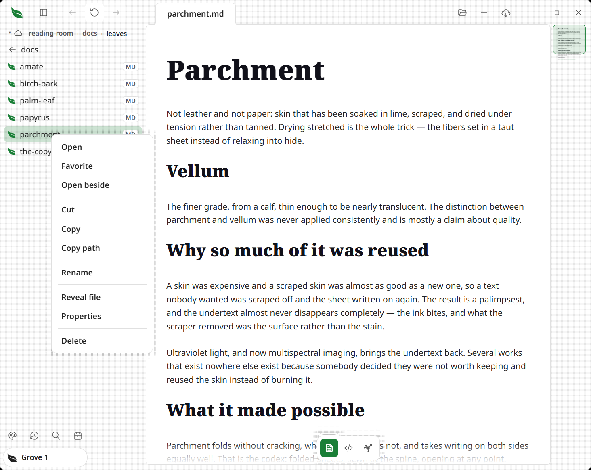

Right-click a file row for a context menu of file actions:

| Action | What it does |
| --- | --- |
| Open | Opens the file in the reader |
| Favorite | Pins the file to the top of the pane, and reads **Unfavorite** on one already there |
| Open beside | Stands the file in a column of its own beside the document you are reading, which keeps the keys. There while a document is open and nothing is split — see [two documents side by side](../01-features/02-navigation.md#two-documents-side-by-side) |
| Cut | Puts the file on the system clipboard to move on paste |
| Copy | Puts the file on the system clipboard to copy on paste |
| Copy path | Copies the file's full path as text |
| Duplicate | Makes a copy beside the file, named `… copy`, then `… copy 2` |
| Hide from the pane | Keeps the row out of the pane without touching the file; **Show in the pane** takes it back while [Show hidden](#sorting-and-drawing-a-folder) is on |
| Rename | Edits the name inline; press Enter to apply, Escape to cancel. A name another file in the folder already has is refused; changing only the capitals of the file's own name is not, so `notes.md` can become `Notes.md`. A name holding `<`, `>`, `:`, `"`, `\|`, `?` or `*`, or one Windows keeps for a device such as `CON`, is refused on both platforms, so a file can always travel to a Windows machine. The same box opens over a page [headed with its own file name](../01-features/07-editing.md#renaming-from-the-heading) |
| Reveal file | Shows the file in your OS file manager |
| Properties | Opens the OS file-properties view |
| Delete | Asks first, then moves the file to the Recycle Bin / Trash — and offers it back |

Right-click anywhere on the rendered page, blank space included, for actions on the document you are reading. They are **Favorite** or **Unfavorite**, **Copy path**, **Reveal file**, **Properties** and **Delete**.

Over a saved web page, an `.html` or `.htm` file, **Open in browser** stands above **Copy path**. It sends the page to your browser, which draws its own layout, type and color.

With words highlighted, **Copy** leads the menu and puts exactly those words on the clipboard — `Ctrl+C`, or `Cmd+C` on a Mac, does the same thing without the menu. **Open**, **Cut**, **Copy** and **Rename** stay on a file row because they act on a row in a folder.

A link inside a document has [its own menu](../01-features/02-navigation.md#opening-a-link-in-a-new-page), and a block being typed in keeps its text menu.

Reveal and Properties map to each OS:

- Windows: Explorer; the file Properties dialog.
- macOS: Finder; Get Info, which brings Finder to the front so its window is the one you are looking at.

### Right-click a picture

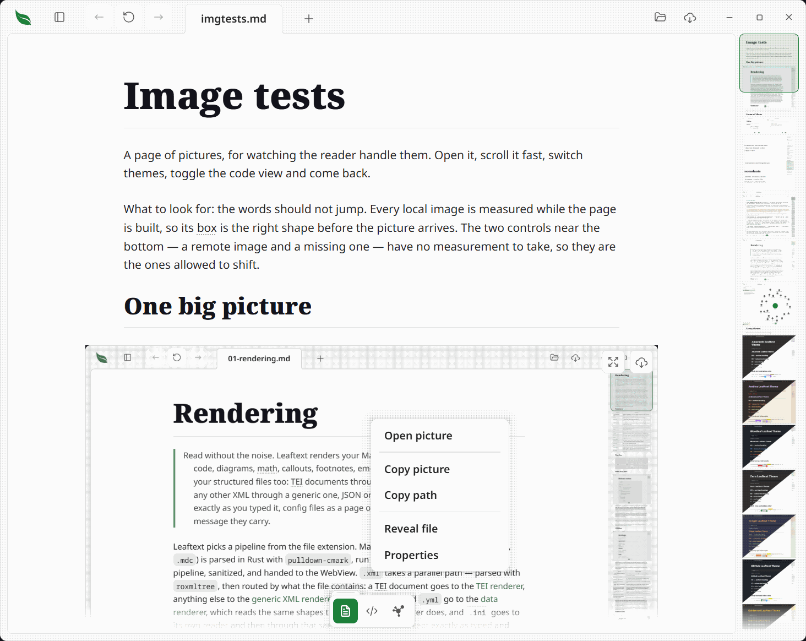

A picture kept on your own disk answers for itself. Right-click one in the page and the menu is about the picture, not the note around it:

| Action | What it does |
| --- | --- |
| Open picture | Opens it on the whole window, the same view the expand button over a picture opens — including a picture sitting inside a sentence, which has no button of its own |
| Copy picture | Puts the picture itself on the clipboard, as pixels to paste into a message or a document. Every kind the page can draw copies, because what crosses is a PNG the page's own drawing wrote |
| Copy path | Copies the picture's full path as text |
| Reveal file | Shows the picture in your OS file manager, sitting where it is kept |
| Properties | Opens the OS file-properties view for the picture |
| Delete picture | Takes the picture out of the document. Only while the [padlock](../01-features/07-editing.md) is open, and only for a picture on a line of its own |

- **Delete picture leaves the file alone.** It removes the picture from the note, as one press of undo, and nothing is written until you save. The picture on your disk is untouched.
- **A picture inside a sentence has no Delete row.** The only piece of source it belongs to is the sentence around it, so removing it would take the words with it.
- **A picture already open on the whole window** keeps Copy picture, Copy path, Reveal file and Properties, and loses the two rows that have nowhere left to go.
- **A picture from the web, one written into the document as data, and one Leaftext cannot find** get no picture menu. None of these has a file to act on.
- **A picture wrapped in a link** keeps the link's own menu, because the link is what a click on it opens.

Where either window will not open, a message in the bottom-right corner says so, so the menu item never just appears to do nothing. **Cut, Copy and Copy path say so the same way.**

A clipboard another program holds open is ordinary for a computer. A failed copy would otherwise only show at a paste in another app, minutes later, with nothing to connect it back.

### Deleting asks first, and can be taken back

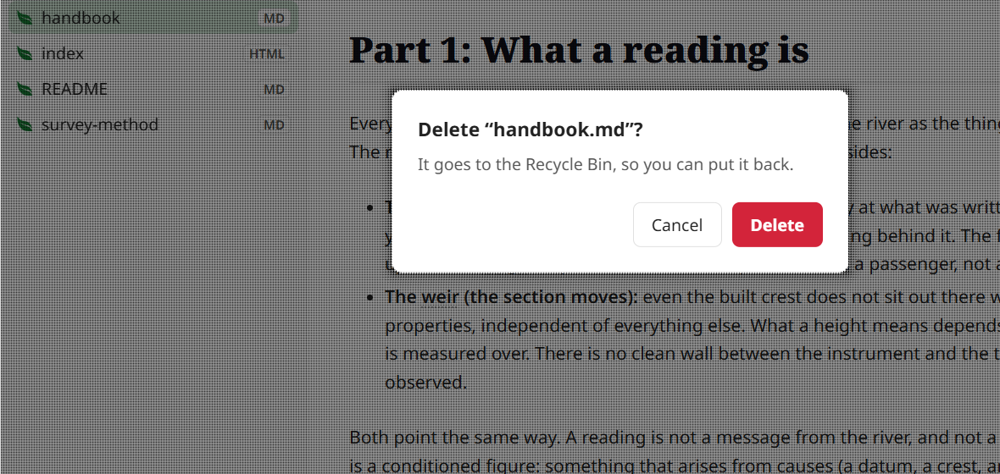

Delete does not act on the click. It asks — naming the file and saying where it goes — and the safe answer is where the pointer already is. Escape or a click on the dimmed page cancels; Enter deletes.

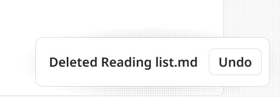

Once the file has gone, a message in the bottom-right corner says so and carries an **Undo** button. Press it and the file goes back to the folder it came from, under its own name. **Ctrl+Z** does the same thing while that message is up, unless you are typing — anything you are editing keeps the key.

The offer lasts as long as the message and covers one delete. After it goes, the file is still in the Recycle Bin or Trash, so nothing is lost by letting it pass. You put it back as you would any other file.

Two things stop an undo, and it says which: the file is no longer in the bin, or something else has taken its name in the meantime. It never writes over the newer file.

### Folders, and the space around them

Right-clicking a **folder on this computer** — or the empty space below its rows, which stands for the folder you are browsing — offers these actions. Both make in the folder that was right-clicked, and a name already taken there is refused rather than written over.

In Books online, a category's right-click menu offers **Open folder** only; the empty space in a category has no folder menu.

| Action | What it does |
| --- | --- |
| Open folder | Goes into it. Only on a folder row; the empty space is already the folder you are in |
| Favorite | Pins the folder to the top of the pane, and reads **Unfavorite** on one already there. Only on a folder row |
| New file | Makes an empty file in this folder and opens it. The name comes up as `Untitled.md` with `Untitled` selected, so typing replaces the name and keeps the extension; press Enter to make it, Escape to change your mind. A name with no extension is made as Markdown, and an extension Leaftext cannot read is refused in words rather than made into a file Leaftext could not open |
| New folder | Makes a folder in this folder, from the same box, prefilled `New folder`. Nothing opens — the pane shows it where you made it |
| Hide from the pane | Keeps the folder out of the pane without touching it on disk; **Show in the pane** takes it back while [Show hidden](#sorting-and-drawing-a-folder) is on. Only on a folder row |
| Paste | Puts what you last cut or copied into this folder. Only shown when there is something to paste |
| Export as site… | Writes this folder's readable documents as linked web pages in a folder you choose |
| Copy path | Copies the folder's full path as text — on the empty space, the path of the folder you are in |
| Reveal folder | Shows the folder in your OS file manager |
| Properties | Opens the OS folder-properties view |

The site's `index.html` opens directly from your disk and works on a static web host. It keeps links between exported documents, their pictures, diagrams and Previous and Next links, with one shared `assets` folder. A folder with a README uses it as its index; another folder gets a contents page.

To put the site in team-docs, copy the exported folder into `public/docs/<slug>/` and point that repository's `staticPath` at its `index.html`.

### Picking several files

Hold `Ctrl` (`Cmd` on a Mac) and click rows to pick them one at a time. Hold `Shift` and click to pick every row from the last one you clicked. Picked rows are tinted and outlined; the row of the document you have open keeps its own tint as well.

A plain click, Escape, opening another folder, opening a document or clicking the empty space below the rows lets them go.

With rows picked and the pane in use, `Ctrl+X` and `Ctrl+C` cut and copy them all, and `Ctrl+V` pastes into the folder you see. Delete sends them to the Recycle Bin. On a Mac, use `Cmd+X`, `Cmd+C`, `Cmd+V` and `Cmd+Backspace`. Right-clicking a picked row acts on every picked row.

Ctrl+C anywhere else still copies the words highlighted in the document.

### Carrying files onto a folder

Press a row and drag it: a small tag follows the pointer naming the file, or how many you are carrying when the row is one of several picked. Let go over a folder row, a folder in the path at the top of the pane, or the empty space of the pane itself, and the files move there.

Hold Ctrl as you let go to copy instead (Option on a Mac). A folder does not light up for itself or for a folder inside it, and neither does the folder the files are already in. Escape puts them down where they were.

Keep going past the edge of the window, and the files come with you. Let go over an Explorer or Finder window, the desktop, or a mail being written, and that program takes them as its own drag.

### Dropping files in from outside

Drag files in from Explorer or Finder and they land on whatever you let go over. Over a folder row or the pane, they are copied into that folder; hold Shift as you let go to move them instead.

Over the tab strip, or anywhere that is not one of these, they open as tabs, the way a drop always has.

Over the open document, a dropped file is written into it as a reference, at the place you let go, spelled the way that kind of document names another file. The path is relative to the document's own folder, and absolute only when the file is on another drive.

| The open document | A file | A picture |
| --- | --- | --- |
| Markdown | `[name](../01-features/path)` | `` |
| HTML | `<a href="path">name</a>` | `` |
| XML | `<link href="path"/>` | `` |
| JSON | `{ "$ref": "path" }` | the same |
| YAML | `{ $ref: path }` | the same |
| Text, INI, source code | the path on its own | the same |
| Email, Word, Excel, PowerPoint, OpenDocument, EPUB, a service page | nothing: the drop is refused and says why | the same |

In JSON and YAML there is nowhere between two values to put one. So a file dropped on a text value replaces it, and a drop anywhere else is refused. In the source view the reference goes in at the cursor.

A path in an XML, JSON or YAML value draws as a link you can click, and so does any `$ref`.

A file Leaftext cannot read can still be dropped into a folder, or written into a document as a link. Dropped on the tab strip, it is refused with the reason.

### Cut, copy, paste

Cut or Copy a file, then Paste it into a folder to move or copy it there. A cut is used up by the paste; a copy can be pasted again. When some of several files cannot go — a name already taken — the rest still land, and one message says which did not and why.

Two things are worth knowing:

- **Nothing is overwritten.** Pasting where the name is already taken refuses and says so, rather than replacing what is there.
- **This clipboard is Leaftext's own.** Cut and Copy also put the file on the system clipboard, so you can paste it in Explorer or Finder. The reverse does not hold: a file copied in your file manager is not what Paste here acts on.

Copying a whole folder is not supported; a folder can be pasted only as a move (Cut, then Paste).

## Search

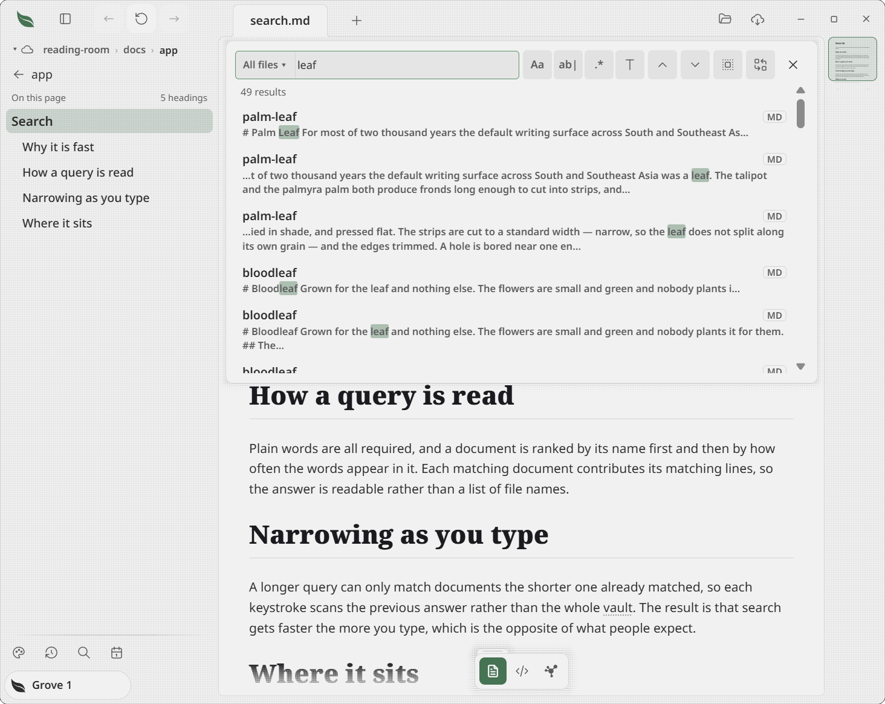

Search covers the active vault, and it is one of the two things the [find bar](../01-features/02-navigation.md#find-in-this-document) searches. Press `Ctrl+F` anywhere and pick **All files** from the menu at the left of the field. On the start screen, with no document, the bar opens on All files already.

The results hang under the bar, so the pane goes on showing your files or your [outline](../01-features/02-navigation.md#the-documents-outline) while you read them. With no vault, All files searches the folder the pane is showing, and the field says which — **Search all files in scholar** — with the cursor already in it.

That folder is read again each time the bar opens, so a note changed since is found by its new words.

Your home folder, a folder holding it, and the top of a drive are too wide to read. There the bar asks for a folder inside your home folder. At the very top of the library, where the pane lists drives, the field says to open a folder.

On a published site, **All files** searches every page the site serves. The first search holds up to 32 MB of pages; each search reads the remaining pages when it needs them, without keeping their text.

Adding letters to a finished plain search reads only the pages that matched, and retries any that could not be read. Deleting letters, or changing the search another way, reads every remaining page again. A page the browser could not read or search is named with the results. Open a result to go to that page.

`Escape` closes the bar and takes the results with it. Nothing about the pane changes either way — it is not where the answer lands.

| Search type | Behavior |
| --- | --- |
| Name matches | Ranked first, and by how much of the name you typed: the whole name, then the start of it, then the start of a word in it, then buried inside one |
| Its [other names](#other-names) | Counted as names, on the same scale — a note's `aliases` entry matched end to end is worth what its file name matched end to end is worth. The row says which name matched |
| Folder names | Counted, and weakly — everything under `notes/` matches "notes" |
| Content matches | Ranked by how often the terms appear **for the document's size**, so a long file cannot out-count a one-page note by being long |
| A word in the text | Found where it starts a word, so a note holding `working` is not found by `king` and `fut` still finds `future` while you type. A word in Chinese or Japanese, written without spaces, is found anywhere |
| An HTML page | Found for its title and the words it shows, never for a tag, a class name, a comment or a style sheet, and its row shows those words without markup |
| A match in a heading | Outranks the same word in a paragraph |
| Multiple terms | Every term must appear, in a name, the folder or the body |
| More than words | The box takes a [filter](#filtering) — `#work status:open due:<friday -draft` |
| Rows per file | Up to three, one per line the words are on — a word found twice on one line is one row with both places marked |
| Two files of one name | Each row says its folder beside the name, so a `README` at the top and one in `docs/` read `README leaftext` and `README docs`. A file whose name no other result shares carries none. A file answering with more than one row names the line each row is on, `line 380`, so the rows can be told apart |
| Result limit | The best 50 files. Past that the count says so — "84 results in the first 50 files" |
| Folders left out | Named in the same line, with how many — "12 results · 1 folder of generated files not read". Rest on the line to see which. See [Skipped folders](#skipped-folders) |
| Text left out | A vault too big to read whole reads its notes first — Markdown, text, web pages, mail, Word, PowerPoint, OpenDocument and books — and its data files after, and searches the text past what it holds after the rest, straight off the disk, so those rows arrive under the first ones. The same line says "12 results · part of the vault's text not read" until every file has been searched, then goes. See **Documents read** under [Facts](#facts) |
| A file too far down to read | Found by the words inside it, read off the disk after the rest of the vault has answered, and by its name, when every word you typed starts a word in it — or all but one, in a search of three words or more, so `the once and future king` finds `white-once-and-future-king`. A file kept only online is found by its name alone, because reading it would download it |
| While the vault is still being read | Rows arrive in batches, a turning ring sits in the count line, and the count says what it has so far. Before the first row arrives, three result-shaped rows stand in their place — a name with the two lines of matched words under it — and they go the moment one real row exists, whether it is this query's first batch or the query before it |

Opening a result lands on the line the match is on. Documents whose source Leaftext cannot place a line in — anything but Markdown — fall back to the nearest heading above the match.

Asking the same thing twice costs nothing. The last answer is kept and handed straight back while the query and the vault's text are unchanged, as when you walk the folders with a search in the box.

Typing one more letter costs almost nothing either. Only files that matched the shorter word can match the longer one, so only those are read again. The same holds for the names a file is found by.

A box that held no word yet — a lone quote mark, say — narrows nothing, so the first word typed after it reads every file. Anything else, including a letter deleted or a file saved while you type, reads the vault afresh.

To search **inside** the document you are reading rather than across the vault, switch the same bar to **This file** — see [Find in this document](../01-features/02-navigation.md#find-in-this-document).

Search reads the same copy of the text as the [graph](#graph): one pass over the vault, held in memory. It is patched one file at a time when you save, tick a box, or the [watcher](#live-updates) sees a change. It is dropped when you move to another folder or quit.

A read still running stops at the same moment, so leaving a big folder hands the machine straight back. The vault you switched to starts reading at once.

Naming the folder you are already in is not moving. That means **New vault…** on a folder already a vault, or **Change folder…** accepting the folder shown. That vault keeps what it read, and a running read carries on. There is no index on disk, so nothing can go stale relative to your files.

That pass starts as you arrive in the vault, so the field names under the search field are ready before you type. A search made while it is running is the one that pays for the rest.

Arriving while another vault is still being read starts it too, but only one vault is read at a time. So the arrival waits, and the moment the vault you left gives up its read, yours takes it up.

How long that takes is your disk, not the matching. A vault read once already answers in milliseconds, but one untouched since the machine started can take a minute. So the first one answers as it reads.

The folder listing that must finish before smallest-first reading no longer holds everything up. The first handful of documents it walks past are read at once, so matches can appear before the listing finishes.

Those early rows are a taste rather than an answer, and one of them can vanish when the settled list arrives. A line above the results carries a turning ring while the vault is still being read. Matches appear underneath as batches of documents land, and the count says what it has so far.

Rows already on screen keep their place while more arrive, and stay the same rows. A match that still matches is left where it is, so a press mid-search lands and the focus ring stays on your row.

Only the rows the answer actually changed are redrawn. The list never grows past what one answer can hold. While the vault is still being read, it stops at the first fifty documents, the ceiling every answer is cut at. So the count climbs to that ceiling and stays there.

The ranking is settled once, on the last answer, which is when the ring goes. A search run while an older query's results are still up is marked the same way. So the results never answer a question you have moved on from.

The [map](#graph) still waits for the whole read, because a picture redrawn three times a second is not one anybody can look at.

## Filtering

See [Tags](#tags) for the tags a note carries and how to rename them.

The search field takes more than words.

| You type | You get |
| --- | --- |
| `harvest` | the word, in a name, one of its [other names](#other-names), the folder path or the text |
| `"the second draft"` | those words in that order |
| `-draft` | not that. It goes in front of anything, not just a word — `-status:open` works |
| `#work` | the note carries that tag, or one under it like `#work/reports` |
| `status:open` | a [frontmatter field](../01-features/01-rendering.md#frontmatter) with that value |
| `status:` | the field is set, whatever it says |
| `due:<friday` | a date field before that day |
| `rating:>4` | a number field over that. `<`, `>`, `<=` and `>=` all work |
| `ext:md` | a file of that kind |
| `in:notes/2026` | inside that folder, or anything under it |
| `task:open` | the document holds an unfinished `- [ ]`; `task:done` wants every box in it ticked |
| `a OR b` | either. `OR` and `AND` are the only reserved words, and only in capitals — a note called `or` is still found by typing `or` |
| `(a OR b) -c` | grouped |

A date can be `today`, `tomorrow`, `yesterday`, a weekday name, or a date such as `2026-08-10`. `friday` means the next Friday, or today on a Friday. `last7d` and `next7d` work for any number of days. The day it counts from is your machine's, not a server's.

**Nothing you type is an error.** A search box mostly holds half a filter, so every unfinished shape means something. An unclosed quote runs to the end, an unclosed bracket groups to the end, and a stray `)` is ignored. A trailing `OR` drops, leaving the side you typed.

Inside quotes nothing is special, so `"-draft"` and `"#work"` find those characters.

A colon starts a field only when the word before it looks like a field name and what follows does not start with a slash. So `C:\Users\me`, `https://leaftext.com` and `12:30` stay findable text.

**It says what it understood.** Type anything past plain words and a line appears under the box reading the filter back — `tagged work, status is open, due before 2026-08-07, not draft` — and naming any field the vault has never set.

A filter on a field nobody uses matches nothing. An empty list that really means "there is no such field" is the one thing a filter must not do quietly.

**It completes as you type.** The field names your vault actually uses, and the values each one holds, are offered under the box. Arrows walk the list, Enter or Tab takes one, Escape closes it — and only then does a second Escape clear the field.

The list is what the vault sets now, not when it opened. Add a field to a note and it is offered; when the last note drops a field, its name stops being offered.

## Scheduled tasks

A checkbox in a note can carry [a date](../01-features/01-rendering.md#task-lists). Every one of them that is still open shows up in one box on the home screen, above Recent and Favorites, with the nearest due at the top.

With an agent in front, the Scheduled tasks row of [More](../01-features/02-navigation.md#more) opens the same list over it.

The box is about the vault you are in, the same as Recent and Favorites. Leave the vault and its rows go with it; the new vault's own arrive once its text has been read.

| A row shows | Where it comes from |
| --- | --- |
| The words on the checkbox line | The line itself, without its date |
| The note and the folder holding it | The path |
| The date | Red once it is past, green on the day itself, amber from tomorrow through the next seven days, gray after that. Today is your machine's |

Overdue work is at the top, because a past date is the nearest one. Two tasks due the same day settle by note and then by the line they sit on, so the order does not shuffle between one look and the next. Pressing a row opens that note and lands on the checkbox.

A ticked box is not in the list, and neither is a checkbox with no date on it — those stay in their notes. With nothing open and dated, the box is not on the screen at all.

## Calendar

Inside a vault, the Calendar row of [More](../01-features/02-navigation.md#more), with a document in front, opens a month of the vault's documents in a sheet from the bottom of the window. Each day wears up to three marks for the documents dated to it, and its full date and count are read out to a screen reader.

| Control | What it does |
| --- | --- |
| Changed, Made, or a field | Which date is counted: when a file was last changed, when it was made, or any date field the vault's notes write in their [frontmatter](#filtering). Written dates are grouped under **Written in your notes**, with how many notes carry each. The calendar starts on Due where the vault writes one and remembers your last choice. A written date and time belongs to the day it names. A field that disappears from every note falls back to Changed for that vault without replacing your choice |
| Month, Week, Day | How long a stretch is shown. The choice is kept until the app closes |
| The arrows and Today | Step back or forward by the stretch shown, or jump to today |

Pressing a day rings it and lists that day's documents under the month, up to 50, each with its folder. The month and the list scroll together inside the sheet. Pressing a document opens it and puts the sheet away, and the day stays picked, so the calendar opens on it again.

The cross beside the day's name clears the day and leaves the month up. A search from the [find bar](../01-features/02-navigation.md#find-in-this-document) leaves the day where it is.

The keyboard works the month too. The arrows move a day or a week, Home and End reach the week's edges, and Page Up and Page Down turn the month. Enter or Space picks, and Escape closes the sheet.

The calendar reads only the vault's text already held in memory, and it stays current: a file changed, made or re-dated while the sheet is open is counted again. Outside a vault there is no Calendar button.

## Other names

A note can answer to more than the name of its file. Give it an `aliases` field and every name in the list works everywhere the file's own name works:

```markdown
---
aliases:
  - Mozart
  - W. A. Mozart
---
```

Now `[[Mozart]]` reaches `Wolfgang Amadeus Mozart.md`. It draws that edge on the map, finds the note in [search](#search), previews it on hover, and appears in the `[[` list with its file named beside it. Written `aliases: [Mozart, W. A. Mozart]` on one line, or as a single `aliases: Mozart`, it reads the same.

This is the same field [Obsidian](https://obsidian.md/help/properties) uses, so a vault written there opens here with its links intact.

**A name with a comma in it goes in quotes.** On one line, `aliases: ["Smith, John", Jack]` is two names — the quotes run until their pair, so the comma inside belongs to the name and `[[Smith, John]]` finds it. An apostrophe is left alone: `[a, don't, b]` is three names, because a quote only opens a run where a name starts.

A list written a line each needs no quotes at all.

A few rules, so a preferred name can never quietly take a real one:

- **A file name always wins.** If one note is called `Mozart.md` and another prefers the name, `[[Mozart]]` opens the file.
- **Between two notes preferring one name**, the first found wins, and the code view's [broken-link check](../01-features/07-editing.md#typing-help) says which note the link opens and which others wanted it.
- **A node on the map keeps its file's name** — a node labeled with a preferred name is one you cannot find by the name on disk. Hover it to see the rest.
- **Thirty-two per note.** Past that they are ignored, and the check marks the `aliases` line to say how many there were.

It works outside a vault too. For a document in a plain folder, Leaftext reads the top of each file beside it, the field block and no further, for up to 500 files. One folder, never the tree below it.

## Tags

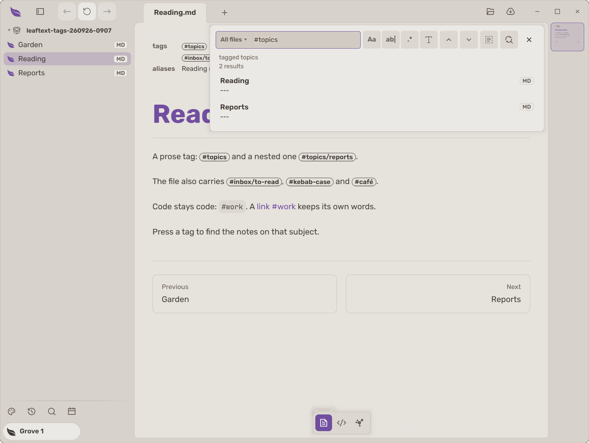

A [tag](../GLOSSARY.md#tag) such as `#work` or `#work/reports` draws as a small pill in a Markdown note's prose and in its `tags` field. Press it to search the active vault through the [find bar](../01-features/02-navigation.md#find-in-this-document)'s **All files**. A parent tag finds its children: `#work` finds `#work/reports`, while `#workshop` is a different subject. Matching ignores capitals.

Tags in prose and the field block belong to the same set. A field value may include its leading `#` or leave it out. Tags inside code, link words, addresses, brace syntax and heading-only wiki references stay text.

A tag needs a letter. A number on its own, or numbers held together by slashes or dashes as in `#2/` or `#2-`, is not a tag. A slash at a tag's end is not part of it. Outside a vault, tags still draw as tags.

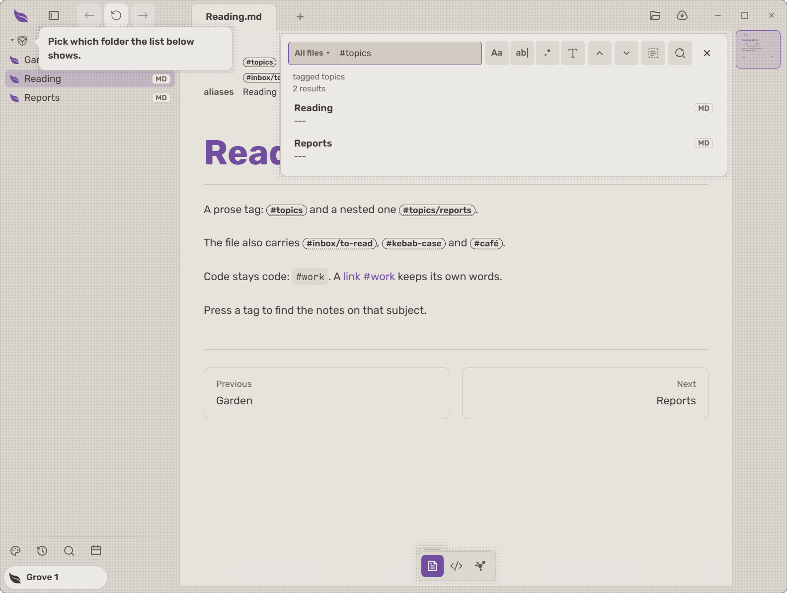

In the desktop app, right-click a tag for **Search for this tag** or **Rename everywhere…**. Enter the new name and choose whether to include nested tags. Leaftext counts the files before asking you to confirm. A rename keeps each note's encoding, line endings, quotes and other words. Save or discard unsaved edits in affected notes first.

A read-only file or a file changed since confirmation stops the run; a stopped run lists the files changed and the files left unchanged.

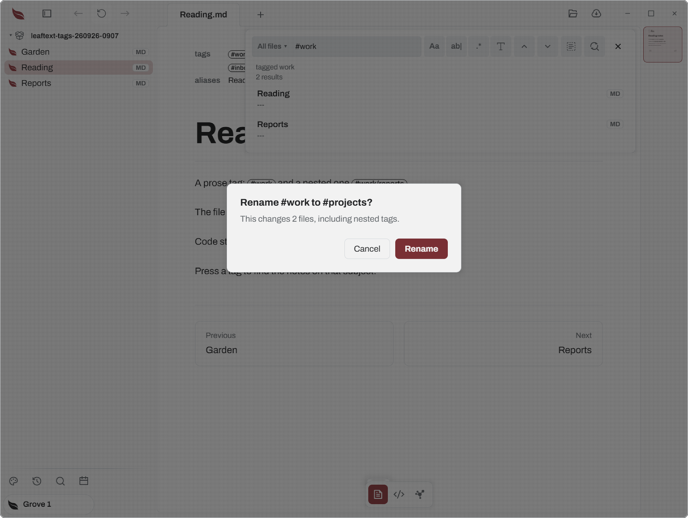

The browser readers offer tag search where their host has a vault; they cannot rename files on your disk.

## Graph

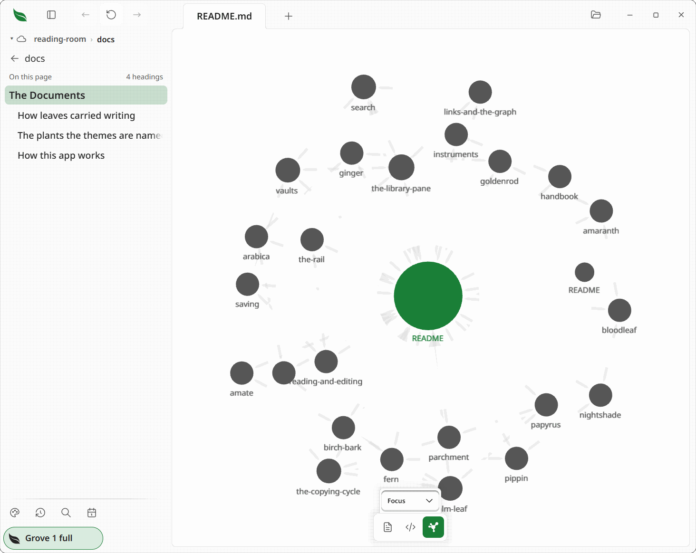

A force-directed relationship map. Each **node** is one of your documents, or a [web address](#web-addresses) one of them links to. Each **edge** is a link that resolves: a Markdown link, an `<a href>`, a TEI `target=`, or a bare URL in the text. A `[[wiki]]` link counts too, matched by file name or by one of the note's [other names](#other-names).

It is a **view of the page**, not a panel — reach it from the [floating toolbar](../01-features/02-navigation.md#the-floating-toolbar) under a document or web tab, beside reading and the source view. It does **not** need a vault.

### What it maps

What it draws over depends on where the open document lives, and you never choose between them:

- **Inside your active vault** — the map is of the whole vault. Every document in it is a node, so you see what links to the document you are on, as well as what it links to. `[[wiki]]` names resolve against the whole collection.
- **Anywhere else** — the map is of that document: itself, the documents in its folder, and whatever it links to, wherever those live. A link is followed one hop out; nothing below the folder is read.
- **On leaftext.com and Emptyguru** — the map uses the links published with the site's document list. It draws the open page, other pages in its folder, and pages it links to without fetching those pages when you open the map.
- **In a live web tab** — the map draws the current page and up to 499 distinct pages it links to. Pages on the same site are filled and named by path; pages on another site are rings named by site. Press a page to visit it in the tab and redraw the map around it.

The second map is **smaller, not wrong**. A document records only what it links to; what links back is written in someone else's file. Reading the folder is what recovers incoming links, and it stops there. A link to a *document* outside the set simply draws no line.

[Web addresses](#web-addresses) are unaffected — those are nodes in their own right, so a document's outbound links show up either way. Put the folder in a vault and the map widens.

> [!NOTE]
> Neither map reads anything you did not point at. The vault's map reads the folder you named. A document's map reads that document, one folder listing, and one file per link. Opening the map on a file sitting at `C:\` does not walk your drive.

### Moving around it

- The map **opens framed on everything it drew** — the tightest zoom that still holds the whole layout, centered. Two documents fill the view; two thousand shrink to fit.

  The first pan, zoom, drag or flight hands the view to you, and it stops reframing. That holds even after you leave: read a document, come back, and you see the same corner at the same zoom. A framing you never touched is framed afresh, and so is a map of something else.
- While the layout settles the view **follows only what leaves the frame**, then frames everything once more when it comes to rest. A force layout breathes as it works, and a camera refitting on every frame of that put the pumping on screen.

  The layout is drawn in the view's own shape, framed clear of the bar and the status line. Once settled, every node keeps a slow drift. The drift is left out on maps of more than 400 documents, and when the system asks for less motion.
- A map whose drawing could not load is **tried again on its own**, up to three times, before it says `The map could not be drawn.`; pressing **Graph** again tries once more.
- The document you are reading is highlighted in the accent color and pulled larger.
- **Names** float in dim gray beneath the nodes. Names stay a fixed size as you zoom, and are thinned by fit. Where the layout is open every name shows; where nodes crowd, only those clear of their neighbors do. The document you are on always keeps its name, and hovering shows the hovered node's name and its neighbors'.
- **Edges point the way the link was written.** An arrowhead sits where the line meets the document being linked *to*. Two documents that link each other get one line with a head at both ends, not two lines on top of each other.

  Heads are left off a very dense map, and while you are zoomed far out — at that size they are ink and nothing else.
- **Click** a node to open that document and **keep the map**. It redraws around what you opened and flies to its node, so you can keep following links from there. **Hover** to light up a node's direct links and dim the rest.
- **Drag** a node to reposition it, **drag the background** to pan, **scroll** to zoom.
- Opening a document from the pane while the map is up **keeps the map up** too, and moves the highlight. Changing what you are looking at is not a reason to change how you are looking at it.
- Closing the last tab closes the map with it: the start screen is not one of a document's views.
- Editing a document the map covers **redraws it in place**. Every node keeps its position, your pan and zoom are kept, and the layout eases into what changed. An edit that draws the same map — a word typed into a document that links nowhere new — changes nothing on screen at all.
- **Coming back to the map shows it at once.** Leaving it for another view keeps the drawing, paused, so switching back shows the same picture with no wait. A layout still settling picks up where it stopped.

  It is drawn again only when something could have changed it. That means a different graph size, a different document's map, a vault switch, or a file behind it being edited, saved or changed on disk.
- Leaving the map puts the page back where you were reading. Press **Reading**, and you are on the paragraph you left. Press **Source**, and it opens on the lines that were on screen, not line 1. A source view you were already in returns to the same scroll.

  That holds whichever view opened the map. Opened from the source view, **Reading** lands on the paragraph those lines belong to, not the top of the page.
- Building the map shows the same waiting page a slow document does — including the redraw after a node click, which builds a new map.

  Leaving the map waits too. Open a search hit or switch to the [source](../01-features/07-editing.md#code-view), and the map holds until its replacement is ready, with the wait shown over it.

### How much it draws

How many documents it draws is set by the [Graph size](../01-features/05-settings.md#graph-size) setting — from a tight **Focus** neighborhood (the open document and its direct links) up to **Everything**. Smaller sizes render faster; larger ones stay responsive by easing the layout and repainting less often as it settles.

A [vault](#vaults) stops reading at its [limit](#facts), so a very large one can hold a document it never read. That document is mapped from its own links rather than drawn empty, the way it would be outside any vault.

Where a **Focus** map inside a vault still comes back with nothing, it says the document is not in that vault's map — not that the document has no links.

### Web addresses

A `http` or `https` link is a node too, drawn as a **ring with a dot at its center** rather than a filled disc. It is labeled by its domain, such as `reddit.com`, with the whole URL in the tooltip.

**Clicking one opens your browser and leaves the map exactly as it is** — no redraw, because nothing here replaced the document you are on.

They are found wherever a reader can click one: `[text](https://…)`, `<https://…>`, an `<a href>`, or **bare in the text**. The same finder turns bare URLs into links when the document is rendered. So the graph and the page can't disagree about what a link is.

**Two documents citing one page share one node** — the point of drawing them. The scheme and host are matched case-insensitively and a `#fragment` or trailing slash is ignored, so `https://Example.org/a/`, `https://example.org/a` and `https://example.org/a#notes` are one page.

- Email addresses are not nodes. Neither is any other scheme — `mailto:`, `file:`, a custom one.
- One document contributes at most **25** web addresses. A bibliography is a real document, and without a cap it would bury the notes around it.

## GitHub sync

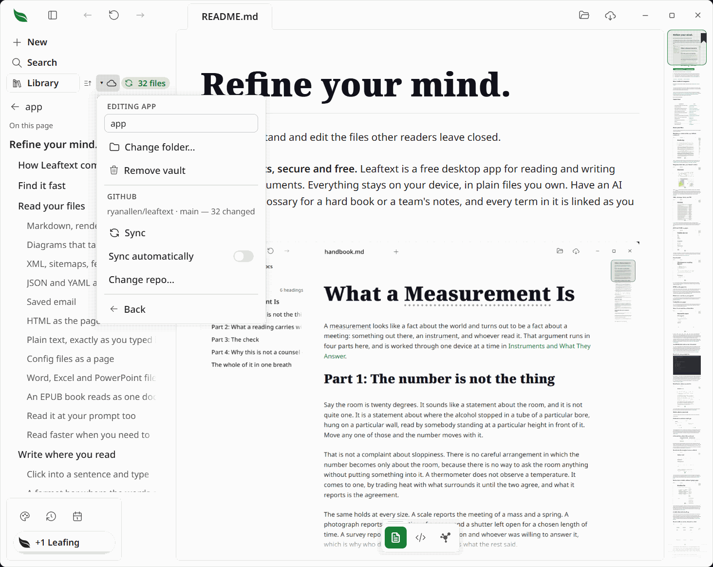

A vault can be a git repository that pushes to GitHub. Open a vault's settings from the switcher to see where it stands.

The panel stays open while you go elsewhere. The row that opens a browser leaves it standing, and switching away and back keeps what you typed. So pasting an address you had to fetch takes one trip.

The lists it opens over, the vaults and the folders the path swallowed, close with the window the way any menu does.

### What it needs

**git is the only requirement.** Leaftext never holds a token: it runs the `git` already on your machine, which already knows who you are and how to sign in.

| What is installed | What the panel offers |
| --- | --- |
| git and [`gh`](https://cli.github.com) | **Create a private repo** — one click, made and pushed |
| git alone | **Create it on GitHub ↗** — opens GitHub with the name filled in; paste the address back and the panel points the vault at it |
| neither | A link to install git, and nothing else |

On Windows, Git for Windows installs Git Credential Manager and sets it as the default, so the first push opens a browser once and never asks again. On macOS, the bundled credential helper can no longer sign in to GitHub, so `gh` or Git Credential Manager must be installed. The panel says so rather than letting a push fail.

Leaftext uses the account saved by the repository's configured Git credential helper. Tokens inherited from a program that launched Leaftext do not replace that saved desktop login.

If a fetch or push fails after the local commit, the message says the work is saved on this computer and names the step GitHub refused. Pressing Sync after fixing the login sends the saved commit without a new one.

The panel also warns before the fact about the two things git needs and often lacks, and each warning carries its own way out rather than stopping at the diagnosis.

**No identity.** Two fields and a **Set who I am** button under the warning. What you type is written to git's settings for the whole machine, where the warning is read from. So a press that works also clears the warning, and someone with no identity sets it once, not once per vault.

An empty field, or one starting with a dash, is refused before git is run.

**No way to sign in.** A sentence naming what fixes it — install [`gh`](https://cli.github.com) and run `gh auth login`, or a credential manager — and **How to sign in ↗**, which opens GitHub's own page on it.

It is a link, never a button. Leaftext's own git requests have their prompts shut off, so you sign in at a console, never through the app's sync.

**And a failed sync says which of them to press.** Where git's own words name the cause, such as nothing signed in or nobody to commit as, the panel says so and points at the fix above it. It does not pass on git's first line untranslated.

Where git's words name neither, its line stands as it is. A network that is down has no button here, and pointing at one would send you to press the wrong thing. Where git printed nothing at all, the line names the step and how it ended — `git add stopped without saying why (exit 128)` — rather than the step alone.

### Clone a repository

**Clone a repository…** under **New vault…** in the switcher takes a git address, asks where it should go, and makes the clone a vault. Paste `https://github.com/owner/repo.git` or the `git@` form; the folder you pick is the *parent*, and the repository gets its own folder inside it named after itself.

Nothing of yours is at risk if it goes wrong. Git makes that folder and removes it if the clone fails, so a broken clone leaves nothing behind and registers no vault. A name already taken in the folder you picked is refused rather than cloned into.

Again there is no sign-in of Leaftext's own. A public repository just works. A private one works when your own git can already reach it, and says what is missing when it cannot. Leaftext never puts up a password box, since a prompt hidden behind a window is worse than a clear refusal.

### Changing the repository

The settings panel names the address the vault points at now. **Change repo…** opens a field for a new one, with **Save** and **Cancel**. Nothing changes until you press Save, and the address it replaced is offered back with one press, in case of a mistake.

Setting or changing the address only points the vault — it never pushes on its own. Sending your files starts with a separate, deliberate [Sync](#syncing), so naming a repository can never overwrite what is already in it.

Leaftext also refuses to act on a repository the vault folder merely sits *inside*; it works only on a repository the folder is the root of.

### Syncing

**Sync** commits everything changed, asks GitHub whether it holds anything the vault lacks, and pushes. Only then is the vault rebased onto it, after committing anything written since the first commit. So a file another program or window writes during a sync never stops the push.

Commit messages describe the change — `Update README.md`, or `Update 4 files` — and carry no mention of the app.

GitHub sync starts manually unless this vault's settings has **Sync automatically** turned on. The switch belongs to one vault and starts off, so private notes can wait for a press while another vault sends itself.

An automatic sync waits for the vault to stop changing, starting ten seconds after the last change. So a run of saves, yours, an agent's or another program's, goes to GitHub as one sync. A vault that never goes quiet is sent anyway after two minutes.

Once a sync finishes, however it started, the next automatic sync of that vault waits a minute. So saves spread over a few minutes go out as a few pushes, not one every ten seconds. Saves during that minute do not push its end back.

The minute is counted only while the app is open, so a fresh launch waits the usual ten seconds. Pressing Sync during any of these waits starts at once. Automatic sync uses the same Sync turn, count and result growl as the button.

After a failure, later saves leave the header's Sync button waiting instead of trying again, the switch stays on, and the panel says **Automatic sync stopped. Press Sync to start it again.**

The button says so too, for as long as it lasts. It turns red and reads **Stopped** before its count, with what went wrong in its tooltip. The failure's growl adds that automatic sync is off until a sync works. Pressing Sync or completing another GitHub action allows automatic sync to start again.

**A sync is never given up on for taking too long.** Sending a large vault the first time can run as long as the connection needs. Only silence stops a transfer: two minutes with nothing arriving. The panel and growl say exactly that, rather than blaming the network.

Every failed sync writes one line into the [journal](../01-features/05-settings.md#journal), naming the vault, the step, how git ended and everything it said. So a sync that stopped while you were away leaves something to read. A sync that worked writes nothing.

A **sync button appears at the end of the Library row** whenever there is work that has not reached GitHub, carrying the count.

It spins as long as the sync really runs. Opening the vault's settings mid-sync keeps it spinning and the panel's rows dimmed, so a second sync cannot start. A vault too large to stage quickly is never cut off part way, since that would lock the repository.

**Resting on it while it spins shows the upload's progress**, in a bar under the Library row. It reads the count and percentage git reports, such as `283 of 827 · 34%`. Keyboard focus opens the same bar, a press still does nothing, and a step with nothing to count draws no bar.

It fades out still spinning — more slowly under [Reduce Motion](../01-features/05-settings.md#reduce-motion), which slows every spinner rather than stopping it — and a growl in the corner says where the push landed.

Where GitHub held commits the vault lacked, the growl and the panel's note count them, as in **Synced to the repository; 3 came down.** That is your only record that the vault changed under you.

The button counts changed files, including individual files in new folders. If no file has changed, it counts saved commits still waiting to send. Its title names changed files and waiting commits separately.

Whether the remote has moved needs a fetch, so it is not checked in the background. Behind-counts appear in the vault's settings panel and after a sync, where you asked for them.

A tracked repository inside the vault is left to itself: work still uncommitted inside it is not counted as waiting and is never committed from the outer vault. When that inner repository moves to a new commit, the changed recorded commit belongs to the outer vault and is counted and synced.

> [!IMPORTANT]
> Some conflicts are only a note rewrapped or re-spelled on one machine and edited on another. Those are settled paragraph by paragraph: the note keeps the edit, laid out on the rewrapped lines. The growl ends **merged 1 note**, since the note changed under you.
>
> Any other conflict — a paragraph both machines edited, or a file that is not Markdown — undoes the sync before it returns. There is no merge view in a reader, so the panel says what happened and leaves the folder as it found it, for you to resolve in git.

### Repositories inside repositories

A vault whose folder already holds a repository below it, such as a project vault with its code in `app/`, has that named in the panel. That holds whether or not the vault is a repository itself.

Creating a repository at the vault root adds those nested ones to a new `.gitignore`, with the reason beside them. Each has its own remote, and tracking one from outside records a pointer nobody else can resolve.

A vault that already **is** a repository gets the same warning and one press to act on it.

Some repositories inside it may be neither tracked by the vault nor named in its `.gitignore`, such as a project cloned in yesterday. The panel warns that the next sync would swallow each as a pointer nobody can resolve. **Ignore them** writes those folders into the `.gitignore`, with the same reason.

Pressing it a second time adds nothing, because a path the file already names is skipped.

The offer names only the ones nothing is holding back. A repository the vault already tracks is left as it is. It is named in the panel but kept out of the offer, since an ignore line for a tracked path does nothing. Its moved commit is still committed and pushed as [syncing](#syncing) describes.

A vault sitting *inside* someone else's repository is told so too. Creating a repository there is legal and common, but it should not be a surprise afterwards.

## Live updates

While [another app is in front](../01-features/02-navigation.md#when-another-app-is-in-front), the documents on screen and the folder list keep updating. The vault's changed-file count, search index and map catch up once when you return; any unsaved edits stay in place.

The pane keeps up with changes on disk, so a file you just created shows up without a refresh.

- The same file watcher that drives live reload watches the active vault **recursively**, plus the open document's folder when it sits outside the vault. With no vault, only the folder you are browsing is watched, and not recursively — browsing a drive root should not subscribe to the whole drive.
- A file added, renamed or removed in the folder you are looking at refreshes the list. A read that describes exactly what is already on screen leaves the rows where they are, so a row can never be replaced under your finger mid-click.
- A change inside a `.git` folder is ignored outright. Nothing in there is a document or a row. Reading a repository's state runs `git`, which writes there, so treating those writes as news would have the app answering itself forever.
- A change inside a folder of generated files is ignored for the same reason: it is no document and no row. A build rewriting tens of thousands of files was once measured taking a third of a computer while nobody touched the window.

  See [Skipped folders](#skipped-folders) for which folders those are. The exception is the folder the open document sits in, so a file you are actually reading out of one still reloads when it changes.
- Something *you* did — a [paste, rename or delete](#file-actions) — refreshes the list the moment it lands, rather than waiting on the watcher to notice.
- The vault's in-memory text is patched for the one file that changed, so [search](#search), the [graph](#graph) and the completion menu under the [filter box](#filtering) stay current without re-reading the vault. Saving the note you are reading takes the same path, so the words you just wrote are findable at once rather than after the vault has been read again.

  So does a checkbox you tick in the page, in a list or inside a table, which writes the file straight away and with no press of Save behind it.

  Only a document whose text actually moved counts. Git writing to itself, a saved image or an editor's temporary file are not changes to your documents.
- A folder rewritten wholesale, by a branch switch, a folder sync or a pull, arrives as one batch. The pane is re-read once for the batch, not once per file.

  Only one read of the pane runs at a time. A change during one earns exactly one more read after it, which waits as long as the last read took. So a document opened from a folder of thousands, like a crowded Downloads, never stalls the window.

  Each changed file's text is still patched into the vault, and the [graph](#graph) is redrawn at most once for the whole batch.
- A change that lands while the vault is still being read is held until that read finishes, then applied once.

  The pass under way reads every file as it was when it started. A change folded into it would be lost to the next batch, or carried back stale by a later one.

  Search can answer with the old words for the rest of that read; the answer it settles on when the ring goes has the change in it.
- A [graph of one document](#graph) holds nothing in memory to patch, so it is simply read again. That is a folder listing and a file per link, cheap enough not to cache. It cannot go stale, and a redraw that produces the same picture never reaches the screen.
- The [sync count](#syncing) is re-read too, after a change to any file in the vault. It is also re-read whenever the window is focused, which catches a commit made in a terminal. Such a commit writes only the repository's bookkeeping, which the watcher ignores.

## Where the launchers went

Themes, Scheduled tasks, the Calendar and the Grove are rows of [More](../01-features/02-navigation.md#more), at the right of the floating bar, sorted by what is in front. The Calendar sits beside a vault document, Scheduled tasks beside an agent while a dated checkbox is open. Themes and the Grove appear everywhere.

Favorites and Recent are the side pane's **Pinned** and **Recent**, behind the Outline's Back. Opening any of them never leaves the document: close it and you are where you were.

### On a published site

A site made with [Export as site](#folders-and-the-space-around-them) has no rows. Its pane keeps the folder trail at the top and a small page at the bottom holding Themes and **Search**, which opens the [find bar](../01-features/02-navigation.md#find-in-this-document).

Drag that pane narrower and whatever no longer fits folds under a chevron, the same one the app bar folds into, and opens upward as a menu.

## Console

**New**, the first row of the pane, opens a menu: **New page**, **Console**, and the agents **Claude**, **Codex** and **Antigravity**, which [start straight onto a console](../01-features/10-agents.md#run-the-agent-in-a-console). **Console** opens a console in the folder shown by the library.

On a Mac, it starts your shell as a login shell, as Terminal does, and tells it what terminal it is in. So your own path, prompt and colors are there, and Homebrew programs are found. Its tooltip names that folder, even when the library pane is closed.

Opening an untitled document leaves that folder in place. With no folder chosen, including at the drive list, it starts in your home folder. If that folder is unavailable, it uses the system drive root on Windows or / on a Mac.

Each press opens another console; with a page in front it stands in the [chat column](../01-features/02-navigation.md#the-chat-column) beside the page, and otherwise it takes the window. With the [Leaftext plugin](../01-features/10-agents.md#install-the-plugin), a Codex or Claude console uses the topic the agent saved for its conversation, even when its own terminal titles are off.

Until a topic arrives, the tab reads a few words from the first prompt. Answering one of the agent's own questions, such as trusting the folder, reviewing hooks or approving a command, never names it. A console still titled with its starting command takes its name from that first prompt too.

Ask the agent to name its console to replace the automatic topic. Hover the tab or its Agents row to read the prompt as sent. Starting over clears the old name.

A plain shell keeps the name its program supplies. Where there is none, the tab reads the folder name, numbered when several consoles share it, with the full path on hover. Its [map rail](../01-features/04-minimap.md) shows the console's scrollback, and closing the tab stops that console. An open console follows the app's light and dark themes without losing its output.

Drag a console tab off the window, and it stands in a [window of its own](../01-features/02-navigation.md#tabs). Let go over another Leaftext window, and it joins that one. Either way its command keeps running, with the last megabyte of output on screen.

A program drawing over the whole console, such as Claude Code or an editor, arrives in that same full-screen mode, so its screens are not piled up above it. Console tabs are not restored when Leaftext opens again.

With the plugin installed, [the agent's status row](../01-features/10-agents.md#the-agents-status-under-its-console) shows the model, context and limits its own session reports.

Type an installed agent's command into the console, and it keeps its own settings. Its model, gateway, project rules, skills, hooks and plugins all load as in any other terminal. [Connect the agent to Leaftext](../01-features/10-agents.md) in the agent's settings if you want it to work with the open document.

The console draws with Ghostty's terminal core, the same code the Ghostty terminal runs, built for the page on Windows and the Mac alike. Scrolled back through a console's output, you keep your place while the program goes on printing.

A console behind another tab keeps everything it prints but draws nothing until you return. So a long build printing away costs the document you are reading nothing. While a console is working, its tab icon pulses gray; when it finishes, the icon turns the theme's main color and holds still.

The mark stays visible while you read another tab or bring the finished console forward.

The console sizes each letter and row from the font's full line and keeps every cell on whole screen pixels as the window scale changes. Braille dots, blocks and box borders are drawn inside those cells, so their edges meet across columns and rows while ordinary text keeps even spacing.

Alt chords reach the program as a terminal sends them. On Windows, `Alt+B`, `Alt+F` and every other Alt letter arrive as an escape then the letter, so word movement works. On a Mac, Option types the character it composes, as in Terminal.

A console also tells the programs it starts that the terminal is Leaftext, the way a terminal names itself, so an agent run there knows where it is.

A program that asks for the mouse, such as Claude Code, Codex, an editor or a pager, gets your clicks. Press in its prompt box and the cursor lands there. Drags and the wheel reach it as in Windows Terminal or Terminal.

Hold `Shift` to select text instead, and the right button still opens the console's own menu.

On Windows, highlight text in a console and `Ctrl+C` copies it, as in Windows Terminal. With nothing highlighted, `Ctrl+C` goes to the program and interrupts it as usual. On a Mac, `Cmd+C` copies and `Ctrl+C` always interrupts.

A screenshot on the clipboard pastes into a console as a picture file. Use `Ctrl+V` or `Alt+V` on Windows, or `Cmd+V`, `Ctrl+V` or `Option+V` on a Mac. It is written to a PNG in the temporary folder, and that path is pasted for Claude Code and Codex to attach. Text on the clipboard pastes as text.

The folder keeps only the twenty newest pictures.

A web or mail address a console prints, `https://`, `http://` or `mailto:`, opens in your browser or mail program. `Ctrl`-click it on Windows or `Cmd`-click on a Mac, whether written out or behind linked words.

An address of any other kind opens nothing, so a program cannot get the app to open a file or start another program by printing a link to it.

### A finished console says so

While a plain console works, its tab's mark is gray with a soft glow pulsing behind it. When it finishes, the icon turns the theme's main color and holds still. A plain shell at rest stays gray.

A console holding an agent has no tab, so its mark is on its row in All chats. While the agent works, the mark is the theme's main color with a pulsing glow. Once it finishes, rests or asks for you, the mark takes the chat name's color and holds still. So busy agents are the only colored marks in the list.

A saved chat's mark is the color of its name too, and a pinned chat whose agent is working pulses like its running row. Claude Code says it is working and when it has finished in its title, and Leaftext reads that; Codex and Antigravity report their state from their own screens.

A plain shell counts as finished once it has printed for a while and then gone quiet for five seconds, or rings the terminal bell. Typing into a finished plain shell takes the color off; looking at the tab alone does not.

Typing to Claude Code, Codex or Antigravity while its row says **Working** leaves the tab glowing. That holds in the terminal or from the chat box, until the agent reports another state. Under [Reduce Motion](../01-features/05-settings.md#reduce-motion) the glow holds still.

### Every agent in one list

While Claude Code, Codex or Antigravity runs in any console in this window, its chat stays one row in **All chats**, among the past chats. Another Leaftext window lists its own. Where a past chat shows its age, it shows what it is doing: **Needs you**, **Done**, **Working** or **At rest**.

An agent asking for you moves to the top in the theme's main color, as does a new chat until its agent saves it. The row of the chat you are on, in front or in the chat column, is lit like its tab.

Press a row, and that console comes to the front, in the [chat column](../01-features/02-navigation.md#the-chat-column) beside the page if a page is in front. The list holds still while the pointer is over it, and a new chat still arrives at the top.

A console holding an agent has no tab of its own, so its row is where it is picked. Its three dots and a right-click open **Open beside**, **Move to a new window**, **Stop**, and for Claude Code and Codex, the folder move. **Stop** ends the agent and leaves the chat's row where it is.

A plain console keeps its tab until an agent starts in it. A pinned chat its agent is running stays in its pinned place and reads that agent's state there. An agent started from **New** leaves the top of the list the moment it ends, and its tab goes back to the console's own mark.

Leaftext recognizes Claude Code by its own title or its folder trust question, even before its title names Claude on a Mac. It recognizes Codex by its command title, the live prompt, or its welcome and sign-in screen. Then it reads whether either is asking from the last lines of its screen.

Codex waiting for sign-in or asking to update reads **Needs you**. So does Claude Code asking for its first-run text style or sign-in, showing its security notes, or warning before running with bypassed permissions. A Claude Code just started reads **At rest** until it is given something to do.

A Codex self-update reads **Working** until installation ends, including while the installer is quiet; restart Codex after the update to return to **At rest** on its ready prompt. Codex reads **Working** while its answer streams, and **Done** once it draws its `Worked for` line, stops on its interrupted mark, or has been quiet for five seconds.

A Codex that starts a fresh chat with `/clear` or `/new` goes back to **At rest**.

### Past conversations in the sidebar

Under the pane's rows, **All chats** holds the running agents, then every past Claude Code, Codex and Antigravity conversation, newest first. Each row has its agent's mark, its title and its age, whatever is in front.

Press one, and its whole conversation shows at once, read from the agent's own record, with nothing started. Type in its box, and the agent starts in its old folder, carrying on where it left off. A message sent before it is ready waits and goes in once it is.

A chat whose agent is still running brings that console forward instead. Nothing has to be closed. A chat at rest and out of sight for ten minutes, with its answer seen, is stopped for you, unless another agent waits on it. Its row stays where it was.

Press **Library** for the files, and again for the chats; the files come back just where you left them. An agent whose saved list cannot be read says so in a line of its own rather than leaving its conversations out without a word.

Each row has a three-dot button that shows when the pointer is over it, and the same menu opens on a right-click. Every entry carries its letter at the right, and pressing that letter while the menu is open picks it:

| Entry | What it does |
| --- | --- |
| **Mark as unread**, U | The row reads bold until you open the chat again; **Mark as read** takes it off |
| **Pin**, P | Puts the chat in the first section over All chats, making a **Pinned** section where none stands; **Unpin** sends it back |
| **Rename**, R | Changes the chat's name in All chats. For Claude Code and Codex the new name is written where the agent keeps its own, so the agent's own resume list shows it too |
| **Archive**, A | Takes the chat out of the list. The **Filter** button on the All chats heading picks **Active**, **Archived** or **All** under **Status**; under Archived, **Unarchive** brings one back |
| **Delete**, D | Asks first, naming the chat, then moves every file the agent keeps for that conversation to the Recycle Bin or the Trash, so it can be brought back from there |

**Filter** narrows and orders the list with five rows. **Type** is all, chats or tasks; **Status** is active, archived or all; **Last activity** is all, or the last 1, 3, 7 or 30 days. **Group by** offers date, type, unread, your own sections, agent, or none. **Sort by** offers last activity, date created or name.

The button stands pressed while any of them differs from all, active, all, none and last activity. Press the **All chats** heading to fold the list to its heading and again to open it; the pinned sections above it stay.

Unread, archived and pinned are Leaftext's own marks, kept in its settings, since no agent has them.

Carry a chat out of All chats, and a Pinned section appears to take it, with **New section** under the last one while you carry. A section heading's menu has **Rename section** and **Remove section**, which returns its chats to All chats. A section goes away with its last chat.

A chat whose agent is working is carried the same way and stands in Pinned with its state. Its console comes forward when a press is let go, not when it goes down. A console whose agent has no conversation yet has nothing to pin; its row only brings it forward.

Carry a chat past the window's edge instead, and it stands in its own Leaftext window, or beside the page in the window you let it go over. A running agent keeps running there, still signed in, with its conversation and everything it was told. A past chat opens there from its own record.

A pinned chat whose agent has since deleted it stays in its section, its title gray and its age reading *gone*, rather than vanishing.

Unlike a document, a console shows no fade at its top or bottom edge. So whatever a program puts there, such as Claude Code's starting banner or the line you are typing, reads at full strength.

### The command you ran stays at the top

Run something long at a console's shell prompt, and once your typed line scrolls off the top, it stays held at the top edge while output scrolls under it. So a long build or test run still says what it is.

It is one row, in the console's own colors, with the output scrolling beneath it; a command too long for one row shows its first row and an ellipsis. Press the row and the console scrolls back to the command.

The row goes away once the command is back on screen, once the next prompt comes into view, and while a full-screen program such as an editor fills the console.

The console asks the shell where each command starts. Windows' command prompt keeps your own prompt and gains two invisible marks around it. Zsh on a Mac reads all your startup files first, then adds them. In a shell that says nothing, the line you pressed Enter on is held instead.

### The prompt you sent an agent stays at the top

Send Claude Code, Codex or another console-filling chat a prompt, and once its work pushes your prompt off the top, the prompt is held there. So you can read the work against what you asked. A prompt longer than the row ends in an ellipsis.

Where the chat holds your prompt on its own first row, as Codex does, Leaftext's row stands over that one. So every chat shows its prompt the same way.

The prompt counts only once the chat writes it into its conversation. So answering one of its menus leaves the last prompt in place. The row goes away while the prompt is on screen, and when the chat closes.

Once you have sent more than one prompt, **Previous prompt** and **Next prompt** arrows stand at the row's ends, with your place between them, such as **2 of 3**. Each press puts that prompt in the row and turns the agent's screen back to it.

A prompt sent from the chat's message box is held the same way as one typed at the agent's own line. An editor or any other full-screen program you have sent no prompt to gets no row.

## Layout

| Behavior | Rule |
| --- | --- |
| Toggle | The panel button in the app bar, left of Back, opens and closes the pane. It never folds into the app bar's overflow menu, so it is reachable at every window size. Opening or closing it keeps what you were reading at the top of the page, and inside a long table that is the row you were reading, even though the page's new width wraps every row to a new height |
| Long tables | Tables beyond the view take their new width one at a time after the pane lands. If you scroll while they settle, they wait until the scroll stops, then the nearest table settles first. |
| Motion | Opening springs slightly past its width and settles; closing slams to the page's padding, bounces off it once and seats there, the pane's contents fading with the travel. The pane, the tabs above it, the page header under them and the page edge move as one, dragging the divider tracks the pointer exactly, and under [Reduce Motion](../01-features/05-settings.md#reduce-motion) both land instantly |
| Opening width | 240 px, or the width of the buttons at the left end of the app bar where those come to more — the leaf, the panel button and the history arrows, and on macOS the window's own three dots beside them. That group is sized to the pane so the tab strip begins at the pane's edge, and a pane opening inside it would leave the first tab over the page. A width you dragged to is restored exactly as you left it, at any size |
| Snap shut | Drag narrower than 40 px to close the pane; press just left of the page and drag right to open it again |
| Reader minimum | Reader stays at least 360 px wide |
| Small window | At 720 pixels wide and under the pane stops taking room — see [Narrow windows](#narrow-windows) |

Saved library state includes:

- `library_closed`
- `library_width`
- `graph_scope`
- `calendar_field`
- `library_project_path`

The active vault is saved in `manifest.db` beside the vault list, not in [settings](../01-features/05-settings.md).

### Narrow windows

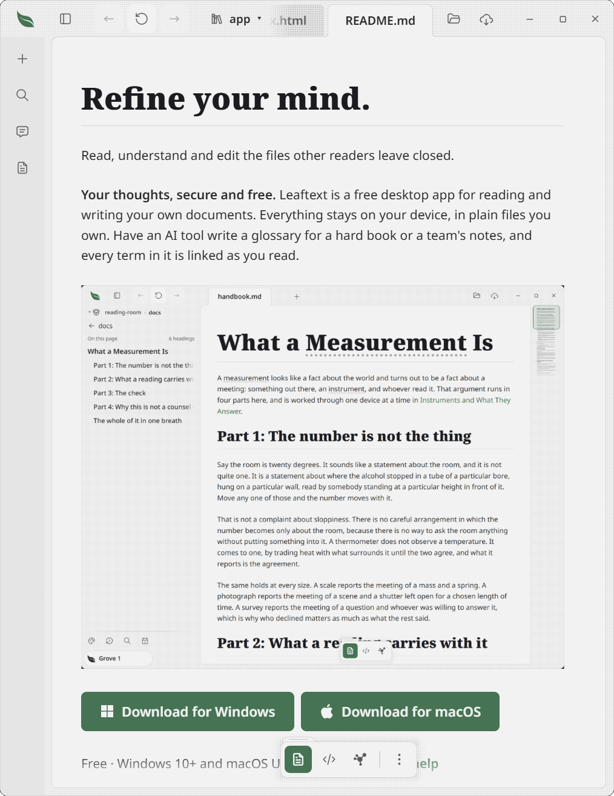

At 720 pixels wide and under, where the [minimap](../01-features/04-minimap.md) gives way to scrollbars, the side pane closes to the icon rail. The picker then names the folder alone, with its whole place in the tooltip.

A press in the rail or on the pane button opens the pane over the page, and the next press elsewhere puts it away. Picking a document dismisses it too, since that page is behind it. It slides in, or arrives in place under [Reduce Motion](../01-features/05-settings.md#reduce-motion).

The app bar stays above it, so the button that opened it also closes it.

The sheet is not saved. It describes the current view rather than a preference, so widening the window puts the pane back beside the page and there is no sheet to restore.

## Facts

| Item | Value |
| --- | --- |
| Vault registry | `manifest.db` — the vaults you have named, and which one is active |
| Vault text | Held in memory for the active vault only; dropped when the folder you are in changes, and on quit |
| Documents read | Up to 25,000 per vault, or 32 MB of text — whichever comes first, notes before data files and smallest first within each. A file past either is still [found by its name and its words](#search), up to 100,000 files listed, a folder level at a time so a cache deep in one corner cannot use them up before your own folders are reached |
| Folders not read | A folder that declares itself a cache, and eleven names a build tool picks. See [Skipped folders](#skipped-folders) |
| Repositories inside a vault | Found up to three folders deep, stopping at the first one on each branch. See [Repositories inside repositories](#repositories-inside-repositories) |
| Scheduled tasks | The active vault's open dated checkboxes, nearest due first. See [Scheduled tasks](#scheduled-tasks) |
| Search results | Top 50 |
| A calendar day's documents | Top 50 |
| Folder listing | One directory per click |
| First-launch bubbles | One per launch at most, with a quiet launch between; each one shows until you point at what it points at, then never again. A [sheet](#the-bubble-on-your-first-launch) takes it down, unmet, until the last one closes |
| The pane's vault introduction | Shown once, to a reader with no vault outside their cloud folders; retired by picking a folder or opening the vault list |

> [!NOTE]
> `manifest.db` keeps its name from when it held a file index. It no longer does — anything that reads a document reads the disk. What it holds now is the list of folders you called vaults, which is why losing it loses that list.

## Next

- [Settings](../01-features/05-settings.md)
- [Navigation](../01-features/02-navigation.md#the-floating-toolbar)
