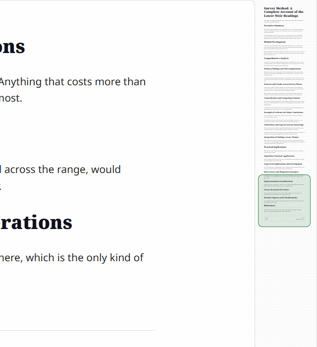
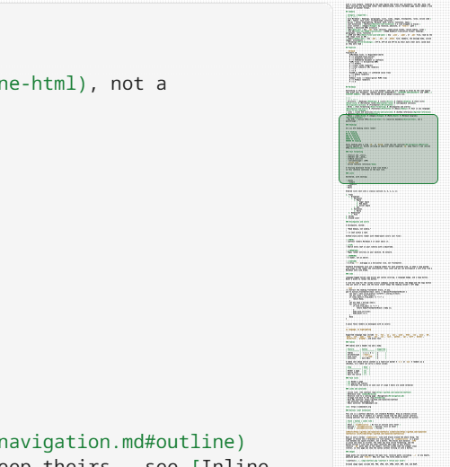

# Minimap in detail

> Everything about the minimap, one fact at a time

This page holds the full behavior behind [Minimap](../01-features/04-minimap.md). Each section matches a section there.

## Web pages

A [web tab](../01-features/02-navigation.md#web-tabs) keeps the same rail beside its live page. The rail draws a picture of the whole page after it paints and replaces the picture when the page changes height. Its position box follows scrolling without taking another picture.

A page too long to draw at its own width is drawn smaller. Its text shows as bands that still mark where sections start and end, and the box follows it all the way down. Click the rail to jump, drag the box to move through the page, or scroll over the rail.

At a window width of 720 pixels or less, or with the rail [dragged shut](#always-there), the live page uses its own scrollbar.

## Consoles

A [console tab](../01-features/03-library.md#console) keeps the rail beside its output. The rail shows lines from the console's scrollback, including lines above the visible screen; its position box follows the terminal viewport, and dragging it scrolls through that output. At a window width of 720 pixels or less, or with the rail [dragged shut](#always-there), the console uses its own scrollbar.

> Take in the whole page at once. A tiny version of your document runs down the side — real text, not abstract bars — with a marker showing where you are. Click to jump to any section; drag the marker to scroll; turn the wheel over the rail and the page scrolls just as it does under the pointer.

## Summary

| Feature | What you get |
| --- | --- |
| [Real text](#how-it-works) | A scaled clone of the rendered page, not a synthesized pattern of lines — so you recognize a section by its shape |
| [Viewport indicator](#how-it-works) | A box marking what is on screen; click the rail to jump, drag the box to scroll, turn the wheel over it to keep scrolling |
| [Laid out like the page](#how-it-works) | The clone is given the reading column's own width, so a wide table in the thumbnail wraps where it wraps on the page and the picture ends where the document ends |
| [A deck's slides](#a-decks-slides) | Beside a slide deck the rail is divided one stretch per slide, each numbered, over the same real thumbnail |
| [Whether it appears](#whether-the-rail-appears) | Skipped entirely for an empty document; shown for every format, including XML, JSON and YAML |
| [The code view's rail](#the-code-views-minimap) | The editor's own map of the source, always present there |
| [Console scrollback](#consoles) | The terminal's earlier output and its current viewport in the same rail |
| [Responsive widths](#responsive-behavior) | The lane narrows with the window, and gives way to the self-hiding scrollbar at 720 pixels and under |
| [Always there](#always-there) | The rail is the primary scroll indicator, present for every non-empty document in any window wider than 720 pixels until you drag the page's right edge to shut it |
| [On an exported page](#on-an-exported-page) | A page [exported as a web page](../01-features/02-navigation.md#export-the-page) carries the rail too, so whoever you send it to can see the shape of the whole document |

## What it is

The minimap is a scaled side-rail showing the actual document beside the reading view.

It sits outside the page, not on it. The page's border stops 4 px short, and the rail stands on the same textured chrome as the [library](../01-features/03-library.md) pane and app bar. It is held off the window edge by the page card's gutter, and starts level with the card's top, so the two read as one object.

It gives you spatial orientation in long documents and lets you jump to any section by clicking or dragging. Because it is a real rendering of the page, you recognize your place from the shape of the text: a heading, a code block, a verse, a dense paragraph.

## How it works

The minimap clones the rendered document and shrinks it to the rail's width with a CSS `scale(...)`, as a code editor's minimap does. A vertical nudge lines the thumbnail up with where the real content begins.

The clone is laid out in a box as wide as the reading column, with the same container query. So anything measuring itself against that column wraps in the thumbnail exactly as on the page.

A [wide table](../01-features/01-rendering.md#tables) is the one thing that does. Without that box it measured the whole window, so every wide table was drawn too wide. The picture then wrapped less, ended short of the rail's bottom, and a low click landed further down than it pointed.

What you see in the rail is a real (very small) copy of the page, so the text that is actually there is what shows up.

A picture from your own disk is drawn there from a small copy, at most 384 pixels wide. The system's picture reader makes it away from the window, held to the full picture's box. So a document of full-page screenshots does not hold each twice at full size. The page, the picture sheet, copying and export all use the file.

A picture that cannot be made small — an animation, a damaged file, one too large to read safely — and a picture from the web are drawn from the file itself.

The clone is stripped of links, of the two grips a pointer over a [table](../01-features/01-rendering.md#tables) adds, and of ids. So nothing in it is focusable or duplicated for assistive technology, and the whole copy is inert to the keyboard. A diagram's own ids are kept, since a [Mermaid diagram](../01-features/01-rendering.md#mermaid-diagrams) scopes its colors and arrowheads to its SVG's id.

It inherits the active theme through the shared stylesheet, so switching light/dark needs no rebuild.

The one thing it does not inherit is the dot grain on tinted cells. The page pins that texture to the window, so meeting surfaces share one grid with no seam. A pinned texture answers the nearest scaled thing above it instead. So in a scaled clone, every grained cell would become a picture of its own to repaint each frame.

The clone's cells carry their texture with them, the page's own keep the pin, and the rail is drawn the same either way.

With [leaf bullets](../01-features/09-progress.md#grow-with-seeds) on, the clone draws its list items without the leaf. At the rail's scale a leaf is under a pixel, and repainting one per item dropped several times the frames on a quick drag.

A diagram nobody has drawn yet is a blank block of the right height in the rail, never a spinner. Dozens turning down a narrow rail would be motion with nothing behind it.

The thumbnail dissolves into the rail's dot grain at its top and bottom edges. Each fade stops at the viewport indicator, so the miniature page inside the box stays crisp.

A [whole HTML page](../01-features/01-rendering.md#html-files) is the one document the rail does not clone.

It is drawn as the page its own CSS makes, inside its own frame, and a frame cannot be cut in half. So the rail carries one more frame holding the same page, scaled down. It is built once when the document is drawn, and left alone while you scroll.

Everything below about slices and rebuilds is about the clone; that second frame is laid out once. What it does follow is a picture. Replace a picture beside the page on disk, and the rail's copy gets the new file the same moment as the page, so the two never disagree.

On a document taller than the rail, the clone holds the slice the rail can actually show rather than the whole page.

The rail is a few hundred pixels over a thumbnail that, for a large glossary, is hundreds of thousands of pixels tall. So a whole-document clone is almost all off-screen, a second copy of every element. That alone can make each wheel click cost most of a second.

The window carries a rail's worth of document above and below the visible part, so you can scroll that far before a rebuild. While you type, it carries only what the rail can show.

A letter typed inside a block the picture holds, such as a paragraph, heading or cell, is drawn straight into the rail's copy. That happens in the same frame the page lays it out, and nothing else is rebuilt. Where the letter wraps a line, the rows below move in the copy as on the page.

Any other change to the words rebuilds the slice. That covers a block added or removed, and a change in a block the picture lacks that moves the page. It also covers a letter in a code block or diagram, which the rail draws whole.

A rebuild is all the browser laying that slice out, and the cost falls with its rows. So that rebuild draws only the rail's own screen. A moment after typing stops, the rail draws once more with its scroll room restored.

A further change to the words cancels that and books its own, so the rail never widens onto a document that has moved on.

When one block is taller than the whole window, as a long table or a highlighted source block can be, the slice cuts inside it. The cut lines go back inside shallow copies of their original wrappers, so they keep the page's rendering.

Each wrapper keeps whatever else of its own the window reaches. So a table cut near its top still wears the header row the page draws above that place.

The rows the cut reaches are found by halving over where each row ends, which works only where rows stand under one another. A table's lane also holds two corner buttons above the table. Where a lower cut lands the halving on those and finds no rows, the search reads that level's children once and carries on into the table.

Where the window reaches past that block's own edge, the rows on the far side are carried in beside the block, not inside it. So the picture holds both sides of the edge.

A carried row running past the end of what was asked for is cut the same way. Where one long table follows another, the carried row is a whole unseen table. Taking only the part the rail reaches halves the rebuild at that boundary.

The cut stops at a table's own rows. A row's cells sit side by side, so the last row the window touches goes in whole, and the rest of the table stays out.

A side cut that way is measured to what the window asked for, not the carried row's own edge, since most of that row is not in the picture.

Where the window reaches the first or last row, it is measured to the ends of what it was cut from. That means the block's own edges where it cut inside one, and the document's ends otherwise.

Where the window stops at a row short of the holder's end, it is measured to the facing edge of the row left out. The ground between is margin the page draws empty too. So a view starting in the space under a heading is inside the window, not cause for a rebuild at every letter.

The space above the first row and below the last is the holder's own padding, which no clone of rows holds. So sitting at the very top or foot is inside the window and needs no rebuild. A slice claiming the document's ends from inside a block would claim ground it has no rows for, leaving a rail blank forever.

It is still a clone of the real rendering, so the rail shows real text, not a made-up pattern of lines. On a document the rail can show whole, the window is the whole document, so none of this depends on size.

A viewport indicator overlays the portion currently visible; as you scroll, it moves in lockstep. When the document is taller than the rail, the thumbnail itself slides inside the rail (again, like a code editor) so the region around your position stays in view.

Click anywhere on the rail to scroll the reader to that point. Drag the indicator, and the grabbed point stays under the cursor. Turn the wheel over the rail, and the page scrolls by the same distance a notch moves it under the pointer.

Either way, the point you land on becomes the reader's recorded position (see [Restore](../01-features/02-navigation.md#restore)). So content settling afterward, such as images, diagrams or the [Pager](../01-features/02-navigation.md#pager), cannot pull you back.

The clone is rebuilt only when needed. That is when the content changes, as with live reload, highlighting, Mermaid diagrams or math settling in. It also covers a picture of unknown size loading or failing, the rail resizing, and the reading column changing width. And it covers a scroll or drag leaving the window it was built for.

How much document a rebuild slices depends on what asked for it. A content change asks for the rail's own screen, a gesture for a quarter screen, and anything else for a whole screen either side.

Dragging the window's edge or the library's divider is a gesture too. A thumbnail the new width can simply be handed is laid out again at that width. Only one that no longer reaches the screen is rebuilt, narrowly, until the edge rests.

A gesture's quarter is not spent evenly. A hand dragging the box moves one way, and a rebuild takes long enough for the hand to pass its slice. So seven eighths of the room goes ahead and an eighth behind. That reaches nearly twice as far ahead for the same cost.

An eighth stays behind on purpose, so a hand that stops or jitters a pixel back is not standing on the window's own edge. A rest and a release both take the full room either side, which is what puts the ground behind the reader back once they stop.

When a gesture left the window, by wheel, keyboard or the held indicator, the rebuild is drawn while your hand still moves. So the picture stays on the track through a whole flick or drag.

Laying out a fresh slice is a rebuild's whole cost, and a gesture passes hundreds of positions. The narrow ask makes drawing at each affordable. It is a fifth of a resting rebuild's layout, small enough for a moving frame, and wide enough that ordinary scrolling leaves it only every few seconds.

A moment after the movement stops the rail draws once more with the room to scroll into put back, the way it does after typing.

The reading column is on that list separately, because it keeps growing with the window after the text stops widening. A clone laid out against the old width would draw a wide table at the wrong size.

A `
` opening inside the rail's own clone is not a document change. Inserting a clone holding an open one makes the browser announce it. Answering that made the rail rebuild from its own thumbnail every animation frame, for as long as the file was open.

Scrolling otherwise writes three inline values and nothing else:

- The indicator's `transform` sets where the visible region sits in the rail. It is a `transform`, not `top`, because the indicator moves every frame, and a layout property made the browser lay the rail out again.
- The indicator's `height` — the reader window at the thumbnail's scale
- The thumbnail lane's `transform` slides the thumbnail inside the rail on tall documents. It is a `transform`, not `top`, because the lane moves every frame, and a layout property made the browser re-lay-out the page.

Each of those is written straight onto the element that draws it, never as a CSS custom property on the rail around them.

A custom property inherits, so one write on the rail re-resolves style across every element of the clone. That is a couple of thousand on an ordinary document. It measured 78 ms a write, against a fraction of a millisecond written on the element itself. The rail's own height is written the same way, onto the track.

A `requestAnimationFrame`-throttled loop writes those on scroll, and reads no geometry at all while doing it. The rail's measurements, the document's height, the thumbnail's scale and the rail's height, change only with the content or the window. So they are cached, and dropped by what can change them; scrolling changes none.

Re-measuring on every wheel click would force a fresh layout of the whole document. On a large file, that is the difference between a rail that follows the wheel and one that answers a second late.

The indicator's position and travel come from the reader's exact scroll over its scrollable height, and its height is the reader window scaled to the rail. So click-to-scroll and the indicator stay aligned with the thumbnail at any length.

A [complete HTML file](../01-features/01-rendering.md#html-files) keeps its own styles in a contained page. So its rail is another contained rendering of that page, not a body clone the app would restyle. That second rendering is built once when the document is drawn; scrolling moves only the viewport indicator over it.

Markdown and every other format keep the windowed real-page clone described above.

The wheel is not handled by Leaftext at all.

The rail's column is itself a scroller, with a spacer under the thumbnail sized to travel as far as the reader can. The column's scroll writes the reader's position one to one. So a notch over the rail is the same gesture as over the page, moving as smoothly.

The thumbnail, the track and the indicator are pinned to the top of that column, so the travel never shifts the parts a click or a drag reads.

The reader's own scroll writes the column back, which keeps it where a rail click, an indicator drag, the keyboard or a tab switch put the reader. While the indicator is dragged, the column's scroll stands aside, so a notch cannot fight the held box.

The column stands aside for that write too. A scroll event arrives a frame after the write that caused it. So while the page glides, the column's event carries last frame's position, and writing it back would pull the page backward.

On a trackpad, the page's position changes frame after frame through a glide. That is the difference between a document that tracks two fingers and one that stutters.

A render stands aside the same way. Replacing the column's contents collapses it, so the browser snaps it to the top and raises a scroll a frame later. That move came from the page, not a hand. Reading it as a gesture would send a reader halfway down back to line one when the file changed.

With no rail in the column, or a document too short to scroll, the column has no travel. A notch there belongs to the browser, as anywhere else.

> [!NOTE]
> The thumbnail is a second, scaled-down layout, so it cannot exist until the document itself has been laid out.
>
> Until it is built, the rail shows a small spinner rather than an empty lane. On a large document that build is a visible wait, and a blank rail beside a finished page looks failed.
>
> The rail keeps that spinner while any [Mermaid diagram](../01-features/01-rendering.md#mermaid-diagrams) in the document is still unmeasured. The thumbnail clones the page, and an undrawn diagram gives the clone nothing to take.
>
> Every diagram is drawn once after the page settles. So that is one wait, ending when the last block knows its height, not a spinner on every scroll into undrawn diagrams.

## A deck's slides

A [slide deck](../01-features/01-rendering.md#office-and-opendocument-files) is not prose. A deck is eight or twenty-three fixed things, and someone scrolling one wants the fourth of them. A column of paragraph marks says only how far down the file you are.

So beside a deck, the rail carries a hairline rule where each slide starts, with its number beside it. The thumbnail underneath is the same real page as beside any document.

The stretch holding the viewport indicator is the slide you are reading. Pressing anywhere in a stretch carries you into that slide, as the rail's press always has.

Nothing new is a control and nothing else moves. The number is drawn only where its own stretch is tall enough to hold it; on a deck of very many short slides the rules divide alone.

The first slide's stretch begins at the page's top, not its heading. Its number dissolves into the rail's top fade, as the thumbnail does at both edges.

Both deck formats are divided this way, and every other document is untouched. The divisions are read from a mark the deck reader puts where each slide begins, so a document with none gets none. A deck [exported as a web page](../01-features/02-navigation.md#export-the-page) carries the marks with it, so its rail is divided too.

## The ribbon bookmark

A small ribbon on the rail marks the deepest point you have read in a document. A block counts as read once it has been on screen for two seconds, and the ribbon stops where the screen stopped showing that block.

It follows the same part of the document if a picture loads or a different font changes the page height after you quit and reopen it. In a book, the bookmark keeps the chapter you were in and how far into it, so it stays beside the same words however the book is laid out.

The dwell is the same measure [your Grove](../01-features/09-progress.md) counts reading by, so a fling to the bottom does not mark it all read. The ribbon only moves down, never back up when you reread.

It is there for everybody, whether or not the reading record is on. It is drawn in the page's own text color, near-black on light themes and near-white on dark. So it stands out from the rail's gray lines on every theme.

With **Ribbon bookmark** bought and switched on in [the Grove](../01-features/09-progress.md#grow-with-seeds), it takes the theme's accent instead.

Each document keeps its place after you quit and reopen. The app writes it to [`reading-places.json`](../01-features/05-settings.md#files) beside your settings. A published site keeps it in your browser's own storage, never in a cookie, and never sends it anywhere. A file you rename or cut and paste in Leaftext takes its place with it.

Click the ribbon to return to how far you read. If that passage is already on screen, the page stays still. Otherwise the marked point returns to the bottom edge of the view, where it was recorded. Refresh keeps the passage on screen and the ribbon at the place read.

Pointing at the ribbon names it. Right-click it and press **Remove bookmark** to clear that document's place, or pick the same entry from the page's own menu, which is how the keyboard reaches it. The ribbon comes back where you are two seconds later, without a scroll. A document shown inside somebody else's product keeps no place.

## Whether the rail appears

The Rust side sends the page one flag, `has_visible_content`: an empty document says no and the rail is skipped entirely. Nothing else about the document is sent, because the thumbnail comes from the clone.

[XML](../01-features/01-rendering.md#xml) and [JSON or YAML](../01-features/01-rendering.md#data-files-json-and-yaml) documents are asked the same question of their rendered blocks, having no Markdown source. So an `.xml`, `.json` or `.yaml` file gets the same real-text rail as Markdown. The thumbnail is always the live clone, whatever the format.

## The code view's minimap

The [code view](../01-features/07-editing.md#code-view) has a rail of its own — the editor's, not this one.

It draws the source rather than cloning a page, which keeps it honest on a file too large to lay out twice. It appears wherever the reader's rail would. With the rail up, the source view draws no scrollbar, so the rail shows your place. With the rail [dragged shut](#always-there), the map goes and the editor's thin bar fades in while scrolling.

The reader's rail and the editor's are two versions of one idea, so they are dressed alike. They share the viewport box, border, rounding, width and distance from the page.

Both rails are **chrome, not page**: they stand on the window's textured surface beside the card, and the page's own right border is the line between the two.

In the code view, the editor paints no background there, and the map's drawing surface is transparent. The editor casts no scroll shadow across the rail's top. So the chrome's dot grain shows between the lines, and the map reads as text on the window.

> [!NOTE]
> The reading view's rail is a real clone of the page; the code view's is the editor's drawing of the source. They look and behave alike on purpose. Both are present in any window wider than 720 pixels until the rail is dragged shut, and both go together.

## On an exported page

A document [written out as a web page](../01-features/02-navigation.md#export-the-page) carries the rail with it. That is the copy someone without Leaftext reads. They have none of the other ways to see a document's shape: no library pane, no outline, no tab strip.

The rail works as it does here. The whole document is shrunk down the right edge, with a box marking what is on screen. A click jumps, and a drag scrubs. Its thumbnail dissolves into the page's own color at both ends, without the window chrome's texture.

The wheel over it works too, more simply. The browser scrolls the whole page there, not a pane inside it, so a notch over the rail moves the document with nothing of ours in the way.

It is the only thing on that page that runs, and it fetches nothing. There is no button to turn it off, since the exported page carries no controls, and one would start a control surface.

That copy holds the whole document, not a window of it. A folded section is drawn as the page draws it, its summary line only. So a long chart of folded groups costs the rail no more than its visible lines. Opening a group on the page brings its rows into the rail.

It is rebuilt only when its picture would actually change. The thumbnail's scale is the reading column's width over the rail's. So a rebuild checks whether either width or the document's height has moved. A window that changed only its height reuses the thumbnail and moves just the rail and box.

That is the resize a phone makes every time its address bar slides away, and it used to clone the whole page twice.

The rail needs room, so it stands on a browser window 721 pixels or wider and is absent below that. A phone gets the document and its own scrollbar. Printing the exported page never draws it either, since a rail pinned to the window would come out on every sheet.

## Responsive behavior

The minimap adjusts its preview lane width depending on the available space:

| Breakpoint | Preview width |
| ---------- | ------------- |
| > 900 px   | 68 px         |
| 721–900 px | 46 px         |
| ≤ 720 px   | no rail       |

At 720 pixels and under — a phone, or a window dragged narrow — the rail gives way. The page takes the whole width and wears the reader's thin [scrollbar](../01-features/02-navigation.md#scrollbars), drawn while the page moves and gone a moment after it stops.

It is the same edge an [exported page](#on-an-exported-page) drops its rail at, so a narrow window reads alike whichever host draws it. Widen the window past it and the rail comes back.

## Always there

In any window wider than 720 pixels the minimap is the reader's scroll indicator, and it is there until you put it away.

Drag the narrow gap between the page's right border and the rail to the right. Once the pointer has traveled half the rail's width, the rail snaps shut and the page takes its width. The view's own thin scrollbar then shows your place. That is the reading page's, the [code view](#the-code-views-minimap)'s, a [console](#consoles)'s, or a [web page](#web-pages)'s own.

Drag the window's right edge back to the left the same distance and the rail snaps open again, and the scrollbar goes. A drag let go short of that point leaves the rail as it was.

The choice is remembered, so the window opens as you left it. A window 720 pixels wide or less uses the scrollbar either way; see [Responsive behavior](#responsive-behavior).

Inside another product's frame, the document scrolls within the frame, and the minimap stands beside it while the frame is wider than 720 pixels. A narrower frame uses the scrollbar, like a narrow window. A wheel over either the document or the minimap moves the same page; pressing the minimap jumps through it.

With [two documents side by side](../01-features/02-navigation.md#two-documents-side-by-side), each column has its own rail, drawn from its document and following its scrolling. The rail is the scroll indicator, so a column without one would scroll with nothing to show its place.

The [chat column](../01-features/02-navigation.md#the-chat-column) has a rail too: a picture of the conversation, with a window over what is on screen. Press or drag on it to scroll the chat, or turn the wheel over it.

With two pages up, the grip stands in the gap beside the right-hand rail. Dragging it shut shuts every rail at once, the chat's included, and each view wears its own scrollbar. Dragging back opens them all.

With [source beside the page](../01-features/07-editing.md#source-beside-the-page), the rendered page's rail is the one picture for the pair. Dragging it moves both the page and its source; the source editor does not draw a second minimap.

The rail still comes and goes with the document. There is none on the home screen, none while the [graph](../01-features/03-library.md#graph) is up, none in a window 720 pixels wide or less, and none while dragged shut.

With no rail, its column collapses to zero, and the page widens back to the window's gutter, leaving no empty band. The reader's own thin [scrollbar](../01-features/02-navigation.md#scrollbars) returns, drawn while scrolling and gone a moment after. While the rail is present the scrollbar stays hidden, because the rail is that indicator.

> [!TIP]
> Use the minimap to quickly gauge document length and find dense sections at a glance. Because it is a real rendering of the page, headings, code blocks, verse and dense paragraphs keep their own shapes. So you can spot section breaks and dense passages in the rail without reading a word.

## Next

- [Navigation → Outline](../01-features/02-navigation.md#outline) — the rail's companion: the document's structure as clickable text
- [Settings → Minimap](../01-features/05-settings.md#minimap) — why it stopped being a preference
- [Editing → Code view](../01-features/07-editing.md#code-view) — the view the second rail belongs to
