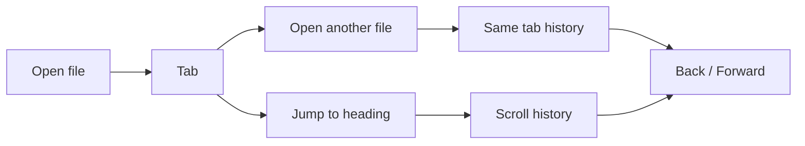
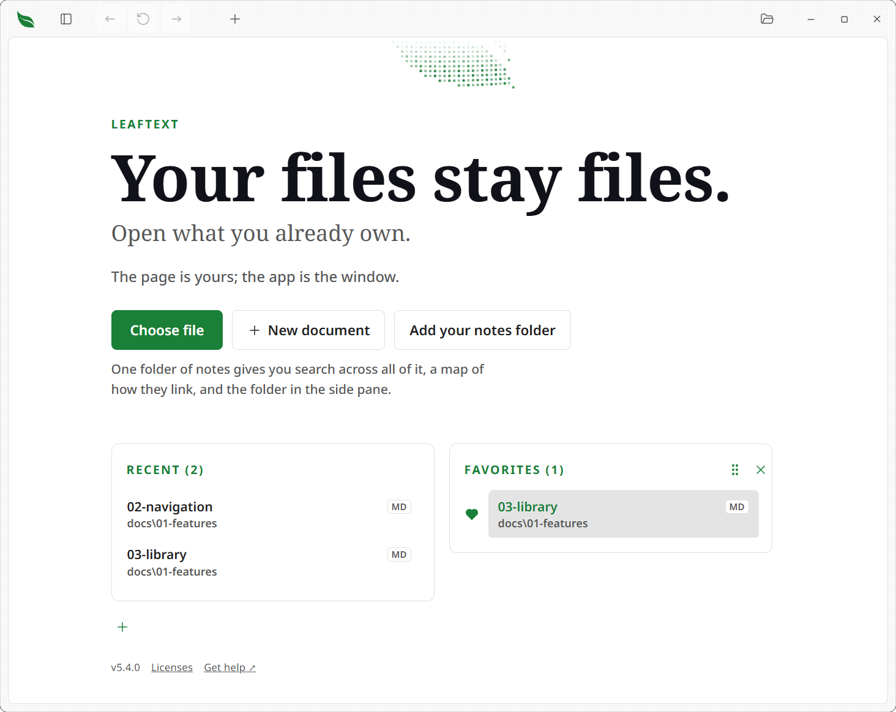
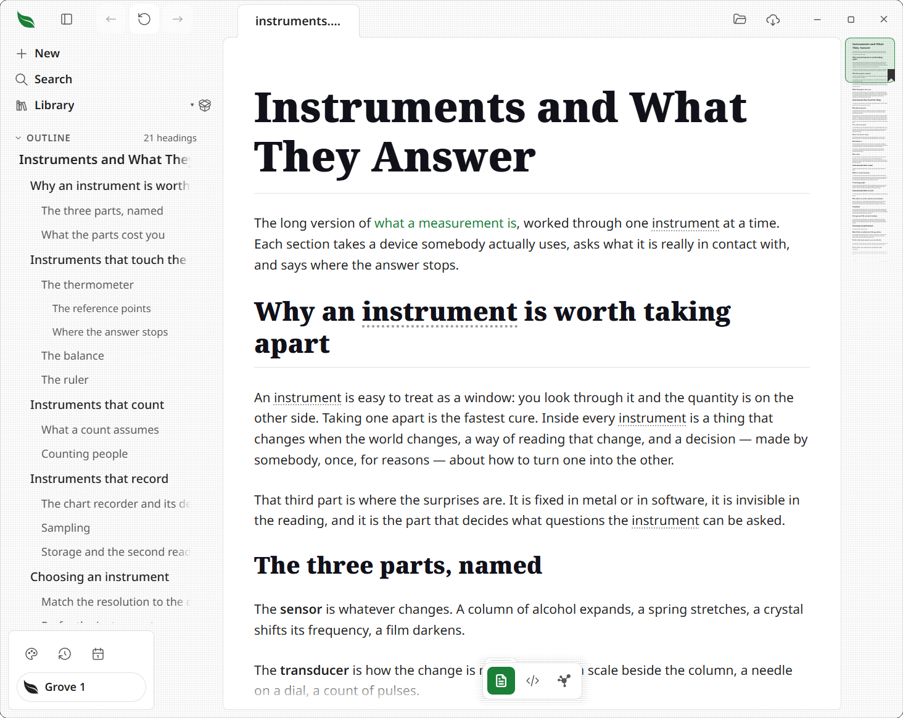
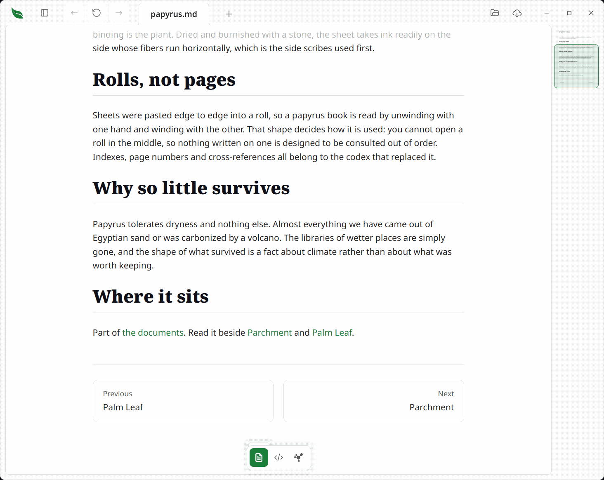
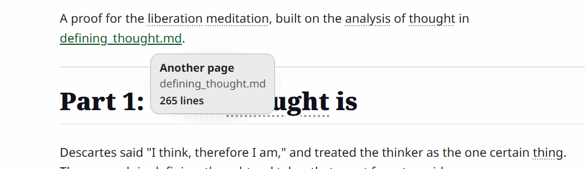
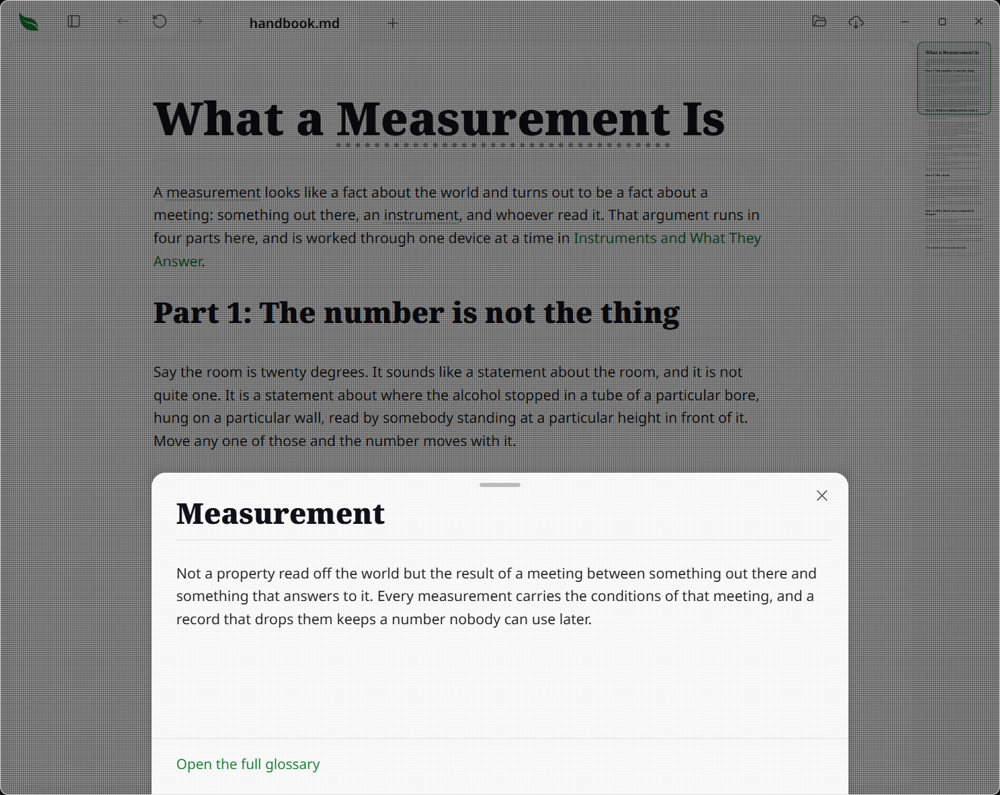
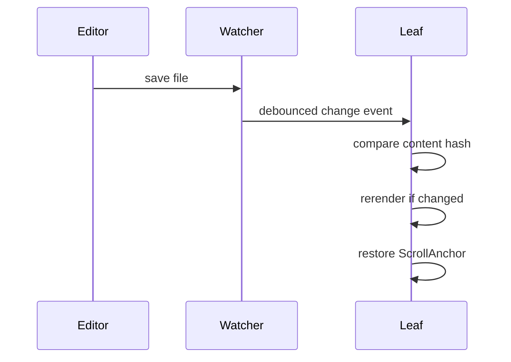

# Navigation in detail

> Everything about tabs, history and moving around, one fact at a time

This page holds the full behavior behind [Navigation](../01-features/02-navigation.md). Each section matches a section there.

## Overview

- Each tab keeps its own file history and its own in-document scroll history.
- Links inside note and glossary sheets follow the same route as links in the document.
- Web and mail links open in their usual app, while Leaftext keeps its tabs and controls.
- `Ctrl`-click (`Cmd`-click on a Mac) or a middle click keeps a local page in the background. `Shift`-click sends a saved web page to the browser.
- A link that misses this route cannot replace the reader or open a popup. Leaftext keeps the page and explains that the link could not open.
- Reloading the reader clears its loading card without resizing the window again.

## Summary

| Feature | What it means |
| --- | --- |
| [Tabs](#tabs) | Open multiple documents at once |
| [Tabs inside a document](#tabs-inside-a-document) | Switch among sheets in a workbook or named parts of a Markdown note |
| [Web tabs](#web-tabs) | Browse a live web page beside your documents |
| [Console tabs](../01-features/03-library.md#console) | Run a command line in the folder shown by the library |
| [Two documents side by side](#two-documents-side-by-side) | Stand a second tab beside the one you are reading, each column scrolling on its own with its own rail |
| [The chat column](#the-chat-column) | An agent's chat in its own column beside the pages, every chat you opened a tab in its top row, resized, swapped to either side, closed and brought back on its own |
| [New document](../01-features/07-editing.md#new-document) | **New** at the top of the icon rail starts a blank page, ready to type |
| [Outline](#outline) | The open document's headings, which the side pane opens on whenever a document is in front, with the one you are reading lit and its Back leading to your pinned and recent documents |
| [Back / Forward](#history) | Move through file history and in-page jumps, landing where you were reading, with the page you arrive at on screen at once |
| [Refresh](#history) | Draw the open file and its current glossary again, dropping page-only state such as a folded block or dragged table column |
| [Scroll anchors](#restore) | Restore the same reading spot after rerenders, and on every step of a tab's history |
| [Scrollbars](#scrollbars) | Every bar fades in while its box is being scrolled and out a moment after it stops, and comes back thicker while the pointer rests on it — or stays drawn the whole time, where your machine is set to always show scrollbars |
| [Live reload](#reload) | Reload a changed file without losing your place |
| [Recent files](#recent-files) | Reopen a recently opened file from the home screen, showing the vault you are standing in |
| [Favorites](#favorites) | Favorite a file or folder so it is never lost off the end of Recent, in its own column beside it |
| [Loading](#loading) | The reader holds the shape of the page that is coming — a heading bar and the paragraph bars under it — while a slow document or view renders |
| [When the page stops](#when-the-page-stops) | A window whose page process crashes or is ended is drawn a new page with its tabs and unsaved edits, and a web tab whose page dies reloads |
| [Export the page](#export-the-page) | Save the page you are reading as one continuous PDF, as a picture of the whole document, as a web page with its stylesheet, its pictures and its [minimap](../01-features/04-minimap.md#on-an-exported-page) in a folder beside it — every one of them in the theme on screen — as the Markdown note itself with its pictures in a folder beside it, or as an EPUB book with its pictures inside, for a phone or an e-reader |
| [Glossary sheet](#glossary) | Open a glossary term over the page without leaving it |
| [Link hints](#link-hints) | Hover a link to see what kind it is, where it points, the opening of a linked note, and a glossary term's whole entry |
| [The pointer](#the-pointer) | The hand means this goes somewhere — a link, a button written into a document, and the controls that carry you between documents; the arrow stays over the reader's view buttons, the vault picker and the start screen's vault switch, every menu and popup row, the icons the app bar draws for itself, and anything you cannot press right now |
| [What a control does under the pointer](#what-a-control-does-under-the-pointer) | The buttons at either end of the bar, the file rows in the pane and a button written into a document answer with their color over the same beat, and with nothing else — none of them lifts, changes shape or moves. The [Previous / Next](#pager) card answers with its color and a dotted shadow around it, and is the one control that adds anything |
| [Open a link in a new page](#opening-a-link-in-a-new-page) | Ctrl-click, middle-click or right-click a link to open it behind what you are reading |
| [Pager](#pager) | Previous / Next buttons at the bottom of each document for reading a folder in order, filling with the theme's color under the pointer and throwing a dotted shadow around themselves |
| [Single window](#tabs) | One running Leaftext holding as many windows as you like: Control N, or Command N on a Mac, opens a new one, and so does launching Leaftext again with no file on Windows; opening a file from outside still adds it as a tab to the window you were last in |
| [When another app is in front](#when-another-app-is-in-front) | The whole window settles together the moment it falls behind another app — chrome, document, pictures and the little picture of the page all keep some color at half strength, with black text going less dark, faded in and out over the same beat |
| [More](#more) | The last press in the icon rail: Themes, the Grove, New window and About Leaftext wherever you are, the Calendar in a vault with dated notes, Scheduled tasks where there are any, and Zoom on a web page |
| [When the bar runs out of room](#when-the-bar-runs-out-of-room) | On a window too narrow for the whole app bar, its buttons fold into a chevron menu one at a time — and the window's own close, minimize and maximize stay on the bar |
| [Code view](../01-features/07-editing.md) | Toggle any document to its raw, editable source |

## Web tabs

Press **New** at the top of the icon rail on the window's left edge and choose **New page**. Then enter an address in the field in the middle of the empty page. A bare host such as `ryanallen.com` opens over HTTPS; words open a Google search. **Browse free books** under it opens [Books online](../01-features/03-library.md#books-online).

Typing the first character of a note removes the field and the button.

On [Home](#recent-files), add the **Web address** box with the small plus below the boxes. Type an address or search words and press **Enter** or **Go** to open a new selected web tab. Tabs already open stay available.

A web tab takes its name from the page's title. Move the pointer onto the app bar to slide its address open, or press **Ctrl+L** to select it. **Enter** opens the new address, **Escape** closes the bar, and **Copy** copies the current address.

The bar stays open while you edit and closes after the pointer leaves it and the app bar.

Back, Forward and Refresh control the live page. Refresh keeps your place as the page loads, even when its own script adds content later. Closing, switching and dragging work as they do on document tabs. A saved web tab reopens at its last address when you bring it forward. Links asking for a new window open in another web tab.

A link that hands off to another app, such as a Linear issue, a Slack channel or a `mailto:` address, asks first. A message names the app, and **Open** starts it. The [minimap](../01-features/04-minimap.md#web-pages) shows a picture of the page and follows its scroll position.

Zoom a web tab the way a browser does. On Windows, hold **Ctrl** and roll the wheel, or press **Ctrl+Plus**, **Ctrl+Minus** or **Ctrl+0** to go back to actual size. On a Mac, press **Command+Plus**, **Command+Minus** or **Command+0**. A pinch on the touchpad zooms on either.

Or open [More](#more) with the page in front. Its first row is **Zoom**, with minus, the level and plus; pressing the level returns the page to actual size. A tab that is not at actual size wears its level beside its name, however it got there.

The zoom stays through the tab's own links until the tab closes, and the minimap redraws the zoomed page.

The live page fits inside the reading card's thin border and all four rounded corners, so its top curves like the bar over a document. The address bar lies over its top while the page holds still.

Its main scroll bar is hidden because the minimap shows the page's place; scrolling inside a page element still uses that element's own bar. The active web tab takes a solid page background when one is available and chooses readable light or dark letters for it.

An [HTML file](../01-features/01-rendering.md#html-files) opened on the desktop is a live page the same way, served from its own folder on an address only this computer can reach. Its tab is named by the file, with the star and right-click menu any document tab has.

Its address is in the same bar. Back steps through its pages and its heading jumps, landing where each link was pressed, then through the documents read in the tab before it. A link out of the site makes it an ordinary web tab.

Its **Code** is the file itself, to edit and save, rather than a copy of the markup.

The view bar stands over a web tab with **Reading** and **Code**. **Code** shows the page's markup as a browser's Inspect does: the page as it stands now, including what its script built. It shows one element per line, indented by depth.

It is read-only, since there is no file behind it; find works as it does on a document. It is a copy taken when you press **Code**, so **Refresh** and **Code** again take a fresh one. **Reading** brings the live page back.

## Model



## Shortcuts

| Action | Windows | macOS |
| --- | --- | --- |
| Open file | `Ctrl+O` | `Cmd+O` |
| [New window](#tabs), also a row in [More](#more) | `Ctrl+N` | `Cmd+N` |
| Close tab | `Ctrl+W` | `Cmd+W` |
| Quit, keeping your tabs and unsaved edits for next time | `Ctrl+Q` | `Cmd+Q` |
| Back | `Alt+Left` | `Cmd+Left` |
| Forward | `Alt+Right` | `Cmd+Right` |
| Next tab | `Ctrl+Tab` | `Ctrl+Tab` |
| Previous tab | `Ctrl+Shift+Tab` | `Ctrl+Shift+Tab` |
| [Stand the next tab beside this one](#two-documents-side-by-side), or bring back the page closed last | `Ctrl+\` | `Cmd+\` |
| [Full screen](../01-features/06-themes.md#windows), the window's own button at the top right | `F11` | Green dot at the top left |
| Save (with [unsaved edits](../01-features/07-editing.md#save), your own typing included) | `Ctrl+S` | `Cmd+S` |
| [Undo](../01-features/07-editing.md#undo) — a word of your typing, then the last reading-view edit | `Ctrl+Z` | `Cmd+Z` |
| [Redo](../01-features/07-editing.md#undo) a word of typing, or a whole edit, you took back | `Ctrl+Y` or `Ctrl+Shift+Z` | `Cmd+Shift+Z` |
| Select the page — or, with the caret in a block, [a step wider per press](../01-features/07-editing.md#deleting) | `Ctrl+A` | `Cmd+A` |
| Copy the words highlighted in the document, keeping their headings, lists, bold and links when pasted into a mail, a word processor or a web editor; a plain paste gets the words alone, a table its rows with a tab between cells, and never the words on the buttons Leaftext draws over a table | `Ctrl+C` | `Cmd+C` |
| [Delete](../01-features/07-editing.md#deleting) a selection that crosses blocks | `Delete` or `Backspace` | `Delete` or `Backspace` |
| [Find](#find-in-this-document) in this document, or across [all files](../01-features/03-library.md#search) | `Ctrl+F` | `Cmd+F` |
| [Find and replace](#find-in-this-document) | `Ctrl+H` | `Cmd+H` |
| [Put a cursor on every match](#find-in-this-document), from the find field | `Alt+Enter` | `Alt+Enter` |
| [Add a cursor where you click](#find-in-this-document) | `Ctrl`+click | `Cmd`+click |
| [Bold](../01-features/07-editing.md#the-format-bar) the highlighted words | `Ctrl+B` | `Cmd+B` |
| [Italic](../01-features/07-editing.md#the-format-bar) the highlighted words | `Ctrl+I` | `Cmd+I` |
| [Link](../01-features/07-editing.md#the-format-bar) the highlighted words | `Ctrl+K` | `Cmd+K` |
| [Open a link in a new page](#opening-a-link-in-a-new-page) | `Ctrl`+click | `Cmd`+click |

Tab cycling is `Ctrl`-based on every platform, including macOS. Mouse side buttons also trigger Back and Forward.

## The chrome

Two bars. The one at the top is about the app; the one floating at the foot of the page is about the document.

### The app bar


**New** ([new document](../01-features/07-editing.md#new-document), a [console](../01-features/03-library.md#console) or an agent) is the first press in the icon rail down the window's left edge rather than a button in the tab strip. The page header under the tabs names where the document sits, and at its right Open and [Export](#export-a-pdf).

Over a chat or console Open is gone, and over a running agent's chat each folder in the header is a press that [changes the folder the agent works in](../01-features/10-agents.md#the-agents-status-under-its-console).

The [theme picker](../01-features/06-themes.md#choose), the Grove and the rest of what stood at the pane's foot are rows of [More](#more), at the right end of the floating bar.

The leaf mark at the left is the way home — click it to return to the no-file screen. Beside it sit the pane button, Back, Refresh and Forward, and in the middle of the bar the one [vault picker](../01-features/03-library.md#the-vault-picker), which names the folder of whatever is in front.

Those are about the app rather than the document, which is why they are up here and not on the floating toolbar. The tabs stand on the page under them, and the page header under the tabs names the vault, the folders down to the document and the document itself.

**Open reaches any file, on either platform.** On Windows the dialog carries a list of the [formats the reader opens](../01-features/03-library.md#file-types), with **All files** at the end for anything else.

A Mac dialog has no such list, so it shows everything. That gives the same answer, since a file with an unknown ending is [read as Markdown](../01-features/01-rendering.md) rather than refused.

### Export the page

The export button in the app bar — shown only while a rendered document is in front of you — asks where the file goes, and which kind of file it is. On Windows the save window carries every kind it can write, and the row you choose decides the kind; the ending decides only when you choose All files.

On a Mac that window shows no format at all, so a short menu asks first and the window then carries the one you picked. Either way the list is the one the app can actually write on the machine you are on.

The reader stays exactly where it is while the save window is open and while the file is rendered: its tabs, bar, pane and toolbar do not move. The button steps aside on the home screen, in the [source view](../01-features/07-editing.md#code-view) and on the [graph](../01-features/03-library.md#graph), since none of those is a page to hand over.

A page whose [diagrams](../01-features/01-rendering.md#mermaid-diagrams) are not all drawn yet has each drawn before anything is asked. So a document exported the moment it opens carries its drawings, not empty frames.

The reading spinner stands over the page meanwhile: a few seconds for a dozen diagrams, about fifteen for two hundred. The save window opens when it is done.

**PDF document** writes a slide deck with one page per slide. Each page follows the deck?s own shape, growing to fit the tallest slide when needed, and keeps the words, pictures and charts the reading view draws.

Other documents export as one continuous page: every screen of it, in the theme on screen, with none of the app's controls and the paper ending at the last line.

A document taller than the longest PDF page, about two hundred inches, is still one page. The whole is shrunk to fit rather than cut into sheets, since a drawing cannot be split across a cut.

**PNG picture** writes a deck?s slide pages one under another in a single picture. Other documents export whole as one picture: every screen, in the theme on screen, with none of the app's controls. It is the same document the PDF row writes, at the same width, as pixels.

It is the row to pick for pasting the page into a chat, a slide or a web page, none of which will take a PDF. A long document makes a large file; nothing is scaled down to keep it small, because a twentieth-size picture of a document is not a picture of it.

**WebP picture** writes that same picture at about half the file, in the format anything you paste into already reads. It cannot hold a picture more than 16,383 pixels tall, which a long document passes. There it says so and writes nothing; the PNG row has no such limit.

**JPEG picture** writes that same picture again, in the one format every tool takes, for anything that will not accept a WebP.

It suits a long document as much as reach. It holds four times what WebP does, and is smaller than the PNG on the pages measured. A page four thousand pixels tall came to 805 KB against 845 KB. One twenty thousand pixels tall came to 1,756 KB against 2,710 KB, where WebP is refused.

Either spelling of the ending works, `.jpg` or `.jpeg`. Past what it can hold it says so and writes nothing, and the PNG row takes it.

**Web page** writes what is on screen as a page any browser can open: the same theme and type, with diagrams drawn and links live. Its stylesheet and every picture go in an `assets` folder beside it.

It lays out as the app does. Sentences hold a comfortable column that follows the browser's width, while a wide table or picture takes the room beside it. Printing that page still returns everything to the column, so the sheets come out right.

That folder is shared. Export a second document into the same place and it joins the first; a picture whose name is taken by a different picture is written beside it, not over it.

The stylesheet carries the drawings of the page's [theme](../01-features/06-themes.md#icons) only, not the other five sets. So it is smaller than the app's. Two documents exported in themes with different drawings get a sheet each.

Export the same document again, and it finds its last copies and points at them. So the folder holds one copy of each picture however often you export. A document with math in it carries the stylesheet that draws equations too; one without carries neither it nor its fonts.

That folder also holds one small script, the [minimap](../01-features/04-minimap.md#on-an-exported-page). Its rail stands down the right of the exported page where there is room. The page is the document alone: no buttons, no settings, nothing fetched over a network.

The stylesheet, that script and the equation set are left alone where the existing file is the one wanted. So exporting a folder of notes one at a time writes each once. After an app update, when they differ, they are written again.

**Web page, one file** writes the page and everything it needs into one `.html` file: its theme, diagrams, minimap, local pictures and, when it has equations, its math fonts. Open that file on its own, attach it to a message or upload it to a course without carrying an `assets` folder. A picture served over the network keeps its address.

A page with more than 64 MB of local pictures is refused before the file is written.

**Markdown document** writes the note itself: its own words, unsaved edits and all, spelled as the file was. What comes out is a note you can keep editing.

Every picture it draws from your machine is copied into an `imgs` folder beside the file, and the note points at the copy. That covers a Markdown picture, one written as HTML, one in a [diagram](../01-features/01-rendering.md#mermaid-diagrams) box and one named at the note's foot. Only the address changes, so the words and layout around each stay as written.

A picture served over the network stays as it was written and keeps working, and so does one whose file is missing. Export the same note into the same place again, and it finds its last copies and copies nothing. A different picture with a taken name is written beside it, not over it.

The row appears only with a Markdown note in front, since a JSON, HTML or email file under a `.md` name would not be a note. The file you are reading is not touched.

**EPUB book** writes the document as one book file with every picture inside it, for a phone, an e-reader or any reading app — nothing sits beside it. A long page is divided at its part headings so a reading app opens it a part at a time; a short page stays whole.

It works on every document the app opens, a note as much as a Word file or a book. It carries what is on screen: the words, headings, tables, diagrams and equations. It uses the theme's light version always, since a reading app brings its own night mode.

Its contents lists the document's headings, a book lists every chapter its own contents named, under the same words, and a document with neither lists its title.

A footnote is marked the way reading apps look for one, so resting on its number shows the note. A [glossary](#glossary) name keeps its underline and opens its entry, from a glossary at the book's end.

Three things stay behind, because a reading app cannot follow them. A picture served over the network, or of a kind readers need not draw, leaves a blank with its description. A link to another note keeps its words but loses its address, except in a book from a published site. And nothing that runs travels, so an HTML page goes in without its scripts.

The book is named the page's own title, or the name you type into the save window where the page has none.

On leaftext.com, and on any site the app exports, Export stands at the right end of the bar beside the leaftext name. The words start directly under that one bar.

There, and in a document embedded in another product, Export offers three rows. **PDF** is the browser's own print. **Web page, one file** downloads the page as one file, pictures inside. **EPUB book** downloads the same book the app writes, named after the document, with every picture the site serves inside.

A picture from another site is the one that stays behind there, as it does here, keeping its description.

On a published site, a PDF and a one-file page point every site link, and every [glossary](#glossary) name, at its address on the site. So your local copy still opens them. A link the site has no page for stays as written.

A quiet note names the file when it is written, and the name is a press — click it to open it in whatever your machine opens that kind with.

**There is no Settings button.** Every control stands where it applies — see [Settings](../01-features/05-settings.md). The one thing that comes and goes is the [update](../01-features/05-settings.md#updates) bell, which is in the bar only while there is something to download or install.

The app bar doubles as the title bar on both systems, and Leaftext draws the window buttons itself. They are squares at the right on [Windows](../01-features/06-themes.md#windows), and three dots at the left on [macOS](../01-features/06-themes.md#macos). Both fold into the chevron menu when the bar runs out of room.

### When another app is in front

Click into another app, and the whole window steps back at once. That covers the leaf, window buttons, tabs, icon rail, [side pane](../01-features/03-library.md), [floating toolbar](#the-floating-toolbar), [find bar](#find-in-this-document) and [minimap](../01-features/04-minimap.md). The document underneath steps back too, with its words, code, diagrams and pictures. All keep half their color and lose some contrast, so black text softens and the paper comes down to meet it.

It is not gray: a red is still plainly red, and a tinted theme stays tinted. Click back and every part of it returns together.

The documents on screen keep [live-reloading](#reload) while you work in another app. Vault status and the library's search index and map catch up once when you return. The theme picker's [Random preview](../01-features/06-themes.md#random) rests while away, and a due [update check](../01-features/05-settings.md#updates) runs on return.

It fades rather than switches, over about a fifth of a second, both ways. Reduce Motion removes the fade but keeps the quieter window.

Nothing goes see-through and no background is swapped, so no stray line appears. The band the window casts on the desktop keeps full strength, since it is drawn outside the app.

A page exported or printed while the window is behind another app comes out at full strength, since the state is the window's rather than the document's.

It follows the window rather than the page. Clicking another tab in a browser showing an [exported page](#export-the-page) or the published documentation leaves that page alone. Only the app's own window has a front and back to tell apart.

### The floating toolbar

A small bar floats over the foot of the page, holding the ways of looking at the document you have open, then whatever you can do to it.

| Group | What is in it |
| --- | --- |
| Views | [Reading](../01-features/01-rendering.md), the [source](../01-features/07-editing.md#code-view), and the [graph](../01-features/03-library.md#graph). One pill in the accent color sits behind them, and it slides to the button you press with a small bounce at the end. It moves at the press rather than when the new view lands, so the bar answers straight away; a source view that will not open puts it back |
| View tools | A nub stands proud of the bar over the button of the view you are in, and grows upward into a small tray when you point at that button or at the nub, or when the keyboard reaches what is inside. On a touchscreen, tap that button or the nub: the tray stays out after your finger lifts, so its tools can be tapped in turn, and tapping the button again, tapping anywhere else or pressing Escape puts it away. The recess in it carries the tools of the view you are in: the [padlock](../01-features/07-editing.md#the-padlock) in both editable views, the [speed reader](../01-features/05-settings.md#speed-reader) Off/On button, [Flash words](../01-features/05-settings.md#flash-words) and the [Read aloud](../01-features/05-settings.md#read-aloud) speaker in the reading view, the [typing help](../01-features/07-editing.md#typing-help) wand in the source, and how big a graph to draw on the [graph](../01-features/03-library.md#graph). Move away and it comes home the way the library pane does: down onto the bar, one small bounce back off it, and it parks as the nub again. Every view has one. A view left with none of them loses the tray and the nub with it — the reading view of a [page drawn in its own frame](../01-features/01-rendering.md#html-files), which has neither |
| Edits | [Undo](../01-features/07-editing.md#undo) and [Save](../01-features/07-editing.md#save), each appearing only when there is something to undo or save |

### More

The last press in the icon rail, at its foot, opens **More**. It holds everything that is not a control of the page in front, in one place; there is no other More. Every row is a press, and the keyboard walks them.

| Row | When it stands | What it does |
| --- | --- | --- |
| **Zoom** | A web page is in front | Minus, the level and plus; pressing the level goes back to actual size |
| **Themes** | Always | Opens the [theme picker](../01-features/06-themes.md#choose); its tooltip names the family and appearance you are on |
| **Calendar** | The vault has dated notes | Opens the [calendar](../01-features/03-library.md#calendar) |
| **Scheduled tasks** | There are tasks | Opens the [scheduled tasks](../01-features/03-library.md#scheduled-tasks) list |
| **Grove** | Always | Opens [the Grove](../01-features/09-progress.md), with your level bar in the row |
| **New window** | Always | Opens a second window, and shows its key, `Ctrl+N` or `Cmd+N` |
| **About Leaftext** | Always | Shows the version you are running, **Restart to update** while an update is waiting, **Licenses**, which opens every third-party notice as a document, and **Open the journal**, which opens the app's [journal](../01-features/05-settings.md#journal) read-only in a tab, the file a bug report attaches |

There is no Settings row, because there is no settings panel, and no Full screen row, because the window's own button at the top right does that. On a published site there is no rail and no More.

Over a console holding Claude Code, Codex or Antigravity, the bar carries **Chat** and **Console** in place of the views, with the same sliding pill. Chat shows the conversation; Console shows the agent's own terminal, with the keys, until you press Chat. See [the conversation as a chat](../01-features/10-agents.md#the-conversation-as-a-chat).

**The bar stays put while a view changes.** Its horizontal place is the same in reading, source and graph views, including the first time source opens after launch.

The page underneath goes blank while the new view builds, and the bar stands over that wait. So the control under your hand stays there, and stays pressable, the whole way across.

**No document, no bar.** The three views show one thing three ways, and the start screen is not that thing. A toggle there would be navigation, which the [library](../01-features/03-library.md) pane already does better.

**All three views are always enterable.** With the bar up there is a document, and a document can be read, edited as source, and mapped — so no view button is ever dead. The graph used to gray out without a [vault](../01-features/03-library.md#vaults); it maps the [open document](../01-features/03-library.md#graph) instead now.

The reading tools do appear and disappear with the reading view, because a control for a view you are not in says nothing.

### Tabs

- Opening another file creates another tab, and so does starting a [new document](../01-features/07-editing.md#new-document). A console or a chat is picked from **Conversations** in the left menu rather than from a tab.
- **The tabs are your documents, and they stay while you are in a chat.** With a console or past chat in front, every document tab stays in the bar, none marked as in front. Press any to go straight back to that document.
- **A full strip scrolls; it never squeezes.** Tabs keep their size however many are open, so once they need more room than the bar's middle has, the strip scrolls.

  A full strip rests at its right end, newest tabs in sight and the oldest fading into the buttons at the left. It stays at that end through a launch, a close and a resized window. A wheel over the tabs moves them.

  The tab you just opened, switched to, or were left on by a close is always in sight. The strip brings it in just far enough to show it whole. A strip you scrolled by hand stays where you put it.
- Reopening Leaftext restores the saved file tabs in order and opens the tab that was in front, at its last reading or source position. The other documents load when you select them.

  A file that is no longer there does not return unless you had left words unsaved in it, and neither does a [new document](../01-features/07-editing.md#new-document) nobody typed into. Where that leaves nothing at all to put back — every saved tab a file that has since moved or been deleted — Leaftext opens on the home screen with no tabs.
- A tab closed with [unsaved edits](../01-features/07-editing.md#save) returns with those edits and its dot lit, whether front or behind. A [new document](../01-features/07-editing.md#new-document) with words returns too, under its old name, still asking where to go on first save.

  Where the file changed on disk meanwhile, the file wins and the tab opens as the disk has it. Writing your old words over someone else's edit is the worse of the two.

  Where the file has left the disk, deleted, renamed or on an unmounted drive, the tab returns as a note with no file under its old name. The words are still there, and the first save asks where.

  A tab that followed a link out of the document you typed in returns on that document, not the page it walked to. The words belong there, and a reopened tab has no Back.
- Each tab keeps its own document history, and every step in it remembers where you were reading on that document.
- Each tab also keeps its own scroll history.
- Switching away from a tab and back returns you to where you left it: the same reading position, or the same source spot for a tab in the [code view](../01-features/07-editing.md#code-view).
- A tab keeps its last render, so returning to an unchanged document shows it without reading or parsing the file again, however long it is. Leaftext asks the file how long it is and when it was last written, which the folder already knows, and only opens it where either has moved.

  A file something else wrote while the tab was behind is read again and drawn as the disk has it.
- A tab you have typed in comes back the same way. Unsaved words are never overwritten from disk, so Leaftext does not read the file to check. Once you have saved, it asks the folder the same two questions, and opens the file only if one has moved.

  Leaving a long note and coming back to it costs the same whether you have typed in it or not.
- The page also keeps the last page it drew. Switching between two documents puts the drawn page back rather than rebuilding it: the same words, pictures, diagrams and side picture. Returning costs about what leaving does, however long the document.

  Only the tab that was in front is kept, so a switch to a third document draws that one and keeps it in place of the older. Anything other than a plain switch back to the same unchanged document draws the page the usual way. That covers a reload, a moved file, the [source view](../01-features/07-editing.md#code-view) and the home screen.
- A selected tab over a saved site takes the solid color that site paints behind its page, through both curved joins. Its filename, favorite heart and close cross turn black or white together, whichever reads more clearly on that color.
- A tab shows its file name with its ending, such as `email-thread.md`. Every tab keeps one width, selected or not, so pressing one never moves the others. A long name fades at its end, a long selected name ends in an ellipsis instead, and pointing at a tab shows its whole name.

  Its close cross shows only when you point at it or the keyboard reaches it, so a strip of tabs is a row of names. The cross fades in over the end with a wash behind it. Neither it nor the [favorite](#favorites) heart in the other corner takes room, since neither is drawn at rest.
- A tab with [unsaved edits](../01-features/07-editing.md#save) shows a dot where its close button sits, until saved. Pointing at the tab hands that corner back to the button. The two share one spot rather than each taking their own, so a tab never changes size as the pointer crosses it.
- Both corner buttons take their own click on a tab you are not reading: the cross closes it and the heart marks it, without switching to it first.
- Closing a tab you are not reading leaves your page exactly where it was. Only the strip loses the tab, whether your page is the rendered document or the [source](../01-features/07-editing.md#code-view). Closing the tab you *are* reading brings the neighbor forward at the place you left it, the same as switching to it would.
- Drag tabs to reorder them, and your page stays exactly where it was. Only the strip changes order, whether your page is the rendered document or the [source](../01-features/07-editing.md#code-view).
- Pull a tab down off the strip a tab's height or more, or past the window's edge, and let go. A second Leaftext window opens on that document, at your reading place, with any unsaved words. Below the strip, that drop works wherever a drop would otherwise only move the tab along the row.

  While the carried tab is somewhere letting go would do that, it wears a dashed edge; nearer the strip, a drop still just moves it along the row. Past the window's edge the carried tab waits at the edge until you let go.

  Carry a tab over another window, and that window's tabs open a gap under your hand. Let go, and it joins between those two tabs. Drag a window's only tab away, and the window it left closes.

  A [console](../01-features/03-library.md#console) goes the same way, its command still running and what it printed still on screen. A window's only tab let go anywhere but another window stays where it is — move the window instead.

  Every window returns after a restart with its own tabs and vault, at its own size and place. A theme picked in one is picked in all.
- Clicking a tab while the [Graph view](../01-features/03-library.md#graph) is open flies the graph to that document's node and zooms in on it.
- Closing the last tab returns to the home screen. So does closing the last page when the only chats left are ones you put away; they keep running, each reachable from its row in **All chats**. A chat still standing in [the chat column](#the-chat-column) takes the window instead.

  Clicking the leaf mark returns home too — the mark at the left of the app bar, which brightens on hover to show it is a control.
- Opening a file while Leaftext runs reuses the running window, such as through Explorer's Open with or a double-clicked [associated file](../02-installation.md#file-associations). The file opens as a new tab in your last window, which comes to the front.
- Press `Ctrl+N`, or `Cmd+N` on a Mac, to open a new Leaftext window on the start screen beside yours, as a terminal or browser does. It has no vault open, and its own tabs, [agents](../01-features/03-library.md#every-agent-in-one-list) and [vault](../01-features/03-library.md#vaults).

  Launching Leaftext again from the Start menu or taskbar does the same on Windows. On a Mac, a click on the Dock icon brings its windows forward. Inside a [console](../01-features/03-library.md#console) the program running there keeps the key, as it keeps Control W.

Press outside a right-click menu to close it. The control you press keeps its action, including a console program that uses the mouse.

#### Two documents side by side

Any second tab can stand beside the one you read, in its own column, so two documents are on screen, each scrolling alone.

A [console](../01-features/03-library.md#console) or [web page tab](#web-tabs) can stand in either half too, beside a note, console or page. Pressing into its card hands it the keys. A chat opened while a page is in front does not take a half: it stands in [the chat column](#the-chat-column), beside both pages.

- Press `Ctrl+\` (`Cmd+\` on a Mac) to stand the next tab beside the one in front. Right-click a tab and choose **Open beside** to stand that tab on the right. When it is the tab you are reading, it takes the keys to the right and the next tab fills the left.

  The row is there where there is another tab for it to stand beside, so a window with one document open does not offer it. The same menu row reads **Close beside** while a split is open.
- Each page carries its own close at the end of its own tab row, never over what it shows. It closes that page, whichever one has the keys, and the other page takes the window.

  Leaftext remembers the page you closed and its side, so `Ctrl+\` with one page up stands it back there. With nothing closed, the key stands the next tab beside, as before.
- Right-click a file in the [browse sheet](../01-features/03-library.md#file-actions) and choose **Open beside** to stand that file in the second column, with the document you are reading keeping the keys.
- Dragging a tab onto the right half of the page opens that tab on the right. When it is the tab you are reading, it takes the keys and keeps your reading place while the next tab fills the left.

  The tab rides above everything under your hand. Over the half, the second page appears as a see-through ghost with its name, at the split's share. Carry it back out, and the ghost goes and nothing opens.

  Along the strip itself, the tab still reorders. Carried past the last tab, anywhere up to the window's right edge, it counts as the half, and the other tabs stay put. That covers the plus, the buttons at the bar's end, and the minimap rail.
- Each column keeps its own place, Back list, unsaved edits and [minimap](../01-features/04-minimap.md) rail, because each is a tab and a tab carries all of those.
- Each page wears its own tabs.

  The strip splits into a group per card, each taking its card's share of the window, so a document's tab sits over its page. A press in a card's strip draws into that card. A tab dragged from the other card's strip hands that document to this card.

  The second page's own tab, carried onto the other page or its strip, closes that side. The page it would close fades while the tab is over it; carry it back, and both stay up.
- One column has the keys. Find, the outline, the floating toolbar, the padlocks and the source view all act on it. The floating toolbar stands under that card, which shows which one has them. Press into the other column to move the keys there; neither document moves when you do.
- The row of tabs stays over the left page, and the right page wears only its one tab, whichever page you pressed into. So pressing into the other page moves no tab. A document opened while the right page has the keys opens there, and the tab it replaces goes back into the row.

  The tab each card is showing is drawn selected, so the strip says which two documents are on screen and which card each one is in. One document standing beside itself as its source and its page wears one tab, over both cards.
- Drag the line between the two columns to share the window differently, and Leaftext remembers where you left it. A side stops at the narrowest a page can be read at; pull it on past that and the split closes.

  Two pages need the room left after the pane, the rails, the line and the chat column. A window without that room folds the second column away, and brings it back once there is room.
- A split is remembered across launches, as the tabs are. Closing either tab ends the split; closing the one you are reading brings the other forward.
- Pressing a tab in neither column reads that document alone and puts the split away. Pressing the tab you were reading stands the same pair back up, on the same side.

  Opening a new web page tab puts the split away the same way, so pressing the tab you were reading brings the pair back. Closing a page with its close or **Close beside** is you saying you are done with it, so that tab opens on one page from then on.

One document can stand beside itself too. **Open source beside** on a tab puts its [source](../01-features/07-editing.md#code-view) in one card and its drawn page in the other, under that one tab.

It is one document and one buffer, so a word typed in the source arrives in the page beside it, and the Save mark is the tab's. Closing it leaves the tab in whichever view you were in.

#### The chat column

An agent's chat stands in its own column beside the pages. So you can read what it writes while you read and resize the pages it works on.

Press a chat's row in **All chats**, start one from **New**, or open a console while a page is in front. The chat stands left of the pages, with your page still in front of you. A document or web page the agent opens lands in the pages, with the chat still up.

- The chat stands in a card shaped like the page's, held off the sidebar and the pages by the same gap the pages keep. It has its own top row holding the chats you opened as tabs, its own [minimap](../01-features/04-minimap.md) rail picturing the conversation, and its own line to the pages.

  Press or drag on the rail to scroll the chat there, or turn the wheel over it. Drag that line to give the chat more or less room; it stops at the narrowest a chat can be read at and stays there however far you pull. Leaftext remembers the chat's share.
- The grip at the start of the chat's top row carries the column. Drag it, and a band marked **Chat goes here** stands beyond the pages, lit once you pass their middle. Let go there, and the chat stands on that side. Let go short of the middle and it stays where it was.

  The side is remembered. Let go outside the window instead, and the chat stands in a Leaftext window of its own. Or it stands beside the page in the window under the pointer, its agent still running and signed in.
- With the chat up, two pages can still stand side by side beside it, each with its own tabs, rail and close. The chat gives up room down to its narrowest before the second page folds away.
- Every chat you open joins the tabs in the column's top row, in opening order, with the one in front selected. That covers a row pressed in **All chats**, a chat started from **New**, and one carried in from another window. Press another tab to bring that chat forward, the page in front staying where it is.

  A tab's own cross puts that chat away. It leaves the row while its agent keeps running, its row in **All chats** brings it back, and the chat beside it comes forward. Putting the last one away puts the column away.
- With no page in front, the chat in front has the window. The same tabs stand at the start of the row under the document tabs, before the chat's folder.
- The chat's top row has no close of its own; each tab's cross is the only one. A narrow window never closes the chat, the way it never closes a page: the chat and the page share what room there is.
- A tab carried over the chat column has nowhere to land there: nothing lights, its copy fades, and let go over the chat it goes back where it was.
- A second chat opened beside — **Compare agents**, or **Open beside** on a chat's row — stands in the pages, so two chats can still be read side by side.
- The chats in the column are remembered across launches. The next launch stands each conversation back up as a tab, in order, with the front one in front. Each is ready once its agent has written its first turn.

#### When the bar runs out of room

Tabs are never squeezed to make space for the toolbar, and a strip that has run out of room folds nothing: the tabs scroll instead.

What folds is the bar running wider than the window. Its buttons go into a chevron menu one at a time, right to left: the trailing actions, then Back, Refresh and Forward, then the window controls.

Two never fold — the leaf, which is the way home, and the [library](../01-features/03-library.md#layout) button, which on a narrow window is the only way to reach the library at all. Once a group has gone entirely — Open and Export, or Back, Refresh and Forward — the row closes up over it rather than holding a gap where it stood.

The tabs are never folded away; [New](../01-features/03-library.md#layout), which used to stand at their end, is the first press in the icon rail. Widening the window puts each one back where it came from.

A button you reached with Tab keeps the keyboard while the window changes width, on the bar or in the open chevron menu. It follows the button when it crosses between them.

That matters most on a small window with nothing open, where the window's own buttons would run off the right edge. The bar is measured on its own, so the chevron holds whatever will not fit.

The menu reads in its own order, not the order things folded into it: Back, Refresh, Forward, Open, Export, then the window buttons at the foot. So the controls you open it for are at the top, and close is not the first thing under the pointer.

On a Mac, the three dots stack at the bottom with green above and close at the foot. That is the reverse of how they read across the bar, since stacked they run top to bottom.

While the [library sheet](../01-features/03-library.md#narrow-windows) is up it covers the page, so the tab strip goes with it.

## Moving between documents

#### Tabs inside a document

A workbook with two or more sheets shows their names in a row inside the page, below its title. Press a name to see that sheet alone. The sheet names come from the workbook and cannot be changed from this row.

A Markdown file with two or more [tab markers](../01-features/01-rendering.md#tabs-leaf-extension) uses the same row. Press **+** at its end to add a part, then type its name. Double-click a name to rename it, drag it to move its whole part, or right-click it to remove it. Removing a part that holds content asks first. Each change is unsaved until you press **Save**.

Find and the outline search the whole document and open the tab that holds the result. The minimap shows the open part.

### History

**Files.** Open `README.md`, then click a link to `docs/guide.md`. Back returns to `README.md`, at the paragraph you left rather than the top of the page. Forward returns to `docs/guide.md`, at the place you left that one.

**Jumps.** Jump from `#intro` to `#api` inside the same document. Back returns to the earlier reading position instead of switching files.

**Refresh.** Press the circular arrow between Back and Forward to read the open file again and redraw it from scratch. It resets page-only state, including folded blocks and dragged table columns, and picks up a picture or stylesheet an HTML page draws from beside itself.

A file with unsaved edits asks first: press **Refresh anyway** to discard those edits, or leave the notice alone to keep them.

**A renamed file.** [Rename a file](../01-features/03-library.md#file-actions), and every history step standing on it follows the new name, in every tab, forward and back. So Back onto a document you read lands on it, not on an error.

Each step keeps the place you were reading at.

That second case is why Leaftext keeps scroll history separately from file history.

**Every destination arrives at once.** Following a link, pressing Back or Forward, and entering a folder in the [library](../01-features/03-library.md#file-tree) pane all put the page or list on screen the moment it is ready. It arrives at full strength, with nothing fading or sliding.

So does everything else that redraws: saving, an edit, a file changing on disk, the padlock and clicking a tab.

### Restore

Leaftext stores a reading position as a `ScrollAnchor`:

| Part | Meaning |
| --- | --- |
| `section` | Nearest heading above the top edge |
| `block` | Content block number within that section |
| `offsetY` | Pixel offset from that block |

This is more stable than storing only raw scroll pixels, so the app can usually return to the same paragraph after rerendering.

Every step in a tab's [file history](#history) carries one, written as you navigate off that document, so Back and Forward land where you were reading rather than at the top. A document you have not left yet has no anchor, which is why a first visit starts at the top.

A document that fails to open loses its step and its position together, so Back never restores a place on a page it cannot show.

The [map](../01-features/03-library.md#graph) hides the reading page rather than replacing it, and a hidden page measures nothing. So its anchor is kept rather than re-read while the map is up. Your place is taken before the map covers the page.

A page drawn while the map is already up, as on the trip in from the [source view](../01-features/07-editing.md#code-view), holds its landing. The landing runs the moment the map steps aside.

That is what lets the map hand the page back where you were, and the source view open on the lines that were on screen.

The same anchor also holds your place while a document is still settling. Images decode, Mermaid diagrams and math render, and the Pager arrives a beat later. Each changes the page's height, so Leaftext re-pins the reader to its anchor and your text stays put.

So anything that moves the reader records a fresh anchor as it lands, including a click, drag or wheel notch on the [minimap](../01-features/04-minimap.md). Otherwise the next late arrival would restore the spot you left.

The anchor is recorded a moment after scrolling stops rather than on every frame of it. Reading it means measuring the document, which on a large file is expensive enough that doing it per wheel click is what makes the wheel feel slow.

While a scroll or drag is in flight, the position is yours, so the re-pin waits until the gesture settles. Re-pinning mid-gesture would pull against the scroll itself.

A re-pin reads your place at the moment it runs, never the moment it was queued. Drawing a page of [Mermaid diagrams](../01-features/01-rendering.md#mermaid-diagrams) holds the window a beat at a time. So a re-pin asked for before you scrolled can land after it. The place it restores must be where you are now.

### Recent files


The no-file home screen lists your most recent files under the **Choose file** and **New document** buttons. **Add your notes folder** appears there until you have a [vault](../01-features/03-library.md#your-first-vault). The last 50 are kept. Every row shows the file's clean name with its type as a badge and the folder underneath, so you read the name rather than the path.

With any [favorites](#favorites) it becomes two boxes side by side, Recent on the left and Favorites on the right. Hover or focus a box to reveal its heading's grip and close controls; on touch they stay visible.

Drag a box by its grip, and a copy follows the pointer while a space opens where it will land. The other boxes ease aside. Let go to keep that order, or press `Esc` or let go off Home to undo.

The small plus below the boxes adds one back or adds a **Web address** box. Changes save immediately for the next launch. The whole path is still the row's tooltip either way, and a right-click gives the same menu it always did.

- **The three lines at the top change with each visit.**

  The headline and the two lines under it come together from one of three voices. One is about palm leaves and the long history of writing on them, one about clear thinking, and one about your files staying yours. You get a different voice each time you return.

  Nothing under them moves with it: the buttons, both lists, the help line and the version are the same every time.
- **The screen is about the [vault](../01-features/03-library.md#vaults) you are standing in.** Recent shows that vault's files alone, the way [Favorites](#favorites) beside it does, and the small word over the headline is the vault's name where it otherwise reads **Leaftext**. Switching vaults from the [library](../01-features/03-library.md#vaults) pane with the home screen up changes both lists and that word with them.

  Standing outside every vault, both lists show every vault at once, grouped under each vault's name with the files in no vault last.
- **Scheduled tasks starts above the lists.** Open checkboxes carrying a date show up in a full-width box, nearest due first — see [Scheduled tasks](../01-features/03-library.md#scheduled-tasks). You can move or close this box like the others.
- **Books online starts below the lists.** Once you have the [Books online](../01-features/03-library.md#books-online) vault, its box draws a card for each library. They are Internet Archive, Open Library, Project Gutenberg with its book count, and Standard Ebooks. A press on a card opens that library to browse. Books you have read are in Recent, not here.

  Its place is yours to change.
- Each box is eight rows deep and scrolls, with the app's own thin [bar](#scrollbars) and a soft edge wherever there is more list past it.
- Missing files are removed automatically.
- Equivalent path spellings collapse to one entry.
- Clicking a recent file opens it immediately.

Where the window is too narrow for two columns, each list shows its first five rows with **Show all** under it. That opens the list in a sheet from the bottom; drag it down or press Escape to close.



### Favorites

Recent is a record of where you have been, and anything that fails to open drops off it. A favorite is a choice you made, so it stays until you say otherwise, and it has its own column on the home screen beside Recent.

- **From the tab you are reading.** Point at the tab and a heart appears in its top-left corner: click it to favorite the file, click it again to stop.

  It is filled when the file is already a favorite, and fades out a beat after the pointer leaves. A resting strip of tabs carries no marks, so the list is where you see them all.
- **From a right-click, for anything else.** **Favorite** in the menu, reading **Unfavorite** on one that is already a favorite. It works on a file row in the [library](../01-features/03-library.md) pane, the page you are reading, a tab, a row in the recent list, and a folder on this computer.
- **From the home screen.** Every row in the Favorites column carries a filled heart: click it and the file is unfavorited. The row stays for half a minute, dimmed, and clicking the heart again puts it back — so unfavoriting one is never a click you cannot take back.
- Marking shows straight away and is saved beside the recent list, in the same file.
- A favorite belongs to the [vault](../01-features/03-library.md#vaults) it was marked inside. Something opened from outside every vault can still be favorited; removing a vault takes its own favorites with it.
- Outside a vault the column shows every vault's favorites at once, under the vault's name; inside one it shows that vault's alone, with no heading. Switching vaults from the [library](../01-features/03-library.md#vaults) pane with the home screen up changes the column with it, and so does adding, renaming or removing one.

  A favorite folder opens the [library](../01-features/03-library.md) pane at that folder rather than opening as a document.
- **A favorite whose file has moved stays, and says so.**

  Recent drops anything that fails to open. A favorite is your decision, so its row is struck through instead, keeping its folder line to show where it was. **Find it…** at the row's end opens the file picker to point that favorite at a new file.

  Nothing is ever repointed for you. A vault whose folder has gone says so once on its heading, and its rows carry no way out. One file cannot be found inside a folder that is not there.
- **Drag a row to put the list in the order you want.** Press a row and move it: the row is carried under the pointer, the rows around it step aside, and the gap it will drop into shows where it lands.

  A row never leaves its own vault's group, and the order is saved, so it is the order you find next time. A press that does not move still opens the file.
- With no favorites there is no second column: the home screen is the Recent list on its own.

### Loading

Opening a document hands it to the Rust side to parse and render before the view returns. Building the page in the reading view can also take a moment for a large file.

For a big document either half can be slow. So Leaftext shows the shape of the arriving page, a heading bar and paragraph bars, and clears it the instant the view arrives.

- The waiting page covers every path that loads a view. That means opening a file from [recent files](#recent-files), the [library](../01-features/03-library.md), a link, the Open dialog or a drop. It also covers Back and Forward, switching tabs, and toggling the [code view](../01-features/07-editing.md#code-view) either way.
- It appears immediately when a load starts, so a quick load may show it briefly rather than not at all.
- Its surface is opaque, so the document being replaced is not left showing through as though it were still the answer.
- The bars pulse while you wait. Under [Reduce Motion](../01-features/05-settings.md#reduce-motion) they hold still at their dim value rather than reading as text that has finished arriving.
- It overlays the reader without disturbing the [library](../01-features/03-library.md) pane or the app bar, and lets clicks pass through.
- Re-clicking the tab you are already on does nothing on the host side, so no waiting page appears there. Reading-view edits, such as ticking a checkbox, re-render in place without one.
- The [minimap](../01-features/04-minimap.md#how-it-works) rail carries a spinner of its own. Its thumbnail is a scaled clone of the finished page, so it can be built only once the document is laid out. It arrives just after the page.
- A safety timeout lowers it even if a response never comes, so it can never get stuck on screen.

### When the page stops

If the browser engine behind a window's page crashes or ends, Leaftext draws that window a new page from what it already holds. That includes every tab, the document in front, and unsaved edits, so you carry on without relaunching. A [web tab](#web-tabs) whose own page process dies reloads its address.

A page that stops answering without ending gets a minute. If it is still silent while the rest of Leaftext answers, its window gets a new page the same way. A page that answers again within that minute is left alone.

A window whose page ends twice within 30 seconds is not rebuilt a second time, so a page that keeps dying cannot hold the window in a loop.

## Moving within a document

### Scrollbars

Every scrollbar fades in while its box moves and fades out a moment after it stops, and there is only one kind. It appears on the reading page, the [library](../01-features/03-library.md#browsing) pane, the home lists and the [theme](../01-features/06-themes.md) picker's cards. It also appears on a long [glossary](../GLOSSARY.md) entry, the [flowchart editor](../01-features/07-editing.md#the-flowchart-editor)'s canvas, text pane and shape picker. And it appears on boxes a document brings: wide code, a wide equation, a [frontmatter](../01-features/01-rendering.md#frontmatter) block, and any table too wide for the measure.

A scroll Leaftext makes itself brings it up too, when it restores your place or jumps to a find match.

Resting the pointer anywhere in the box does not bring it back. Resting on the narrow strip the bar lives in does, and the bar thickens while pointed at, so it can be dragged. Moving away thins it and removes it.

The bar's space is held whether drawn or not, so nothing shifts when one arrives. With the [minimap](../01-features/04-minimap.md) rail up, the reading page draws no bar, since the rail is the indicator.

In a window 720 pixels wide or less, such as a phone or a narrow window, there is [no rail](../01-features/04-minimap.md#responsive-behavior). The same goes for a rail you [dragged shut](../01-features/04-minimap.md#always-there). Then the reading page wears the bar like every box, and the page takes the rail's width.

The strip the rail stands in scrolls too, which is how a wheel over the rail moves the page. It draws no bar either, since the rail beside it already shows where you are.

Where your computer always shows scrollbars, every one of those bars stays drawn from launch. That is the accessibility setting on Windows, or **Show scroll bars: Always** on a Mac.

Nothing else changes: a bar still thickens under the pointer, it still holds the same space, and the reading page with the rail up still draws none. The setting is read at launch, so a change takes effect on the next start. The app has no switch of its own for it.

### Find in this document

`Ctrl+F` opens one find bar at the top right of the page, over whichever view is on screen — the rendered document or the [source](../01-features/07-editing.md#code-view). It works on the start screen too, with no document. The bar opens on **All files**, rather than letting the key reach the web view's own find box.

`Ctrl+H` opens it with the replace row already down. Pressing the replace button slides that row down under the bar rather than snapping it there — see [collapsible sections](../01-features/01-rendering.md#collapsible-sections), which is the same motion everything that folds open uses.

**One bar, two searches.** At the left end of the field, inside the same well, a small menu says what is being searched: **This file** or **All files**. It opens on This file over a document and on All files on the start screen, and picking the other one keeps what you have typed.

All files is the [vault search](../01-features/03-library.md#search) the pane once had its own box for, with the same filters, completion menu and ranked results. The results now hang under the bar that asked. So the [pane](../01-features/03-library.md#browsing) keeps showing your files or [outline](#the-documents-outline) either way.

Under All files, the document's own controls, the toggles, steps, cursors and replace, stay in the row and go quiet. So nothing you learned the place of moves. Closing the bar takes the results with it.

With no vault, All files searches the folder the pane is showing and names it in the field, with the cursor already there — see [search](../01-features/03-library.md#search).

- The field opens with whatever you had highlighted, and the counter beside it reads **3 of 41** as you type. Past 999 matches it says `999+`.
- `Enter` steps to the next match, `Shift+Enter` to the previous, and `Escape` closes the bar and hands the keyboard back to the document. With the scope menu open, the first `Escape` puts that menu away and the bar stands.
- Every match is washed in the theme's accent color, and the current one takes the primary. So stepping through is a moving mark, not a page of identical stripes.
- Four toggles: **Aa** match case (`Alt+C`), **ab|** whole word (`Alt+W`), **.\*** regular expression (`Alt+R`), and find inside the text you had highlighted (`Alt+L`). A half-typed expression reads `Bad expression` rather than `No results`.
- **Find inside the text you had highlighted narrows to your last highlight**, not whatever is highlighted when you press it. Opening the bar puts the cursor in the field, which clears the page's highlight, so the page remembers it.

  Highlight a few paragraphs, press `Ctrl+F`, then the toggle, and the counter answers for those paragraphs rather than for the whole document. Highlight something else and the toggle follows it; clear the highlight and it says to highlight some text first.
- Every control on the bar matches the app bar's button size. On a narrow window the bar keeps whole: the field shrinks first, then buttons wrap under it. On a phone-width window, the bar spans the page instead of floating in the corner.
- **Typing keeps pace however long the document is.** The page's words are read when the bar opens and whenever the page redraws, not on every letter you type. So a letter costs the same in a megabyte of Markdown as in a paragraph.

  Edit the page while the bar is open and the count catches up with what you just typed.

Replacing needs the [padlock](../01-features/07-editing.md#the-padlock) lifted for the view you are in, and the padlocks are separate: unlocking the page you read is not consent to rewrite the file by hand. **Replace** rewrites the match you are on, **All** rewrites every one, and either way it is a single edit — one `Ctrl+Z` puts the whole thing back.

**All rewrites the matches the counter found, and it says so when there were more.** The counter stops at `999+` on purpose, so a word appearing ten thousand times goes 999 at a time. When a press leaves some behind, a line at lower right says more remain and to press All again.

Nothing is lost — keep pressing until it stops saying it. Where formatting also split a match in the rendered view, the same line says both things at once.

**Put a cursor on every match** — the two-caret button between Next and Replace, or `Alt+Enter` from the field — works in both views. Every match becomes a selection with the cursor at its end, so the first thing you type overwrites them all. One `Ctrl+Z` puts back everything you typed into them.

The counter reads **41 selected** while they stand, and `Escape` lets go of them and leaves the bar where it was. Hold `Ctrl` (`Cmd` on a Mac) and click to put a cursor wherever you click, as many times as you like, in either view.

On the rendered page, a match split by formatting, as in **mea**dow, takes no cursor, since its letters are not together in the file. A message says how many were left out. The source view has no such matches.

Typing, `Backspace`, `Delete` and pasting land at every cursor. `Enter` does nothing, since a new line in a dozen places changes shape, not words. An arrow key returns to one cursor where the last one was, and a plain click releases them all.

Both views ask their own padlock: the source view says so before placing any carets, and the page marks the places first and says so at the first key.

In the rendered view a replace is written to the file's source, not to the page. So the odd match cannot be replaced from there. `**dh**arma` reads as one word on screen but is three pieces in the file. Leaftext says so and leaves it for the source view rather than guessing.

Replacing in the rendered view is Markdown only; open the source view for the other formats.

### Outline



Open a document, and the [sidebar](../01-features/03-library.md#the-icon-rail-and-the-side-pane) shows its **Outline** above the chats. Its headings are listed in order, from the page's own title, indented by level, with the one you are reading lit. The lit row moves as you scroll, so the sidebar says where you are as well as what is there.

- The **Outline** heading counts the headings at its right — **23 headings** — counted off the rows drawn below, so the number and the list can never disagree. Press it to fold the list away and again to open it; it stays the way you left it.
- On a published site the outline stands in the pane in place of the files instead, with a back row wearing the folder's name that puts the files back.
- **The page's own title is the first row**, so every section below it hangs under something you can see, and it is counted with them.
- **The levels look like levels.** The shallowest headings read largest and boldest; each level in is a step smaller and lighter, and from the third level in they sit in the page's quieter ink.

  So the shape of a document shows in the type as well as in the indenting, which matters most in a narrow pane where the indents run out.
- Clicking a row jumps to that heading, and the jump joins scroll history, so Back returns to where you were reading.

  The row you clicked is the row that lights, with its heading still on screen. The lit row is read from the line under the app bar where a document is read, not the reader's top edge.
- It is built from the rendered headings, so it behaves the same for Markdown, [XML](../01-features/01-rendering.md#xml), [JSON or YAML](../01-features/01-rendering.md#data-files-json-and-yaml), and [email](../01-features/01-rendering.md#email-eml).
- It appears whenever a document has a title plus at least one more heading.
- **A very long outline opens as fast as a short one.** However many headings a document holds, only the visible rows and a pane's worth either side are drawn. The rest draw as you reach them. So the count, the scrollbar and every jump cover the whole document, and nothing waits on thousands of rows.

  With a row focused, the arrow keys step a heading at a time, and Page Up and Page Down move a pane. Home and End reach the first and last heading. Enter or Space jumps to the one you land on.

The outline lists the sections of the current document, making it a companion to the [minimap](../01-features/04-minimap.md). The outline is the structure as clickable text; the minimap is a scaled picture of the page.

### Pager



Some documents get a **Previous / Next** bar at the bottom of the page. That applies to a Markdown, [XML](../01-features/01-rendering.md#xml), [JSON or YAML](../01-features/01-rendering.md#data-files-json-and-yaml), or [email](../01-features/01-rendering.md#email-eml) document inside a folder tree joined by `README.md` files. Clicking a button opens the adjacent document in reading order without creating an extra history entry.

Reading order follows a depth-first walk. Inside each folder, the documents other than README come first, sorted by name. Then comes each subfolder, its README as the landing page, followed by its own pages. The documents counted are every format the pane lists together, from Markdown to email and Office files. A [source file](../01-features/01-rendering.md#source-files) is not one of them.

`README` and `GLOSSARY` files (either extension) are never standalone entries in the sequence.

Working out the Previous / Next links means scanning the folder tree, so Leaftext does it after the document is already on screen rather than blocking the initial render. A placeholder bar shows in its place for the moment it takes, then the real buttons fill in.

In a folder with a great many files the page appears immediately and the pager simply arrives a beat later.

Point at either button, and it fills with the theme's own color like the app bar's buttons. The document name and the word above it reverse out of the fill.

Around the card, the app's dotted shadow comes up, the same band every menu and panel throws. So the card reads as lifting off the page while staying exactly where it rests.

The [hover tooltip](#link-hints) gives it the same card as any document link: that it opens another page, that page's address, and its length. It sits clear of the button, not over it. A middle click and the right-click menu treat it as a page too.

The pager is always there; it is not a [setting](../01-features/05-settings.md#pager).

### Link hints

A link to a page marker shows the marked paragraph and the words after it, in the same hover card as a heading link. That holds even when the marker is deep in a long document.



Hovering a link shows a small tooltip naming what kind of link it is, with the exact address written. So you can tell a [glossary](#glossary) term from an in-page jump or an outside site before clicking.

When the link opens another document, the tooltip shows that document above the detail rows, with its length. A typed file counts in lines. A book or Office file counts in words. A picture-only book counts in pages, each picture chapter one page. Where the address names a heading, it shows that heading's section only: the heading and everything under it.

A heading that has since been renamed, or an address naming no section at all, shows the document's opening. A [glossary](#glossary) term does the same at reading size. The entry is drawn in the card at the words' own size, not shrunk, so most terms read without a press.

A long entry stops at about three fifths of the window, fades over the cut, and says a press opens the rest. A term the glossary lacks shows only the kind and address rows. No line count is shown for one, because the number would be the whole glossary file's.

A bare `glossary:` link with no term is the whole file, not one entry. So it draws the file's opening shrunk to a picture with its length, like the same file linked by name.

It opens with a dot-textured loading space and keeps one size while the opening arrives; website links keep the text-only tooltip, so a hover never contacts a site. Moving to a second link while the first card is still drawing lets the second card start without waiting for that drawing.

A link whose page was deleted, renamed or cannot be read drops that space and shows the kind and address rows. So it never leaves you on a loading mark that will not finish.

Whatever the file is, the card draws it as its own tab would, only as far as the card shows. A document opening on a long table or code block gives the card that block's beginning, such as a table head and first rows. So a hover costs the same for a page or a thousand pages.

A link to a [settings or workflow file](../01-features/01-rendering.md#data-files-json-and-yaml), a [feed](../01-features/01-rendering.md#xml) or a [saved email](../01-features/01-rendering.md#email-eml) shows the headings and rows a press opens, not raw characters as prose. A data file opening on three dashes shows its own opening, not a note's metadata box.

A data file larger than a megabyte drops the picture and keeps the kind, address and length rows, since drawing one that big would hold the window up. An Office or OpenDocument file larger than a megabyte drops its length along with its picture, because its words are counted off that same drawing.

A [Mermaid diagram](../01-features/01-rendering.md#mermaid-diagrams) in that opening is drawn in the tooltip too. While it draws, its spot holds the same empty box with a spinner the reading view gives an undrawn diagram. The words above and below stay readable, and the drawing then takes that spot.

A diagram too tall to read at the tooltip's size, such as a page-long flowchart, settles into a thin strip with its name in the corner. So the rest of the opening still reads past it.

A diagram is drawn whole even where the opening ran out of room before it. A long table or code block gives only its beginning, but half a diagram is no diagram, so the card takes all of it and stops there.

A diagram the tooltip has drawn once is not drawn again, and one the reading view has already drawn costs the tooltip nothing.

| Hint | When you see it |
| --- | --- |
| Glossary entry | A `glossary:` term link, or a link to `GLOSSARY.md#term`. The entry itself is drawn in the card |
| Full glossary | A bare `glossary:` link that opens the whole glossary. It draws the file's opening and its length, the same as that file linked by name |
| In-page jump | A `#fragment` link to a heading on the current page, and a link naming the current page by its own file name, such as `DEVS-WITH.md#a-heading` inside `DEVS-WITH.md`, since a press on it only scrolls. The line under it is the opening words of the place it lands on — a heading's words, or the sentence around a spot in a paragraph — and a note number says which note; the address shows only where the page holds no such place |
| Another page | A link to any document Leaftext reads — `.md`, [`.xml`](../01-features/01-rendering.md#xml), [`.json`, `.yaml`](../01-features/01-rendering.md#data-files-json-and-yaml), [`.txt`](../01-features/01-rendering.md#plain-text-files), [`.ini`](../01-features/01-rendering.md#ini-files), [`.css`](../01-features/01-rendering.md#css-files), [`.csv`, `.tsv`](../01-features/01-rendering.md#csv-files), [`.eml`](../01-features/01-rendering.md#email-eml), a [source file](../01-features/01-rendering.md#source-files), an [EPUB book](../01-features/01-rendering.md#epub-books), a [Word, Excel, PowerPoint or OpenDocument file](../01-features/01-rendering.md#office-and-opendocument-files), and a file with no ending whose opening bytes are text, such as `CHANGELOG` — including a [Previous / Next](#pager) button (its line count is shown too) |
| External site | An `http://` or `https://` link |
| Email link | A `mailto:` link |
| Opens in another app | A link to a local file Leaftext does not read — a PDF, a picture, a saved web page. The address under it is where that file actually sits, worked out from the folder the document is in, so you can tell a live link from one pointing at nothing |
| Goes nowhere | A link written with an address this app does not follow: another program's own scheme, or a phone number. It is not painted like a link at all — see below |

This is a desktop affordance: it appears only with a mouse (a fine pointer that can hover), and is left off on touch screens.

The tooltip follows the cursor and flips to stay on screen near edges. It hides on scroll, when the window loses focus, or when you [right-click the link it describes](#opening-a-link-in-a-new-page). It also hides the moment a new page renders, including a click on its own link.

Over a Previous / Next button it stands clear of the whole button instead of following the cursor into it, so it never covers the document name printed on it.

A link the app will not follow gets no link color, hover underline or hand. Its words stay the document's own with a dotted underline, and the hint says its address is not one this app follows.

So a dead link reads as dead before you click it rather than after. A brace-wrapped [button](../01-features/01-rendering.md#buttons-leaf-extension) written that way stops drawing as a button for the same reason.

The hint also tells you where a click will land.

A link to a document Leaftext reads opens in the reading view, in the current tab, with a history entry. That covers every format it renders, not just Markdown. So a link from a note to a `.json` beside it stays in the app. So does a link to a `CHANGELOG` or `LICENSE` with no ending, once its opening bytes read as text.

A file dropped over the tabs opens by the same rule; a picture dropped onto an unlocked Markdown note is placed on the line below the block where it lands.

A link to any other local file, such as an image, a PDF or a saved web page, is handed to your system to open in its usual app. The link is resolved against the document's own folder first. So `../designs/map.html` opens the file at that place.

A whole path works the same way, from the drive letter (`C:\notes\plan.md`) or as a `file://` address. A link naming a file the system would run asks before it runs it.

Where no file is there, the app says so in the corner and names where it looked. So you know whether the link was broken or the click was missed.

A link naming something your computer would **run** rather than open, such as a program, an installer or a script, asks first. It names the file in the same box the app uses before a delete. Answer no and nothing is sent.

Notes travel in folders, archives and shared vaults, and a link that starts a program looks like every other link until you rest on it.

### The pointer

The shape under the pointer says one thing: the hand means this goes somewhere.

You get it over a link in the document, over a [button written into one](../01-features/01-rendering.md#buttons-leaf-extension), and over the controls that move you between documents. Those are the leaf, Back, Forward, a tab, a file or folder row in the [library](../01-features/03-library.md#browsing) pane, a folder path step and the find bar's controls.

The arrow says the opposite: nothing here leaves the page.

It stays an arrow over any control you cannot press right now, most often Back on a session's first document. It also stays over the folder you stand in, the reader's view buttons, the vault picker and the start screen's vault switch. 

  The same holds for menu and popup rows and the app's own bar and rail icons. Those are pane toggle, new document, search, open, export and the window buttons. Two document controls that are not links keep it too: a fold's summary line and a task checkbox.

The [minimap](../01-features/04-minimap.md) rail keeps it too, because it is dragged rather than followed.

Every other pointer shape still works, because it describes a gesture, not a promise. The caret shows over words you can [type in](../01-features/07-editing.md#inline-editing-the-reading-view), and the open hand over a draggable block. The double arrow shows over the [library](../01-features/03-library.md#browsing) pane's edge and a [diagram sheet](../01-features/01-rendering.md#mermaid-diagrams)'s divider. The cross shows while you draw a connection.

### What a control does under the pointer

Some controls answer when you point at them. They are the icon buttons on the bar, [Back and Forward](#history) at the left and Open and Export at the right, and a press in the icon rail. File rows in the [browse sheet](../01-features/03-library.md#the-vault-picker) and [buttons written into a document](../01-features/01-rendering.md#buttons-leaf-extension) answer too.

The fill goes to the theme's own color and the glyph reverses out of it. The ink and the edge arrive over the same beat, as on every control in the app.

That is the whole answer. Nothing changes shape and nothing slides. The control keeps its box, corner and place, so what you aimed at stays under the pointer and no row changes height. The color reverses the moment the pointer leaves, and with [Reduce Motion](../01-features/05-settings.md#reduce-motion) on it arrives in one frame.

The widest control adds one thing. The [Previous / Next](#pager) card takes the same fill, and also throws the app's dotted shadow, the band every menu and panel casts. It stays the size and the place it rests at like everything else — the shadow falls outside the card rather than moving it.

The file you have open keeps its own tint while you point elsewhere, so what is open still reads as open, and the keyboard's own ring is unchanged.

### Opening a link in a new page

A plain click follows a link in the [tab](#tabs) you are reading, so coming back means a trip through [Back](#history).

Hold `Ctrl` (`Cmd` on macOS) as you click, or click with the middle button, to open the linked document in a new tab behind yours. You keep your place, and it waits in the tab strip.

Hold `Shift` as you click a link to a saved web page, an `.html` or `.htm` file on this computer, and it goes straight to your browser. That matches **Open in browser** on its menu. Inside a saved site opened as [the site it is](../01-features/01-rendering.md#html-files), `Shift` on a link to another of its pages sends that page to your browser too.

On any other link `Shift` changes nothing, and `Alt` is not part of the gesture.

This works on a link to any document Leaftext reads — the `Another page` hint above — and on the [Previous / Next](#pager) buttons under a document. An outside site has no page here, so the gesture sends it to your browser as a plain click does. An in-page jump has nowhere to go, so it simply jumps.

A document that is already open in another tab does not get a second one, and you are not moved to it — you asked to stay where you are.

A link naming a heading in another document lands on that heading, not the top. That holds for `[the rule](../01-features/Note.md#the-rule)` or a [wiki link](../01-features/01-rendering.md#wiki-links) like `[[Note#The rule]]`, clicked or opened behind.

Where no heading carries the name, a link lands on the first table row whose first cell matches it. That is how a [relation](../01-features/08-relational-tables.md#relations) opens on the row it names.

A tab opened behind waits on the heading, and lands on it the first time you visit, even after a restart. From then on it keeps your place, like any other tab.

Right-click a link for the same thing by name, plus copying it. The pointer must rest on the link for the menu to be about the link, so the [hint](#link-hints) is already up. It goes as the menu opens, and stays away while the menu is up:

| Item | What it does |
| --- | --- |
| Open | Follows the link, as a plain click does. It says where it is sending you when that is out of Leaftext: **Open in browser** on an outside link, **Open in another app** on a file Leaftext does not read, and **Open in your mail app** on an email address, which come off the same answer the [hint](#link-hints) over that link gives |
| Open in new page | Opens it as a tab behind this one |
| Open in browser | Sends a saved web page to your browser, where its own layout, type and color are drawn — the browser this machine opens web addresses in, even where Leaftext is the app `.html` files open with |
| Copy link | Copies the link exactly as it is written in the document |
| Copy link text | Copies the words the link is written on |
| Reveal file | Shows the file it points at in Explorer or Finder — on a link to a place in this page, the document that place names |
| Copy path | Copies the full path of the file it points at — on a link to a place in this page, the path of the document that place names |

The last four items are the same actions as the [library pane's menu](../01-features/03-library.md#file-actions) on a file. **Reveal file** and **Copy path** [report a refusal the same way](../01-features/03-library.md#file-actions).

**Open in new page** needs a page in this app. So it is left out on an outside link, an in-page jump, and a link to a local file Leaftext cannot read.

**Open in browser** appears only on a link to an `.html` or `.htm` file on this computer, since a browser draws a saved page better than Leaftext. An outside site already says **Open in browser** on **Open** itself, so the words never appear twice.

When the file the link names is not there, it says so rather than opening nothing.

**Reveal file** and **Copy path** ask whether a file is behind the link. So they appear for a PDF or saved web page beside your note as much as for a note, and are left out only where there is no file.

A link to a heading or table row on this page carries them too, where that place names one document. That means the heading's next line opens with a link to it, or the row links to it and no other file.

So a name in a list that jumps to a document's own section copies that document's path rather than the page you are reading. While you are [editing a block](../01-features/07-editing.md#inline-editing-the-reading-view), a right-click keeps the text menu it has there.

## Glossary



A document draws its terms from a shared glossary file. You do not have to link them yourself: wherever a defined term appears in the text, Leaftext links it for you.

Clicking one does not switch documents: it opens that single glossary entry in a sheet that slides up over the page you are reading, so you keep your place underneath.

- Terms are matched automatically as whole words, ignoring case, in Markdown, [XML](../01-features/01-rendering.md#xml), [JSON and YAML](../01-features/01-rendering.md#data-files-json-and-yaml) and [INI](../01-features/01-rendering.md#ini-files) files. The same goes for [email](../01-features/01-rendering.md#email-eml), [EPUB books](../01-features/01-rendering.md#epub-books), and [Word, Excel, PowerPoint and OpenDocument files](../01-features/01-rendering.md#office-and-opendocument-files). So one glossary covers every page with no per-page markup.

  A term of several words matches across any whitespace between them. So a term split by a line break links as one, keeping the break where the author wrote it.
- Text that is already a link, or inside code, is left alone, and the glossary file never links its own entries to themselves.
- Dismiss the sheet with its close button, a click outside, the `Escape` key, or by dragging the grab bar at its top down. A short flick is enough, and letting go partway springs it back.
- The sheet rises the moment you click the term. A large glossary takes a moment to read, so it opens on a spinner and fills in when ready. A glossary small enough to answer at once never shows one.

  If there is no `GLOSSARY.md` to be found, or no entry under that term, the sheet says so instead of spinning.
- A link inside the sheet that points at another glossary term swaps the entry in place; any other link leaves the glossary and follows the link normally.
- An entry holding a [Mermaid diagram](../01-features/01-rendering.md#mermaid-diagrams) shows it as a thin strip marked `MERMAID` rather than drawing it, and the rest of the entry reads on below.

  The sheet is not the reading page, so nothing there can be zoomed, panned, fitted, exported or opened as source. A drawing you can do none of that to is worth less than its room.
- Resting on a term without clicking draws its entry in the [hover card](#link-hints). So a short one is read in place, and the sheet is left for long ones.
- A link at the foot of the sheet opens the whole glossary as a page.
- Glossary term links take the surrounding text's color, with a quiet dotted underline in a dimmed wash of it, in every theme and mode. That marks a term without pulling the eye from the prose. Where the prose is already muted, as in a quote, the underline dims further to match.
- The glossary lives at one file, so the whole document set can share a single set of definitions.
- Changing that glossary updates its dotted links in pages already open, including a page beside another. Refresh reads the current glossary again while keeping your place when you asked it to; returning to a tab also checks whether its glossary changed.

### Author a glossary

Write one `GLOSSARY.md` at or above your documents, with a heading per term. Capitals in the file name do not matter — `GLOSSARY.md`, `Glossary.md` and `glossary.md` are all found, on every kind of disk:

```md
# Glossary

## Minimap

The overview rail down the right edge of the reading view.

## Tab

Also: Tabs

One open document, with its own Back/Forward history and scroll position.
```

Every mention of *Minimap*, *Tab* or *Tabs* across your documents opens its entry.

Entries can use any heading size from `##` to `######`. The glossary is read at the size most of its headings use. So `###` entries under `##` section titles link the entries, not the titles, and a smaller heading inside an entry stays part of it.

To link other spellings to one entry, put `Also:` on the first nonblank line below its heading and separate the spellings with commas. Only the spellings you name link, as whole words without regard to capitals; later `Also:` lines are ordinary entry text.

If a spelling is also another entry's heading, that heading keeps it; if two entries name the same spelling, the first keeps it.

The desktop finds the glossary by walking up from the open document, taking the first file named `GLOSSARY.md` in any capitalization. So it can sit beside a page, or many folders above at a project's root.

A published site makes the same choice from its file list for each page; where no glossary sits above a page, it uses the first glossary listed. Each project's pages bind to that project's own glossary, while one glossary can still serve the whole set.

You can still link a term by hand when you want to — using the heading's slug (its text lowercased, spaces turned to hyphens — so `Bottom Sheet` becomes `bottom-sheet`):

```md
Keep your place with the [minimap](glossary:minimap).
```

The `glossary:` link carries no file path, so the same text works from any page no matter how deeply it is nested. A plain relative link to the file also works — `[minimap](../01-features/GLOSSARY.md#minimap)`, or `[minimap](../GLOSSARY.md#minimap)` from a page one folder down — but you have to count the folders yourself. Both forms open the same sheet as the automatic links.

> [!TIP]
> These docs ship their own glossary, with an entry per feature and subfeature. The links in the [Introduction](../01-introduction.md) — like [minimap](../GLOSSARY.md#minimap) — open this set's [GLOSSARY.md](../GLOSSARY.md); click one to see the sheet in action.

## Reload

When the current file changes on disk, Leaftext reloads it and tries to preserve your place.



Key details:

- The file watcher waits for a file to be quiet for 200 ms before reloading. All changes inside one window are handled together, not file by file. So a branch switch, folder sync or pull rewriting thousands of files leaves the window answering. At most one batch leaves every 200 ms, and a quiet file waits no more than 400 ms.

  A burst of changes too large for Windows to report one by one re-reads the folder rather than being lost.

  A write still running when that time is up says so. Leaftext then waits for word that the file has settled, rather than reading it half-written. So saving a big Word file or deck redraws once, at the usual moment.
- A [Word, Excel, PowerPoint or OpenDocument file](../01-features/01-rendering.md#office-and-opendocument-files) lists every part it holds in a directory at its end. So an event about one is answered by reading that end, and a returning save never reopens the archive.

  Every other format is its own text and has no cheaper answer, so it is read.

  The read happens away from the window, so a long note, a slow share or a slow file never stops scrolling or clicks. A read overtaken by a save, a later change or a switch of document is thrown away, not drawn.
- Leaftext hashes what it read to skip duplicate reloads, and skips a reload when the file already matches the screen. The hash is unknown right after a document opens. The whole folder is watched, so the first event is usually about something else.
- Reload re-renders through the same pipeline the file opened with — [XML](../01-features/01-rendering.md#xml) stays XML, [JSON and YAML](../01-features/01-rendering.md#data-files-json-and-yaml) stay themselves, [email](../01-features/01-rendering.md#email-eml) stays email, Markdown stays Markdown.
- A reload while the [code view](../01-features/07-editing.md#code-view) is open leaves you in the source you were reading, with the new text in it, rather than dropping back to the rendered document.
- The parent directory is watched instead of only the file, so atomic-save editors still work.
- Other Markdown files changed in that same folder are indexed live, so the [library](../01-features/03-library.md#live-updates) pane stays current too.
- A link card you already opened keeps its words while Leaftext refreshes them after a change. So returning to a changed target never shows its old opening.
- Replacing an [image](../01-features/01-rendering.md#images) the document shows refreshes the picture in place, without a rerender, so the reader does not move. Other pictures keep their loaded copies, including those far above or below the screen. A picture written elsewhere in the vault leaves the document alone. Both reading columns and their minimaps receive a replacement they show.

  The note's folder and each distinct folder containing one of its local pictures are watched without walking those folders' trees; a recursive vault watch already covers every picture below it.
- A picture inside a [whole HTML page](../01-features/01-rendering.md#html-files) refreshes the same way. The page draws its pictures at the addresses its author wrote, inside a frame of its own. The [minimap](../01-features/04-minimap.md) holds a second copy, so both refresh together, and the rail never shows a picture the page dropped.

  The page is not laid out again and you keep your place in it. A movie, a sound, their subtitles, and a movie's still before it plays refresh the same way. The player is sent the replacement and starts it from the beginning.

  A picture drawn from a rule in the page's stylesheet refreshes too. The page's stylesheets are fetched again under a fresh address for their folder, so every picture, font and stylesheet a rule names arrives fresh.

  Nothing of the page's own CSS is read or rewritten, and a page exported afterwards is saved with the addresses its author wrote.
- A [new document](../01-features/07-editing.md#new-document) shows no file at all, so nothing on disk reloads it. A file with its name in the folder Leaftext started in is a different document, and opens as one.
- A change that lands while a **different tab** is in front is picked up when you return to that tab. That holds whether or not you ticked a box or edited there, since arriving at a document reads its file.
- Saving from the [code view](../01-features/07-editing.md#save) does not trigger a reload — the watcher recognizes the app's own write — and a document with [unsaved edits](../01-features/07-editing.md#external-changes) is never clobbered by an outside change.

## Next

- [Quickstart](../03-quickstart.md) if you want the basics first
- [Library](../01-features/03-library.md) if you want browsing and search
- [Editing](../01-features/07-editing.md) if you want to write in the page
