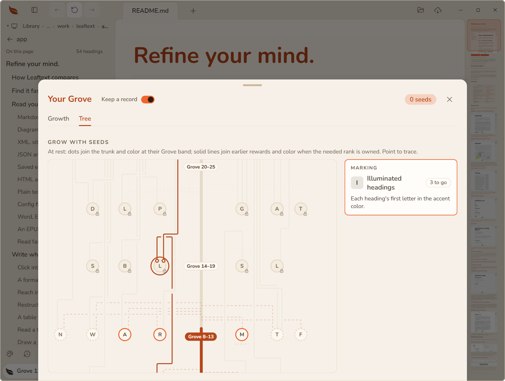
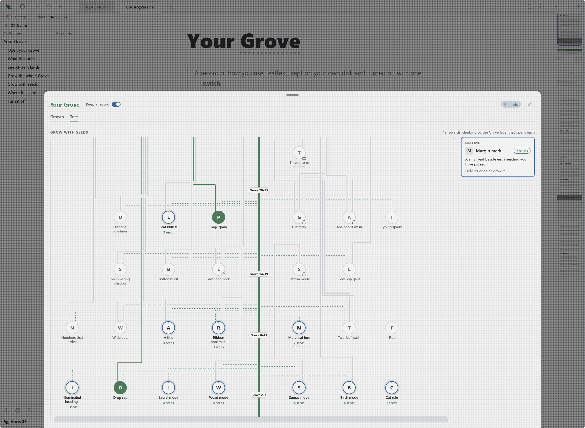

# Your Grove in detail

> Everything about the Grove, its areas and its seeds, one fact at a time

This page holds the full behavior behind [Your Grove](../01-features/09-progress.md). Each section matches a section there.

## Overview

- Leaftext keeps a quiet record of what you do and shows it as your **Grove**.
- It has thirteen Growth areas, each leveled by its own kind of use, and one Grove level that everything fills.
- XP is earned as you go. Each area levels on its own the moment its bar fills, and every point also goes into the Grove's bar.
- The Grove level is the one thing you take. When its bar is full, it becomes a press you hold to grow a level, and that level hands you seeds.
- None of it changes how a document reads, and nothing it counts leaves your computer.

## Open your Grove

The **Grove** is a row of [More](../01-features/02-navigation.md#more), at the foot of the icon rail, wherever you are. It shows the Leaftext leaf and your Grove level. When its bar is full and the next level is ready to take, it reads **Grove 2 full**, with the row in the theme's accent.

Press it, and a large sheet rises from the bottom of the window. It shows your Grove level and its bar, the XP it holds toward the next level, or **At its ceiling** once every area is fully grown. Then comes a year of days, one square a day on your computer's calendar, darker the more grew that day. Last is every Growth area, with its level and a bar for how far into it you are.

Drag the sheet down, press the cross, press outside it or press Escape to put it away. The document stays open underneath.

![The Grove sheet risen over a document: Your Grove with six seeds and the Keep a record switch on in its header, the Growth and Tree tabs under it drawn as the tabs over a document, Growth framed and open into the sheet and Tree a darker grain cell, Grove 2 with the line saying everything you do in Leaftext fills this one bar, and in place of the thin bar a wide green press reading Hold to grow to Grove 3 over the line saying the bar is full and that Grove 3 brings six seeds, then a year of days with the last few weeks shaded, the Growth areas in two columns one even gap apart, each at its own level with its own bar, and a column beside them holding Earned lately with a See all XP button on its heading and a Today block counting the words read today](../../imgs/grove-sheet-5-v2.png)

When the library pane is dragged narrow the Grove's words shorten and then go, and the leaf stays. When the pane is shut the Grove goes with it; open the pane to reach it again.

## What it counts

Each area grows from one kind of thing you already do, whether you do it by hand or an agent does it through Leaftext:

| Growth area | What grows it |
| --- | --- |
| Leafing | Reading documents |
| Scribing | Writing prose |
| Marking | Highlighting passages, hanging notes off them, and starting or replying to a comment on one |
| Charting | Drawing flowcharts, including diagrams an agent writes into a note through Leaftext |
| Tabling | Filling in tables |
| Furnishing | Ticking checkboxes, writing fields, placing pictures, and giving a slide its build, once for each slide each time the app is opened |
| Wayfinding | Making links from one note to another, following links, opening the map and the glossary, and defining a word in a book |
| Seeking | Every search that finds something, and opening what a vault search found |
| Tending | Making and deleting files and folders, renaming and moving files, setting favorites, and trusting a project's checks with `leaftext --harness trust`; each project pays for its first trust once, trusting it again after the file changes pays nothing, and a trust typed while Leaftext is closed pays nothing; each job an agent completes against those checks pays once, an attempt the harness sends back pays nothing, and a job completed while Leaftext is closed pays nothing |
| Rooting | Adding vaults, successfully making or linking repositories, turning automatic sync on for a vault, and pressing Sync when it sends your work, including a saved commit sent on retry; each of these is setup a vault does once, so picking a folder that is already a vault switches to it and pays nothing, a vault pays for its first successful remote link and for its switch once each, a sync with nothing to send earns nothing, and the syncs the switch makes on its own earn nothing |
| Sharing | Exporting a diagram, a picture, a PDF or a page, once for each file written |
| Delving | Looking at a document's source, standing two documents side by side, and opening a console, once for each folder each time the app is opened |
| Foraging | Opening a new kind of file or source language and wearing a new theme |

Every area in the sheet lists every rule that pays it, with the XP each is worth, so nothing is a guess. Examples are **Every 500 words read**, **Each picture page read** and **Each new format read**.

Only what lands pays.

Where the app says it could not do what you asked, the bar stays exactly where it was. That covers a note, highlight, table cell or typing in a document whose file has gone. It covers a [rename or paste](../01-features/03-library.md#file-actions) onto a taken name, and a [new file or folder](../01-features/03-library.md#folders-and-the-space-around-them) under a name the folder holds. It also covers an export whose save window you closed, or whose file could not be written.

Foraging counts each readable file format and source language once, so a Rust file, a Python file and a Dockerfile are separate finds. A Google Drive shortcut is not a find. A second file of a kind already opened pays nothing.

The pool holds 54 points across file formats, source languages and theme families, capped at level 11. That last level costs whatever is left of the pool, so every find pays a point. Earlier XP remains in the record, and a reader above the new cap stands at level 11.

Seeking counts a search once it has found something and settled. That means a query typed into the [find bar](../01-features/02-navigation.md#find-in-this-document) that has held at least one match for a second, in this document or the whole vault.

Stepping through matches, a redraw under the bar, and asking the same thing again in one sitting pay nothing. Another word, another document, or the same word in another vault is another search.

Leafing counts the reading you actually reach. A paragraph, heading or other prose block counts once it has been on screen for two seconds, and every 500 words is a point.

A sourced picture page in a comic, manga volume or illustrated book is one point after the same two-second dwell. A picture page taller than the window waits until you have reached 90% of it.

A table of pictures pays a picture page for every picture alone in its cell, so two compared side by side are two points. A picture beside a caption, or a grid of small badges and icons, pays its words instead. A table of pictures taller than the window pays as you move down it.

A table of words pays every word in its cells, the same as those words would in a paragraph. A block with both substantial prose and a picture pays whichever reading is worth more, never both. So a 500-word illustrated chapter is a word payment, and a picture-led page a picture-page payment.

A block taller than the window, such as a long table or code block, counts by how far down it you have read. So scrolling past the top of one pays only for the part you saw. A page Leaftext cannot split into blocks counts by how far down you have read it.

Reading the same block or picture page again in one sitting adds nothing. Nothing counts while nobody has scrolled, typed or moved the pointer for five minutes, so a window left open overnight earns nothing.

A page being read aloud counts as someone being there; every sentence the voice starts keeps the count going. So a chapter you listen to, hands off the computer, pays for the blocks on screen as reading would. Picture pages never add invented words to **Words read today** or its landmarks.

An area that has not counted anything yet stays at level 1 and says **Not started**. Every rule pays one point, so one thing you do never reaches more than one level at once.

The first unit of anything still reaches level 2, and the early levels come quickly. Each later level costs more than the last by a growing amount, so level 50 is months of steady use away.

Leafing climbs a steeper curve than every other area. Reading is what someone does for hours and earns far more than anything else, so each Leafing level takes longer than the same level elsewhere.

Foraging stops at level 11, since there are only so many file formats, source languages and theme families to find. Its last level costs whatever is left of the pool. Every bar says the XP it holds and the XP the next level costs; an area at its ceiling says so instead.

**Seeds** come with the Grove's own level. Every level the Grove reaches hands the same number, whichever areas the XP came from. So reading deep in one area pays exactly what dabbling across many does. They arrive with each Grove level you take, and show at the top right of the sheet.

## See XP as it lands

With the Grove shut, whatever pays XP says so on the Grove row for a few seconds, such as **+1 Leafing**. A thin bar along its foot shows how far that area now is into its level. Pointing at it gives the same words as the area's bar. When one thing you did pays two areas, each takes its turn.

Then the pill goes back to your Grove level. Nothing plays when the app opens.

With the Grove open, the same things pop in at the foot of the sheet and rise over it, such as **500 words read**, then **+1 Leafing XP**. Each stands a couple of seconds and fades, up to three at a time. Meanwhile the area's card fills, its level rolls over, and the Grove bar takes the same XP.

Anything that pays while the All XP list is up waits there and rises when you come back, joined into one line where the same thing paid more than once. With Reduce Motion on, the words simply appear and go, and the levels change with no roll.

The Grove sheet's column beside the areas opens on **Earned lately**: the latest things that paid, newest first. Each shows its day, what you did, such as **1,000 words read** or **Picture page read, 3 times**, and the XP it was worth.

The same kind of payment on the same day adds up on one line, and the list keeps the twelve latest. It starts empty and fills from the next thing that pays.

**See all XP**, on that heading, opens the whole account in place of the sheet's body. It lists every gain Leaftext has kept, newest first, under its day. Each shows the time on your own clock, what you did, the level and Grove pool it moved, and its worth.

A Grove level you took is a line too, with the seeds it brought. **Show older** brings the next couple of hundred; the back arrow and Escape return to your Grove. Gains are kept in `growth-log.jsonl` beside the record, and nothing earned before this list existed is in it — nothing saved those with a time.

Under it, **Today** says what today has come to: the words read and the documents opened. Each document counts once a day, however often you open it or restart. It sits right above the Landmarks for the most of each in a day, so you can see whether today will beat them.

It counts from midnight on your own clock, and stays hidden until today has something on it.

The record holds counts, plus the ids of things that pay only once. Those are the kinds of file and source language you have read and the theme families you have worn. They also include the vaults you linked to a repository and the vaults set to sync themselves. Never a file's name, its folder, or a word of what it says.

## Grow the whole Grove

A Growth area's level is never asked for: its bar fills as you use Leaftext and the card rolls over to the new level where you can see it. The Grove's own level is the one thing you take, and it is the only hold in the app.

When the Grove's bar fills, the thin bar becomes one press the same width, reading **Hold to grow to Grove 3**. A line under it says the bar is full and how many seeds that level brings.

Where the bar has filled more than once, the press names the level it lands on, how many times it filled, and every seed the run brings. It reads **Hold to grow to Grove 7** over **Your bar filled 3 times. Grove 5 to 7 brings 18 seeds.**

Press and hold it until the fill crosses it, and every level it names is yours. The press bursts into confetti, and the Grove number rolls up through them all with every seed they brought. Let go before the fill is across and nothing is sent.

Pressing it once from a screen reader takes it at once, and with Reduce Motion on the numbers simply change. XP you earned past the level stays in the bar toward the next one. Closing the sheet keeps the level waiting, and XP keeps being counted behind it.

While the bar is full, the same press also stands at the top of the **Tree** tab, so a waiting level can be taken where seeds are spent. With the bar not full, the Tree tab shows no press.

## Grow with seeds

Everything you can grow sits in one tree, on the Grove sheet's **Tree** tab beside **Growth**, so reaching it never means scrolling past the bars. The sheet opens on whichever of the two you last looked at.

The tree climbs from a strip of soil up a trunk in nine bands of Grove levels, each band labeled on the trunk. **Grove 2–7** is at the foot, then **Grove 8–13** and so on. The last runs from Grove 50 to the Grove's ceiling.

The trunk fills from the soil to your own Grove level, and your band's label is filled with it. Each reward is a round button with its name under it, standing straight above the reward it grows from: Woad, Lavender and Iridescent skin climb one line.

Where a window is too narrow for names, each band draws its rewards as a row of smaller circles with no words. They never overflow their place and never touch, and the names return as the window widens.

The tree scrolls up and down only, opens with your own band in view, and your seeds stay one number at the top right.

Solid branches connect rewards to their prerequisites, meeting the circles above their names. Each branch has its own route; a small break where unrelated branches cross shows that they do not join. Lighter dotted branches connect independent rewards to the trunk. The tree leaves room for those routes as the window narrows.

At rest the two kinds of line color for different reasons, and the tree's heading says so. A dotted branch colors once your Grove reaches its band. A solid one colors once you own the earlier reward it asks for. Neither says the reward it leads to can be grown yet.

Point at a reward, and its own lines stand out while every other line steps back. Those are the line it grows from, the lines growing from it, and its dotted branch to the trunk if any.

The circles at the other ends of those lines get a light ring, and a small open circle marks each place a traced line meets a circle. Move away and the tree goes back to rest. Tab to a reward and the keyboard traces it the same way; pointing at another reward wins while the pointer is there.

Tracing chooses nothing and spends nothing.

Click a reward's circle, and it is drawn whole in the card beside the tree. The card shows its Growth area, its name, what it does, and everything you can do with it. Until you click one, the card shows the first reward from the soil up that you can grow.

On a narrow window the card stands over the tree instead.

Growing anything asks three things: that your Grove has reached the reward's level, that you own every earlier reward it names, and that you hold the seeds for it. The XP can come from any area — a reward written under Leafing opens just as well on a Grove level you reached by drawing flowcharts.

A reward you cannot grow yet wears a small lock, and its card says what is still in the way — **Needs Grove 22** first, then the earlier rewards. A reward Leaftext has not built yet stands in a dashed ring reading **Not grown yet**. It has no lock and no level, since no Grove level or earlier reward opens it.

The stem joining it to an earlier reward colors once you own that one. A reward growing from nothing hangs off a trunk branch, which colors once your Grove reaches its band.

A few things can be grown more than once, and each of those times waits for a Grove level of its own further up the climb. Something another part of Leaftext has not built yet stands on its path in a dashed ring, and its card says **Not grown yet**.

Hold an affordable reward's circle until its ring fills to grow it or its next rank. Let go early to see its card without spending. When the purchase is taken, confetti bursts from the circle and your seed balance rolls down to its new number.

A screen reader can activate a circle once to hear its card and again to grow it. Seeds you spend are not given back, and nothing you grow is ever taken away. The one exception is a reward Leaftext retires: it leaves the tree and refunds its price to everyone who grew it.

Topping out the Grove pays enough seeds to buy every rank of everything that has grown.

What you can grow today:

- **Six one-color themes**, Foraging's — Woad, Sumac, Laurel, Saffron, Lavender and Birch. Each stands dimmed and priced in the [theme picker](../01-features/06-themes.md) until grown, and pressing it there opens its card here. A grown theme is worn from the picker and joins Random. **Wear it in Themes** in its card opens the picker there.
- **Things on the page**: a drop cap on a document's first words, its letter framed in drawn scrolls and leaves, and a leaf-cut divider. There is the chrome's speckle on the page itself, leaf bullets, and headings whose first letter stands on a small accent tile, a leaf falling past now and then. A small leaf marks each heading you have read. The theme's accent can also color the [ribbon bookmark](../01-features/04-minimap.md#the-ribbon-bookmark) every reader has on the minimap.

  Each arrives switched on and has its own switch in its card.
- **Console scanlines**, Delving's reward, lay fine red, green and blue rows across every console's tab and screen. It is the look of an old color screen, with a soft colored band rolling through now and then. No band passes while your system asks for reduced motion. It arrives switched on and has its own switch in its card.
- **More leaf lore** — six more sentences for the start screen's palm-leaf voice, one each time. From the first sentence its card has a switch that takes every sentence you bought off the start screen and brings them back, while the next one stays for sale.
- **A title** — Reader, Scribe, Cartographer or Prism Keeper, shown under **Your Grove**. Its card has a switch that hides the name and shows it again; you can still pick a different name while it is hidden.

Hiding a reward keeps it: what you paid, its ranks and the name you chose all stay, and the Grove goes on counting.

A reward you grew before the tree was ordered by Grove level stays yours, whatever level now opens it.

## Where it is kept

The record is `profile.json`, beside `settings.json` and `recent-files.json` in Leaftext's settings folder — `%APPDATA%\ryanallen\leaftext\config` on Windows and `~/Library/Application Support/com.ryanallen.leaftext` on a Mac. Leaftext writes it about half a minute after something changes, and once more when you close the window. If the file is missing or cannot be read, Leaftext starts a fresh record and opens as normal.

A record kept by a copy of Leaftext from before the Grove had its own bar is started fresh once. That happens the first time a newer copy opens it, since its numbers were counted the old way.

Every gain is also kept in `growth-log.jsonl` beside the record, one line per thing you did. Each line holds the time, the levels and Grove pool it moved, and its worth.

It is what [See all XP](#see-xp-as-it-lands) reads, and it is appended to rather than rewritten. Once it passes 3 MB, the next launch trims it to its newest 20,000 lines. **Reset all** empties it; **Reset all but stats** keeps it.

## Turn it off

Open your Grove and press **Keep a record** in the sheet's header. With the record off, nothing is counted, no bar moves and no level is earned. The Grove row reads **Grove** with no number, and the sheet holds only the switch and a line saying so.

Everything you have grown on the page, the title and the extra lore go away while it is off, and a theme you are wearing stays on. Press the switch again to start counting where you left off, with everything you grew back as it was.

The published site and a document embedded in another product keep no record, and show no pill.
