# Rendering in detail

> Everything about how Leaftext draws each kind of file, one fact at a time

This page holds the full behavior behind [Rendering](../01-features/01-rendering.md). Each section matches a section there.

## Overview

- Leaftext picks a reader from the file's ending. Where the name has no ending, as with `.gitignore`, `LICENSE` or `Procfile`, it reads the file's first words instead.
- A nameless file opening with a doctype or an `<html>` root is drawn as a page. One opening with an XML declaration goes through the XML reader.
- One opening with a brace or bracket that parses as JSON goes through the data reader. Everything else is read as Markdown, as a `.gitignore` is today.
- A file whose ending already names its format is never asked what it holds. A file you are typing in keeps the format it opened with.
- Markdown (`.md`, `.markdown`, `.mdown`, `.mdc`) is parsed in Rust with `pulldown-cmark`, run through a GitHub-like pipeline, sanitized, and handed to the web view.
- `.xml` is parsed with `roxmltree`, then routed by what it holds: a TEI document to the [TEI renderer](#tei-xml), anything else to the [generic XML renderer](#any-xml).
- `.json`, `.yaml` and `.yml` go to the [data renderer](#data-files-json-and-yaml), which reads the same shapes as the generic XML renderer.
- `.ini` and `.css` each have their own reader, [INI](#ini-files) and [CSS](#css-files), then go through that same renderer.
- `.csv` and `.tsv` go to [a reader of their own](#csv-files) and are drawn as a note's table is. `.txt` is [kept exactly as typed](#plain-text-files), with no parser.
- `.eml`, `.mht` and `.mhtml` go to the [email renderer](#email-eml). A [source file](#source-files) is drawn as one highlighted block under its own name.
- `.docx`, `.docm`, `.xlsx`, `.xlsm`, `.pptx`, `.pptm`, `.odt`, `.ods` and `.odp` arrive as bytes, not text, since each is a zip.
- The archive is opened, the part holding the words is unpacked, and that part goes to [its own reader](#office-and-opendocument-files).
- `.epub` arrives as bytes the same way and goes to [the book reader](#epub-books), which follows the book's own package.
- The Kindle endings `.azw`, `.mobi` and `.azw3` go to [the Kindle reader](#kindle-books).
- A Google Drive app shortcut (`.gsheet`, `.gdoc`, `.gslides`) holds no document of its own. Leaftext offers a press to open it in Google Docs, Sheets or Slides in your browser.
- Every reader produces the same HTML shell.
- Each Markdown feature below has a live example, drawn by the same engine as your documents.
- The XML, data, email and Office sections are described rather than shown, since a Markdown page cannot embed a live document of another format.

## Summary

| Category | Supported |
| --- | --- |
| Core Markdown | Headings, paragraphs, lists, links, images, blockquotes, rules, inline code |
| GFM | Tables, task lists, strikethrough, autolinks |
| Extras | Syntax highlighting, Mermaid, math, alerts, footnotes, emoji |
| [Wiki links](#wiki-links) | `[[Note name]]`, with shown words after a `|` and a heading after a `#`, drawn as a link to that note |
| [Tags](../01-features/03-library.md#tags) | `#work` and `#work/reports` in Markdown prose or the `tags` field; pressing one searches the active vault |
| Leaf extensions | [Buttons](#buttons-leaf-extension) — a link wrapped in braces; [badges](#badges-leaf-extension) — words as inline code with a color name, or a hex color of your own, in a comment after them; [bars](#bars-leaf-extension) — a list whose items end in an amount, drawn on one scale, in a color name or a hex color of your own; [tabs](#tabs-leaf-extension) — named parts of one Markdown file |
| Local content | [Images](#images) by relative, absolute, or `file://` path, using the page's width, opening on the whole window, and saving out as a PNG, a WebP, a JPEG, a PDF or a Markdown document |
| Safety | Sanitized HTML allowlist |
| [XML](#any-xml) | Any `.xml` file: sections, label/value fields, record tables, links |
| [TEI XML](#tei-xml) | Scholarly and archival markup; headings, paragraphs, verse, footnotes |
| [JSON and YAML](#data-files-json-and-yaml) | Any `.json`, `.yaml`, or `.yml` file, read by the same shape rules as XML |
| [Email](#email-eml) | Any `.eml`, `.mht`, or `.mhtml` file: headers, the message body, inline images, attachments |
| [Word, Excel, PowerPoint and OpenDocument](#office-and-opendocument-files) | Any `.docx`, `.docm`, `.xlsx`, `.xlsm`, `.pptx`, `.pptm`, `.odt`, `.ods` or `.odp` file, read as the document it is and edited in place — on the slide or sheet selected in the code view where it has several |
| [EPUB books](#epub-books) | Any `.epub` file, read as one document in the order the book's own package says to read it |
| [Kindle books](#kindle-books) | An `.azw`, `.mobi` or `.azw3` book with no protection on it, read as one document the way its own records put it together |
| [Plain text](#plain-text-files) | Any `.txt` file, kept exactly as typed |
| [INI](#ini-files) | Any `.ini` file: sections, keys and values, each key drawn as it was written |
| [CSS](#css-files) | Any `.css` stylesheet: each rule a heading over its declarations, each property drawn as it was written |
| [CSV](#csv-files) | Any `.csv` or `.tsv` file, as a table with a row per record |
| [Source files](#source-files) | TypeScript, JavaScript, JSONC, SCSS, shell, TOML, Rust, Python, SQL, diff, dotenv, GraphQL, and Dockerfile files as highlighted source |
| [Encodings](#file-encodings) | UTF-8, UTF-16 and UTF-32 by their byte order mark; saved back as they were read |

## Pipeline

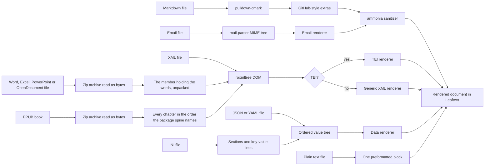

## EPUB books

**[Read *Le Morte d'Arthur* here, with its glossary →](../08-examples/le-morte-darthur/le-morte-darthur.epub)** It is Sir Thomas Malory's book in the [Standard Ebooks](https://standardebooks.org/ebooks/thomas-malory/le-morte-darthur) edition, free to read and share everywhere. A [glossary](../08-examples/le-morte-darthur/GLOSSARY.md) beside it underlines the old words, the names and the places.

Leaftext opens an `.epub` as **one document**, in the order the book's own package says to read it.

An EPUB is a zip of chapters with a package document naming their order. So you get the whole book on one scrolling page. The cover comes where the book puts it. A book naming its cover only in its package is given it under the author's name, before everything else. Then come the book's own contents page, each entry landing on its chapter, and the chapters themselves.

The minimap, find, the heading outline and Previous/Next work on it as on a note, because it is one document rather than a shelf of them.

| In the book | Rendered as |
|---|---|
| The package spine | The order the page runs in, first entry to last |
| A chapter | Its own section of the page, with an anchor a link to it lands on |
| A chapter the package calls plain HTML, the way every book the Internet Archive makes labels its pages | The same chapter, drawn, counted and searched like any other |
| The book's own contents page | A contents page, with every link jumping inside the document |
| What the book's contents call each chapter | That chapter's heading, at the level the contents nest it at, where the chapter draws none of its own |
| The title and author in the package metadata | The page heading, and the author's name under it as a quiet byline |
| A picture the book packs | The picture, drawn out of the book itself, including a cover carried by an SVG `image` element on its own page, and a cover the package declares that no page draws |
| A stylesheet the book packs | The typography it describes, drawn in Leaftext's own type: italic, bold, small, raised, lowered, large, small capitals, centered or aligned, tight, and indented — and a part the book hides is not drawn. The stylesheet itself never reaches the page |
| A script the book packs | Nothing. A book does not script the reading surface |
| A part in a form nothing can draw | One quiet italic sentence saying so, where the part sits |
| A missing first cover page in an Archive book | **This book's cover page is missing.**, followed by the book's readable chapters |

That missing-cover recovery applies only when the first spine entry names `cover` and the manifest has no matching item. A different missing entry still refuses the book, as does a book with no readable chapter. The downloaded file stays unchanged; the same recovery works when opening an EPUB directly or through [Books online](../01-features/03-library.md#books-online).

**Every chapter of a book has a heading, so the outline holds the whole book.** Almost no book writes its chapter titles as headings; a title is an ordinary paragraph the publisher's stylesheet made big. So Leaftext reads the book's own contents, which every EPUB carries, and uses what it calls each chapter.

Where a chapter opens on its title, that line becomes the heading, with no second copy above it. Where it opens on its first words, the name from the book's contents is written above them.

The level comes from the book's own nesting, so a part is a top-level heading and each chapter under it sits one level in.

A chapter that writes its own heading, at any level, is left exactly as written. A book whose contents name nothing reads as it always did. This is what fills the [outline in the pane](../01-features/02-navigation.md#outline), the minimap and find for a book.

**A book keeps its publisher's typography and not its publisher's numbers.** Every EPUB carries a stylesheet, and a book's words are not plain prose. A title is centered and heavy, a book's name in a sentence is italic, a footnote marker is a small raised digit, and a contents page is a close-set list.

Leaftext reads that stylesheet and draws each of those in **its own** type. So a book takes the theme you read in, rather than its publisher's weights and sizes.

Twelve things are recognized: italic, bold, small, raised, lowered, large, larger, small capitals, no gap under a block, an indented first line, the four alignments, and a hidden part. Anything else in a stylesheet is left out. A book cannot set a color, place a box or name an address, since the reading surface is the app's page too.

**A part the book hides stays hidden**, for the same reason any reading system hides it. A comic may pack a full-page panel, then the same panel again in pieces for small screens, each piece marked hidden. Drawing them all would turn eight pages into forty.

**The book's own words start the book.** The author's name under the title, and the sentence shown where a part cannot be drawn, are the reader's own lines. So both are drawn quieter than the words around them.

The [drop cap](../01-features/09-progress.md#grow-with-seeds), once grown and switched on, steps over them as it steps over a heading. It walks past the cover and any empty chapter, and lands on the book's own first paragraph.

**Nothing is fetched from the network when a book opens.** A book may name a picture, font, sound or film on the internet, and each would load itself as the page draws. So a tracking picture in a book somebody sent you would call home before you read a word.

Leaftext removes every such address and draws only the pictures packed inside the book. A **link** is different, because a link is a press. A book's links to the web and to email addresses are kept, and open as any other document's do.

**A book is edited a chapter at a time.** With the padlock open, [typing into a paragraph or heading](../01-features/07-editing.md#formats) changes that chapter's own source file inside the book. The source button opens the chapter you are reading. Save writes only the chapters you typed in, leaving every other file in the book byte for byte as it was.

**A book that is not the book it claims to be says so instead of taking the machine.**

Each fault gets one sentence: a missing or damaged package document, or a chapter pointing outside the book. So do a chapter claiming more text than the app will open, a spine of more than 4,096 parts, and a circular chain of fallbacks.

A book whose chapters are encrypted says so by name; one that only scrambles its fonts reads normally, because a book's own fonts never load here.

**A picture waits inside its book until the page nears it.** Leaftext gives every picture its own box from the size written in its header, so the book has its full height before the picture arrives. The desktop then reads that one picture out of the book when it is needed, and one picture past sixteen megabytes is refused.

Leaftext in a browser, and a document embedded in someone else's page, keep the book they opened. They make each picture from it as the reader nears it, so a comic draws every page there too.

A page that never says it can make pictures that way, such as leaftext.com's own reader, still carries them inside the page. It stops after sixteen megabytes across the whole book. A page embedding Leaftext has to allow `blob:` in its own `img-src` for those pictures to draw.

> [!NOTE]
> Leaftext is a reader of EPUB rather than a conforming EPUB reading system, and does not claim to be one. A fixed-layout book — a comic drawn to exact pages — opens as its pictures in reading order rather than as the pages its maker laid out. A book's scripts do not run and its audio narration has no player.

## Kindle books

Leaftext opens an unprotected Kindle book as **one document**, as it opens an [EPUB book](#epub-books). The cover comes first, then every part in the order the book's own records give. Its links land where they point, and its pictures come from the book itself.

Amazon stores every book as `.azw`, whatever is inside. So the file's own first bytes decide how it is read, not its name, and `.mobi` and `.azw3` open the same way. A book in the older Mobipocket form and one in Kindle Format 8 both read; where a file carries both, the newer one is drawn.

A Kindle book is read and never typed in, and the code view says it has no source to show.

**Some Kindle files do not open, and each one says why.** A book locked to an Amazon account says the key is what is missing. A KFX book, as most books bought from Amazon since 2017 are, says Leaftext has no reader for it. So does a Topaz book of scanned pages. Waiting will not make them open.

Nothing is sent anywhere and nothing in the Kindle app's folder is written, so opening one changes nothing about your library.

**The Kindle app's folder is a vault on its own.** Where the Kindle app keeps its books on this machine — **My Kindle Content** in Documents — Leaftext makes it a vault the way it does [a cloud folder](../01-features/03-library.md#your-cloud-is-already-a-folder).

The pane draws each book under the title, author and kind of file from Amazon's own library record, not the Amazon id its folder is named for. A line above counts the books, the ones that open here, and the ones that are shut.

Where the Kindle app has written no record, each book is listed by its file.

## Plain text files

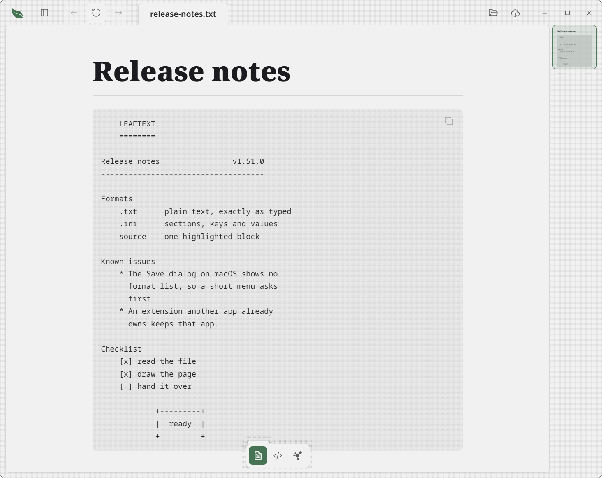

Leaftext opens a `.txt` file as **one block, kept exactly as typed** — every space, every line break, every column of an ASCII banner. Nothing is reflowed, nothing is parsed, and nothing is guessed at, because the app was never told what shape the file holds.

An indented list stays indented, a hand-drawn table stays lined up, and a hand-wrapped paragraph keeps the width somebody chose for it.

That is a deliberate pick over reading a text file as prose. Reflowing blank-line-separated paragraphs would read better for a note and would take apart everything drawn with spaces, which is a great deal of what is in a `.txt` file. If you want prose, the app's own Markdown is a rename away.

The block wears the same border, dot texture, and **Copy** button every code block in the app wears. It carries no click-to-edit range, since a range covering the whole file would be the [code view](../01-features/07-editing.md#code-view) drawn twice. So a `.txt` is edited in the code view.

Installing Leaftext offers it under **Open with** for `.txt` without replacing Notepad or TextEdit as the default. See [File associations](../02-installation.md#file-associations).

## INI files

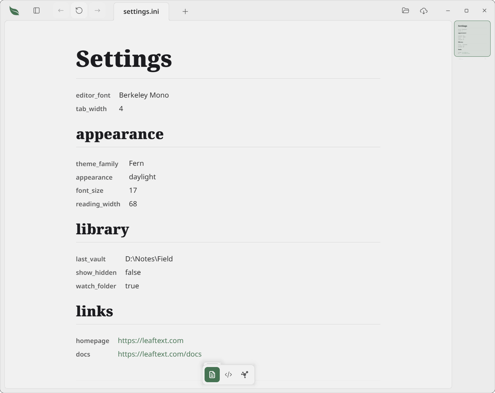

Leaftext opens an `.ini` file as a page like a JSON file's. Each `[section]` is a heading, and its keys form a label-and-value list. A value that looks like a link is drawn as one.

There is no INI standard — dialects disagree about nearly everything — so Leaftext picks one and states it:

| The rule | What it means |
|---|---|
| `;` or `#` first on a line opens a comment | An end-of-line comment is the one difference that silently eats data: a Windows path, a color, a URL and a password all carry `#` in the middle of a value |
| A comment is not drawn | The [code view](../01-features/07-editing.md#code-view) shows the file in full, comments and all |
| The first `=` splits the line | A `:` delimiter is Python's, not the Windows original, and taking both makes any URL-valued key ambiguous |
| The key and the value are trimmed | Nothing else is touched: no unquoting, no unescaping, no joining lines |
| `[name]` alone on a line opens a section | Keys written before the first one are drawn at the top, which is where a `.gitconfig`-shaped file puts its first lines |
| A `title` or `name` key written before the first section heads the page | It becomes the page's big heading rather than a row in that list, the same as in a [JSON or YAML](#data-files-json-and-yaml) file, so the file's own name for itself is not said twice |
| A repeated key draws twice, in order | The point is to show the file as written rather than to model it — a repeated section opens a second heading too |
| A key keeps its own spelling | `font_size` draws `font_size`, not "Font size", because that is a name somebody chose |
| A line that is none of these is drawn with no name | Its words are in the file, so they are on the page |

**Every value, key name and section heading can be typed into where you read it.**

The reader holds the exact bytes between the `=` and the line's end, the key's bytes without spacing, and the section's name inside its brackets. Each is the smallest useful thing to edit. Saving writes the file back in the spelling it was read in. See [Editing data files](../01-features/07-editing.md#editing-data-files).

Installing Leaftext offers it under **Open with** for `.ini` without taking the extension from whatever opens it today.

## CSS files

Leaftext opens a `.css` stylesheet as the page a JSON file already draws: each rule's selector is a heading, and its declarations are a label-and-value list under it. An at-rule with a block — `@media`, `@font-face`, `@supports` — is a heading over the rules inside it, one level down.

| The rule | What it means |
|---|---|
| A rule is a selector, its braces and what is between them | Braces are counted, so a nested rule and an `@media` block read the same way |
| A brace or a semicolon inside quotes, brackets or parentheses ends nothing | `content: "a; b"`, `url(data:…)` and `a[title="{"]` all read as written |
| A declaration splits at its first `:` | The value keeps every byte after it, trimmed of the spacing around it |
| A comment is drawn | A stylesheet's comments are usually the only prose in it, so each one is a row of its own, where it was written |
| An at-rule with no block is a row of its own | `@import` and `@charset` are named by their keyword, with the rest of the line as the value |
| Nothing is sorted, merged or computed | A property set twice draws twice, in order, and a property with an empty value still draws |
| A property and a selector keep their own spelling | `font-size` draws `font-size`, and `--brand` draws `--brand` |

**Every value can be typed into where you read it**, and the save writes the file back in the spelling it was read in. A selector and a property name are not edited on the page; the [code view](../01-features/07-editing.md#code-view) edits the whole file.

Installing Leaftext offers it under **Open with** for `.css` without taking the extension from whatever opens it today.

## CSV files

Leaftext opens a `.csv` or `.tsv` file as a table. The file name is the page heading, the first record is the table's header, and each later record is a row.

It is the same table a note's table is, so a wide one gets its own sideways lane and turns into a card per record when the window is narrow.

| The rule | What it means |
|---|---|
| A `.tsv` splits on tabs | A comma inside a cell is just a comma |
| A `.csv` splits on commas or semicolons | Whichever of the two the first record uses more, outside quotes, and commas on a tie — so a spreadsheet saved in a country that writes decimal commas opens as its columns rather than as one |
| A field in double quotes may hold the separator and line breaks | Two quotes in a row inside it are one quote, as every spreadsheet writes them |
| A line holding nothing is skipped | It is no record |
| A record longer than the header widens the table | The extra columns get blank headings rather than losing the words |
| A record shorter than the header is padded | Its missing cells are drawn empty |
| A byte order mark is not part of the first heading | Excel writes one at the start of every UTF-8 file it saves |

The bar over the table sorts and filters it, and lays it out as a table, cards or a board. The corner button opens it across the whole window. None of these change the file. Describe, which writes a note about the table into a Markdown file, is not offered, because a CSV file has nowhere to keep one.

**A cell can be typed into where you read it** once the page is unlocked.

Only that one field is saved. A field in quotes stays in quotes. A bare one gains them only when your text needs them: a comma, semicolon, quote, line break, or a tab in a `.tsv`. Any quote inside is doubled.

Some files open as a sentence saying which limit they passed. That covers more than 16,384 fields in a record, 1,048,576 records, or 32,767 characters in one field, a spreadsheet's own limits. It also covers 200,000 cells in all, or a quote that never closes.

Installing Leaftext offers it under **Open with** for `.csv` and `.tsv` without taking either from the spreadsheet that opens them today.

## Source files

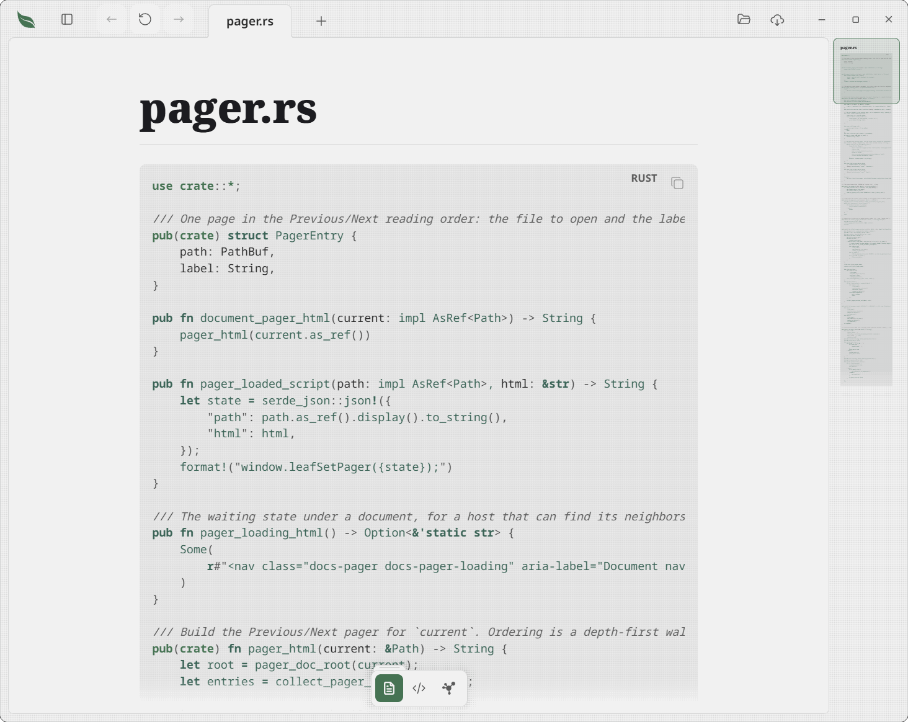

Leaftext opens source and configuration files as a file-name heading above one highlighted source block. It recognizes TypeScript, TSX, JavaScript, JSX, JSONC, SCSS, shell, TOML, Rust, Python, SQL, diff, dotenv, GraphQL, and Dockerfile files.

A `.diff` or `.patch` file holding a unified diff reads as one diff card per file it names. It is the same card an agent's edit uses, each hunk numbered from its `@@` line. A changed line shows twice with only its changed words marked. A copy press puts the diff on the clipboard as plain text. A `diff` code block in a note reads the same way.

A diff that does not read as a unified diff stays highlighted source. A dotenv file opens under its variant names too, such as `.env.local`, `.env.example` and `.env.production`. That holds unless its last ending names a format, so `.env.json` still opens as JSON. JSON, HTML, XML, YAML, INI, CSS, plain text, and Markdown keep their dedicated reading views.

Source files open when you choose one or follow a link, and stay out of vault search, graphs, and Previous/Next pages. Folder listings leave them out too, except the two known by their whole name — `.env` and `Dockerfile` — which the [library pane](../01-features/03-library.md#file-types) lists beside a `.gitignore`.

## Reading at a prompt

Type `leaftext --print notes.md` at a cmd or PowerShell prompt and the document prints right there, rendered, and the prompt comes back under the last line. Every format above prints through the same render the window draws. So a JSON file prints as its tree, a message as its headers and body, and a Word file as its words.

These may follow the file, in any order:

- `--styled` prints in the terminal's own colors even where the text is going somewhere other than a terminal.
- `--plain` prints no colors at all, and wins over `--styled`.
- `--width <columns>` wraps paragraphs at that many columns.
- `--contents` lists a book's chapters, one numbered line each.
- `--chapter <number>` prints that one chapter of a book.

At a prompt the text is styled and wraps at the terminal's width. Sent through a pipe or into a file it is plain and wraps nowhere, so `leaftext --print notes.md > notes.txt` writes clean text. A `NO_COLOR` variable holding anything turns colors off everywhere.

What prints as what:

- A heading sits between blank lines, in bold. A top heading is underlined with a double rule `═` its width under it, a second-level heading has a single rule `─`, and deeper headings are bold alone. The rules print in plain text too, so a file written this way still shows its structure.
- A paragraph wraps at the width, and stays on one line where there is none.
- A list indents under its markers, and a task prints `[x]` or `[ ]`.
- A quote and an alert print behind a bar, the alert's kind leading it.
- Math prints as symbols: `$e^{i\pi}+1=0$` reads `e^(iπ)+1=0`, and a math block prints indented on its own. A command it does not know prints as written.
- A code block and a diagram print as written, indented, because the window is what draws diagrams.
- A table lines its columns up under its headers and keeps each column's alignment.
- A link prints its words followed by a number in angle brackets, like `install notes<1>`. The addresses are listed after everything else, one per line under a short rule, as `<1> docs/install.md`. An address linked more than once keeps one number.

  A link whose words are its address prints the address once and takes no number, and a link within the same document prints its words alone.
- A picture prints `[picture: its description]`, dimmed.
- Footnotes print at the foot, their references in square brackets, like `[1]`.

Hand it a folder instead, as `leaftext --print notes`, and it lists the folder as the [library pane](../01-features/03-library.md#browsing) does. The folder's path is the heading, then its folders with their document counts. Then come its documents, each with its title beside the file name where they differ.

A dimmed last line counts the files the pane leaves out, in the pane's own words. The three words that style and wrap the text work on a folder.

### A book a chapter at a time

An EPUB or Kindle book prints whole, which can run to thousands of lines, so a book can be read a chapter at a time.

`leaftext --print dune.epub --contents` lists a book's chapters in reading order, one numbered line each. Each is named by the book's contents where it names one, else by its heading, else by its opening words, dimmed as a guess. `leaftext --print dune.epub --chapter 9` then prints chapter 9 alone.

A chapter is each part the window draws one after another down the page, so a Kindle book's parts are its chapters. Asking for chapters of anything but a book, or for a number past the last chapter, says so and prints nothing.

Printing opens no window, reads only the one file or the one folder, writes nothing, and a copy open in a window never hears of it.

### Checking a file's diagrams

A printed [Mermaid diagram](#mermaid-diagrams) shows as the source it was typed in. To learn whether each one draws, type `leaftext --diagrams notes.md`.

Leaftext draws every diagram in the file in a window that never appears on screen. Then it prints one line per diagram: where it starts and what kind it is. Each line ends in `drew` with the picture written, or `refused` with the stopping line and why:

```text
notes.md:3   flowchart  drew     C:\Users\you\AppData\Local\Temp\leaftext-diagrams\notes\notes-1.png
notes.md:10  flowchart  refused  The drawing stopped at line 2: a label with brackets in it has to be quoted. …
```

Each picture is a PNG drawn by the same renderer, in the same colors, as the reading page. They go to a folder named after the file under the system's temporary folder, so nothing is written beside your notes; `--out pictures` puts them in a folder you name.

The command ends with an error when any diagram did not draw, so a script can run it as a check. The window you are reading in is never touched, and the hidden one closes when the check is done.

On a Mac the program is inside the app: run `/Applications/leaftext.app/Contents/MacOS/leaftext --print notes.md` in Terminal, or add `alias leaftext=/Applications/leaftext.app/Contents/MacOS/leaftext` to your shell's profile and type `leaftext --print notes.md` from then on.

## Markdown

Everything in this section is a live example: what you are reading is drawn by the same engine that draws your documents. Leaftext parses [CommonMark](../GLOSSARY.md#commonmark) and [GFM](../GLOSSARY.md#gfm), then adds the GitHub extras people actually use.

| | |
| --- | --- |
| Structure | [Headings](#headings) · [Lists](#lists) · [Tables](#tables) · [Task lists](#task-lists) · [Horizontal rules](#horizontal-rules) · [Collapsible sections](#collapsible-sections) · [Frontmatter](#frontmatter) |
| Words | [Text formatting](#text-formatting) · [Blockquotes and alerts](#blockquotes-and-alerts) · [Footnotes](#footnotes) · [Emoji](#emoji) · [Text in any language](#text-in-any-language) |
| Links | [Links and autolinks](#links-and-autolinks) · [GitHub references](#github-references) · [Buttons](#buttons-leaf-extension) |
| Media | [Code](#code) · [Images](#images) · [Math](#math) · [Mermaid diagrams](#mermaid-diagrams) |
| Raw HTML | [Inline HTML](#inline-html) — a [security boundary](#inline-html), not a passthrough |

### Headings

All six ATX heading levels render:

# H1 heading
## H2 heading
### H3 heading
#### H4 heading
##### H5 heading
###### H6 heading

Every heading gets a slug `id`, so `#slug` links and the [outline](../01-features/02-navigation.md#outline) resolve against it. Blocks carrying an explicit author-supplied `id` keep theirs — see [Inline HTML](#inline-html).

A Markdown heading can name its own anchor at the end of its line: `### Deleting a vault {#delete-vault}` draws **Deleting a vault** and keeps `delete-vault` exactly as written for links to `#delete-vault`. The braces must be last, and the name must have at least one character with no whitespace, brace, colon or quotation mark. Braces elsewhere stay in the heading's words.

A badge such as `{green: Shipped}` still draws beside the heading's words; `### Status {green: Shipped} {#status}` carries both the badge and the named anchor.

### Text formatting

- *Italic* and _italic_
- **Bold** and __bold__
- ***Bold italic***
- ~~Strikethrough~~ (GFM)
- `inline code`
- Inline footnote reference[^demo]

A trailing backslash forces a hard line break,\
so this sentence continues on the next line.

### Lists

Unordered, with nesting:

- Leaves
  - Simple
  - Compound
- Stems
- Roots

Ordered lists nest into a classic outline (I, A, 1, a, i):

1. Trees
   1. Broadleaf
      1. Deciduous
         1. Maple
            1. Sugar maple
            2. Red maple
            3. Silver maple
         2. Oak
      2. Evergreen
         1. Holly
   2. Needleleaf
      1. Pine
2. Shrubs
3. Ground cover

### Blockquotes and alerts

A blockquote, nested:

> "Read deeply, not widely."
>
> > A leaf within a leaf.

GitHub-style alerts render with theme-aware colors (all five):

> [!NOTE]
> Leaftext renders Markdown — it never edits it.

> [!TIP]
> Search every leaf in your library with a keystroke.

> [!IMPORTANT]
> Pages render entirely on your machine. No network.

> [!WARNING]
> A reader, not an editor.

> [!CAUTION]
> A stray `---` mid-page is a horizontal rule, not frontmatter.

Standard blockquotes use a hanging indent for each written line. So when a long quoted line wraps, the continuation stays inset, and a soft wrap can be told from a hard line break.

### Code

Language-tagged fenced code blocks get syntax coloring, a language badge, and a Copy button. Hover a block to reveal the button.

A line too long for the column scrolls sideways inside the block. The badge and the Copy button stay put meanwhile, and the block keeps the column's left edge.

```rust
/// Extract the leading frontmatter block, if any.
pub fn extract_frontmatter(text: &str) -> Option<FrontmatterBlock> {
    let text = text.strip_prefix('\u{feff}').unwrap_or(text);
    let mut lines = text.lines();
    if lines.next()?.trim_end() != "---" {
        return None;
    }
    let mut body = String::new();
    for line in lines {
        if line.trim_end() == "---" {
            return Some(FrontmatterBlock { body });
        }
        body.push_str(line);
        body.push('\n');
    }
    None
}
```

A plain fence renders as monospace with no colors:

```
no language, no highlighting
```

Supported language tags include `ts`, `tsx`, `js`, `jsx`, `json`, `html`, `css`, `scss`, `md`, `bash`, `zsh`, `yaml`, `toml`, `xml`, `ini`, `rust`, `python`, `sql`, `diff`, `dotenv`, `dockerfile`, `graphql`, and plain text.

### Tables

GFM tables with a header row and a body:

| Feature       | Syntax         | Supported |
| ------------- | -------------- | --------- |
| Tables        | `\| a \| b \|` | ✅        |
| Strikethrough | `~~text~~`     | ✅        |
| Task lists    | `- [ ] item`   | ✅        |
| Autolinks     | bare URLs      | ✅        |

A colon in the divider row sets a column's alignment — `:---` left, `:---:` center, `---:` right:

| Left | Center | Right |
| :--- | :----: | ----: |
| a    | b      | c     |

**Drag any table outline edge or cell divider to make that side bigger or smaller.** The left and right outlines move the side you grab while holding the opposite side still; top and bottom do the same for height. The strips cover the visible outline even after sideways scrolling, and a one-column table has all four.

Internal dividers size their own column or row, including headings, body cells and joined headings. A row stops at the height its wrapped words need, and a column retains enough room to grab again.

A divider dragged past the lane's room takes room from the column to its right, down to its narrowest. So the table never grows past its lane, and its right edge stays drawn. A table wider than its lane remains its own sideways scroll box. Tables inside cells keep their own sizes independently.

Double-click a strip to return that boundary to its automatic size; other dimensions stay as you left them. Sizing changes the view and leaves your file and undo history unchanged. The shape survives a typing pause, live reload and theme change while the document stays open; refreshing or closing and reopening the document starts with its automatic shape.

Every second body row is filled a shade back from the page, so a reader can follow one row across to its last column. The fill is the [theme](../01-features/06-themes.md) family's own recess, not one gray for every family. That is what lets the band read on a dark page as well as a light one.

A cell can also be one the app keeps right. A [formula line](../GLOSSARY.md#formula-line) commented under the table says what it is, and Leaftext rewrites it as its rows change. See [Editing](../01-features/07-editing.md#a-table-that-adds-itself-up).

A table with one column and at most one body row draws as a card. A header on its own is one set-apart line; a body row makes the header a small label over a large figure. Point at the card to show its **Table** and **Card** switch, which changes only the page and never the file.

**A table with a few rows in it can become a relational table.** Point at a table with a header row and two or more body rows and its quiet bar appears above it: **Table**, **Cards**, **Board**, **Sort** and **Filter**. [Relational tables](../01-features/08-relational-tables.md) explains the RDB view, relations, temporary layouts, filters and the optional schema comment.

It leaves ordinary GFM tables as the file you own.

A table cell starting with a task marker, `[ ]` or `[x]`, renders it as a checkbox, so a table can carry a status column. Words after the marker sit beside the box and dim while it is ticked.

A body cell holding only `☐` or `☑` also draws a checkbox and keeps that character spelling when [ticked and saved](../01-features/07-editing.md#inline-editing-the-reading-view). Character boxes in headers, prose, code or cells with additional words stay text:

| Step            | Done  |
| --------------- | ----- |
| Render a page   | [x]   |
| Search files    | [x]   |
| Edit the source | [ ]   |

A table wider than the text uses the reader's full width rather than the reading measure, staying centered and holding a strip clear either side for the block handle.

Wider still, and it scrolls sideways on its own bar. A sideways trackpad gesture, or `Ctrl` or `Cmd` with the wheel, moves it too. The column at the cut fades into the page: the near edge once you scroll past it, the far edge until the last column.

Those two marks stay under [Reduce Motion](../01-features/05-settings.md#reduce-motion), because they only move when you scroll the table. A plain wheel over a table moves the page, as it does anywhere. A table scrolls only sideways, so resting the pointer on one never takes a gesture meant for the document.

A table that fits the text is left where it is.

Narrow the reader until the grid no longer fits, and the table becomes cards. Every row is a card, the heading row goes, and each cell carries its column heading before its value. No column is dropped, and nothing is guessed.

The heading is drawn small and in capitals, so a field's name is told from its answer at a glance rather than by weight and shade alone. The table becomes a quiet lane with every record a card on it. So a page of them reads as a list of records, not one long document.

Cells share a line where their widths fit. A column too long to share a line takes its own line behind a rule. Which columns those are is read from the table's own values, so short fields get no rule and several long columns get a section each.

Cards are for a reader with no room left. While the column is wider than a phone's, the table stays a grid however far it overflows. So the bar, the faded edges and the sideways gesture are how a wide table is read.

Under that width the changeover is measured against what the table itself needs rather than the window, so a table that still fits stays a grid there too.

A column alignment is ignored as cards, since it belongs to a column and cards have none. The expand button above still opens the table on the whole window, where it is a grid again. The record tables read out of [XML](#any-xml) and [data files](#data-files-json-and-yaml) fold the same way.

The [frontmatter](#frontmatter) block is already a key and a value per row, so it is left as it is, and paper keeps its grid.

### Task lists

- [x] Render a page
- [x] Search the library
- [ ] Reformat the source on save (out of scope — edits are saved verbatim)

A ticked task's own words are drawn dimmed, the way a finished item reads; a task nested under it, and the date badge on its line, keep their own strength.

A task can carry a date at the end of its line, written `📅 09/16/2026` — month, day and four-digit year.

It is drawn as a short badge after the words, `Sep 16`, with the year only when not this year. It is red once past, green on the day, amber from tomorrow through the next seven days, and gray when later or ticked.

Pressing the badge opens a menu offering today, tomorrow and next Monday, a box for any other date, and a row that clears it. Picking one rewrites only that date in the file, and undo puts it back. A date written any other way stays part of the words.

### Links and autolinks

A link alone on its own line draws as a card with its name, the kind of link and its address. Links to another page show a small picture of that page when the card nears the screen. Cards sit three to a row when the reading column is wide, two on a narrower page and one on a phone.

In the desktop app, a card that links an HTML page on your own disk plays that page live in the note instead of showing a picture. It spans the full width of the text, its scripts and controls work, and it grows to the height the page reports.

The page runs from its own folder and cannot reach the app or other files. The link under it still opens the page in a tab of its own. On the published site and in an embed, the card stays a picture.

A link inside a sentence stays a link.

- Inline link: [the Leaftext repo](https://github.com/ryanallen/leaftext)
- Reference link: [CommonMark][cm]
- Relative link to a sibling page: [Navigation](../01-features/02-navigation.md)
- In-page link back to the [top](#rendering)
- Bare URL autolink: https://github.com/ryanallen/leaftext
- www autolink: www.example.com
- Email autolink: hello@example.com

[cm]: https://commonmark.org

A link may point at the web, an email address, a page beside the document, or any file on this computer. A whole path, from the drive letter or as a `file://` address, works like a relative one. A link to a file the system would run asks before running it.

Any other kind of address — another program's own scheme, a phone number — is not one Leaftext follows, so it is taken off the link.

What is left is drawn as the document's own words with a dotted underline, not in the link color. Its [hover hint](../01-features/02-navigation.md#link-hints) says the address is not one this app follows. So a dead link can be told from a live one without clicking.

### Wiki links

A note written the way Obsidian writes them links to another note by name: `[[Station handbook]]`. The reading view draws it as an ordinary link to that note and leaves the brackets off the page. Three spellings are read:

| Written | Shown | Opens |
| --- | --- | --- |
| `[[Station handbook]]` | Station handbook | the note called Station handbook |
| `[[Station handbook\|the rules]]` | the rules | the same note |
| `[[Station handbook#Boundary rule]]` | Station handbook | that note, at its Boundary rule heading |

The name is matched however it is capitalized. A note whose file has that name wins over a note listing the name in its `aliases` field. A name no file carries opens the first note listing it as an alias.

The note is looked for in the document's [vault](../01-features/03-library.md#vaults), or its own folder when it belongs to none. A published site looks in the documents it serves. A name no note answers to leaves the page where it is and says so.

Hovering one shows the note's first lines, and the link's menu reveals it or copies its path, the same as any link to a page beside the document.

Editing the paragraph around a wiki link writes it back exactly as it was spelled. To change where it points or the words it shows, change it in the [code view](../01-features/07-editing.md). Written inside code, behind a backslash, across a line break, with nothing before a `#`, or as an embed (`![[…]]`), it stays the words it was written as.

### Tabs (Leaf extension)

Put a whole comment line where each part begins: `<!-- tab: Overview -->`, then its Markdown, then `<!-- tab: Budget -->` and the next part. With two through 100 markers, Leaftext shows a row of names above the first part and one part at a time. The words before the first marker stay above every part.

Other Markdown readers hide the comments and show all parts in order. A marker written inside a sentence, or one with no name, makes no tab.

### Buttons (Leaf extension)

This one is a Leaftext addition, not standard Markdown. Wrap an ordinary inline link in braces and it renders as a button styled like the app's action controls, linking wherever the link points. The more braces, the more prominent the button:

| Style | Syntax | Looks like |
| --- | --- | --- |
| Ghost | `{[Label](../01-features/url)}` | No fill or outline until hover |
| Outline | `{{[Label](../01-features/url)}}` | Outline, fills on hover |
| Filled | `{{{[Label](../01-features/url)}}}` | Filled |

{[Ghost](https://github.com/ryanallen/leaftext)} {{[Outline](https://github.com/ryanallen/leaftext)}} {{{[Filled](https://github.com/ryanallen/leaftext)}}}

**All three answer the pointer the same way**, whatever they look like at rest. The fill arrives over a beat and nothing else moves; the box and its corner stay put. See [what a control does under the pointer](../01-features/02-navigation.md#what-a-control-does-under-the-pointer).

A button whose link goes nowhere is drawn as words rather than as a button, so it takes none of that.

Each is just a normal `[label](../01-features/url)` link with braces around the whole thing. The wrapper is braces only — brackets are link syntax, so `[[Label](../01-features/url)]` is a plain link between two square brackets, not a button. The braces must balance: `{{…}` is prose and stays as written.

The label may hold inline formatting, and the button follows a link like any other (external URLs open in your browser, relative `.md` paths open in the reader). Written inside code the wrapper stays literal, so this page can show the syntax without turning it into a button.

Several buttons on one line keep room between them at any width. So a pair side by side on a wide page, and stacked on a narrow one, reads as two buttons either way.

**A button can wear a mark.** Name one inside the braces, before the label, and it is drawn at the front of the button in the button's own color:

| Syntax | Looks like |
| --- | --- |
| `{{{icon:windows[Download for Windows](../01-features/url)}}}` | The Microsoft four-square, then the label |
| `{{{icon:apple[Download for macOS](../01-features/url)}}}` | The Apple mark, then the label |

{{{icon:windows[Download for Windows](https://github.com/ryanallen/leaftext)}}} {{{icon:apple[Download for macOS](https://github.com/ryanallen/leaftext)}}}

The marks a document may wear are a short list, not the whole icon set. A document that could name any of them could wear any part of the app's own interface.

A name not on the list is not a button at all. The whole thing stays as written, so a typo shows rather than a button with a blank where its mark should be.

### Badges (Leaf extension)

Another Leaftext addition. Write some words as inline code and put a color name in a comment straight after. The words are drawn as a small badge in that color, so a list of states can be scanned down its left edge:

| Syntax | Looks like |
| --- | --- |
| ``` `Shipped`<!--green--> ``` | `Shipped`<!--green--> |
| ``` `Next press, on hold`<!--amber--> ``` | `Next press, on hold`<!--amber--> |
| ``` `Conflicts with #205`<!--red--> ``` | `Conflicts with #205`<!--red--> |
| ``` `Backlog`<!--gray--> ``` | `Backlog`<!--gray--> |
| ``` `In review`<!--primary--> ``` | `In review`<!--primary--> |

**Anywhere else, it is inline code.** A Markdown reader that has never heard of Leaftext hides the comment and draws an ordinary code chip. So a note full of badges still reads cleanly on GitHub or in another editor.

The comment goes after the words, touching them. Written first, a comment at a line's start swallows the whole line; with a space between, the words stay plain code. Spaces inside the comment are fine — `<!-- green -->` reads the same.

Notes written the older way, with the color and words inside braces — `{green: Shipped}` — still draw. Editing a paragraph that holds one writes that badge back in the new spelling, and nothing else in the note is touched.

There are four named colors and no more. The [theme families](../01-features/06-themes.md) each carry one accent, and a fifth named color could not be told from the other four in all of them.

Each takes a color its family already sets, so a badge follows the theme with nothing chosen per family. Every one was measured against every family's page, and each clears the readable floor.

`primary` is the fifth, and it is not a color you pick. It is the color your current theme is recognized by, so the same badge is green on one family and violet on the next.

That is also why it is the one tone allowed to match a named one. On a family whose action color is green, `primary` and `green` are the same color, because the family really is green.

There is no second theme color: in most families it is a shade of the main one, so a badge in it could not be told apart from `primary`.

The words are yours and a named color is the app's. A name the app does not know is not a badge at all. ``` `bar`<!--foo--> ``` stays plain code with its comment hidden, so a typo shows rather than a colorless badge.

Written inside a longer code span or a fenced block, the syntax stays literal, so this page can show it without drawing one.

**A color of your own.** Where the five do not answer — a client, a project, a category — put `#` and an opaque hex color where a color name goes, in either spelling:

| Syntax | Looks like |
| --- | --- |
| ``` `Design`<!--#3b82f6--> ``` | `Design`<!--#3b82f6--> |
| ``` `Client`<!--#b45309 icon:tag--> ``` | `Client`<!--#b45309 icon:tag--> |
| `{#0a7: Field notes}` | {#0a7: Field notes} |

Three digits or six, in either letter case, and the marks work the way they do on a named color.

Your digits are kept exactly as typed, so editing that paragraph writes the badge back in your color. Choosing one of the five in the bar over your words replaces it, which is the way back out.

**Only those two lengths.** Four- and eight-digit colors carry transparency. The drawn color, and whether it reads at all, would then depend on what lies behind the badge, so they are not a color here. Anything else is not one either: a missing `#`, a digit that is not hex, any other length.

Each of those stays exactly the characters you typed, the same way an unknown color name does.

**A color you write is yours to check.** The five named colors were measured against every family's page, and each is readable on all. A color from your file stays the same on light and dark pages, and nothing changes it for you.

Pick one that can be read on both, or use a named color and let the theme answer for it.

**A badge is not a tag.** They share a base on purpose, and differ in the two things that matter. A badge has a square corner and cannot be pressed, since it labels a state. A [tag chip](../01-features/07-editing.md#the-fields-at-the-top-of-a-note) has a fully rounded corner and carries its `#`.

**A list whose items begin with a badge is drawn as a status list.** The badges take a column of their own, so every title beside them starts on one left edge, with a hairline between rows. A badge that is a whole sentence keeps its column rather than pushing the titles along.

An item that does not begin with a badge keeps the ordinary list drawing, so a shopping list is never converted.

- `Shipped`<!--green--> **The release went out** — both installers published and the download page moved.
- `Conflicts with #205`<!--red--> **The pager** — a badge that is a whole sentence keeps its own column.
- `Backlog`<!--gray--> **Nothing is waiting on this**

**A badge can wear a mark.** Name one in the comment, after the color, and it is drawn at the front of the badge in the badge's own color:

| Syntax | Looks like |
| --- | --- |
| ``` `Shipped`<!--green icon:check--> ``` | `Shipped`<!--green icon:check--> |
| ``` `Waiting on review`<!--amber icon:update--> ``` | `Waiting on review`<!--amber icon:update--> |
| ``` `Turned down`<!--red icon:close--> ``` | `Turned down`<!--red icon:close--> |
| ``` `Filed`<!--gray icon:tag--> ``` | `Filed`<!--gray icon:tag--> |

Four marks, and they are the app's list rather than yours — the same reason a button's marks are a short list. A name not on it is not a badge at all. The words stay plain code, so a typo shows rather than a badge with a blank where its mark should be.

You do not have to type any of it. Choose words in the reading view, and the [bar over them](../01-features/07-editing.md) offers Badge. It asks which of the five colors, then wraps exactly the words you chose. Pressed over a badge, it changes the color instead of adding a second badge.

On an empty line the [plus in the margin](../01-features/07-editing.md) offers Badge too. Pick a color, and a box asks what the badge says, offers the four marks, and draws the badge beside the field as you type. Nothing is written into the note until there is something to draw.

Both rows draw each color's name in that color, so the choice is made by looking rather than by reading.

### Bars (Leaf extension)

A list whose items end in an amount can be drawn as bars. Three numbers far apart in size then become a comparison you see, not three strings to compare in your head. End each item with its amount as inline code and a comment reading `bar` and a color name straight after it:

```markdown
- One picture per **section** `~$2,000,000`<!--bar red-->
- One picture per **distinct course** `$75k–$200k`<!--bar amber-->
- One picture per **archetype** — what we built `$56`<!--bar green-->
```

Each item is drawn as its words on the left, its amount on the right, and a track under both, filled as far as the amount reaches:

- One picture per **section** `~$2,000,000`<!--bar red-->
- One picture per **distinct course** `$75k–$200k`<!--bar amber-->
- One picture per **archetype** — what we built `$56`<!--bar green-->

**The number is read out of the amount you wrote**, so a bar can never disagree with the figure printed beside it.

The amount is the first run of digits. Commas between groups are skipped, and one `.` is a decimal point. A `k`, `m` or `b` straight after means thousands, millions or billions, and a minus straight before makes it negative.

`~$2,000,000` is two million, `1.5M` is one and a half million, and a range like `$75k–$200k` is drawn at its low end, which is the part that is certain.

**Every bar in one list shares one scale.** The largest amount fills the track and the rest are measured against it, so the smallest is still a visible sliver. An amount ending in `%` is out of 100 instead, and one over 100% fills its track.

A list nested under a bar is its own run with its own scale. Zero or a negative amount draws an empty track.

**The colors are the badge's**: the five names `green`, `amber`, `red`, `gray` and `primary`, and a bare `<!--bar-->` takes `primary`, the theme's own color. Each of the five fills was measured against its track on every theme family.

**A color of your own**, exactly as a badge takes one — put `#` and an opaque three- or six-digit hex color where a color name goes:

```markdown
- Client work `$2,000`<!--bar #3b82f6-->
- Everything else `$500`<!--bar #f0a-->
```

- Client work `$2,000`<!--bar #3b82f6-->
- Everything else `$500`<!--bar #f0a-->

That color is yours, so whether the fill can be told apart from the track in both light and dark is yours too. The five names are measured for you; a color you name is not.

A color that is neither one of the five names nor an opaque hex color leaves the item an ordinary list item. So does an amount with no digit at all. A typo shows as plain words, not a bar of made-up length.

**Anywhere else, it is a list.** A Markdown reader that has never heard of Leaftext hides the comment and draws each item as its words with the amount as a code chip. So a note of bars still reads cleanly on GitHub or elsewhere.

The comment has to touch the amount and end the item's line, the way a badge's comment touches its words.

Typing in a row's words keeps every bar in the list. You need not type the syntax at all: on an empty line the [plus in the margin](../01-features/07-editing.md) offers Bars. Pick a color, and a box asks what the bar is and how much, drawing the bar beside the fields as you type; Enter writes one row.

Press the plus again on the line under it for the next bar, and it joins the same list and the same scale.

### Framed figures (Leaf extension)

A framed figure is a titled box with a note in its top right, whatever you put inside, and a caption under a line at the foot. Use it for a figure, a worked example, a set of numbers, or anything the reader should take as one thing.

<figure class="note-frame">

<div class="note-frame-head">

Cost of a cover <span class="note-frame-aside">Per 1,000 covers</span>

</div>

The body holds whatever blocks you put in the box — prose, a list, a table, a diagram — and each keeps the drawing it already has.

- A first point.
- A second point.

<figcaption class="note-frame-caption">

A caption under a line, on a sunken strip.

</figcaption>

</figure>

It is written as plain HTML with a class on it:

```markdown
<figure class="note-frame">

<div class="note-frame-head">

Cost of a cover <span class="note-frame-aside">Per 1,000 covers</span>

</div>

The body, with whatever blocks you want in it.

<figcaption class="note-frame-caption">

A caption under a line.

</figcaption>

</figure>
```

**The blank line around every piece of content is not a style — leave one out and the note stops being editable.**

Markdown ends an HTML block at each blank line, which gives the title, body and caption their own places in the file. Written on consecutive lines, the whole box is one block, and then no paragraph in the note can be typed in.

**You do not have to remember any of it.** On an empty line the [plus in the margin](../01-features/07-editing.md) offers **Framed figure**. It writes exactly this shape, with the title under the caret ready to type over. Every part of it is editable in place afterwards — click the title, the body or the caption and type.

Delete every word of the body, and the frame keeps an empty line where it was. So there is still somewhere to type, or to press the plus for another block.

It has four parts, each optional but the frame. `note-frame` goes on the box, `note-frame-head` on the title's line, `note-frame-aside` on the note at top right, and `note-frame-caption` on the caption. A frame missing its head, its body or its caption draws the parts it has.

**Anywhere else, it is a figure.** A reader that has never heard of Leaftext drops the classes and draws what is left. The title is a line of prose, the body itself, and the caption a caption, in that order.

Nothing arrives as visible syntax, which is why the drawing is written this way rather than as a fenced block.

**`note-` is the only class a document may name**, and that keeps this safe. Every other class is stripped, so a note can draw a box of its own without wearing any part of the app's interface. A class that leaves the namespace takes the whole attribute with it rather than half-drawing something.

There is no `style` on any tag, ever.

**When to write the whole file as HTML instead.** A page with its own typography, grid and palette is better off as an `.html` file. Leaftext draws it exactly as its own stylesheet makes it, in a frame of its own ([HTML files](#html-files)).

That costs what makes a note a note. Only its words can be [typed on in place](../01-features/07-editing.md#editing-an-html-file), its links do not follow into your vault, and no script runs, so its diagrams do not draw. A framed figure is the answer when you want the box *and* the note.

### Cards across the page (Leaf extension)

Several cards side by side, for things meant to be compared rather than read one after the next: two lists, a set of figures, a row of colors.

<div class="note-card-grid">

<div class="note-card">

#### Can do today

- Read a note
- Edit it in place

</div>

<div class="note-card">

#### Cannot do today

- Sync a vault
- Share a link
- Record a voice note

</div>

</div>

A grid wraps the cards, and each card holds whatever Markdown you like:

```markdown
<div class="note-card-grid">

<div class="note-card">

## Can do today

- Read a note

</div>

<div class="note-card">

## Cannot do today

- Sync a vault

</div>

</div>
```

`note-card-grid` sets prose cards two across the reading column. Add `note-card-grid-compact` beside it — `<div class="note-card-grid note-card-grid-compact">` — for short cards, three or four across.

Cards keep the order you wrote, and each keeps its own height rather than stretching to its neighbor's. A last card alone on its row keeps the width of those above. When the window is too narrow for two, the cards stack into one column.

**The blank lines are load-bearing here too**, for the same reason as in a [framed figure](#framed-figures-leaf-extension): around each wrapper and around every block inside a card. **You do not have to type it**: on an empty line the [plus in the margin](../01-features/07-editing.md) offers **Cards**, then **Prose cards** (two), **Compact cards** (four) or **Picture cards** (two).

Each card opens on an empty heading with the caret in the first one, so the first thing you type is the first card's title.

**A figure in a card** is a one-column table with one row, which reads as a label over its value:

```markdown
<div class="note-card">

| Readers |
| --- |
| 1,204 |

</div>
```

**A color swatch.** A card whose own line is nothing but one code span starting with a color — `` `#14b8a6` `` — is drawn with a band of that color across its top. It takes an opaque hex color in its three- or six-digit spelling, and words may follow it inside the span: `` `#b45309 brand amber` ``.

Anything else stays ordinary code: a four- or eight-digit color, one without the `#`, a color written inside a sentence, or a code span beside other words on its line. The band is your color rather than the theme's, like a picture, so it looks the same in light and dark.

**Picture cards.** Add `note-card-grid-pictures` to the grid for cards that each carry a title, a few words, a picture and a More link. That is how a set of features appears on a product page:

<div class="note-card-grid note-card-grid-pictures">

<div class="note-card">

#### Read almost anything

A page you want to read.

<div class="note-card-media">

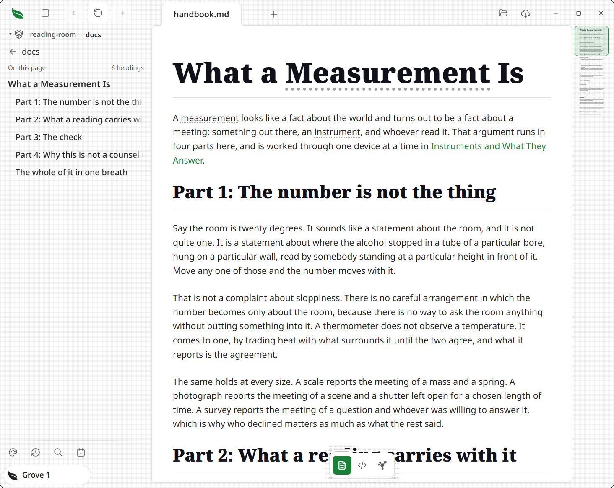

</div>

<div class="note-card-more">

[More →](#cards-across-the-page-leaf-extension)

</div>

</div>

<div class="note-card">

#### Edit the rendered page

Click into the page and type. A longer description makes this card taller, and the picture and the link still line up with the card beside it.

<div class="note-card-media">


</div>

<div class="note-card-more">

[More →](../01-features/07-editing.md)

</div>

</div>

</div>

Put the picture in a `note-card-media` wrapper and the link in a `note-card-more` wrapper. **Picture cards** in the plus's Cards row writes two of them empty, with a line to type on for each part. One card filled in reads:

```markdown
<div class="note-card-grid note-card-grid-pictures">

<div class="note-card">

## Read almost anything

A page you want to read.

<div class="note-card-media">


</div>

<div class="note-card-more">

[More →](reading.md)

</div>

</div>

</div>
```

Repeat the card for as many as you want. Picture cards sit two across when the reading column has room and one above the next when it does not, never three.

Every card in a row is as tall as the tallest. However long each description runs, the pictures start at the same height and the More links line up under them.

Each picture fills the same wide area, cut from its top left. Hovering it shows the same buttons as any picture alone in its paragraph, so the whole picture is one press away. A card's title, words and link are ordinary Markdown you type in place.

**Leave out what a card does not have.** A card with no picture leaves out its `note-card-media` wrapper and its link follows straight after its words; a card with no link leaves out `note-card-more`. Nothing holds an empty space for the missing part. A picture Leaftext cannot find keeps its own small mark rather than an empty wide area.

Long titles, words and links wrap rather than being cut off.

**Anywhere else, it is still a document.** A reader that has never heard of Leaftext drops the classes and draws every card's contents in order. Nothing arrives as visible syntax; a swatch card is its heading and its code line.

### Images

Image paths are resolved against the open file: relative paths (including `../` at any depth), absolute paths, and `file://` URLs all load. The title shows on hover:

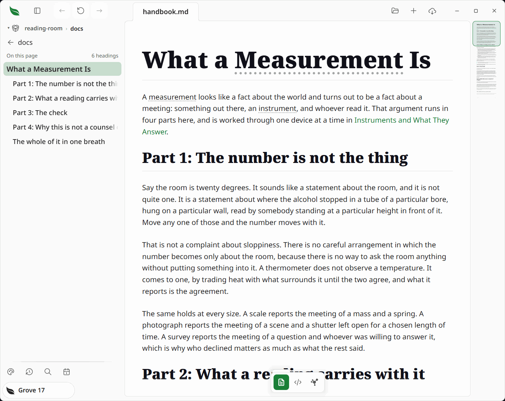

Allowed image types include SVG, PNG, JPEG (`.jpg`, `.jpeg` and `.jfif`), GIF, APNG, AVIF, BMP, ICO, and WebP. The picker behind [Insert image](../01-features/07-editing.md#images) offers exactly these and nothing else, so a picture you can choose is one the page draws.

Every local picture is measured as the page is built, its size read from its own header. So its space is held before it decodes, and the words around it never jump. A picture Leaftext cannot find keeps its place too, marked with one glyph in the page's ink, with its alt text on hover.

The same mark shows on both platforms.

A long page of pictures stays quick to scroll. A picture whose size is held loads only as the screen nears it. A picture wider than its room is shown from a copy made at that width, not at full size.

Opening one on the whole window, copying it, dragging it out and exporting the page all use the original file. An export waits for every picture before it is written.

Images always show the file that is on disk. Leaftext watches the note's folder and each distinct folder containing one of its local pictures without walking those folders' trees. Overwriting one refreshes it in the open document straight away ([Reload](../01-features/02-navigation.md#reload)), and every rerender re-reads them, so a replaced picture never lingers as a cached copy.

A missing one that later appears is found by that same refresh.

A picture alone in its paragraph reads at the width of the page rather than the width of the writing, the same room a wide [table](#tables) takes. It is never blown up: a picture smaller than the text column stays exactly the size it is, centered, and the words either side keep the measure.

Hovering one shows an expand button at its top right. It opens the picture on the whole window, fitted whole against the dimmed page, with no title bar or text over it. The close mark appears only when the pointer comes near the top right corner; `Escape` and a click on the dimmed page close it as well.

A picture alone in a [table](#tables) cell, with no words beside it, shows the same buttons in its top right. So a table of pictures side by side can open any one of them. A picture Leaftext could not find gets no button, because there is nothing behind the mark to open.

Beside that expand button is a second one that takes the picture out of the note as a file of its own.

It asks where the file goes and which kind. On Windows the save window offers PNG, WebP, JPEG, PDF and Markdown, and the name's ending decides what is written. On a Mac, a short menu asks first, since that window shows none.

A picture already in the format you asked for is copied rather than remade, so you get the file on disk. A `.jpeg` asked for as `.jpg` counts, since they are one format spelled two ways.

**JPEG** writes the picture in the one format every tool accepts, for anything that refuses WebP. It is never the smaller of the two, but on a photograph it is a fraction of the PNG. A picture with transparency in it comes out on the page color you were reading on, because JPEG carries none.

**PDF** puts the picture on a page of its own at its own size. **Markdown** writes a small document holding the picture, with the picture itself copied into an `imgs` folder beside it under its own name.

Take the same picture out again into the same place, and it finds its last copy and points at that. So the folder holds one copy however many times you export.

A different picture under a name already there gets a numbered one beside it, so an export never writes over a picture you already have. Nothing about the note changes: an export is a file beside it. A quiet note in the bottom-right corner names the file when it is written, and the name is a press that opens it.

A picture served from the web gets no export button, because there is no file here to take. A picture Leaftext could not find gets neither button.

**Right-click a picture kept on your own disk, and the menu is about the picture**, not its note. Open it big, copy the picture, copy its path, show it in your file manager, or open its properties. While the page is unlocked, you can also take it out of the document. See [Picture actions](../01-features/03-library.md#right-click-a-picture).

### Math

Inline math uses `$…$`: the mass–energy equivalence is $E = mc^2$.

Display math uses `$$…$$`:

$$ \int_{a}^{b} f(x)\,dx = F(b) - F(a) $$

### Mermaid diagrams

`mermaid` fences are rendered with the bundled Mermaid runtime, fully offline.

A diagram that cannot be drawn shows what you wrote instead: your lines, numbered, with the line it stopped at marked and one sentence saying why. For a common reason it also shows that line written a way that draws, such as a bracketed label put in quotes.

Only that diagram is affected: the ones drawn beside it keep their drawing and their corner buttons. A diagram that was drawn in full and then stumbled over placing one label on one arrow keeps its drawing.

**Only the diagrams near what you are reading are drawn**, a few at a time and nearest first. So a page of sixty opens as fast as a page of three. The rest wait as empty blocks of the right size, and draw as you scroll to them.

A diagram you have read stays drawn, so reading back up finds every drawing where you left it. Off screen, the page stops painting it, and it holds its height so nothing moves.

The exception is a document with more than 200 diagrams, past what the app can remember. There a diagram several screens behind goes back to a block, and is drawn again on return.

A diagram waiting its turn shows a spinner, not the Mermaid it will replace, and one too far off shows nothing. Your place is kept as they land: a drawing landing above you is paid back in the same beat, so the words do not move.

Once the page settles, every diagram is drawn once in the background, so each block holds its drawing's height and the page stops changing length. That pass stops the moment you scroll or type, and resumes when the window is quiet.

`Ctrl`+`F` still finds the words inside a diagram nobody has drawn. [Exporting the page](../01-features/02-navigation.md#export-the-page) draws every diagram in the document first, however many it holds, so the file carries all of them.

Diagrams take your theme's colors and its reading face. Boxes use the theme's muted surface, groups its sunken one, and arrows its muted ink. A Gantt chart uses the theme's own active, done and critical colors. Switch theme and every diagram on the page is redrawn to match.

The twelve-color scale a mindmap or pie chart cycles through is your theme's primary hue turned around the wheel, as described in [Themes → Diagrams](../01-features/06-themes.md#diagrams).

A bar chart with more than one row of bars stands them side by side in each band. Each row has its own color, picked to read against the page, and its own numbers, in a note and inside an HTML page alike.

A group's title stays on one line, inside the group's border with room around it, so a long one reads whole. The group widens to hold it, and drag, zoom and the full-window view carry a wide drawing.

In a diagram you save as a picture the title may still wrap, and the group is drawn tall enough that every line of it stays clear of the boxes.

A drawn diagram sits in its own cell, on the same tint and dot grain as a code block, and you can look around inside it. Drag the drawing to move it; `Ctrl` and the wheel — or `Cmd`, or a trackpad pinch — to zoom, with buttons for the same in the corner.

Zooming never changes the block's height, so the words around a diagram hold still while you lean into it, and **Fit** or a double-click puts it back. A plain wheel scrolls the page as always.

The fourth button in that group opens the diagram on the whole window. It is drawn again at that size rather than blown up. So a chart too wide for the column is simply legible, not something to drag around inside a small box.

It opens showing the whole thing, with the same zoom and drag. Escape, the X or a click outside returns you to where you were reading, the diagram as you left it.

Left of that group sits one more button, and a shut padlock keeps it: it saves the diagram as a file of its own.

Each format writes something different. **Markdown** writes the Mermaid text in a fenced block. **PNG** writes the drawing at twice its size, on your theme's page color with room around it. **WebP** writes that same picture at about half the file size. **PDF** prints it on its own page, sharp at any zoom. **JPEG** writes the one format every tool takes.

Pressing it asks where the file goes. On Windows the save window offers all five, and the name's ending decides what is written. On a Mac that window shows no format, so a short menu asks first, and the window then carries your pick in the name.

The document you are reading is not touched — the same five files [the flowchart editor](../01-features/07-editing.md#export) writes, on every kind of diagram rather than only the ones it can draw.

A quiet note in the bottom-right corner names the file once written. Click the name to open the file in your computer's usual app for it, as when [saving the page itself](../01-features/02-navigation.md#export-the-page). The full-window view carries the same button.

On an unlocked page, hovering a diagram also shows two buttons in the opposite corner. One swaps it for its Mermaid source, editable in place like any block ([Editing](../01-features/07-editing.md)). The other opens it in [the flowchart editor](../01-features/07-editing.md#the-flowchart-editor), a canvas beside the Mermaid text.

Both ride along into the full-window view, where picking either one closes it and takes you to the diagram in the page.

A box can also carry a link, an icon or a picture. `click A "https://…"` makes the box a link, and clicking it does what clicking a text link does: it opens in a tab in the app. `Ctrl` (or `Cmd`) or a middle click opens it behind the page you are reading.

`A@{ icon: "leaf:back" }` draws one of the app's own drawings, named as `leaf:` and the icon's name. Nothing is fetched. An unknown icon or set draws the broken-picture mark, and the rest of the diagram stays intact.

`B@{ img: "shot.png" }` draws a picture, from a file beside the document or an address. A picture that will not load is caught before Mermaid sees it, so a bad one costs only that box its picture. `click A call fn()` is read and does nothing: a document cannot name a function inside the app and have it run.

One more detail: a `---` front-matter block inside a `mermaid` fence reaches Mermaid intact, so `title:`, `config:`, `look:` and `layout:` written that way all work, as does a `%%{init: { ... }}%%` line.

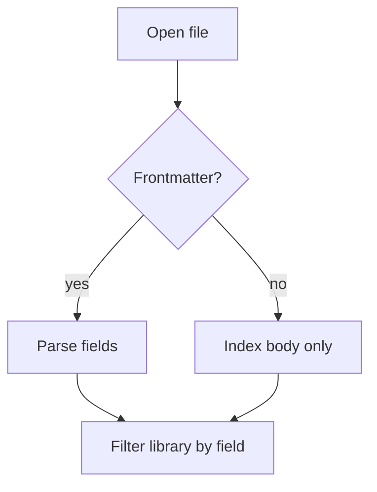

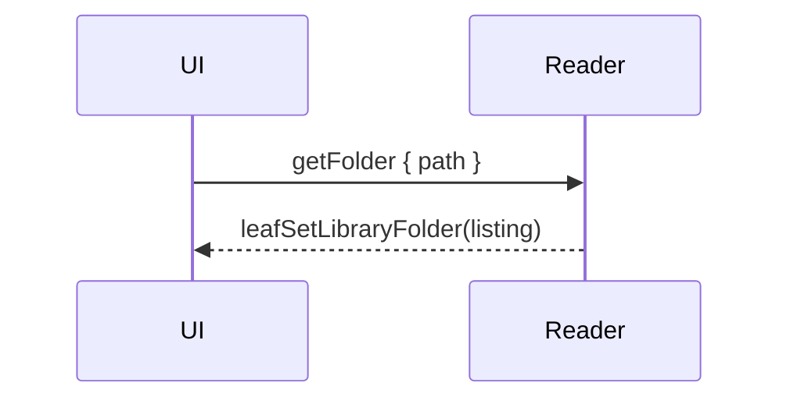

### Emoji

Leaftext renders GitHub shortcodes:

- `:rocket:` → :rocket:
- `:tada:` → :tada:
- `:warning:` → :warning:
- `:white_check_mark:` → :white_check_mark:
- `:shipit:` → :shipit:

### GitHub references

An issue or PR reference links when it names its repository; @mentions are highlighted:

- Issue or PR: ryanallen/leaftext#3
- Mention: @ryanallen
- Team mention: @ryanallen/maintainers

A bare #1 or GH-2 stays as written, in a Git folder or not. A number after a hash is as often a list item, a control id or a ticket as an issue, and GitHub itself draws one as text in a file.

Bare commit hashes are **not** linked. GitHub turns any run of 7 or 40 hex characters into a commit link, so a color like `f0f0f0f` becomes a link to a commit that probably does not exist. Hex is too ordinary to claim. Write the link yourself when you want one.

### Footnotes

Footnotes collect at the foot of the page, each with a back-link.[^one] Reference one twice[^one] or add more.[^two] Two markers set side by side get a raised comma between them,[^one][^two] so a 1 and a 2 never read as 12. A book or a page saved from it keeps that comma.

Rest the pointer on a footnote marker to read its note in the link card without leaving the sentence.

Press it, and the whole note rises in a sheet from the foot of the window, like a glossary term, leaving the page where you were reading. *Go to the note* at the sheet's foot goes down to the note itself, as does a press with `Ctrl` (`Cmd` on a Mac) held.

Both gestures read marked endnotes in a book too. A book's marked notes are drawn as footnotes are, smaller and quieter than the story and each under a thin rule. A screen reader hears each marker as a note reference, each note as a footnote and each back-arrow as the way back.

[^demo]: Referenced from the *Text formatting* section.
[^one]: Click the back-arrow to jump back.
[^two]: With `inline code` and a [link](https://commonmark.org).

### Frontmatter

The `tags` field's items draw as the same [tags](../01-features/03-library.md#tags) as hashtags in prose. The field keeps its original values when you [add or remove an item](../01-features/07-editing.md#the-fields-at-the-top-of-a-note).

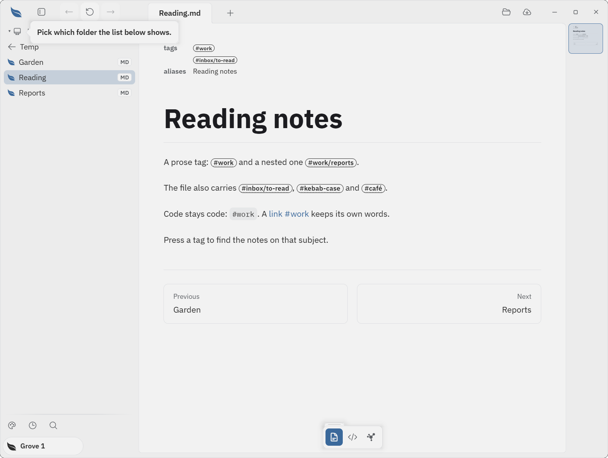

A leading `--- … ---` block becomes a metadata table at the top of the page, and **each field is drawn as the thing it is**:

```yaml
---
Author: Ada Lovelace               # the key keeps the case you wrote it in
status: draft                      # text
audience: [readers, testers]       # inline array → a list
tags:                              # block list → a list
  - markdown
  - demo
created: 2026-06-14                # a real date, and 06/14/2026 is the same one; 2026-13-45 is text
pinned: true                       # a checkbox
version: "1.0"                     # quoted, so text — bare 1.0 is a number
---
```

…renders as this table:

<div class="frontmatter"><table><tbody><tr><th>Author</th><td>Ada Lovelace</td></tr><tr><th>status</th><td>draft</td></tr><tr><th>audience</th><td><ul><li>readers</li><li>testers</li></ul></td></tr><tr><th>tags</th><td><ul><li>markdown</li><li>demo</li></ul></td></tr><tr><th>created</th><td>2026-06-14</td></tr><tr><th>pinned</th><td><input type="checkbox" disabled checked></td></tr><tr><th>version</th><td>1.0</td></tr></tbody></table></div>

**Six types, the same six Obsidian uses:** text, list, number, checkbox, date, and date and time.

A field's type comes from four places, and later ones win. First is the file's own quoting, then the value's shape, then the vault's `.obsidian/types.json` if any. Last is a `leaftext-types` line in the note itself, such as `leaftext-types: [phone=text, due=date]`. `aliases`, `cssclasses` and `tags` are always lists, so `tags: one` is a list of one.

**A date is written in either order.** `2026-06-14` and `06/14/2026` are the same day, and both are typed as a date. So a note writing dates the American way answers the [filter](../01-features/03-library.md#filtering) `due:<friday` exactly as a year-first one does.

It takes ten characters either way. `6/14/26` and `06-14-2026` stay text, rather than have a century or separator guessed. A date and time keeps its year-first shapes.

**What a note may ask for by name.** `cssclasses: [wide]` gives the page the reader's whole lane. That is the only style so far, under the names `wide` and `full-width`; a name the app does not have changes nothing and says so.

- **A quoted item on a one-line list keeps its commas.** `aliases: ["Smith, John", Jack]` is two items: a quote opens a run where an item starts and the run ends at its pair. An apostrophe mid-word is just a letter, so `[a, don't, b]` is three, and a quote left unclosed makes one long item rather than several invented ones.
- Only the **leading** block counts; a later `---` is a horizontal rule.
- Malformed frontmatter still renders — just without the table.
- **Nested fields are not read.** A `person:` with `name:` indented under it is refused rather than turned into a top-level `name`, and a key set twice keeps the first. Anything the block could not read arrives as one message when the note opens.
- **The table waits behind a small `Frontmatter` edge above the title**, so a note opens on its own first line rather than on its fields.

  Rest the pointer on the edge, and the sheet drops far enough to show the first field. Press it, and the whole table opens in a sheet hung from the top. Its close button, `Escape` or a press outside puts it away.

  The page does not move under any of the three, and a note with no fields shows no edge at all.
- **A poem's `meter` stands after its title.** Write `meter: iambic pentameter` and the name appears beside the document's first top-level heading, in quieter type, wrapping with the title on a narrow page.

  Where the note's nearest glossary has an entry for the name, it is underlined like any glossary word, and pressing it opens the explanation over the poem. Otherwise it is plain words.

  The name comes from the field the author wrote — Leaftext never works a meter out from the lines — and the heading itself stays exactly what the author typed.
- **The table is edited in place**, and so is the document under it — see [the fields at the top of a note](../01-features/07-editing.md#the-fields-at-the-top-of-a-note).

### Collapsible sections

`<details>` / `<summary>` fold content away. Add `open` to start expanded.

Rest the pointer on a closed section's summary to read the opening of its contents in the link card. Press the summary to open the section. This also works for TEI front matter.

A summary may share the opening line with `<details>` or stand on the next line. Markdown blocks inside the box and after it remain editable when the box is written either way.

It slides rather than jumping. Opening one grows it to its height over a quarter of a second, and the page below travels with it. Closing is the same move, quicker.

That is true of everything that folds open in the flow of the page. That covers the [front matter of a TEI document](#tei-xml), the find bar's [replace row](../01-features/02-navigation.md#find-in-this-document), and the [insert row](../01-features/07-editing.md#adding-a-block) in the margin.

It is the one motion the app cannot draw everywhere. On Windows it slides; on a Mac it opens in one frame, because the Mac's web view cannot animate an unset height. Under [Reduce Motion](../01-features/05-settings.md#reduce-motion) it opens in one frame on both.

<details open>
<summary>Open by default — click to collapse</summary>

Folded content holds full Markdown: **formatting**, <kbd>Ctrl</kbd>, and a list.

- A leaf
- A page

</details>

<details>
<summary>Closed by default — click to expand</summary>

Tucked away until you open it.

</details>

### Inline HTML

Leaftext sanitizes raw HTML with `ammonia`: a curated set of **safe** tags is allowed; the rest is stripped, keeping the inner text.

**HTML you style yourself draws the way a browser draws it.** A `style` attribute, your own class names and a `<style>` block written in the note all reach the page. So a grid of colored boxes drawn in HTML arrives as that grid, not bare words.

Leaftext draws that HTML inside a box of its own. Your CSS styles only what is inside it, and a fixed or stacked element stays within it. Nothing it writes can fetch more than a picture in the note already could. Scripts, event handlers and forms are still removed.

An inline `<svg>` draws at its place in a Markdown note, including a note with no stylesheet. Static shapes, text, symbols, clipping and linear gradients are kept. A `<use>` or paint reference such as `fill="url(#ink)"` can point only to a drawing in the same note; external references, animation, embedded HTML and scripts are removed.

Beyond plain Markdown: <ins>inserted</ins>, <s>struck</s>, and <mark>highlighted</mark> text. Water is H<sub>2</sub>O and 2<sup>10</sup> = 1024. Press <kbd>Ctrl</kbd> + <kbd>F</kbd> to search. An <abbr title="HyperText Markup Language">HTML</abbr> abbreviation shows its title on hover.

Definition list:

<dl>
<dt>Leaf</dt>
<dd>A page, rendered for reading.</dd>
<dt>Frontmatter</dt>
<dd>Metadata at the top of a page.</dd>
</dl>

`align` on `<div>`, `<p>`, and headings (`<h1>`–`<h6>`) controls horizontal alignment:

<div align="center">Centered block</div>
<p align="right">Right-aligned paragraph</p>
<h2 align="center">Centered heading</h2>

Accepted values: `left`, `center`, `right`, `justify`. Note: `align` is stripped from `<blockquote>` — it is not in the allowlist for that tag.

An `id` on a `<div>`, `<p>`, `<span>`, a heading (`<h1>`–`<h6>`) or an SVG shape creates a named anchor or drawing reference with a stable, author-controlled address:

<h1 id="foreword" align="center">Foreword</h1>

Link to it from anywhere on the same page: `[Foreword](#foreword)`. Headings are addressable this way without any markup of your own — each gets a slug `id` from its text.

`<br>` forces a line break inside a paragraph without starting a new block:

Line one.<br>Same paragraph, next line.

Markdown italic can wrap an HTML heading — useful for centering and italicising a title together:

*<h1 align="center">Field Notes from the Lower Weir</h1>*

Stripped for safety: `<script>`, inline event handlers such as `onclick=`, `javascript:` URLs, and disallowed elements such as `<iframe>` and `<form>`.

### Horizontal rules

Three or more `-`, `*`, or `_` on their own line:

---

***

___

### Text in any language

The interface is English. Your documents are not: anything valid UTF-8 renders as written, unaltered — accents, Greek, Cyrillic, Hebrew, Arabic, CJK, emoji:

> Lire, sans éditer. Ανάγνωση, όχι επεξεργασία. — Leaftext показывает готовый документ.

| Feature | Behavior |
| :-- | :-- |
| Full-text search | Matches on any substring, whatever the script |
| Frontmatter | Filters the library by field, whatever the value |

Editing is anchored to byte offsets in the file, so a multi-byte character above the block you are editing never shifts where that block is saved.

## XML

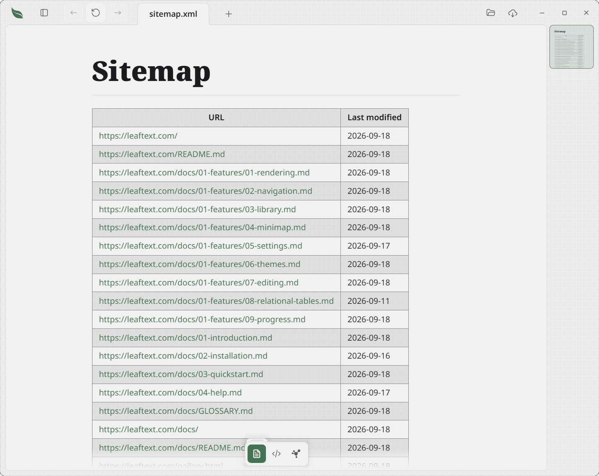

Leaftext opens `.xml` files alongside `.md` files — the same "Open Document" dialog accepts both, and the [library](../01-features/03-library.md) indexes both. The file itself decides which XML renderer runs, not its name. A document with a `<TEI>` root or a `<teiHeader>` goes to the [TEI renderer](#tei-xml), and everything else to the generic one.

Doctypes are read and ignored, so plists, XHTML, and DocBook open normally. A file that is not well-formed renders as a single line naming the parse position — `XML parse error. expected 'b' tag, not 'a' at 1:7` — instead of a blank page.

### Any XML

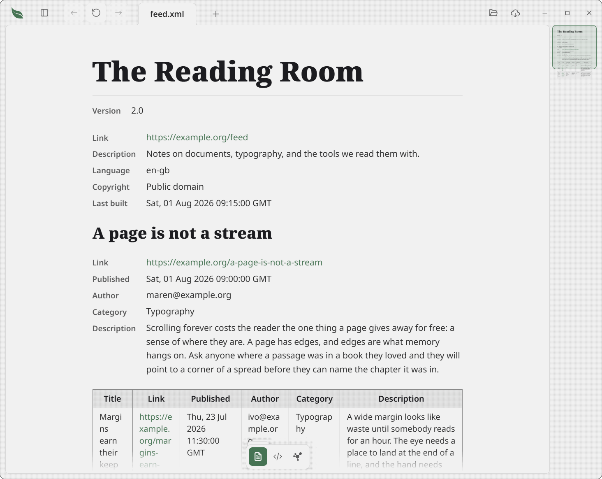

Most XML carries no reading conventions to follow, so the generic renderer works from the shape of the tree:

| Shape in the file | Rendered as |
|---|---|
| An element holding only text, or only attributes | A label/value field. Consecutive ones share one two-column list, so labels line up down the page |
| Two or more sibling records with the same tag, made only of short values | A [table](#tables), one row per record, columns in first-seen order |
| An element holding other elements | A section. Its heading is its own `<title>`/`<head>` child, or `Tag: name` when a `<name>` child or a naming attribute (`name`, `id`, `type`, `class`) is all there is, or the tag name itself |
| An element mixing text and inline markup | A paragraph of its text |
| A value that is entirely a URL | A link |

Tag names are read as words, so `lastBuildDate` renders as "Last build date" and `group_id` as "Group id". A few names common in feeds and sitemaps are spelled out: `loc` is "URL", `lastmod` is "Last modified", and `pubDate` is "Published". Headings get the same slugs Markdown headings do, so the [outline](../01-features/02-navigation.md#outline) and the [minimap](../01-features/04-minimap.md) work the same way.

A file that names no title of its own — a sitemap has nowhere to say what it is — is headed and titled by its file name.

A sitemap renders as a table of its `<url>` records. An RSS or Atom feed shows its channel title and fields, then one section per item. A Maven POM shows its project fields and a table of dependencies.

### TEI XML

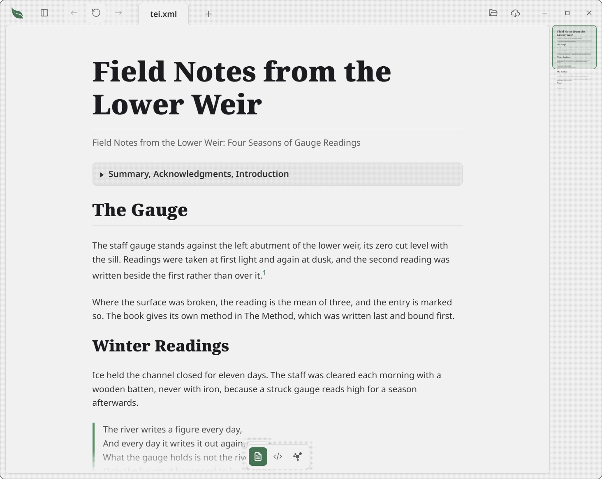

TEI documents have conventions worth following, so they get their own renderer.

**Supported TEI elements:**

| Element | Rendered as |
|---|---|
| `<titleStmt>` titles | The document title block. The English main title (`type="mainTitle" xml:lang="en"`) becomes the page heading and the tab/library title; beneath it, in muted text, come the Sanskrit main title (italic), the English long title, and the Sanskrit long title (italic). Tibetan titles are never shown. Files with no typed titles fall back to the first non-Tibetan `<title>` |
| `<front>` | The front matter (summary, acknowledgments, introduction) that precedes the body, rendered as a collapsed disclosure (a `<details>` you click to open) so the reader lands on the translation itself. Its own section headings stay out of the outline |
| `<div type="…">` | A nested section. Heading level follows nesting depth (`##` at the top, one smaller per level, floored at `######`), so a nested heading is never larger than the one above it. `translation` is a transparent wrapper (no heading, no added depth) |
| `<head>` | Heading text at the div's depth, including inline children (e.g. a nested `<title>`) |
| `<p>` | Paragraph |
| `<lg><l>…</l></lg>` | Verse stanza rendered as a [blockquote](#blockquotes-and-alerts) (left bar + hanging indent), one `<l>` line per row |
| bare `<l>…</l>` | Verse lines with no `<lg>` wrapper — a run of adjacent `<l>` siblings is coalesced into a single blockquote, like consecutive `>` lines in Markdown |
| `<note place="end">` | Inline footnote (collected at page foot) |
| `<ptr>` | Cross-reference label kept; linked when the target is an external URL, plain text for internal targets |
| `<term>`, `<title>`, `<ref>` | Inline text (tags stripped) |
| `<milestone>`, `<lb>`, `<caesura>` | Omitted |

**A comment between two blocks is drawn in either renderer** as a shut row saying `Comment`, which you click to read. It is a note left beside the document, not its words, so it takes one line until you ask. The file's `<!--` marks stay off the page.

Clicking the words inside it puts a caret in them, so the note is corrected where it is read and the marks stay out of the page — see [editing](../01-features/07-editing.md#inline-editing-the-reading-view). A comment written inside an element, among its words, is part of that element's text and is not drawn separately.

Both XML renderers walk the `roxmltree` DOM and produce the same HTML structure as the Markdown pipeline. So themes, footnotes, the minimap, the pager and [inline editing](../01-features/07-editing.md#inline-editing-the-reading-view) all work unchanged for XML.

This site draws its own pages through the same renderer, fetched as a module. So a page here is the document Leaftext draws, not a second version of it, for XML and every other format.

## Data files (JSON and YAML)

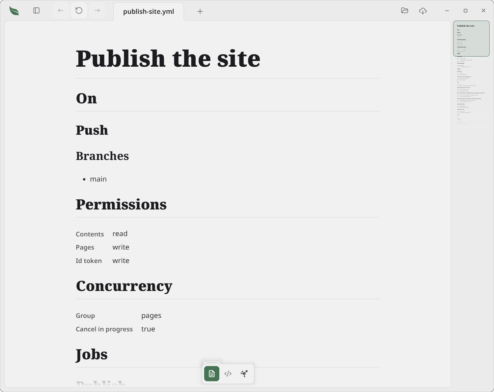

Leaftext opens `.json`, `.yaml`, and `.yml` as pages. A data file is a tree of mappings, lists and values, not prose. So it is read by the same shape rules as [any XML](#any-xml), with the same labels: a sitemap and the JSON beside it name a field the same way.

| Shape in the file | Rendered as |
|---|---|
| A run of keys holding single values | A label/value field. Consecutive ones share one two-column list, so labels line up down the page |
| Two or more list entries with the same keys, made only of short values | A [table](#tables), one row per entry, columns in first-seen order |
| A key holding a mapping or a list | A section, headed by the key name |
| A list of single values | A bulleted list |
| A value that is entirely a URL | A link |
| `null`, or a value that is empty | Nothing at all, like an empty XML element |

Key names are read as words, so `runs-on` renders as "Runs on" and `lastBuildDate` as "Last build date"; the same spelled-out names apply (`loc` → "URL", `lastmod` → "Last modified").

A root `title` or `name` key titles the document and heads the page, and is not repeated in the body. A file with neither is headed and titled by its file name. Headings get the same slugs Markdown headings do, so the [outline](../01-features/02-navigation.md#outline), the [minimap](../01-features/04-minimap.md), and the [pager](../01-features/02-navigation.md#pager) all work as they do elsewhere.

**JSON** is read by Leaftext's own reader, so nothing is normalized on the way in. Keys stay in the file's order, and numbers display exactly as written, never routed through a float.

It forgives two things that are not strictly JSON but fill everyday `.json` files, like `tsconfig.json` and editor settings. Those are `//` and `/* */` comments, and a trailing comma before a closing brace or bracket.

**YAML** is parsed with `yaml-rust2`. An `*alias` is resolved to what its `&anchor` held, and a `<<:` merge key is spliced into the mapping that used it. So a job merging shared defaults shows those settings under the job, not as a field named `<<`. Keys already written win, which is what merging means.

Several documents in one stream (separated by `---`) read as a list of them, so a multi-document Kubernetes manifest renders as a table of its resources.

An alias is a copy of everything its anchor held, so a few lines of aliases pointing at aliases can name far more blocks than the file has bytes.

Leaftext counts the blocks a file produces, and past 200,000 draws **Too much to draw.** in place of the page. That is twice the largest document in this tree.

Nothing is copied once that ceiling is reached, so the refusal costs no wait. The window, other tabs and that file's [code view](../01-features/07-editing.md#code-view) all stay as they were.

A file that will not parse renders a single line naming the position — `JSON parse error. expected ',' or '}' after the value (line 12)` — instead of a blank page. A file nested hundreds of levels deep is refused the same way rather than being followed down.

> [!NOTE]
> Data files are indexed and paged like any document. Installing Leaftext [registers it for](../02-installation.md#file-associations) `.json`, `.yaml` and `.yml`. A double-click opens Leaftext where nothing else claimed the extension, and your editor keeps it where it has.

Editing works, with one limit worth knowing. The [code view](../01-features/07-editing.md#code-view) edits any data file as raw text, exactly as it does Markdown and XML. In the reading view, a block is click-to-edit only where its precise byte range in the file can be *proved*: that covers every JSON value, and YAML plain scalars.

YAML lists, tables, quoted strings and block scalars (`|`, `>`) are read-only in the reading view and edited in the code view. An approximate range would splice an edit over the wrong bytes, so none is offered. See [Editing data files](../01-features/07-editing.md#editing-data-files).

## HTML files

On the desktop, Leaftext opens `.html` and `.htm` files as the site they are. The page starts once its card has a real size, so a canvas or chart that fits itself when it opens measures the space it will use. The page stays live with the reading padlock open or shut.

The page runs as a browser runs it: its scripts, its modules, the data it fetches and the pages it links to. So a project whose script builds the page opens finished, not as a header over empty space.

There is nothing to press. The file's folder is served at an address only this computer can reach, and the page opens on the same live surface as a [web tab](../01-features/02-navigation.md#web-tabs). Its address sits in the bar that slides open when the pointer rests on the app bar.

The folder is served one file at a time and never listed, and a note or a key sitting beside the page is not handed to it.

The tab is named by the file, with its star and the same right-click menu any document's tab carries. A menu, a tip or a message the app lays over the page stands in front of it, with the page still drawn all round it.

**Code** shows the file itself, to edit and save like any other document; **Reading** brings the page back. Saving it, or changing it or a file beside it in another program, refreshes the page where you were on it. A link out of the site turns the tab into an ordinary web tab, named by the page it reached.

Closing the tab, or opening another document in it, stops serving the folder, and a copy of its address stops opening.

Where the live page cannot start, and in a browser, where there is no desktop to serve the folder, the file opens as the page its own CSS draws. A saved report, an exported note or a hand-written page keeps its own colors, type, layout, sticky headers and media queries — the way a browser tab draws it.

That includes the state a page writes on its outermost elements. A theme class, layout mode, text direction or open state on `<html>` or `<body>` all cross. So a page that themes itself dark opens dark, and an open section opens with it. The tab is named by the file.

That page is drawn in a frame of its own, which is what keeps it from reaching anything around it.

It runs no script, form, frame, object or embed, and each control it drops takes its own wording with it. A toolbar's buttons, a dropdown's options and a fallback for something that never draws are gone. The page's prose, tables and address blocks are untouched.

It carries a security policy of its own that refuses every network address — a saved page cannot phone the site it was saved from. What it may reach is the folder it sits in: its stylesheets, pictures, fonts and media, one file at a time, and nothing above that folder.

A rule in the page cannot style Leaftext, and Leaftext's own type and spacing are not applied to the page.

Because nothing in the frame runs, a page's interactive parts do not open: a menu that drops down, a lightbox that enlarges a picture, a banner that asks something. A part the author hid stays hidden, so those panels are absent rather than parked over the document. What you read is the page as it first draws.

The reader's own tools still work on it. [Find](../01-features/02-navigation.md#find-in-this-document), the [outline](../01-features/02-navigation.md#outline), the [minimap](../01-features/04-minimap.md), the right-click menu, text selection and link following all reach into the page, and exporting it writes the whole page rather than one screen.

Marked Mermaid blocks draw as diagrams under Leaftext's bundled strict renderer, without letting the page run a script. The page paints first, then the visible diagrams, and the rest warm behind them. Each drawing keeps the page's own place and size, without the [corner buttons](#mermaid-diagrams) a note's diagram carries.

The [Speed Reader](../01-features/05-settings.md#speed-reader) is the one that does not. It would split the page's own words apart, so it leaves the document alone and is not offered here, like the padlock. The frame scrolls itself, so where you were is remembered across a tab switch.

The original source stays intact in the [code view](../01-features/07-editing.md#code-view), where every byte of it can be changed; a change there redraws the page without saving. Edit a live page in the code view.

Where the live page cannot start, or in a browser, the reading padlock lets you type on the contained copy's words where they are drawn — see [Editing an HTML file](../01-features/07-editing.md#editing-an-html-file).

Installing Leaftext offers it under **Open with** for HTML without replacing the browser as the default. See [File associations](../02-installation.md#file-associations).

## Email (.eml)

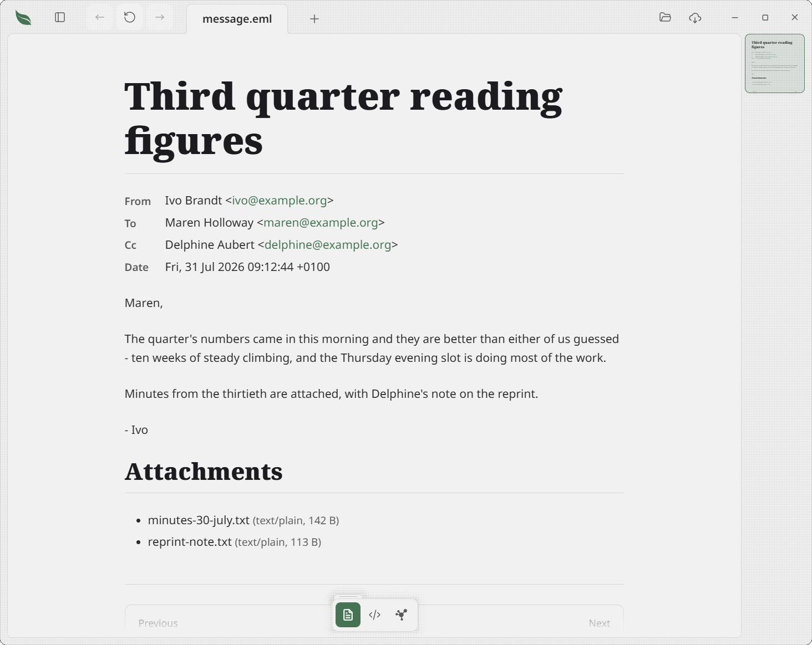

Leaftext opens `.eml` files — the message format Gmail, Outlook, and Apple Mail export — as the email they carry. `.mht` and `.mhtml` web archives are the same envelope, so the one reader opens those too.

On disk such a file is wild: delivery and signature headers on top, then every part of the message base64- or quoted-printable-coded. The reader undoes all of that:

| In the file | Rendered as |
|---|---|
| `Subject:` | The page title and heading (encoded-word headers decoded) |
| Every other header, in the file's order | The header card a note's fields are drawn in; `To`, `Cc`, `Bcc` and `Reply-To` one address each |
| The HTML body | The message, sanitized through the [inline HTML](#inline-html) allowlist plus one mail-only rule: a control takes its unusable content with it |
| A plain-text body | Note syntax — lists, quoted replies, bold and links drawn as a note draws them — with every line break kept and any HTML in it shown as the text it is |
| Inline images (`cid:` references) | Embedded in place, straight from the message's own parts |
| Attachments | A list of name, type, and size |

Some headers are not shown. `MIME-Version` and every `Content-` header say how the rest of the file is read. `Received`, `Return-Path`, `DKIM-Signature`, the `ARC-` headers, `Authentication-Results` and `Received-SPF` were written and signed by servers on the way. They are machine plumbing; the [code view](../01-features/07-editing.md#code-view) shows the raw message.

Nothing in the message can reach the network: inline images come from the file itself, never from a remote server.

**A message body takes the rendered allowlist and one rule of its own: a control goes with the words inside it.**

A note keeps its task boxes, since that is how a checklist is written. A message has none. So a button, a dropdown, a text box, a frame's fallback markup and a tick box are dropped whole, not left as loose words and blank controls.

Ordinary prose inside a form or fieldset still reads. So does an author's fallback for a picture or embed the reader does not draw, since that fallback is what you have instead.

**Every part of a message names the charset its words are written in, and each is decoded from the file's own bytes.**

So a message written straight in Shift_JIS, GBK, KOI8-R or any other legacy charset draws its words. That holds whether its body arrived base64-coded, quoted-printable, or as raw eight-bit bytes from a mail client.

It is the one format that does not need the Windows-1252 guess [below](#file-encodings): the file says what it is, so the reader believes the file.

A message is also [edited where you read it](../01-features/07-editing.md#editing-an-email), wherever the file says the same words the page draws. In an HTML body, that means each line whose markup the page draws exactly as spelled. The bar over selected text writes plain tags there.

> [!NOTE]
> Installing Leaftext [registers it for](../02-installation.md#file-associations) `.eml`, `.mht`, and `.mhtml`, though a mail app that already owns `.eml` keeps it.

## Office and OpenDocument files

Leaftext opens `.docx`, `.docm`, `.xlsx`, `.xlsm`, `.pptx`, `.pptm`, `.odt`, `.ods` and `.odp` files — the documents most people are handed — with no network, no account and no sign-in. Each of these is a zip of XML, so the app unpacks the part holding the words and draws it as a document like any other.

| In the file | Rendered as |
|---|---|
| A Word title or heading style | The page heading, and the headings under it |
| A Word or OpenDocument paragraph, bulleted item or numbered item | A paragraph or a list item, a sub-point drawn one level in under its point, up to eight levels deep |
| A Word table | The table drawing a Markdown table takes |
| A sheet in a workbook | A heading with the sheet's name, then its rows as a record table |
| A slide in a deck | The slide itself, at the deck's own shape and as wide as the lane a wide table takes, with every box where the file puts it and its words in the deck's own face, placed inside the box the way the deck places them and at the size the file sets them — a title, the words in its boxes, and each table as a table headed by its first row. A box the file gives no place follows the slide in reading order. A chart uses the numbers saved with it: a bar, line, or pie of one series is drawn as a chart; other kinds and several series read as a table. A picture is drawn where it sits among them, carrying the description its author gave it; a deck draws up to 16 MB of pictures, the same as a book, and says once at its foot that the rest are not shown. Bulleted text reads as a list, at the level it was written, whether the slide says so itself or takes its bullet from the layout and the master behind it. A slide that marks no title is headed by its largest words nearest the top, and by its number where it has none. A slide's build — the boxes it brings in when it is shown, in order, each with its effect and how long after the start it arrives — is listed under the slide, above its notes; a build made in another program is named there with its count of effects and kept as it is. Speaker notes follow the slide behind a bar labeled Speaker notes, apart from the words shown on screen |
| The macro in a `.docm`, `.xlsm` or `.pptm` | Nothing. It is read past, not run |

**A file that is not the document it claims to be says so instead of taking the machine.**

A part claiming more than 256 MB of words, or unpacking past that however small it looked, is refused by name. So is a spreadsheet naming a column no spreadsheet has. A cell saying it repeats a billion times fills the 16,384 cells a sheet has room for, and stops.

Each of those draws a sentence about the file, and the window stays where it was.

**A macro is never run.** `.docm`, `.xlsm` and `.pptm` are a file's spellings once somebody records a macro in it. Leaftext opens one exactly like the file without a macro. The part holding the words is drawn, and the part holding the macro is carried along untouched.

Leaftext has no way to run one, and a file somebody sent you because it is macro-enabled is safe to read here.

**An edit is written back into the file it came out of, and nothing else in that file is touched.** Only the part holding the words is rewritten; the styles, the theme, the comments, the tracked changes, the charts and the macros are copied across exactly as they were. Charts are read from their saved numbers without rewriting them.

An OpenDocument file keeps the first part that says what it is, in the place a computer looks for it.

A deck is edited where it is drawn. With the padlock open, press into a box on any slide and type its words; its bold, its color and its size stay the file's own. Press a box and drag the strip round it to move it, or a corner to size it; neither can leave the slide.

The handle in the margin beside a slide drags it to a new place in the deck. Pressing it opens a menu with Duplicate slide and Delete slide; a deck always keeps one slide. Every one of those is one step of Undo, and Save writes the slides you changed and carries the rest of the file forward.

With the padlock open, the list under the slide sets its build: whether it starts on a click or by itself. For each box, choose Type, its words fading in letter by letter, or Rise, fading in as it moves up. Set how many milliseconds after the start each begins.

Press a box on the slide and *Add the selected box* adds it to the end; drag a row to change the order, and its × takes it out. Each box in the build wears its number on the slide. PowerPoint and Keynote play the build when the deck is opened there.

A build made in another program is kept as it is and cannot be added to here. Every change is one step of Undo.

A workbook of several sheets is read whole and typed into on the sheet selected in the [code view](../01-features/07-editing.md#code-view). The first sheet is selected when the file opens. A block anywhere else is read rather than typed into, the same treatment a value the app cannot vouch for gets in a data file.

So nothing has to be pressed to find out which is which. With the padlock open, every typable block wears a thin accent bar on its leading edge. As the padlock opens, the app says once that the rest is read in the page and edited in the source view.

A Word file or an OpenDocument file keeps all its words in one part, so it wears no bar and hears nothing. The code view names the XML part it shows and lets you choose another readable slide or sheet.

A cell in a spreadsheet is typed into where it is drawn. Excel keeps almost every cell's text in one shared table, not in the sheet. So Leaftext writes the cell itself, with its own words. A cell that shared its text stops sharing it, and the other cell reads what it always did.

> [!NOTE]
> Installing Leaftext [registers it for](../02-installation.md#file-associations) all nine spellings, though Word, Excel, PowerPoint and whatever opens an OpenDocument file each keep their own file types.

Legacy `.doc`, `.xls` and `.ppt` files are a different format altogether and do not open.

## File encodings

Most text files are UTF-8, and those need no thought. Leaftext reads the others by the **byte order mark** at the start of the file — the few bytes some editors write to say how the rest is spelled:

| File starts with | Read as |
| --- | --- |
| Nothing special, valid UTF-8 | UTF-8. Every plain-ASCII file is one of these |
| `EF BB BF` | UTF-8 with a mark, as Notepad and PowerShell write it |
| `FF FE` | UTF-16, little-endian |
| `FE FF` | UTF-16, big-endian |
| `FF FE 00 00` | UTF-32, little-endian |
| `00 00 FE FF` | UTF-32, big-endian |

**A file is saved back the way it was read.** A UTF-16 document stays UTF-16, mark and all; a file that had no mark does not gain one. Saving is not where your file quietly changes shape.

**Unmarked files that are not UTF-8** — a text file from an older Windows program, say — have nothing in them that says what they are, so they are read as Windows-1252. That is an assumption, not a fact: if it is the wrong one, you get mojibake (`café` as `café`), which is at least something you can see.

Such a file becomes UTF-8 when you save it, because writing the guess back out would drop any character the guess has no room for.

**An [email message](#email-eml) is the exception**, because each part names its own charset. The guess is undone before the message is read, so its words draw right. A save writes the file's own bytes back, rather than re-spelling a body that is not UTF-8.

A character that message's charset has no room for refuses the save and says which — see [Editing an email](../01-features/07-editing.md#editing-an-email).

**Files that are not text at all** are refused rather than shown as noise.

The words depend on whether Leaftext reads that kind of file. A `.rtf` or `.zip` is an ending it opens nothing for, so it says `Leaftext doesn't open .rtf files`. A file named for a format it reads, such as a `.md` holding a picture, is described by its bytes. A zero byte in the first few kilobytes is the tell, and the message says where it was found.

Either way you are told what is wrong rather than "failed to open".

> [!NOTE]
> A byte order mark is removed from the text on the way in and put back on the way out. It is invisible, but it is a character: left in place it would keep `---` from opening [frontmatter](#frontmatter) and turn a first-line list into a paragraph.

## Next

- [Navigation](../01-features/02-navigation.md)
- [Themes](../01-features/06-themes.md)
