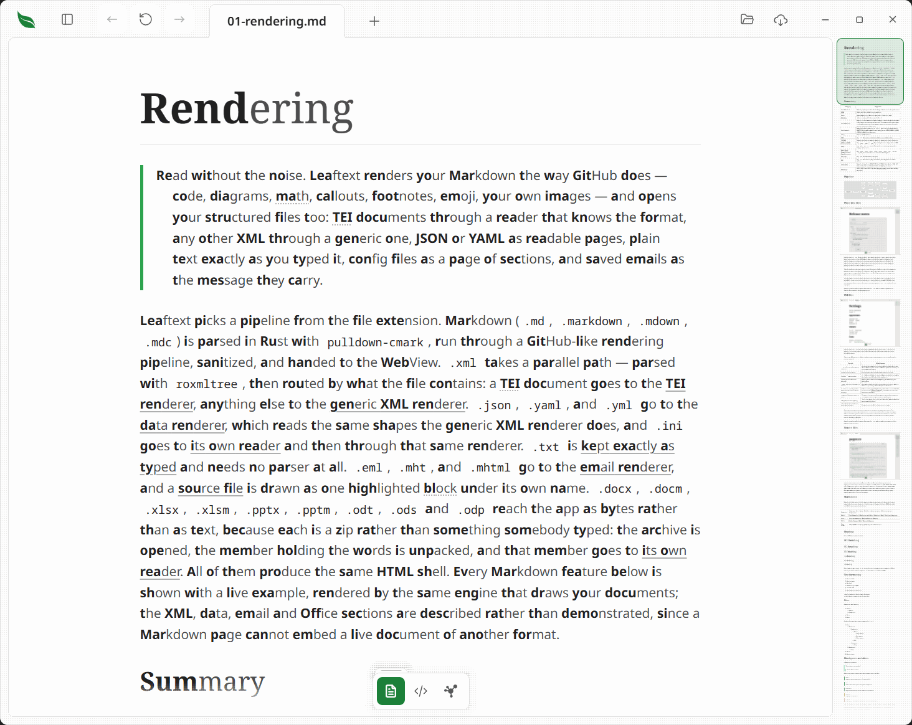

# Settings in detail

> Every preference, its default and where it is kept, one fact at a time

This page holds the full behavior behind [Settings](../01-features/05-settings.md). Each section matches a section there.

## Overview

Settings are owned by the Rust app rather than browser storage, which keeps them durable across restarts and consistent across the embedded WebView.

**There is no settings panel.** Every control stands where it applies, and this page is the account of the file they all save to.

## Options

| Setting | Options | Default | Where the control is |
| --- | --- | --- | --- |
| [Theme](#theme) | Amaranth, Arabica, Bloodleaf, Fern, Ginger, GitHub, Goldenrod, Halcyon, Nightshade, Pippin, Sage, Random | Random | The Themes row at the top of the library pane |
| [Appearance](../01-features/06-themes.md#appearance) | System, Light, Dark, Daylight | Daylight | The same [theme picker](../01-features/06-themes.md#choose) |
| [Graph size](#graph-size) | Focus, Medium, Large, Everything | Focus | The [graph](../01-features/03-library.md#graph) view's own toolbar |
| [Calendar date](#calendar-date) | Changed, Made, or a date field written in the vault | Due | The [calendar](../01-features/03-library.md#calendar) sheet |

Other preferences are saved here but set where they apply. They are the [Home box order](#home-boxes), [Speed Reader](#speed-reader), the [Flash words](#flash-words) pace and the [Read aloud](#read-aloud) voice, speed and ElevenLabs model. [Typing help](#typing-help), [your wisp's name and light](#your-wisp) and [the two padlocks](#the-padlocks) are saved here too.

**Speed Reader** is a reading-view tool on the [floating toolbar](../01-features/02-navigation.md#the-floating-toolbar), a way of reading rather than a setting to hunt for. It saves to the same file as the rest. The code view's [typing help](../01-features/07-editing.md#typing-help) wand works the same way: toggled where it applies, saved here.

The [pager](#pager) stopped being a choice and is always on; the [minimap](#minimap) is put away and brought back by dragging the page's right edge, and that is saved here.

One preference is not saved here at all, because it is your system's: [Reduce Motion](#reduce-motion).

### The padlocks

Whether a document can be typed into is the [padlock](../01-features/07-editing.md#the-padlock) on the floating toolbar. There are two, one for the reading view and one for the source, because unlocking the page is not consent to rewrite the file by hand.

Both are saved (`reading_unlocked`, `code_unlocked`), so the answer you gave last time is the answer next launch, on every document. Both start locked. A published site remembers neither.

## Open

There is nothing to open. Every control changes the app the moment you use it and saves straight away.

The version you run is at the foot of the home screen ([Updates](#updates)) and in **About Leaftext**, the last row of [More](../01-features/02-navigation.md#more). **Licenses** beside it opens every third-party notice the app carries, as a document, with no network needed. That covers the icon packs, the libraries behind math, diagrams, the source editor and the graph, and all 179 Rust packages compiled in.

## Files

| File | Purpose |
| --- | --- |
| `{config_dir}/settings.json` | Preferences, the tabs to reopen, and any [unsaved edits](../01-features/07-editing.md#save) the window was closed on |
| `{config_dir}/recent-files.json` | The last 50 opened files, and your favorites |
| `{config_dir}/profile.json` | [Your Grove](../01-features/09-progress.md#where-it-is-kept): counts of what you do in Leaftext and the switch that turns the record off, never a file name or a word of a document |
| `{config_dir}/reading-places.json` | How far you have read each document, for the [ribbon bookmark](../01-features/04-minimap.md#the-ribbon-bookmark): the document's path, the block and point in it you reached — in a book, the chapter and how far into it — the share of the page it occupied, and when you last read further. Older entries with only a share still open. It keeps the 1,000 documents you read most recently, and **Remove bookmark** deletes one |
| `{config_dir}/growth-log.jsonl` | Every gain [your Grove](../01-features/09-progress.md#see-xp-as-it-lands) has kept, one line each with the time it happened on your own clock, what you did and what it was worth — never a file name or a word of a document. It is trimmed back to its newest 20,000 lines when it passes 3 MB |
| `{config_dir}/mcp.json` | Kept for outside tool servers, in the `mcpServers` shape. No part of Leaftext reads this file or starts a server yet — [outside tools are still coming](../05-compare.md#outside-tools-through-mcp). When they arrive it is read from this folder alone, never from a vault, a document or a link, and a server is switched off with `"disabled": true` rather than deleted. A server names either a `command` the app starts or a `url` it reaches over HTTPS, never both, and an address may carry a `clientId` for a sign-in server that will not let the app register itself. An address is signed in through your own browser, and that sign-in is kept in the machine's credential store, never in this file — which is why a `headers` entry is refused |
| `{data_dir}/agent-accounts.json` | The names you give [Claude Code and Codex accounts](../01-features/10-agents.md#the-agent's-status-under-its-console), keyed by agent and account folder |
| `{data_dir}/manifest.db` | The [vaults](../01-features/03-library.md#vaults) you have named, and which one is active |
| `{data_dir}/spoken-audio` | Completed ElevenLabs passages and their word timing, kept until you forget that account in the speaker's voice list |
| `{data_dir}/remote/<vault id>` | Files a storage service vault from an earlier version copied down. One that held edits never sent stays here as an ordinary folder vault; the rest are deleted the first time this version starts |
| `{data_dir}/books-online` | The [Books online](../01-features/03-library.md#books-online) catalog and its download counts. Removing the vault deletes them |
| `{data_dir}/models` | Nothing Leaftext writes now: a model an earlier version downloaded here is deleted when the app starts, and uninstalling deletes the folder too |
| `{data_dir}/webview2` | The window's own WebView2 data; each new version drops the last one's compiled scripts the first time it starts |
| `{data_dir}/web` | The web page tabs' own browser data, sign-ins included. Each launch clears its caches once together they pass 256 MB, keeping cookies and site data, so no site signs you out |
| `{data_dir}/sessions.db` | [Saved conversations](../01-features/10-agents.md) kept inside Leaftext, compressed, in one file; **Stop saving and delete everything** removes it |
| `{data_dir}/wisp-conversation.json` | The conversation [your wisp](#your-wisp) talks in, and the agent, account and folder it runs on, so its next message after a restart picks it up again |
| `{data_dir}/slack-seen.json`, `{data_dir}/discord-seen.json` | The last message your wisp handled in each Slack or Discord conversation, so a restart answers nothing twice |
| `{data_dir}/updates` | Verified installer waiting to be applied ([Updates](#updates)) |
| `{data_dir}/journal.log` | What the app printed this run, crashes and missed window or page responses ([Journal](#journal)) |
| `{data_dir}/journal.prev.log` | The previous journal, kept when the live one fills up |
| `{data_dir}/run.marker` | A one-line file saying a run is under way, which run and when it started; the close that saves takes it away ([Journal](#journal)) |

Here `{config_dir}` and `{data_dir}` are the per-app directories derived from the app id `com.ryanallen.leaftext` — they already include the vendor/app path segments (there is no extra `leaftext/` component to add). See [Paths](#paths) for the real per-platform locations.

Both JSON files are editable by hand, and a byte order mark in front of the opening brace is fine — Windows editors add one by default. If `settings.json` still cannot be read, Leaftext starts on its defaults and says so in the corner, rather than looking factory-fresh. The file is left untouched for you to inspect.

## Example

```json
{
  "session": {
    "tabs": [
      { "path": "/Users/alice/notes/daily.md", "title": "Daily notes", "code_view": false, "anchor": { "section": "tasks", "block": 1, "offsetY": -18.0 }, "saved_code_scroll": null, "untitled": false, "unsaved_text": null, "saved_text": null },
      { "path": "Untitled.md", "title": "Untitled", "code_view": false, "anchor": null, "saved_code_scroll": null, "untitled": true, "unsaved_text": "Notes from the call\n", "saved_text": null }
    ],
    "active": 0
  },
  "speed_reader_enabled": false,
  "flash_reader_wpm": 300,
  "flash_reader_chunk": 1,
  "read_aloud_voice": "",
  "read_aloud_speed": 100,
  "elevenlabs_model": "eleven_flash_v2_5",
  "code_intel_enabled": true,
  "reading_unlocked": false,
  "code_unlocked": false,
  "theme_family": "random",
  "theme_mode": "daylight",
  "theme_random_used": [],
  "graph_scope": "small",
  "calendar_field": "field:due",
  "library_project_path": "",
  "library_closed": false,
  "home_boxes": ["scheduled", "recent", "favorites", "books-online"],
  "library_width": 240,
  "window_width": 1080,
  "window_height": 820,
  "window_maximized": false,
  "window_x": 240,
  "window_y": 120,
  "update_last_checked": 0,
  "update_staged_version": "",
  "update_auto_applied": "",
  "hint_launches": 0,
  "hints_seen": [],
  "hint_last_launch": 0
}
```

Missing fields fall back to defaults on load, and unknown ones are ignored. So a file from an older version, with keys for settings that are gone, loads fine and drops them on the next save.

## Recents

`recent-files.json` stores the last 50 opened file paths, and the [favorites](../01-features/02-navigation.md#favorites) beside them in the same file. A favorite carries the vault it was marked in (`null` outside every vault), the path, and whether it is a document or a folder. The list has no cap, since each entry is a choice someone made.

Example:

```json
{
  "files": [
    "/Users/alice/projects/api/README.md",
    "/Users/alice/notes/daily.md"
  ],
  "favorites": [
    { "vaultId": 1, "path": "/Users/alice/notes/daily.md", "kind": "document" }
  ]
}
```

Leaftext removes broken entries from the recent list automatically and collapses equivalent path spellings to one item.

## Behavior

### Theme

- The **Themes** row of [More](../01-features/02-navigation.md#more), at the foot of the icon rail, opens the [theme picker](../01-features/06-themes.md#choose); its tooltip names the family and appearance you are on
- Saved as `theme_family` (a family or `random`) and `theme_mode` (appearance) for the first window. Every other window keeps its own, as `theme_family` and `theme_mode` on its entry in `more_windows`. An entry without them wears the first window's.
- New installs default to `random` and `daylight`; once you pick a theme your choice is saved and used from then on
- Choosing [Random](../01-features/06-themes.md#random) draws a fresh family at each launch; `theme_random_used` records the families already shown in the current no-repeat cycle so the rotation survives restarts

### Graph size

- A labeled dropdown in the [floating toolbar](../01-features/02-navigation.md#the-floating-toolbar), shown only while the graph is up — it is the map's own setting, so it stands on the map
- Controls how many documents the [graph](../01-features/03-library.md#graph) draws
- **Focus** (default) shows the open document and its direct links
- **Medium** shows up to the 2,000 most-linked documents, **Large** up to 5,000, and **Everything** the whole vault with no cap
- Smaller sizes open faster; the larger ones stay responsive by settling the layout sooner and repainting less often
- Saved as `graph_scope`, stored as `small`, `medium`, `large`, or `xl`

### Calendar date

- Controls which date the [calendar](../01-features/03-library.md#calendar) counts across a vault
- Starts on Due where the vault writes one, and shows Changed for a vault without the chosen field
- Saved as `calendar_field`, stored as `changed`, `made`, or `field:` followed by the field name

### Minimap

- **Yours to shut.** [Drag the page's right edge](../01-features/04-minimap.md#always-there) to put the rail away and back; there is no checkbox
- Saved as `minimap_shut`, open until you drag it shut, so the window opens the way you left it
- The rail still comes and goes with the document, and a window 720 pixels wide or narrower [wears the self-hiding scrollbar instead](../01-features/04-minimap.md#responsive-behavior) whichever way it was left
- A `minimap_enabled` left in an older `settings.json` from when the minimap had a checkbox is still ignored and dropped on the next save

### Home boxes

Move or close a Home box from the quiet controls on its heading; the small plus below the boxes adds one back or adds a Web address box. Each change saves immediately as `home_boxes` and is restored the next time the app opens. Empty Scheduled tasks, Books online and Favorites boxes stay out of view until they have content.

### Speed Reader



- Off by default, turned on and off with one press of its button on the reading view's [toolbar](../01-features/02-navigation.md#the-floating-toolbar)
- Dims non-anchor prose text (including headings) so bold lead anchors carry the most contrast against the background
- Quiets links to the dimmed prose color with a faint underline, until hover or keyboard focus brightens them
- Regularizes existing bold text and adds bold lead anchors at word starts; all-caps acronyms (HTML, GFM) are bolded whole
- Leaves an [HTML page drawn in its own frame](../01-features/01-rendering.md#html-files) exactly as its author wrote it, and the choice is not offered on one
- A way of reading and nothing more: an [edit](../01-features/07-editing.md) made with it on writes the words your file holds, never the anchors drawn over them
- Saved as `speed_reader_enabled`

### Flash words

- The lightning button beside the speed reader on the reading view's [toolbar](../01-features/02-navigation.md#the-floating-toolbar) opens a box over the page. It shows the words one or a few at a time, from the word you selected or clicked, or else the first block on screen.
- The letter your eye rests on sits between two short marks, so a word of any length lands in the same place
- The page dims around the block being read and scrolls to follow it. Closing leaves you at that block with your stopping word selected, ready to copy or start again. A locked page stays locked.
- Space pauses and plays, Left and Right step back and forward, and Up and Down change the pace by 25 words a minute. Escape closes it wherever the keyboard is, and every key has a button in the box.
- A click anywhere outside the box closes it and does nothing else, so it never starts editing or presses what is under it
- Code, math, diagrams and controls are skipped, and a sentence or a block ends its chunk with a short pause
- Words count toward the [Grove](../01-features/09-progress.md) only once each has stood its full time, and never twice with what you read by scrolling
- Leaves the speed reader as it was, and is not offered on an [HTML page drawn in its own frame](../01-features/01-rendering.md#html-files)
- Saved as `flash_reader_wpm` (100 to 1000, 300 by default) and `flash_reader_chunk` (1 to 3 words, 1 by default)

### Read aloud

- The speaker after Flash words on the reading view's [toolbar](../01-features/02-navigation.md#the-floating-toolbar) reads the page aloud. It starts at the sentence you selected, or else the first block on screen; press it again to stop.
- Computer voices run on your machine, so a computer voice sends no word of the document away and needs no account
- On desktop, **Connect ElevenLabs…** in the voice list accepts your key, checks it with ElevenLabs and adds voices from your account. The key and account identifier stay in the system credential store, outside `settings.json`
- The first press with an ElevenLabs voice shows how many uncached characters may be sent and names the model, Flash v2.5 or Multilingual v2. It then waits for Continue, and Cancel sends nothing. A completed passage replays from kept audio without another paid request
- On a Mac with macOS 14 or later, **Use my Personal Voice…** in the voice list asks Apple's permission once. Then every Personal Voice you recorded on that Mac is a row under System. It speaks through the Mac's own engine, lighting each word as spoken.

  Nothing is sent anywhere, and the row is not offered on Windows or in a browser
- **Forget account and audio** removes the credential and that account's stored passages. A failed request stops with a message and never silently switches to a computer voice
- The sentence being spoken is washed lightly and the word being spoken more strongly, and the page scrolls to keep them on screen until you scroll it yourself
- While it reads, a small bar stands where the find bar does. It holds back a sentence, pause, forward a sentence, the voice, the speed (0.75× to 2×) and a cross that stops it. A change is heard from the next sentence. The bar steps aside while find is open, and the voice reads on
- The pause holds your place with the sentence and word still lit, and turns into a play that carries on from that word. Back starts the sentence over once a word after its first has been spoken, and goes to the sentence before otherwise; both skips keep a paused reading paused
- A speed change keeps an ElevenLabs reading going, at the new speed; a new voice ends it, because its audio was agreed for the voice it was asked in
- Code, math, diagrams and controls are skipped, the same as Flash words
- Stops on a view change, another document, or opening Flash words, and is not offered on an [HTML page drawn in its own frame](../01-features/01-rendering.md#html-files)
- Saved as `read_aloud_voice`, `read_aloud_speed` and `elevenlabs_model`. The voice is a computer voice's full name, an ElevenLabs voice ID with its provider prefix, `personal:` and a Personal Voice's id, or empty for System. The speed is 75, 100, 125, 150 or 200 percent, 100 by default. The model is Flash v2.5 by default.

### Typing help

- On by default, toggled with the wand on the code view's [toolbar](../01-features/07-editing.md#typing-help)
- Monaco's IntelliSense, answered from your notes: suggests them after `[[`, headings after `#`, previews a note on hover, and underlines [broken links](../01-features/07-editing.md#typing-help) in the code view
- Saved as `code_intel_enabled`

### Your wisp

- Your wisp is Leaftext's bot: an agent you talk to from Slack, Discord or iMessage. Its row is at the head of the conversations in the library pane, and pressing it opens its chat. That is the conversation its own console holds, drawn like every chat. Its message box takes a pasted picture, files, dictation and commands.

  A head over the chat names the wisp, what it runs on and where it works, and **Settings** there opens its sheet. With nothing chosen to run on or work in, the row opens the sheet instead
- Its name is Wisp until you type another over it at the head of the sheet; a blank name goes back to Wisp. Saved as `wisp_name`, empty for Wisp
- **Runs on**, under its name, is the AI account it runs: every account the New menu lists for Claude Code, Codex and Antigravity. **Works in**, beside it, is the folder its agent starts in, chosen in the system's folder window.

  Its row and its sheet always say both, and read *No AI chosen* or *No folder chosen* until one is — or once the account is removed or the folder deleted. **Model** and **Effort** beside them list what that agent offers, *Agent's default* first, and its next console starts on them; choosing another agent goes back to its default.

  Saved as `wisp_agent`, `wisp_account`, `wisp_folder`, `wisp_model` and `wisp_effort`
- **Its chat** is its own console, started in front the first time you press its row on the chosen account in the chosen folder, and brought forward after that. Its agent is told it is your wisp, under the name you gave it, and that messages reach it from you there and from Slack and Discord.

  Changing Runs on, Works in, Model or Effort starts a fresh console. Its chats are listed in **All chats** with the rest, each wearing the wisp's ✦ where others wear an agent's logo. Pressing one opens it as the wisp. Pressing it again while the wisp starts brings that start forward, rather than starting a second.

  Your chat, Slack and Discord all reach that one conversation, each message labeled with where it came from. After a restart, or a closed console, the next message picks the same conversation up. It is kept in `wisp-conversation.json` in the app's data folder.
- **Slack and Discord from its agent**: your wisp's agent can list the channels and direct messages it is in. It can read the recent messages in one, and post words or a file there as the wisp.

  Leaftext makes those calls with the key it keeps, so the agent never sees a token, and only your wisp's own console can make them, while it is lit
- **Slack**: press **Make the Slack app** on the Slack row of **Connections**. Slack opens with your wisp's app described, so you pick your workspace, then press **Create**, **Install to Workspace** and **Allow**. Paste the **Bot User OAuth Token** it shows back on the row; it begins `xoxb-`.

  Your own token, which begins `xoxp-`, is refused, since the wisp would speak as you, and one kept from before checks red with **Get the bot token** beside it.

  An app of your own works too, with a bot token holding these scopes: `channels:history`, `groups:history`, `im:history`, `mpim:history`, `channels:read`, `groups:read`, `im:read`, `mpim:read`, `im:write`, `chat:write`, `files:read` and `files:write`. An app made before `files:write` was asked for is reinstalled from its Slack page to post files. Name yourself under **Who may talk**, using the member ID from your Slack profile's three dots, **Copy member ID**.

  While your wisp is lit, a message from you in any conversation it is in reaches it with no @ and no command word. It answers there, in the message's thread where there is one. A channel named after one of the skills in **Works in** — **design** for a `design` skill — hands its messages to that skill.

  Messages from anybody else are ignored. Saved as `wisp_slack_member`; the token stays in the system's credential store
- **Discord**: press **Make the Discord bot** on the Discord row. On Discord's page press **New Application**. Then press **Get token** on the row. A guide opens over the wisp's sheet with a press to Discord's page. There, press **Bot**, then **Reset Token**, and copy the token, not the Application ID or Public Key. Switch on **Message Content Intent**, paste the token in the guide's field and press **Keep**.

  **Add it to your server** then opens Discord's invite for that bot with the permissions it needs, so you only pick the server. Name yourself under **Who may talk** with your user ID, from **Copy User ID** on your profile with Developer Mode on.

  It then answers you in its direct messages and in every text channel of every server it is in, as a reply, with no @ needed. A channel named after one of your skills hands its messages to that skill. Saved as `wisp_discord_member`; the token stays in the system's credential store
- **Voice notes**: a voice note you send your wisp in Slack or Discord is turned into words by ElevenLabs' speech-to-text, using the key you gave **Read aloud**. The wisp answers *Heard:* and the words, then answers them. With no key kept it says so and runs nothing.

  The clip is fetched for that one request, at most 25 MB, and not kept; a Slack token needs `files:read` to fetch it
- **People**: someone you have not let in who messages your wisp in Slack or Discord gets one reply, a six-character code, and nothing else. Their code waits on the **People** tab with their ID, the app and when they asked.

  **Let in** adds them; **Refuse** forgets them and keeps them quiet for an hour; a code goes stale after an hour. While nobody is named on Slack, your own first message waits there too, with the code your wisp just sent you, and **This is me** names you.

  **Add somebody** lets a person in by their member ID, with the steps to copy one shown under the field. On Discord, your wisp fills you in itself from the bot's owner. Somebody let in is answered that only you give your wisp work, and nothing they write reaches its agent. **Remove** takes them off.

  Saved as `wisp_people`; codes are never written down
- Its light is the dot at the sheet's top right and at the end of its row. Unlit on every copy, and while it is unlit your wisp makes no outside call at all; press the dot to turn it on. Saved as `bot_enabled`
- Its **Connections** tab has a row each for Slack and Discord, and on a Mac one for iMessage. **Enter token** on Slack's row, and **Keep** in Discord's **Get token** guide, take a key into the system's credential store — never into `settings.json` — and the row then offers **Forget**.

  **Check everything** asks every service at once and writes what each said on its row, giving each ten seconds; while the wisp is unlit it checks nothing
- **Keep running when you close the window**, the switch under its name, is on by default. Closing the last window hides Leaftext behind its icon in the notification area or menu bar, so your wisp keeps working. Quit on the icon, or the quit key, ends Leaftext. Off, closing the last window quits. Saved as `keep_running`

### The board

- **The board the [Board place](../01-features/10-agents.md#the-board) shows**, picked on Pick a board, made with New board or opened as a file, and kept across launches. A file is kept only once it draws as a board. One deleted or no longer a board is forgotten, and the next press opens Pick a board saying why. Saved as `chat_board`

### Pager

- **Always on.** It is not a choice any more, and there is nothing to switch
- Appends a Previous / Next bar at the bottom of documents in a folder tree connected by `README.md` files
- Nothing is saved: a `pager_enabled` left in an older `settings.json` is ignored and dropped on the next save

### Updates

- **Updating is not a setting.** It always happens, and it means what it says: **quit and reopen, and the app you get is the new one.** There is nothing to click and nothing to switch off
- **Every launch asks GitHub for the latest release**, unthrottled — opening the app is when you expect it to know whether it is current. A window left open re-checks at most every six hours while active; returning from another app checks if that time has passed.

  `update_last_checked` records when it last did, so a long session does not spend requests against the rate limit
- When a newer release exists, its installer downloads in the background — the same `.dmg` or `.exe` published for hand-installing, since a release carries nothing else. A download that arrives short or oversized is deleted rather than kept, and the digest of what did land is recorded so the installer can be re-checked before it runs
- While it downloads, the bell wears a spinning ring, and the button under it carries a spinner and fills left to right with the percentage
- **The next launch installs it, before any window opens.** Windows cannot replace a running program, so launch is the one moment it can happen without interrupting anything. The app hands off to a detached helper, which waits for it to exit, installs, and starts the new version.

  No prompt — Leaftext installs per-user, which is what lets it replace itself without administrator rights
- **Restart to update** is still on the button for anyone who does not want to wait for the next launch
- Each staged version is installed automatically **once**. `update_auto_applied` records the attempt before the installer runs, so an installer that fails silently cannot be retried on every launch — that would be a boot loop. After one failed attempt the version waits for a deliberate click
- **An install that does not take says so.** A failed install starts the version you already had, so the window that comes back is the window you left — the one thing you could not otherwise tell. The next launch shows a message naming the version that failed, why it failed, and the version you are still running.

  It appears once, on that launch and no other, and the reason is written to `journal.log` as well so it can be quoted in a bug report
- **The updater speaks only where there is something to do.**

  Some checks pass in silence: one that found nothing, one that could not reach GitHub, and one GitHub refused. So does one that found a release with no file this copy can install yet. There is nothing for you to do about them. The next check or launch takes a release once its file is there.

  What it shows is the download in progress, *Restart to update*, and the message above
- **The bell is only in the app bar while there is news.** No update, no bell — its presence is the message, and there is no control sitting there saying nothing
- **A published site never checks.** leaftext.com and Emptyguru have no installer to hand you, so their pages ask GitHub nothing
- The running version is printed at the foot of the home screen and in **About Leaftext**, the last row of [More](../01-features/02-navigation.md#more). So after a relaunch you can confirm which build is installed. **Licenses** beside it opens the notices of everything the app redistributes. About Leaftext carries **Restart to update** while an update waits.
- Saved as `update_last_checked`, `update_staged_version`, and `update_auto_applied`

> [!NOTE]
> Only one staged installer is kept. Skipping several releases does not accumulate several downloads, and once an update is applied the folder is cleared.

### Window size

- Opening the app puts up a small square window with the leaf and a turning ring in it, and that is what you meet while the page is still coming. It grows into your own window the moment the reader has something on it — the document it is opening, or the home screen where it opens none
- The leaf and the ring are drawn before any of the app's own code runs.

  They are part of the page rather than built by it. So the window fetches the front end while that first frame paints, and runs it on the next frame. That turns the blank moment launches used to open with into the card you see.
- The window reopens on the same spot of the screen and at the size it had when it last closed, and maximized if it was maximized
- On Windows, the page behind that small window is laid out at the size it is about to grow to. So the document is drawn once at your reading width, and the grow is the window opening, not a second layout.

  A long note reaches a window you can scroll as quickly as a short one
- The small launch window is never remembered as your size, and a copy closed while it was still loading comes back at the size you actually left
- Saved as `window_width` and `window_height` (in logical, DPI-independent pixels) plus `window_maximized`, and the top-left corner as `window_x` and `window_y` — screen pixels on Windows, points on a Mac
- The size is stored separately from the maximized state, so un-maximizing returns to the windowed dimensions rather than the maximized ones
- A spot on a monitor since unplugged is not used, and neither is one leaving too little of the window's top on any screen to grab it by. The window opens where the system puts it instead.
- [Full screen](../01-features/06-themes.md#windows) is not saved on either platform: a reopened window returns to its saved ordinary size or maximized state

### Unsaved edits

- Closing the window with [unsaved edits](../01-features/07-editing.md#save) writes them here rather than discarding them, and the next launch puts them back in their [tabs](../01-features/02-navigation.md#tabs) with the dot lit
- A note is saved on the tab as `unsaved_text`, the words as they stood, and `saved_text`, the document as last written to disk. Both are `null` for a tab with nothing unsaved. A book keeps each changed chapter in `unsaved_members`, with its chapter name, typed words and words as read from the book
- The second is what the next launch compares the file against. If it matches, the words go back. If it changed underneath, the file wins and both are dropped. If it is gone from disk, the words return as a note with no file under its old name.
- A [new document](../01-features/07-editing.md#new-document) with words in it is carried too, marked `untitled` and with no `saved_text`, since there is no file to compare against.

  It comes back as the note it was: its name, its words, its dot, and its first save still asking where to go. A note nobody typed into is not written here at all.
- Only closing writes them. A window left open saves nothing of what you have typed, and what has been typed in the last fraction of a second before the close is not carried

### First-launch bubble

- The [bubble that points at the vault picker](../01-features/03-library.md#the-bubble-on-your-first-launch) shows once and then never again, so what has already been met is remembered here
- Saved as `hints_seen`, the ones you have met, and `hint_launches`, the launches that had one to show. `hint_last_launch` is the launch the last bubble showed at, which puts a quiet launch between two of them.
- The [pane's vault introduction](../01-features/03-library.md#your-first-vault) is remembered in the same `hints_seen` list, though it is a box in the pane rather than a bubble
- A launch with nothing to point at — the pane shut — is not counted, so it costs you nothing
- A [sheet](../01-features/03-library.md#the-bubble-on-your-first-launch) taking a bubble down writes nothing. The name stays out of `hints_seen`, so the bubble returns when the last sheet closes, and on the next launch if never met.
- Emptying `hints_seen` and setting both numbers to `0` puts the bubbles back

### Reduce Motion

Leaftext follows your system's Reduce Motion setting. There is no control for it here, because the switch already exists in the system and updates live, with no restart. On Windows it is Settings, Accessibility, Visual effects, Animation effects. On a Mac it is System Settings, Accessibility, Display, Reduce motion.

With it on, nothing in the app slides, rises or fades. Panels, sheets, menus, the find bar and the tab strip all arrive in place, and a control you point at takes its highlight in one frame. Three things carry on, because stopping them would say something untrue:

- **Spinners keep turning, more slowly.** A still spinner reads as a hang, and the app is still working.
- **A [wide table](../01-features/01-rendering.md#tables)'s edge marks stay.** They only move when you scroll the table, so they follow your hand rather than a clock.
- **A loading placeholder stays dim.** At full strength the gray bars read as text that has finished loading.

With it off, a panel slows as it lands and leaves quicker. A button, row or link you point at lights up over about a tenth of a second, and goes dark the same way. A document or folder you open is on screen at once either way — see [every destination arrives at once](../01-features/02-navigation.md#history).

## Installation

These are the details behind [Installation](../02-installation.md).

### The installers

- Every file on the release page is an installer you can run. There are no checksums, and nothing is published for the updater alone.
- Windows has one file, the `.exe`. It is what the front page hands out, and the one no computer's policy refuses. The [updater](#updates) keeps taking that same file.
- The Mac disk image is universal, for Apple Silicon and Intel alike.
- The Windows installer shows one screen: the install folder, with **Change...** to pick another. Later updates keep it where you chose.
- There is no elevation prompt and no confirmation screen. Leaftext installs for the current user, then the setup window closes and Leaftext opens in its place.
- The installer adds one Start Menu entry and no desktop shortcut. Drag it to the desktop or taskbar if you want it there.
- Copies from v0.1.364 or earlier installed into `C:Program Files` for the whole computer. A per-user installer has no authority to remove one, so uninstall it from **Settings → Apps** first.
- A computer once given the older `.msi` installer shows two **Leaftext** rows in Installed apps, since each installer registers its own. Both use the same folder, so there is one copy. Remove the row with the older version.

### The first-launch warnings

- Apple charges a yearly fee to have an app notarized. Leaftext is free and not enrolled, so macOS treats it like everything unnotarized. Nothing was scanned and nothing was flagged.
- The Terminal command `xattr -cr` removes the "downloaded from the internet" tag macOS puts on the file. You do this once per installed app.
- Windows warns because the installer is not signed with a paid certificate. Browsers press hard on an unsigned `.exe`, so expect to choose Keep there too.

### File associations

- Installing registers Leaftext for every ending it reads: `.md`, `.markdown`, `.mdown`, `.mdc`, `.html`, `.htm`, `.xml`, `.json`, `.yaml`, `.yml`, `.txt`, `.ini`, `.css`, `.csv` and `.tsv`.
- It also registers `.eml`, `.mht`, `.mhtml`, `.docx`, `.docm`, `.xlsx`, `.xlsm`, `.pptx`, `.pptm`, `.odt`, `.ods`, `.odp` and `.epub`.
- The Kindle endings `.azw`, `.mobi` and `.azw3`, the Google Drive app's `.gsheet`, `.gdoc` and `.gslides` shortcuts, and the [source-file](../01-features/01-rendering.md#source-files) endings are registered too.
- On Windows the entries are per-user (`HKCU`), like the install itself.
- Neither installer overrides a choice already made. HTML stays with the browser, plain text with Notepad or TextEdit, and `.csv` with your spreadsheet. Office, EPUB and Kindle files stay with their own apps, and a Google shortcut with the Google Drive app.
- Explorer and Finder cache icons, so a new icon can appear only after the shell refreshes. Signing out and back in forces it.

### Google Drive and older copies

- When an older Leaftext left a Google sign-in vault in its database, startup forgets the saved credential under both names it used.
- A vault with an unsent file stays as a local folder, so those words stay available. A vault with no unsent files, and its app-held copy, are removed.

## Journal

Leaftext keeps a plain text note of what it did, at `{data_dir}/journal.log`. It is written for bug reports: if something goes wrong, that file is what to attach.

**Open the journal** in About Leaftext, the last row of [More](../01-features/02-navigation.md#more), opens it read-only in a tab, so you need not find the folder. Nothing typed there is saved over it.

- It holds what the app printed, the details of a crash, a missed window or page response, and a line for each [GitHub sync](../01-features/03-library.md#syncing) that failed
- **Every line says when and which run.** Each line opens with the date, the time to the second, and the run's number, such as `[11 October 2026, 8:30:41am, run 12345]`. That is the number Task Manager shows for that copy, so two launches' lines never mix.
- An error in a page names the tab it happened in. A line of code an agent ran in a page is noted with the tab and its first 200 characters. So an error that code caused can be read against it.
- A crash outside the app's own code, and a page whose process ended, each leave a line too
- If the window or a visible, unminimized reading page misses a response for five seconds, an independent monitor records it with the last-known operation or document. Recovery gets a matching incident number and elapsed time. Native dialogs and suspension reset that wait.

  A missed response does not establish what caused a freeze; a forced quit before the reporting interval or a journal that cannot be written may leave no line
- **Your writing is never in it.** File paths are recorded, document text is not
- It stops at about a megabyte, at which point it becomes `journal.prev.log` and a fresh one starts — even in the middle of one long run. That is two files, about two megabytes together, and it never grows past them. A single line longer than 16 KB is cut, saying how much was dropped
- It is safe to delete, and it is not sent anywhere — nothing leaves your machine unless you attach it yourself

**A run that ended without closing.** Beside the journal sits `run.marker`, naming the run and when it started.

Leaftext leaves the marker there when it opens and removes it when it closes. So a marker still there at the next launch means the run before never got that far. It was ended from Task Manager, the computer went down, or it stopped on its own.

That launch says so once, in the corner: *Leaftext closed unexpectedly last time. The journal may say why.*

- It says only that the last run did not close. It does not claim to know what happened, and it makes no promise about the tabs or the words that were open
- The journal beside it is where a reason would be if there is one, which is what the sentence points at. A crash the app noticed is in there; a machine that went down leaves nothing to write
- **The marker holds one line**: which run left it and when that run started. So the next launch can name the run that vanished, and its journal lines can be found by number. Nothing about your documents is in it, and it is safe to delete
- The notice is written to the journal as well, so it can be quoted in a bug report
- **A launch with more than one thing to say says all of them**, one after another in the same corner, each for its full eight seconds. The [unreadable settings file](#files) comes first, then the [install that did not take](#updates), then this one. None of them is lost behind another.

  A message you asked for by pressing something takes the corner at once, and clears whatever still waited. So an answer to a gesture never arrives behind a launch notice.

## Paths

These per-app directories are derived from the app id `com.ryanallen.leaftext`:

- macOS: `config_dir` = `data_dir` = `~/Library/Application Support/com.ryanallen.leaftext`
- Windows: `config_dir` = `%APPDATA%\ryanallen\leaftext\config`; `data_dir` = `%LOCALAPPDATA%\ryanallen\leaftext\data`

Both live inside your user profile, so Leaftext never needs administrator rights to run. They are also independent of where the app is installed — reinstalling or moving it keeps your settings, recent files, and [vaults](../01-features/03-library.md#vaults).

## Next

- [Library](../01-features/03-library.md)
- [Themes](../01-features/06-themes.md)
