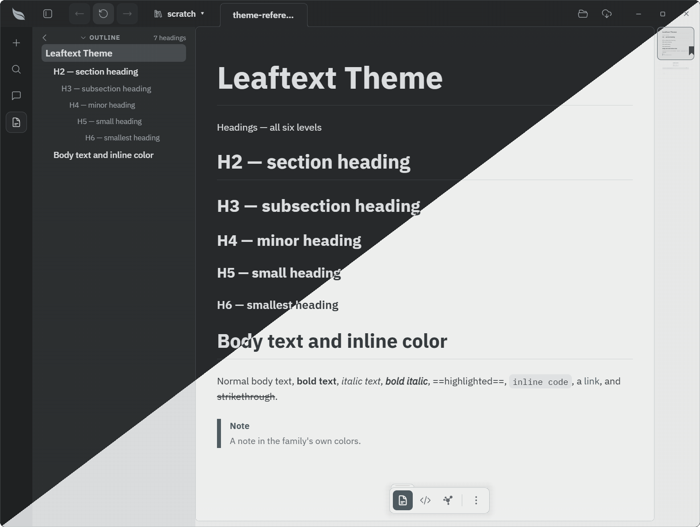

# Artemisia

**Family ID:** `artemisia`

**Pack:** `feather`

## Fonts

| Role    | Stack |
| ------- | ----- |
| Heading | `"IBM Plex Sans", -apple-system, BlinkMacSystemFont, "Segoe UI", Helvetica, Arial, sans-serif` |
| Body    | `"IBM Plex Sans", -apple-system, BlinkMacSystemFont, "Segoe UI", Helvetica, Arial, sans-serif, "Apple Color Emoji", "Segoe UI Emoji"` |
| Code    | `"IBM Plex Mono", ui-monospace, SFMono-Regular, Consolas, "Liberation Mono", Menlo, monospace` |
| Google  | `https://fonts.googleapis.com/css2?family=IBM+Plex+Mono:ital,wght@0,400;0,500;0,600;0,700;1,400&family=IBM+Plex+Sans:ital,wght@0,400;0,500;0,600;0,700;1,400&display=swap` |

## Light

| Token                                   | Value                                          |
| --------------------------------------- | ---------------------------------------------- |
| background                              | `#f8faf9`                                      |
| foreground                              | `#29333a`                                      |
| surface                                 | `#f8faf9`                                      |
| surface-elevated                        | `#ffffff`                                      |
| surface-muted                           | `#e8ecee`                                      |
| surface-sunken                          | `#d8dde1`                                      |
| border                                  | `#c6d1d4`                                      |
| border-strong                           | `#818b98`                                      |
| shadow-ink                              | `#00000033`                                    |
| muted-foreground                        | `#5b6872`                                      |
| primary                                 | `#435d6b`                                      |
| primary-foreground                      | `#ffffff`                                      |
| accent                                  | `#3d5866`                                      |
| accent-foreground                       | `#f8faf9`                                      |
| accent-ink                              | `#0756b5`                                      |
| danger                                  | `#d1242f`                                      |
| danger-foreground                       | `#f8faf9`                                      |
| warning                                 | `#9a6700`                                      |
| success                                 | `#1a7f37`                                      |
| success-foreground                      | `#f8faf9`                                      |
| done                                    | `#8250df`                                      |
| link                                    | `#3d5866`                                      |
| link-hover                              | `#3d5866`                                      |
| editor-inline-code-background           | `#e8ecee`                                      |
| editor-inline-code-foreground           | `#29333a`                                      |
| editor-code-background                  | `#e8ecee`                                      |
| editor-code-foreground                  | `#29333a`                                      |
| editor-code-border                      | `#c6d1d4`                                      |
| editor-code-selection-background        | `#3d586633`                                    |
| editor-code-selection-foreground        | `#29333a`                                      |
| markdown-background                     | `#f8faf9`                                      |
| markdown-foreground                     | `#29333a`                                      |
| speed-reader-anchor                     | `#000000`                                      |
| markdown-heading                        | `#29333a`                                      |
| markdown-heading-2                      | `#29333a`                                      |
| markdown-heading-3                      | `#29333a`                                      |
| markdown-heading-4                      | `#29333a`                                      |
| markdown-heading-5                      | `#29333a`                                      |
| markdown-heading-6                      | `#29333a`                                      |
| markdown-rule                           | `#c6d1d4b3`                                    |
| markdown-link                           | `#3d5866`                                      |
| markdown-blockquote-border              | `#c6d1d4`                                      |
| markdown-blockquote-foreground          | `#5b6872`                                      |
| markdown-alert-note                     | `#3d5866`                                      |
| markdown-alert-tip                      | `#1a7f37`                                      |
| markdown-alert-important                | `#435d6b`                                      |
| markdown-alert-warning                  | `#9a6700`                                      |
| markdown-alert-caution                  | `#d1242f`                                      |
| markdown-badge-background               | `#e8ecee`                                      |
| markdown-badge-foreground               | `#25292e`                                      |
| markdown-table-border                   | `#707a82`                                      |
| markdown-thematic-break                 | `#c6d1d4b3`                                    |
| markdown-math-inline-background         | `#e8ecee`                                      |
| markdown-keyboard-background            | `#f8faf9`                                      |
| markdown-keyboard-border                | `#c6d1d4`                                      |
| minimap-viewport-border                 | `#3d5866`                                      |
| minimap-viewport-background             | `rgba(110, 118, 129, 0.14)`                    |
| navigation-button-hover-background      | `#1c8139`                                      |
| navigation-button-disabled-background   | `#eff2f5`                                      |
| navigation-button-disabled-foreground   | `#818b98`                                      |
| navigation-recent-border                | `#c6d1d4`                                      |
| navigation-recent-item-foreground       | `#29333a`                                      |
| navigation-recent-item-hover-foreground | `#435d6b`                                      |
| focus-ring                              | `#3d5866`                                      |
| focus-selection-background              | `#3d586633`                                    |
| focus-selection-foreground              | `#29333a`                                      |
| syntax-background                       | `#e8ecee`                                      |
| syntax-foreground                       | `#29333a`                                      |
| syntax-comment                          | `#5b6872`                                      |
| syntax-keyword                          | `#cf222e`                                      |
| syntax-string                           | `#0a3069`                                      |
| syntax-number                           | `#0550ae`                                      |
| syntax-function                         | `#6639ba`                                      |
| syntax-variable                         | `#953800`                                      |
| syntax-type                             | `#6639ba`                                      |
| syntax-operator                         | `#cf222e`                                      |
| syntax-punctuation                      | `#5b6872`                                      |
| syntax-inserted                         | `#116329`                                      |
| syntax-inserted-background              | `#dafbe1`                                      |
| syntax-deleted                          | `#82071e`                                      |
| syntax-deleted-background               | `#ffebe9`                                      |
| syntax-changed                          | `#953800`                                      |
| syntax-changed-background               | `#ffd8b5`                                      |

## Dark

| Token                                   | Value                                          |
| --------------------------------------- | ---------------------------------------------- |
| background                              | `#1b2024`                                      |
| foreground                              | `#e3e8eb`                                      |
| surface                                 | `#1b2024`                                      |
| surface-elevated                        | `#2a3036`                                      |
| surface-muted                           | `#242a2f`                                      |
| surface-sunken                          | `#13171a`                                      |
| border                                  | `#39434a`                                      |
| border-strong                           | `#656c76`                                      |
| shadow-ink                              | `#000000`                                      |
| muted-foreground                        | `#9aa7b0`                                      |
| primary                                 | `#9fb4c2`                                      |
| primary-foreground                      | `#1b2024`                                      |
| primary-ink                             | `#9fb4c2`                                      |
| accent                                  | `#9fb4c2`                                      |
| accent-foreground                       | `#1b2024`                                      |
| danger                                  | `#ff7b72`                                      |
| danger-foreground                       | `#ffffff`                                      |
| warning                                 | `#d29922`                                      |
| success                                 | `#3fb950`                                      |
| success-foreground                      | `#ffffff`                                      |
| done                                    | `#ab7df8`                                      |
| link                                    | `#9fb4c2`                                      |
| link-hover                              | `#9fb4c2`                                      |
| editor-inline-code-background           | `#242a2f`                                      |
| editor-inline-code-foreground           | `#e3e8eb`                                      |
| editor-code-background                  | `#242a2f`                                      |
| editor-code-foreground                  | `#e3e8eb`                                      |
| editor-code-border                      | `#3d444d`                                      |
| editor-code-selection-background        | `#1f6febb3`                                    |
| editor-code-selection-foreground        | `#e3e8eb`                                      |
| markdown-background                     | `#1b2024`                                      |
| markdown-foreground                     | `#e3e8eb`                                      |
| speed-reader-anchor                     | `#ffffff`                                      |
| markdown-heading                        | `#e3e8eb`                                      |
| markdown-heading-2                      | `#e3e8eb`                                      |
| markdown-heading-3                      | `#e3e8eb`                                      |
| markdown-heading-4                      | `#e3e8eb`                                      |
| markdown-heading-5                      | `#e3e8eb`                                      |
| markdown-heading-6                      | `#e3e8eb`                                      |
| markdown-rule                           | `#3d444db3`                                    |
| markdown-link                           | `#9fb4c2`                                      |
| markdown-blockquote-border              | `#3d444d`                                      |
| markdown-blockquote-foreground          | `#9aa7b0`                                      |
| markdown-alert-note                     | `#9fb4c2`                                      |
| markdown-alert-tip                      | `#3fb950`                                      |
| markdown-alert-important                | `#9fb4c2`                                      |
| markdown-alert-warning                  | `#d29922`                                      |
| markdown-alert-caution                  | `#ff7b72`                                      |
| markdown-badge-background               | `#212830`                                      |
| markdown-badge-foreground               | `#e3e8eb`                                      |
| markdown-table-border                   | `#75809a`                                      |
| markdown-thematic-break                 | `#3d444db3`                                    |
| markdown-math-inline-background         | `#212830`                                      |
| markdown-keyboard-background            | `#1b2024`                                      |
| markdown-keyboard-border                | `#3d444d`                                      |
| minimap-viewport-border                 | `#9fb4c2`                                      |
| minimap-viewport-background             | `rgba(110, 118, 129, 0.14)`                    |
| navigation-button-hover-background      | `#29903b`                                      |
| navigation-button-disabled-background   | `#212830`                                      |
| navigation-button-disabled-foreground   | `#656c76`                                      |
| navigation-recent-border                | `#3d444d`                                      |
| navigation-recent-item-foreground       | `#e3e8eb`                                      |
| navigation-recent-item-hover-foreground | `#9fb4c2`                                      |
| focus-ring                              | `#1f6feb`                                      |
| focus-selection-background              | `#1f6febb3`                                    |
| focus-selection-foreground              | `#e3e8eb`                                      |
| syntax-background                       | `#242a2f`                                      |
| syntax-foreground                       | `#e3e8eb`                                      |
| syntax-comment                          | `#9aa7b0`                                      |
| syntax-keyword                          | `#ff7b72`                                      |
| syntax-string                           | `#a5d6ff`                                      |
| syntax-number                           | `#79c0ff`                                      |
| syntax-function                         | `#d2a8ff`                                      |
| syntax-variable                         | `#ffa657`                                      |
| syntax-type                             | `#d2a8ff`                                      |
| syntax-operator                         | `#ff7b72`                                      |
| syntax-punctuation                      | `#9aa7b0`                                      |
| syntax-inserted                         | `#aff5b4`                                      |
| syntax-inserted-background              | `#033a16`                                      |
| syntax-deleted                          | `#ffdcd7`                                      |
| syntax-deleted-background               | `#67060c`                                      |
| syntax-changed                          | `#ffdfb6`                                      |
| syntax-changed-background               | `#5a1e02`                                      |

### Overrides

| Token                      | Value       |
| -------------------------- | ----------- |
| border                     | `#39434a`   |
| border-strong              | `#5b6788`   |
| editor-code-border         | `#39434a`   |
| markdown-rule              | `#39434ab3` |
| markdown-blockquote-border | `#39434a`   |
| markdown-table-border      | `#75809a`   |
| markdown-thematic-break    | `#39434ab3` |
| markdown-keyboard-border   | `#39434a`   |
