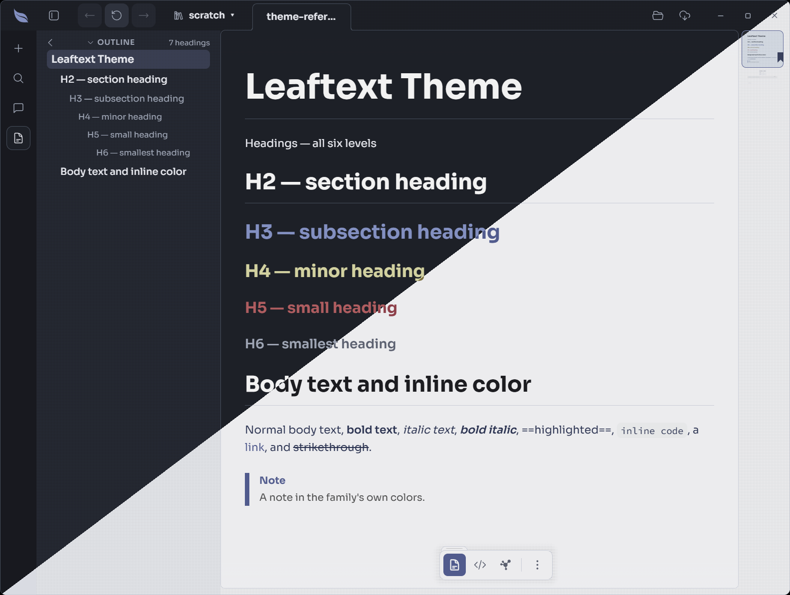

# Bluebell

**Family ID:** `bluebell`

**Pack:** `phosphor`

## Fonts

| Role    | Stack |
| ------- | ----- |
| Heading | `"Manrope", -apple-system, BlinkMacSystemFont, "Segoe UI", Helvetica, Arial, sans-serif` |
| Body    | `"Sora", -apple-system, BlinkMacSystemFont, "Segoe UI", Helvetica, Arial, sans-serif, "Apple Color Emoji", "Segoe UI Emoji"` |
| Code    | `"Source Code Pro", ui-monospace, SFMono-Regular, Consolas, "Liberation Mono", Menlo, monospace` |
| Google  | `https://fonts.googleapis.com/css2?family=Manrope:wght@400;500;600;700&family=Sora:wght@400;500;600;700&family=Source+Code+Pro:ital,wght@0,400;0,500;0,600;0,700;1,400&display=swap` |

## Light

| Token                                   | Value                             |
| --------------------------------------- | --------------------------------- |
| background                              | `#f7f8fd`                         |
| foreground                              | `#18296b`                         |
| surface                                 | `#f7f8fd`                         |
| surface-elevated                        | `#ffffff`                         |
| surface-muted                           | `#eceff9`                         |
| surface-sunken                          | `#e0e5f5`                         |
| border                                  | `#cfd6ec`                         |
| border-strong                           | `#c3c9d1`                         |
| shadow-ink                              | `#00000033`                       |
| muted-foreground                        | `#525c7e`                         |
| primary                                 | `#3f55c4`                         |
| primary-foreground                      | `#ffffff`                         |
| accent                                  | `#3f55c4`                         |
| accent-foreground                       | `#f7f8fd`                         |
| accent-ink                              | `#0552a8`                         |
| danger                                  | `#d3243a`                         |
| danger-foreground                       | `#f7f8fd`                         |
| warning                                 | `#8a6d00`                         |
| success                                 | `#087a34`                         |
| success-foreground                      | `#f7f8fd`                         |
| done                                    | `#3f55c4`                         |
| link                                    | `#3a4fb8`                         |
| link-hover                              | `#0a58b0`                         |
| editor-inline-code-background           | `#f1f3f5`                         |
| editor-inline-code-foreground           | `#18296b`                         |
| editor-code-background                  | `#eceff9`                         |
| editor-code-foreground                  | `#18296b`                         |
| editor-code-border                      | `#cfd6ec`                         |
| editor-code-selection-background        | `#d9e5fb`                         |
| editor-code-selection-foreground        | `#18296b`                         |
| markdown-background                     | `#f7f8fd`                         |
| markdown-foreground                     | `#18296b`                         |
| speed-reader-anchor                     | `#000000`                         |
| markdown-heading                        | `#11111a`                         |
| markdown-heading-2                      | `#11111a`                         |
| markdown-heading-3                      | `#3f55c4`                         |
| markdown-heading-4                      | `#8a6d00`                         |
| markdown-heading-5                      | `#d3243a`                         |
| markdown-heading-6                      | `#525c7e`                         |
| markdown-rule                           | `#cfd6ec`                         |
| markdown-link                           | `#3f55c4`                         |
| markdown-blockquote-border              | `#3f55c4`                         |
| markdown-blockquote-foreground          | `#444444`                         |
| markdown-alert-note                     | `#3f55c4`                         |
| markdown-alert-tip                      | `#087a34`                         |
| markdown-alert-important                | `#3f55c4`                         |
| markdown-alert-warning                  | `#8a6d00`                         |
| markdown-alert-caution                  | `#d3243a`                         |
| markdown-badge-background               | `#eef1f4`                         |
| markdown-badge-foreground               | `#18296b`                         |
| markdown-table-border                   | `#6f7590`                         |
| markdown-thematic-break                 | `#cfd6ec`                         |
| markdown-math-inline-background         | `#eef1f4`                         |
| markdown-keyboard-background            | `#f7f8fd`                         |
| markdown-keyboard-border                | `#ccd2da`                         |
| minimap-viewport-border                 | `#3f55c4`                         |
| minimap-viewport-background             | `rgba(8, 109, 221, 0.14)`         |
| navigation-button-hover-background      | `#2680e8`                         |
| navigation-button-disabled-background   | `#eef1f4`                         |
| navigation-button-disabled-foreground   | `#999999`                         |
| navigation-recent-border                | `#cfd6ec`                         |
| navigation-recent-item-foreground       | `#18296b`                         |
| navigation-recent-item-hover-foreground | `#3f55c4`                         |
| focus-ring                              | `#3f55c4`                         |
| focus-selection-background              | `#d9e5fb`                         |
| focus-selection-foreground              | `#18296b`                         |
| syntax-background                       | `#eceff9`                         |
| syntax-foreground                       | `#18296b`                         |
| syntax-comment                          | `#5c5c5c`                         |
| syntax-keyword                          | `#b0246a`                         |
| syntax-string                           | `#8a5a00`                         |
| syntax-number                           | `#6a30c0`                         |
| syntax-function                         | `#0a5fa0`                         |
| syntax-variable                         | `#18296b`                         |
| syntax-type                             | `#0a5fa0`                         |
| syntax-operator                         | `#b0246a`                         |
| syntax-punctuation                      | `#4a4a4a`                         |
| syntax-inserted                         | `#0a6a2f`                         |
| syntax-inserted-background              | `#d6f2de`                         |
| syntax-deleted                          | `#a01a2a`                         |
| syntax-deleted-background               | `#fbdde1`                         |
| syntax-changed                          | `#7a5200`                         |
| syntax-changed-background               | `#f7ecc9`                         |

## Dark

| Token                                   | Value                            |
| --------------------------------------- | -------------------------------- |
| background                              | `#101525`                        |
| foreground                              | `#eff2ff`                        |
| surface                                 | `#101525`                        |
| surface-elevated                        | `#202943`                        |
| surface-muted                           | `#182038`                        |
| surface-sunken                          | `#0a0e1a`                        |
| border                                  | `#384966`                        |
| border-strong                           | `#4b525d`                        |
| shadow-ink                              | `#000000`                        |
| muted-foreground                        | `#9aaacb`                        |
| primary                                 | `#7491ff`                        |
| primary-foreground                      | `#101525`                        |
| accent                                  | `#7491ff`                        |
| accent-foreground                       | `#101525`                        |
| danger                                  | `#fb5d62`                        |
| danger-foreground                       | `#101525`                        |
| warning                                 | `#e0de71`                        |
| success                                 | `#44cf6e`                        |
| success-foreground                      | `#101525`                        |
| done                                    | `#7491ff`                        |
| link                                    | `#93a9ff`                        |
| link-hover                              | `#79a9ec`                        |
| editor-inline-code-background           | `#182038`                        |
| editor-inline-code-foreground           | `#eff2ff`                        |
| editor-code-background                  | `#0a0e1a`                        |
| editor-code-foreground                  | `#eff2ff`                        |
| editor-code-border                      | `#384966`                        |
| editor-code-selection-background        | `#2f3a54`                        |
| editor-code-selection-foreground        | `#ffffff`                        |
| markdown-background                     | `#101525`                        |
| markdown-foreground                     | `#eff2ff`                        |
| speed-reader-anchor                     | `#ffffff`                        |
| markdown-heading                        | `#ffffff`                        |
| markdown-heading-2                      | `#ffffff`                        |
| markdown-heading-3                      | `#7491ff`                        |
| markdown-heading-4                      | `#e0de71`                        |
| markdown-heading-5                      | `#fb464c`                        |
| markdown-heading-6                      | `#9aaacb`                        |
| markdown-rule                           | `#384966`                        |
| markdown-link                           | `#7491ff`                        |
| markdown-blockquote-border              | `#7491ff`                        |
| markdown-blockquote-foreground          | `#eff2ff`                        |
| markdown-alert-note                     | `#7491ff`                        |
| markdown-alert-tip                      | `#44cf6e`                        |
| markdown-alert-important                | `#7491ff`                        |
| markdown-alert-warning                  | `#e0de71`                        |
| markdown-alert-caution                  | `#fb464c`                        |
| markdown-badge-background               | `#182038`                        |
| markdown-badge-foreground               | `#eff2ff`                        |
| markdown-table-border                   | `#666b71`                        |
| markdown-thematic-break                 | `#384966`                        |
| markdown-math-inline-background         | `#182038`                        |
| markdown-keyboard-background            | `#21262e`                        |
| markdown-keyboard-border                | `#384966`                        |
| minimap-viewport-border                 | `#7491ff`                        |
| minimap-viewport-background             | `rgba(110, 118, 129, 0.14)`      |
| navigation-button-hover-background      | `#6fb1ff`                        |
| navigation-button-disabled-background   | `#182038`                        |
| navigation-button-disabled-foreground   | `#656c77`                        |
| navigation-recent-border                | `#384966`                        |
| navigation-recent-item-foreground       | `#eff2ff`                        |
| navigation-recent-item-hover-foreground | `#7491ff`                        |
| focus-ring                              | `#7491ff`                        |
| focus-selection-background              | `#2f3a54`                        |
| focus-selection-foreground              | `#ffffff`                        |
| syntax-background                       | `#0a0e1a`                        |
| syntax-foreground                       | `#eff2ff`                        |
| syntax-comment                          | `#8c8c8c`                        |
| syntax-keyword                          | `#fa99cd`                        |
| syntax-string                           | `#e0de71`                        |
| syntax-number                           | `#7491ff`                        |
| syntax-function                         | `#44cf6e`                        |
| syntax-variable                         | `#eff2ff`                        |
| syntax-type                             | `#53dfdd`                        |
| syntax-operator                         | `#fa99cd`                        |
| syntax-punctuation                      | `#bababa`                        |
| syntax-inserted                         | `#44cf6e`                        |
| syntax-inserted-background              | `#143621`                        |
| syntax-deleted                          | `#ff8f92`                        |
| syntax-deleted-background               | `#3a1d20`                        |
| syntax-changed                          | `#e0de71`                        |
| syntax-changed-background               | `#33301a`                        |
