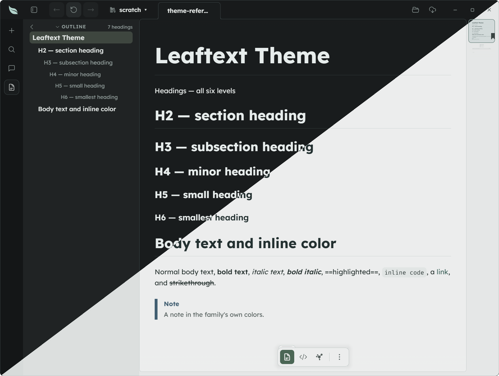

# Spearmint

**Family ID:** `spearmint`

**Pack:** `tabler`

## Fonts

| Role    | Stack |
| ------- | ----- |
| Heading | `"Inter", -apple-system, BlinkMacSystemFont, "Segoe UI", Helvetica, Arial, sans-serif` |
| Body    | `"Lexend", -apple-system, BlinkMacSystemFont, "Segoe UI", Helvetica, Arial, sans-serif, "Apple Color Emoji", "Segoe UI Emoji"` |
| Code    | `"Fira Code", ui-monospace, SFMono-Regular, Consolas, "Liberation Mono", Menlo, monospace` |
| Google  | `https://fonts.googleapis.com/css2?family=Fira+Code:wght@400;500;600;700&family=Inter:ital,wght@0,400;0,500;0,600;0,700;1,400&family=Lexend:ital,wght@0,400;0,500;0,600;0,700;1,400&display=swap` |

## Light

| Token                                   | Value                     |
| --------------------------------------- | ------------------------- |
| background                              | `#f6faf9`                 |
| foreground                              | `#17302b`                 |
| surface                                 | `#f6faf9`                 |
| surface-elevated                        | `#ffffff`                 |
| surface-muted                           | `#e9f1ef`                 |
| surface-sunken                          | `#dce7e4`                 |
| border                                  | `#c4d6d2`                 |
| border-strong                           | `#5f8a86`                 |
| shadow-ink                              | `#00000033`               |
| muted-foreground                        | `#4a605b`                 |
| primary                                 | `#196253`                 |
| primary-foreground                      | `#ffffff`                 |
| accent                                  | `#2f6b45`                 |
| accent-foreground                       | `#ffffff`                 |
| danger                                  | `#b3261e`                 |
| danger-foreground                       | `#ffffff`                 |
| warning                                 | `#765300`                 |
| success                                 | `#2d6e31`                 |
| success-foreground                      | `#ffffff`                 |
| done                                    | `#7a3f8f`                 |
| link                                    | `#1a6a5a`                 |
| link-hover                              | `#0d3b3d`                 |
| editor-inline-code-background           | `#e9f1ef`                 |
| editor-inline-code-foreground           | `#17302b`                 |
| editor-code-background                  | `#e9f1ef`                 |
| editor-code-foreground                  | `#17302b`                 |
| editor-code-border                      | `#c4d6d2`                 |
| editor-code-selection-background        | `#19625333`               |
| editor-code-selection-foreground        | `#0d2a2b`                 |
| markdown-background                     | `#f6faf9`                 |
| markdown-foreground                     | `#17302b`                 |
| speed-reader-anchor                     | `#000000`                 |
| markdown-heading                        | `#0d2a2b`                 |
| markdown-heading-2                      | `#0d2a2b`                 |
| markdown-heading-3                      | `#0d2a2b`                 |
| markdown-heading-4                      | `#0d2a2b`                 |
| markdown-heading-5                      | `#0d2a2b`                 |
| markdown-heading-6                      | `#0d2a2b`                 |
| markdown-rule                           | `#c4d6d2b3`               |
| markdown-link                           | `#1a6a5a`                 |
| markdown-blockquote-border              | `#c4d6d2`                 |
| markdown-blockquote-foreground          | `#4a605b`                 |
| markdown-alert-note                     | `#1f5f8b`                 |
| markdown-alert-tip                      | `#2d6e31`                 |
| markdown-alert-important                | `#7a3f8f`                 |
| markdown-alert-warning                  | `#765300`                 |
| markdown-alert-caution                  | `#b3261e`                 |
| markdown-badge-background               | `#e9f1ef`                 |
| markdown-badge-foreground               | `#17302b`                 |
| markdown-table-border                   | `#5f8a86`                 |
| markdown-thematic-break                 | `#c4d6d2b3`               |
| markdown-math-inline-background         | `#e9f1ef`                 |
| markdown-keyboard-background            | `#ffffff`                 |
| markdown-keyboard-border                | `#c4d6d2`                 |
| minimap-viewport-border                 | `#196253`                 |
| minimap-viewport-background             | `rgba(0, 120, 123, 0.12)` |
| navigation-button-hover-background      | `#1a6a5a`                 |
| navigation-button-disabled-background   | `#e9f1ef`                 |
| navigation-button-disabled-foreground   | `#5f8a86`                 |
| navigation-recent-border                | `#c4d6d2`                 |
| navigation-recent-item-foreground       | `#17302b`                 |
| navigation-recent-item-hover-foreground | `#1a6a5a`                 |
| focus-ring                              | `#2f6b45`                 |
| focus-selection-background              | `#19625333`               |
| focus-selection-foreground              | `#0d2a2b`                 |
| syntax-background                       | `#e9f1ef`                 |
| syntax-foreground                       | `#17302b`                 |
| syntax-comment                          | `#4a605b`                 |
| syntax-keyword                          | `#8a2a6e`                 |
| syntax-string                           | `#6e4a00`                 |
| syntax-number                           | `#1f5f8b`                 |
| syntax-function                         | `#1a6a5a`                 |
| syntax-variable                         | `#8a3f00`                 |
| syntax-type                             | `#1f5f8b`                 |
| syntax-operator                         | `#8a2a6e`                 |
| syntax-punctuation                      | `#4a605b`                 |
| syntax-inserted                         | `#0f5a1c`                 |
| syntax-inserted-background              | `#bfe8c4`                 |
| syntax-deleted                          | `#8a1414`                 |
| syntax-deleted-background               | `#f6cccc`                 |
| syntax-changed                          | `#6e4a00`                 |
| syntax-changed-background               | `#f0dcae`                 |

## Dark

| Token                                   | Value                      |
| --------------------------------------- | -------------------------- |
| background                              | `#0c1114`                  |
| foreground                              | `#e7f0ed`                  |
| surface                                 | `#0c1114`                  |
| surface-elevated                        | `#182224`                  |
| surface-muted                           | `#141c1e`                  |
| surface-sunken                          | `#070b0d`                  |
| border                                  | `#2b4142`                  |
| border-strong                           | `#4f7c79`                  |
| shadow-ink                              | `#000000`                  |
| muted-foreground                        | `#88a29e`                  |
| primary                                 | `#9ce6d4`                  |
| primary-foreground                      | `#0c1114`                  |
| accent                                  | `#9ad08a`                  |
| accent-foreground                       | `#0c1114`                  |
| danger                                  | `#ff8a80`                  |
| danger-foreground                       | `#0c1114`                  |
| warning                                 | `#e8c872`                  |
| success                                 | `#8fdc8a`                  |
| success-foreground                      | `#0c1114`                  |
| done                                    | `#d7a6f0`                  |
| link                                    | `#9ce6d4`                  |
| link-hover                              | `#c8f5f2`                  |
| editor-inline-code-background           | `#141c1e`                  |
| editor-inline-code-foreground           | `#e7f0ed`                  |
| editor-code-background                  | `#141c1e`                  |
| editor-code-foreground                  | `#e7f0ed`                  |
| editor-code-border                      | `#2b4142`                  |
| editor-code-selection-background        | `#9ce6d440`                |
| editor-code-selection-foreground        | `#eefaf9`                  |
| markdown-background                     | `#0c1114`                  |
| markdown-foreground                     | `#e7f0ed`                  |
| speed-reader-anchor                     | `#ffffff`                  |
| markdown-heading                        | `#eefaf9`                  |
| markdown-heading-2                      | `#eefaf9`                  |
| markdown-heading-3                      | `#eefaf9`                  |
| markdown-heading-4                      | `#eefaf9`                  |
| markdown-heading-5                      | `#eefaf9`                  |
| markdown-heading-6                      | `#eefaf9`                  |
| markdown-rule                           | `#2b4142b3`                |
| markdown-link                           | `#9ce6d4`                  |
| markdown-blockquote-border              | `#2f5553`                  |
| markdown-blockquote-foreground          | `#88a29e`                  |
| markdown-alert-note                     | `#8cc4f0`                  |
| markdown-alert-tip                      | `#8fdc8a`                  |
| markdown-alert-important                | `#d7a6f0`                  |
| markdown-alert-warning                  | `#e8c872`                  |
| markdown-alert-caution                  | `#ff8a80`                  |
| markdown-badge-background               | `#1b3033`                  |
| markdown-badge-foreground               | `#e7f0ed`                  |
| markdown-table-border                   | `#4f7c79`                  |
| markdown-thematic-break                 | `#2b4142b3`                |
| markdown-math-inline-background         | `#1b3033`                  |
| markdown-keyboard-background            | `#0c1114`                  |
| markdown-keyboard-border                | `#2f5553`                  |
| minimap-viewport-border                 | `#9ce6d4`                  |
| minimap-viewport-background             | `rgba(95, 214, 210, 0.12)` |
| navigation-button-hover-background      | `#82e2de`                  |
| navigation-button-disabled-background   | `#1b3033`                  |
| navigation-button-disabled-foreground   | `#4f7c79`                  |
| navigation-recent-border                | `#2b4142`                  |
| navigation-recent-item-foreground       | `#e7f0ed`                  |
| navigation-recent-item-hover-foreground | `#9ce6d4`                  |
| focus-ring                              | `#9ad08a`                  |
| focus-selection-background              | `#9ce6d440`                |
| focus-selection-foreground              | `#eefaf9`                  |
| syntax-background                       | `#141c1e`                  |
| syntax-foreground                       | `#e7f0ed`                  |
| syntax-comment                          | `#88a29e`                  |
| syntax-keyword                          | `#e0a3e8`                  |
| syntax-string                           | `#e8c872`                  |
| syntax-number                           | `#ffb07a`                  |
| syntax-function                         | `#9ce6d4`                  |
| syntax-variable                         | `#eefaf9`                  |
| syntax-type                             | `#8cc4f0`                  |
| syntax-operator                         | `#e0a3e8`                  |
| syntax-punctuation                      | `#88a29e`                  |
| syntax-inserted                         | `#b8f0b4`                  |
| syntax-inserted-background              | `#16391c`                  |
| syntax-deleted                          | `#ffb3ad`                  |
| syntax-deleted-background               | `#4a1616`                  |
| syntax-changed                          | `#e8c872`                  |
| syntax-changed-background               | `#3a3212`                  |
